# 平台接口与数据流向图

本文是 `quant-research-platform` 当前代码事实的全局 code map。它覆盖 Phase 1 已实现链路、节点职责、边职责、入口清单和 Phase 1 之后的架构债。

同目录的 [platform-flow-interactive.html](platform-flow-interactive.html) 是本文的交互版，节点和边的语义应保持同步。

## 图例

- **已实现**：当前代码中存在入口、实现和测试面。
- **已实现轻量模式**：Phase 1 已实现受控子集，例如 `processed_existing` runner。
- **保留入口**：为本地调试或兼容保留，不是主流程。
- **后续设计**：不属于 Phase 1 已完成功能，需要单独设计。
- **禁用/计划中**：只允许出现在能力表述、API payload 或前端文案中，不代表真实 market module。

## 总览图

```mermaid
flowchart LR
  raw["N01 CSMAR raw CSV"]
  interim_cli["N02 build_interim CLI"]
  interim["N03 interim CSV"]
  panel_cli["N04 build_panel CLI"]
  panel_builder["N05 build_panel_full_from_interim"]
  panel_file["N06 research panel Parquet"]
  factor_cli["N07 build_factors CLI"]
  factor_builder["N08 calculate_price_volume_factor_full"]
  factor_file["N09 factor and label Parquet"]
  a_eval_cli["N10 A股 run_factor_evaluation CLI"]
  a_eval_adapter["N11 run_processed_factor_evaluation"]
  eval_frame["N12 read_evaluation_frame/read_factor_frame"]
  eval_spec["N13 EvaluationSpec"]
  eval_payload["N14 evaluate_to_payload"]
  run_eval["N15 run_evaluation"]
  kernels["N16 DataFrame/Tensor kernels"]
  writer["N17 write_evaluation_set_artifacts"]
  eval_result["N18 EvaluationSetResult"]
  run_dir["N19 schema 0.5 run directory"]
  manifest["N20 manifest.display"]
  loader["N21 load_evaluation_set"]
  run_repo["N22 run_repository"]
  api_app["N23 FastAPI create_app"]
  runs_api["N24 runs/evidence/table APIs"]
  downloads_api["N25 direct/ZIP downloads"]
  compare_api["N26 comparison APIs"]
  upload_api["N27 CSV upload API"]
  web["N28 React workbench"]
  downloads_ui["N29 ArtifactDownloads"]
  factor_studio["N30 Factor Studio"]
  pipeline_builder["N31 Pipeline Builder"]
  pipeline_api["N32 POST /api/pipeline-runs"]
  pipeline_snapshot["N33 pipeline snapshot"]
  pipeline_runner["N34 processed-existing runner"]
  factor_registry["N35 Factor template registry"]
  factor_factory["N36 Factor Factory batch runner"]
  factor_factory_artifacts["N37 Factor Factory artifacts"]
  factor_factory_api["N38 Factor Factory APIs"]
  cli["N39 qrp CLI"]
  compare_writer["N40 write_run_comparison"]

  raw --> interim_cli --> interim --> panel_cli --> panel_builder --> panel_file
  panel_file --> factor_cli --> factor_builder --> factor_file
  factor_file --> a_eval_cli --> a_eval_adapter --> eval_frame --> eval_spec
  eval_spec --> run_eval
  run_eval --> eval_payload --> kernels --> eval_payload
  run_eval --> writer
  eval_payload --> writer
  writer --> run_dir
  writer --> eval_result
  run_dir --> manifest
  run_dir --> loader --> run_repo
  manifest --> runs_api
  manifest --> downloads_api
  run_repo --> api_app --> runs_api
  api_app --> downloads_api
  api_app --> compare_api
  api_app --> upload_api
  upload_api --> eval_spec
  runs_api --> web
  downloads_api --> downloads_ui
  web --> downloads_ui
  factor_studio --> pipeline_builder --> pipeline_api
  factor_registry --> factor_studio
  factor_registry --> factor_factory
  pipeline_api --> pipeline_snapshot
  pipeline_api --> pipeline_runner
  pipeline_runner --> a_eval_adapter
  factor_factory --> pipeline_runner
  factor_factory --> factor_factory_artifacts --> factor_factory_api --> web
  cli --> a_eval_cli
  cli --> eval_spec
  cli --> compare_writer --> run_dir
```



## 当前 A 股主链路

```text
CSMAR raw CSV
-> build_interim
-> interim CSV
-> build_panel
-> research_panel_<start>_<end>.parquet
-> build_factors
-> price_volume_factors_<start>_<end>.parquet
-> A 股 evaluation adapter
-> EvaluationSpec
-> run_evaluation
-> schema 0.5 artifacts
-> manifest.display
-> API / downloads / React workbench
```

## 节点说明

| ID | 节点 | 状态 | 代码位置 | 功能说明 |
|---|---|---|---|---|
| N01 | CSMAR raw CSV | 已实现私有输入 | `data/raw_private/csmar/` | 用户手工导出的 CSMAR 原始文件；只在本机使用，不提交、不公开、不由代码登录或自动下载。 |
| N02 | build_interim CLI | 已实现入口 | `src/quant_research_platform/markets/implementations/a_share/csmar/build_interim.py` | 读取 raw CSV，按 CSMAR contract 标准化字段、日期和代码，写出可审计 interim CSV。 |
| N03 | interim CSV | 已实现私有产物 | `data/interim_private/csmar/` | 标准化审计层；供 panel 构建读取，不作为公开材料。 |
| N04 | build_panel CLI | 已实现入口 | `src/quant_research_platform/markets/implementations/a_share/datasets/build_panel.py` | 从 interim yearly CSV 构建 A 股 full research panel。 |
| N05 | `build_panel_full_from_interim` | 已实现函数入口 | `src/quant_research_platform/markets/implementations/a_share/datasets/build_panel.py` | 合并行情、公司基础信息和市值快照，计算 turnover、listing age、eligible、can_enter、can_exit。 |
| N06 | research panel Parquet | 已实现私有产物 | `data/processed_private/csmar/panel_full/` | 宽表研究面板；包含后续因子构建需要的 OHLC、成交、流通性、market cap 和 tradability 列。 |
| N07 | build_factors CLI | 已实现入口 | `src/quant_research_platform/markets/implementations/a_share/factors/build_factors.py` | 从 full panel 生成 slim factor and label table。 |
| N08 | `calculate_price_volume_factor_full` | 已实现函数入口 | `src/quant_research_platform/markets/implementations/a_share/factors/build_factors.py` | 计算第一批 price-volume 因子和 forward labels，保留 key、tradability、基础流动性/市值列、factor、label。 |
| N09 | factor and label Parquet | 已实现私有产物 | `data/processed_private/csmar/price_volume_factors_full/` | A 股 evaluation adapter、processed-existing runner 和 Factor Factory 第一版的主要输入。 |
| N10 | A 股 `run_factor_evaluation` CLI | 已实现入口 | `src/quant_research_platform/markets/implementations/a_share/evaluation/run_factor_evaluation.py` | A 股真实私有 evaluation 主入口；`--start-year/--end-year` 定位 processed file，`--start-date/--end-date` 过滤 `trade_date`。 |
| N11 | `run_processed_factor_evaluation` | 已实现编排函数 | `src/quant_research_platform/markets/implementations/a_share/evaluation/evaluation_adapter.py` | 定位覆盖年份的 factor file，检查 label availability，按 label 逐个构造 evaluation run，并写 A 股 metadata。 |
| N12 | `read_evaluation_frame` / `read_factor_frame` | 已实现读取函数 | `src/quant_research_platform/markets/implementations/a_share/evaluation/evaluation_adapter.py` | 读取所需列，执行日期过滤，保留 factor、label、PnL return、segment、risk、neutralization 和 tradability 输入。 |
| N13 | `EvaluationSpec` | 已实现 public contract | `src/quant_research_platform/evaluations/evaluation_spec.py` | evaluation layer 的统一输入；承载 panel、feature、label、PnL return、weights、costs、tradability、neutralization、engine 和 metadata。 |
| N14 | `evaluate_to_payload` | 已实现内部边界 | `src/quant_research_platform/evaluations/evaluation_runner.py` | 纯计算入口；生成 summary、config、manifest seed、tables、report，不写 artifact、不处理 API/download 展示。 |
| N15 | `run_evaluation` | 已实现 public entrypoint | `src/quant_research_platform/evaluations/evaluation_runner.py` | 对外稳定入口；调用 `evaluate_to_payload`，写出 artifacts，并返回 `EvaluationSetResult`。 |
| N16 | DataFrame/Tensor kernels | 已实现计算路径 | `src/quant_research_platform/kernels/` | DataFrame reference path 和 tensor path；evaluation 调用 kernels，kernels 不依赖 API、artifacts 或 market module。 |
| N17 | `write_evaluation_set_artifacts` | 已实现 writer | `src/quant_research_platform/artifacts/artifact_writer.py` | 消费结构化 payload，写 `manifest.json`、`summary.json`、`config.json`、CSV tables 和 `report.md`。 |
| N18 | `EvaluationSetResult` | 已实现结果对象 | `src/quant_research_platform/evaluations/evaluation_result.py` | `run_evaluation` 返回对象；包含内存 summary、metrics、combinations 和 artifact paths。 |
| N19 | schema `0.5` run directory | 已实现产物合同 | `reports/private_real/factor_evaluation/`, `reports/runs/`, configured run roots | evaluation-set artifact 目录；必须包含 schema `0.5`、`artifact_type="evaluation_set"` 和 portable relative paths。 |
| N20 | `manifest.display` | 已实现展示合同 | `src/quant_research_platform/artifacts/display_manifest.py`, `manifest_validation.py` | API、downloads、CSV preview、charts 和 frontend tables 的唯一展示合同。 |
| N21 | `load_evaluation_set` | 已实现 loader | `src/quant_research_platform/artifacts/artifact_loader.py` | 严格读取 schema `0.5` artifacts，复用 display validation，拒绝 unsupported schema 和退休字段。 |
| N22 | `run_repository` | 已实现 API service | `src/quant_research_platform/interfaces/api/services/run_repository.py` | 管理 run roots、`source_alias + run_id` 身份、run index、加载和受控 uploaded-run 删除。 |
| N23 | FastAPI `create_app` | 已实现本地 app 装配 | `src/quant_research_platform/interfaces/api/app.py` | 配置 run roots、pipeline roots、Factor Factory root 和 routers；不是 Phase 2 可部署 `apps/api`。 |
| N24 | runs/evidence/table APIs | 已实现 routes | `src/quant_research_platform/interfaces/api/routes/runs.py`, `artifacts.py` | 暴露 run list、evidence payload、metrics/portfolio/diagnostics/breakdowns preview 和单项 artifact route。 |
| N25 | direct/ZIP downloads | 已实现 routes/services | `src/quant_research_platform/interfaces/api/routes/downloads.py`, `services/download_service.py` | direct download 和 ZIP download 只允许 `manifest.display.downloads.items` 暴露的文件。 |
| N26 | comparison APIs | 已实现 routes/services | `src/quant_research_platform/interfaces/api/routes/comparison.py`, `services/comparison_service.py` | 汇总 API-visible runs 的 comparison JSON 和 CSV；保留 `source_alias`。 |
| N27 | CSV upload API | 保留入口 | `src/quant_research_platform/interfaces/api/routes/uploads.py`, `services/upload_service.py` | 本地调试/兼容入口；提供 factor CSV template，并从用户上传 CSV 构造 `EvaluationSpec`，不是 A 股主流程。 |
| N28 | React workbench | 已实现前端入口 | `web/src/App.tsx` | 本地 evidence workbench；消费 API，不直接读本地文件，不重算 IC、PnL、positions 或 turnover。 |
| N29 | `ArtifactDownloads` | 已实现下载 UI | `web/src/ArtifactDownloads.tsx`, `useArtifactDownloads.ts` | 基于 `manifest.display.downloads` 展示 direct/ZIP 下载和 preset。 |
| N30 | Factor Studio | 已实现前端入口 | `web/src/FactorStudio.tsx`, `factorDraft.ts` | 草拟受控 factor expression，并把表达式/模板传给 Pipeline Builder。 |
| N31 | Pipeline Builder | 已实现前端入口 | `web/src/PipelineBuilder.tsx` | 当前前端提交 snapshot，不传 `execution_mode`；后端同一 API 另支持 `execution_mode=processed_existing`，但不承诺完整 build pipeline。 |
| N32 | `POST /api/pipeline-runs` | 已实现 API | `src/quant_research_platform/interfaces/api/routes/pipeline.py`, `services/pipeline_service.py` | 同一入口支持 `snapshot` 和 `processed_existing`；会校验 market、dates、expression、portfolio、cost、labels、engine。 |
| N33 | pipeline snapshot | 已实现产物 | `reports/private_real/pipeline_runs/` | 写 `run_config.yaml`、`warnings.json`、`summary.md`；用于记录本地配置和前端提交状态。 |
| N34 | processed-existing runner | 已实现轻量模式 | `src/quant_research_platform/pipelines/a_share/runner.py` | 在已有 processed factor table 上调用 A 股 evaluation adapter，写 checkpoints、runtime summary 和 evaluation manifest；不重建 raw/interim/panel/factors。 |
| N35 | Factor template registry | 已实现 registry | `src/quant_research_platform/research/factor_factory/factor_registry.py`, `config/a_share/factor_templates/` | 注册受控 factor primitive/template、参数网格、inputs、outputs、capabilities；不执行任意 Python。 |
| N36 | Factor Factory batch runner | 已实现第一版 | `src/quant_research_platform/research/factor_factory/batch_runner.py` | 批量评估 registry candidates；每个 candidate 成功或失败都记录输入、样本范围、原因和输出。 |
| N37 | Factor Factory artifacts | 已实现 artifact `0.1` | `src/quant_research_platform/research/factor_factory/reports.py`, `reports/private_real/factor_factory/` | 写 `candidate_summary.csv`、`failed_candidates.json` 和 Factor Factory `manifest.display`。 |
| N38 | Factor Factory APIs | 已实现 routes | `src/quant_research_platform/interfaces/api/routes/factor_factory.py` | 浏览 Factor Factory runs、preview display table、下载 display downloads；校验私有路径文本不外露。 |
| N39 | `qrp` CLI | 已实现入口 | `src/quant_research_platform/interfaces/cli/commands.py` | Typer 总入口；包含 `evaluate-parquet`、`compare` 和 `a-share` 帮助/跳转命令组。 |
| N40 | `write_run_comparison` | 已实现离线比较 | `src/quant_research_platform/artifacts/artifact_comparison.py` | `qrp compare` 的离线路径；读取 completed evaluation-set artifacts，写 comparison CSV，不调用 API。 |

## 边说明

| 边 | 状态 | 功能说明 |
|---|---|---|
| N01 -> N02 | 已实现 | raw CSMAR CSV 只通过本地 CLI 进入标准化流程；代码不登录 CSMAR、不自动下载、不处理凭据。 |
| N02 -> N03 | 已实现 | `build_interim` 写出字段标准化、可审计的 interim CSV，作为 raw 与 processed 之间的隔离层。 |
| N03 -> N04 | 已实现 | panel builder 读取 interim yearly CSV，不直接读取 raw。 |
| N04 -> N05 | 已实现 | CLI 调用函数级 panel builder，参数控制年份、结束日期和上市天数过滤。 |
| N05 -> N06 | 已实现 | panel builder 生成 full research panel，包含 universe/tradability 和后续 factor build 必需列。 |
| N06 -> N07 | 已实现 | factor CLI 读取 full panel，不从 evaluation layer 或 API 反向取数据。 |
| N07 -> N08 | 已实现 | CLI 调用 factor builder，按 windows 和 horizons 计算 price-volume factors 和 forward labels。 |
| N08 -> N09 | 已实现 | 写 slim factor table；保留 `stock_code`、`trade_date`、tradability、基础流动性/市值、factor、label、PnL return。 |
| N09 -> N10 | 已实现 | A 股评估入口以 processed factor table 为输入，按年份定位文件、按日期过滤行。 |
| N10 -> N11 | 已实现 | CLI 把 requested factors/labels、engine、portfolio mode、cost、risk/neutralization 参数传给 A 股 adapter。 |
| N11 -> N12 | 已实现 | adapter 选择覆盖年份的 factor file，读取 evaluation 所需列并生成 label availability summary。 |
| N12 -> N13 | 已实现 | adapter 构造 `EvaluationSpec`；A 股私有 metadata、source file、date filter 和 `source_alias` 在此保留。 |
| N13 -> N15 | 已实现 | 所有 input adapters 最终进入同一个 `run_evaluation(spec)`，不分叉成多套评价逻辑。 |
| N15 -> N14 | 已实现 | `run_evaluation` 先调用纯计算 payload 边界，避免 calculation 与 artifact persistence 混在一起。 |
| N14 -> N16 | 已实现 | payload 计算阶段调用 DataFrame 或 Tensor kernels；kernel 只做数值计算。 |
| N16 -> N14 | 已实现 | kernels 返回 IC、grouped returns、portfolio、turnover、PnL、cost、exposure 等表格数据。 |
| N14 -> N17 | 已实现 | writer 消费 summary/config/manifest seed/tables/report；不重新理解 evaluation 执行细节。 |
| N15 -> N17 | 已实现 | `run_evaluation` 负责连接 payload 和 writer，是对外 public API 的完整执行入口。 |
| N17 -> N19 | 已实现 | writer 写 schema `0.5` evaluation-set run directory；不恢复旧 `artifacts.xlsx` 或退休 summary 字段。 |
| N17 -> N18 | 已实现 | 写盘后返回 `EvaluationSetResult`，包含 artifact paths 和内存结果。 |
| N19 -> N20 | 已实现 | run directory 中的 `manifest.json` 包含 `display`，是 API/下载/前端展示源。 |
| N19 -> N21 | 已实现 | loader 严格读取 completed run，校验 schema、artifact type、display、table columns 和 chart columns。 |
| N21 -> N22 | 已实现 | API repository 通过 loader 建立 run index；错误会转为 API 可诊断 payload。 |
| N22 -> N23 | 已实现 | app state 注入 run roots、pipeline root、Factor Factory root，routes 不直接扫描任意目录。 |
| N20 -> N24 | 已实现 | evidence/table APIs 只暴露 display 声明的表，避免后端隐藏 shortcut。 |
| N20 -> N25 | 已实现 | direct/ZIP downloads 只接受 display download items 和 presets。 |
| N23 -> N24 | 已实现 | FastAPI app 注册 runs/artifacts routes，保留 endpoint path。 |
| N23 -> N25 | 已实现 | FastAPI app 注册 downloads routes，download cache 按 `source_alias` 隔离。 |
| N23 -> N26 | 已实现 | comparison API 从 API-visible runs 生成比较 payload，保留 `(source_alias, run_id)`。 |
| N23 -> N27 | 保留入口 | upload API 保留本地 CSV 调试/兼容能力，正式 A 股 runs 不走这个入口。 |
| N27 -> N13 | 已实现 | upload service 从 CSV payload 构造 `EvaluationSpec`，再进入统一 evaluation layer。 |
| N24 -> N28 | 已实现 | React workbench 通过 API 获取 run list、summary、tables、charts 和 reports。 |
| N25 -> N29 | 已实现 | `ArtifactDownloads` 调用 direct/ZIP endpoints，不自己扫描 artifact directory。 |
| N28 -> N29 | 已实现 | 前端下载 UI 是 workbench 的一部分，状态随 run switching 和 combination switching 更新。 |
| N30 -> N31 | 已实现 | Factor Studio 将受控表达式或模板草稿传入 Pipeline Builder。 |
| N35 -> N30 | 已实现 | 前端通过 factor template API 获取 registry templates，用于受控表达式入口。 |
| N31 -> N32 | 已实现 | Pipeline Builder 提交 `POST /api/pipeline-runs`；默认 snapshot，不声称完整 build pipeline。 |
| N32 -> N33 | 已实现 | `execution_mode="snapshot"` 写配置快照、warnings 和 summary。 |
| N32 -> N34 | 已实现轻量模式 | `execution_mode="processed_existing"` 调用 A 股 runner；失败会写 run 状态和 checkpoints。 |
| N34 -> N11 | 已实现轻量模式 | runner 调用 A 股 adapter 的 `run_processed_factor_evaluation`，不通过临时 sliced Parquet 绕过市场适配层。 |
| N35 -> N36 | 已实现 | Factor Factory 从 registry 展开 candidates 和参数网格；不接受任意 Python。 |
| N36 -> N34 | 已实现 | batch runner 对每个 candidate 构造 `PipelineConfig` 并调用 processed-existing runner。 |
| N36 -> N37 | 已实现 | batch runner 完成后写 candidate summary、failed candidate log 和 display manifest。 |
| N37 -> N38 | 已实现 | Factor Factory APIs 只浏览/下载 `manifest.display` 暴露的 UTF-8 文本 artifacts。 |
| N38 -> N28 | 已实现 | React workbench 的 Factor Factory browser 只展示 API/artifact 结果，不重算评价指标。 |
| N39 -> N10 | 已实现入口 | `qrp a-share evaluate` 当前是帮助/跳转入口，正式运行仍使用 A 股模块 CLI。 |
| N39 -> N13 | 已实现 | `qrp evaluate-parquet` 从本地 Parquet 构造 `EvaluationSpec`，适合外部/local adapter check，不替代 A 股 adapter 验收。 |
| N39 -> N40 | 已实现 | `qrp compare` 调用离线 artifact comparison，不调用 `/api/comparison`。 |
| N40 -> N19 | 已实现 | comparison writer 读取 completed run directories 并写 comparison CSV。 |

## 已暴露入口清单

### HTTP API

| Endpoint | 状态 | 说明 |
|---|---|---|
| `GET /health` | 已实现 | 健康检查和 root 配置摘要。 |
| `GET /markets`, `GET /api/markets` | 已实现 | 返回市场能力列表；A 股 enabled，crypto/other planned 或 disabled。 |
| `GET /markets/{market}/capabilities`, `GET /api/markets/{market}/capabilities` | 已实现 | 返回单市场能力。 |
| `GET /api/factor-templates` | 已实现 | 返回 A 股受控 factor templates。 |
| `POST /api/pipeline-runs` | 已实现 | 默认 snapshot；`execution_mode=processed_existing` 时执行 A 股轻量 runner。 |
| `GET /api/pipeline-runs/{run_id}` | 已实现 | 返回进程内 pipeline run summary。 |
| `GET /api/pipeline-runs/{run_id}/checkpoints` | 已实现 | 返回 snapshot 或 runner checkpoints。 |
| `GET /api/runs` | 已实现 | 返回 API-visible evaluation runs，身份为 `(source_alias, run_id)`。 |
| `POST /api/runs` | 保留入口 | 上传 CSV 并创建本地 evaluation run。 |
| `GET /api/templates/factor-csv` | 保留入口 | 下载本地 CSV upload 的 factor template。 |
| `DELETE /api/runs/{source_alias}/{run_id}` | 受控删除 | 仅允许删除 configured run root 内、`summary.data_stage == "uploaded_panel"` 的用户上传 run。 |
| `GET /api/runs/{source_alias}/{run_id}/evidence` | 已实现 | 返回 run 首屏 evidence payload。 |
| `GET /api/runs/{source_alias}/{run_id}/metrics/{metric_name}` | 已实现 | 预览 `manifest.display.tables` 暴露的 metrics 表。 |
| `GET /api/runs/{source_alias}/{run_id}/portfolio/{metric_name}` | 已实现 | 预览 portfolio 表。 |
| `GET /api/runs/{source_alias}/{run_id}/diagnostics/{metric_name}` | 已实现 | 预览 diagnostics 表。 |
| `GET /api/runs/{source_alias}/{run_id}/breakdowns/{group}/{metric_name}` | 已实现 | 预览 year/quarter/month breakdown 表。 |
| `GET /api/runs/{source_alias}/{run_id}/artifacts/{artifact_item:path}` | 已实现 | 下载 display download item。 |
| `GET /api/runs/{source_alias}/{run_id}/report.md` | 已实现 | 下载 report Markdown。 |
| `POST /api/runs/{source_alias}/{run_id}/download` | 已实现 | 按请求 item 打 ZIP。 |
| `GET /api/runs/{source_alias}/{run_id}/download` | 已实现 | 浏览器原生 ZIP 下载入口。 |
| `GET /api/comparison`, `GET /api/comparison.csv` | 已实现 | API-visible runs 的 comparison JSON/CSV。 |
| `GET /api/factor-factory-runs` | 已实现 | 列出 Factor Factory runs。 |
| `GET /api/factor-factory-runs/{run_id}` | 已实现 | 返回 Factor Factory manifest/display 摘要。 |
| `GET /api/factor-factory-runs/{run_id}/tables/{table_key}` | 已实现 | 预览 Factor Factory display table。 |
| `GET /api/factor-factory-runs/{run_id}/artifacts/{artifact_item:path}` | 已实现 | 下载 Factor Factory display download item。 |

### CLI

| 入口 | 状态 | 说明 |
|---|---|---|
| `python -m quant_research_platform.interfaces.cli` / `qrp` | 已实现 | Typer 总入口。 |
| `qrp evaluate-parquet` | 已实现 | 通用 local Parquet adapter check。 |
| `qrp compare` | 已实现 | 离线 comparison writer。 |
| `qrp a-share build-interim` | 已实现帮助入口 | 提示 A 股模块 CLI。 |
| `qrp a-share build-panel` | 已实现帮助入口 | 提示 A 股模块 CLI。 |
| `qrp a-share build-factors` | 已实现帮助入口 | 提示 A 股模块 CLI。 |
| `qrp a-share evaluate` | 已实现帮助入口 | 提示 A 股专用 evaluation CLI。 |
| `python -m quant_research_platform.markets.implementations.a_share.csmar.build_interim` | 已实现 | raw -> interim。 |
| `python -m quant_research_platform.markets.implementations.a_share.datasets.build_panel` | 已实现 | interim -> research panel。 |
| `python -m quant_research_platform.markets.implementations.a_share.factors.build_factors` | 已实现 | panel -> factor and label table。 |
| `python -m quant_research_platform.markets.implementations.a_share.evaluation.run_factor_evaluation` | 已实现 | A 股 processed factor table -> evaluation artifacts。 |
| `python -m quant_research_platform.markets.implementations.a_share.runtime.check_processed_space` | 已实现 | processed data space gate。 |

### Frontend

| 入口 | 状态 | 说明 |
|---|---|---|
| `web/src/App.tsx` | 已实现 | Workbench shell。 |
| `web/src/ResultsView.tsx` | 已实现 | Runs、summary、tables、charts、report。 |
| `web/src/ArtifactDownloads.tsx` | 已实现 | display-driven direct/ZIP download。 |
| `web/src/FactorStudio.tsx` | 已实现 | 受控 factor draft。 |
| `web/src/PipelineBuilder.tsx` | 已实现 | Snapshot submission UI；后端 `processed_existing` runner capability 由 API 支持，但当前 UI 不直接切换执行模式。 |
| `web/src/FactorFactoryRuns.tsx` | 已实现 | Factor Factory run browser。 |
| `web/src/CreateRunPanel.tsx` | 保留入口 | CSV upload local debug / compatibility。 |

## Phase 1 后续架构债

这些不是 Phase 1 清单内未完成项，而是 Phase 1 之后应单独设计的工作：

1. 完整 A 股 build runner：`processed_existing` 已实现，但 raw/interim/panel/factors 全链路重建不应混入当前 runner。
2. 前端 feature split：当前 `web/src` 仍是平铺文件，后续可按 Evidence、Pipeline、Factor Factory、Uploads、shared 拆分。
3. Artifact ZIP packaging 下沉：当前 ZIP packaging 在 API service，后续可抽到 `artifacts/` 纯函数。
4. Eligibility / tradability 可见诊断：当前列进入 panel/factor/evaluation，后续应增加覆盖数和过滤影响 artifact。
5. ML prediction / risk / regime / portfolio optimization：属于 research layer 后续能力，不是 Phase 1 阻塞项。
6. Crypto 和其他市场：只能作为 planned / disabled 能力表述；不得保留空 implementation package。

## 自查结论

- Phase 1 required code functionality 已实现并通过代码验收。
- A 股主链路、evaluation schema `0.5`、`manifest.display`、API/download/frontend、processed-existing runner 和 Factor Factory 第一版已在代码中落地。
- 通用 `evaluate-parquet` 不是 A 股 adapter 验收替代品。
- `source_alias + run_id` 是 API-visible run identity，不能只按 `run_id` 合并、缓存或下载。
- 用户可见 artifact 必须进入 `manifest.display`，不能走后端或前端私有 shortcut。
