# 平台接口与数据流向图

本文是 `quant-research-platform` 当前已实现接口、核心类/函数和 Phase 1 后续待设计能力的可维护图谱。

图中约定：

- 实线表示当前已经实现并可调用的流程。
- 虚线表示 Phase 1 之后还需要单独设计或接入的流程。
- 所有 “入口” 都是外部或上层代码可以直接调用的边界。

## 总览图

```mermaid
flowchart LR
  raw["数据节点：CSMAR 原始 CSV"]
  interim_cli["入口：A股 build_interim CLI"]
  interim["数据节点：interim 标准化 CSV"]
  panel_cli["入口：A股 build_panel CLI"]
  panel_func["函数：build_panel_full_from_interim"]
  panel_file["数据节点：research panel Parquet"]
  factors_cli["入口：A股 build_factors CLI"]
  factors_func["函数：calculate_price_volume_factor_full"]
  factor_file["数据节点：factor and label Parquet"]
  eval_cli["入口：A股 run_factor_evaluation CLI"]
  processed_eval["函数：run_processed_factor_evaluation"]
  read_frame["函数：read_evaluation_frame / read_factor_frame"]
  eval_spec["核心对象：EvaluationSpec"]
  run_eval["入口：run_evaluation"]
  engine_df["引擎：DataFrame evaluator"]
  engine_tensor["引擎：Tensor evaluator"]
  eval_tables["中间结果：tables / summary / report"]
  writer["函数：write_evaluation_set_artifacts"]
  result["核心对象：EvaluationSetResult"]
  run_dir["产物节点：schema 0.5 run directory"]
  manifest["契约：manifest.display"]
  repo["模块：run_repository"]
  loader["函数：load_evaluation_set"]
  api["入口：FastAPI local app"]
  api_runs["入口：runs and evidence APIs"]
  api_download["入口：direct and ZIP download APIs"]
  api_compare["入口：comparison APIs"]
  upload_api["入口：POST uploaded panel run"]
  upload_service["函数：create_uploaded_run"]
  web["入口：React evidence workbench"]
  runs_ui["页面：Runs and Results UI"]
  download_ui["组件：ArtifactDownloads"]
  factor_studio["页面：Factor Studio"]
  pipeline_builder["页面：Pipeline Builder"]
  pipeline_api["入口：POST pipeline snapshot / processed-existing runner"]
  pipeline_store["存储：pipeline run snapshot"]
  qrp["入口：qrp CLI"]
  qrp_ashare["入口：qrp a-share 命令组<br/>当前提示模块 CLI 用法"]
  qrp_eval["入口：qrp evaluate-parquet"]
  qrp_compare["入口：qrp compare"]
  aux_cli["入口：A股辅助/诊断 CLI<br/>inspect / summary / space gate"]
  compare_writer["函数：write_run_comparison"]
  pipeline_runner["入口：A股 processed-existing Pipeline Runner"]
  factor_factory["入口：Factor Factory 候选批量评价"]

  raw --> interim_cli
  interim_cli --> interim
  interim --> panel_cli
  panel_cli --> panel_func
  panel_func --> panel_file
  panel_file --> factors_cli
  factors_cli --> factors_func
  factors_func --> factor_file
  factor_file --> eval_cli
  eval_cli --> processed_eval
  processed_eval --> read_frame
  read_frame --> eval_spec
  eval_spec --> run_eval
  run_eval --> engine_df
  run_eval --> engine_tensor
  engine_df --> eval_tables
  engine_tensor --> eval_tables
  eval_tables --> writer
  writer --> run_dir
  writer --> result
  run_dir --> manifest
  run_dir --> repo
  repo --> loader
  loader --> api_runs
  manifest --> api_runs
  manifest --> api_download
  repo --> api
  api --> api_runs
  api --> api_download
  api --> api_compare
  api --> upload_api
  api --> pipeline_api
  upload_api --> upload_service
  upload_service --> eval_spec
  web --> runs_ui
  runs_ui --> api_runs
  runs_ui --> download_ui
  download_ui --> api_download
  factor_studio --> pipeline_builder
  pipeline_builder --> pipeline_api
  pipeline_api --> pipeline_store
  qrp --> qrp_ashare
  qrp --> qrp_eval
  qrp_eval --> eval_spec
  qrp --> qrp_compare
  aux_cli --> raw
  aux_cli --> interim
  aux_cli --> panel_file
  aux_cli --> factor_file
  aux_cli --> run_dir
  qrp_compare --> compare_writer
  compare_writer --> run_dir

  pipeline_api --> pipeline_runner
  factor_factory --> pipeline_runner
  pipeline_builder -.-> pipeline_runner
  pipeline_runner --> processed_eval
  pipeline_runner -.-> panel_func
  pipeline_runner -.-> factors_func

  classDef ashareCore fill:#e8f6f2,stroke:#0d6f65,stroke-width:2px
  class raw,interim_cli,interim,panel_cli,panel_func,panel_file,factors_cli,factors_func,factor_file,eval_cli,processed_eval,read_frame,eval_spec,run_eval,engine_df,engine_tensor,eval_tables,writer,result,run_dir ashareCore
  linkStyle 0,1,2,3,4,5,6,7,8,9,10,11,12,13,14,15,16,17,18,19 stroke:#0d6f65,stroke-width:3px
```



同目录还有一个可拖拽版本：[platform-flow-interactive.html](platform-flow-interactive.html)。用浏览器打开后可以在三个视图之间切换、拖动节点、缩放和平移。

总览图中浅绿色加粗节点和边，对应下面“当前 A股核心流向图”的主链路。

## 当前 A股核心流向图

这张图只看已经实现的 A股“数据到回测结果”主链路，不包含前端、API、下载、上传 CSV、crypto 或未来 runner。

```mermaid
flowchart LR
  raw_a["数据：CSMAR 原始 CSV"]
  build_interim["入口：build_interim CLI"]
  interim_a["数据：interim 标准化 CSV"]
  build_panel_a["入口：build_panel CLI"]
  panel_func_a["函数：build_panel_full_from_interim"]
  panel_a["数据：research panel Parquet"]
  build_factors_a["入口：build_factors CLI"]
  factor_func_a["函数：calculate_price_volume_factor_full"]
  factor_a["数据：factor and label Parquet"]
  eval_a["入口：run_factor_evaluation CLI"]
  processed_eval_a["函数：run_processed_factor_evaluation"]
  adapter_a["接口：read_evaluation_frame / read_factor_frame"]
  spec_a["核心输入：EvaluationSpec"]
  eval_entry_a["评价入口：run_evaluation"]
  engine_a["计算引擎：DataFrame 或 Tensor"]
  eval_tables_a["中间结果：tables / summary / report"]
  writer_a["函数：write_evaluation_set_artifacts"]
  result_a["核心输出：EvaluationSetResult"]
  artifacts_a["回测结果：schema 0.5 artifacts"]

  raw_a --> build_interim
  build_interim --> interim_a
  interim_a --> build_panel_a
  build_panel_a --> panel_func_a
  panel_func_a --> panel_a
  panel_a --> build_factors_a
  build_factors_a --> factor_func_a
  factor_func_a --> factor_a
  factor_a --> eval_a
  eval_a --> processed_eval_a
  processed_eval_a --> adapter_a
  adapter_a --> spec_a
  spec_a --> eval_entry_a
  eval_entry_a --> engine_a
  engine_a --> eval_tables_a
  eval_tables_a --> writer_a
  writer_a --> artifacts_a
  writer_a --> result_a
```



### 当前 A股核心边说明

| 边 | 状态 | 中文说明 |
| --- | --- | --- |
| CSMAR 原始 CSV -> build_interim CLI | 已实现 | 从私有 raw CSMAR 文件进入本项目的数据标准化层。 |
| build_interim CLI -> interim 标准化 CSV | 已实现 | 输出可审计、字段标准化的中间层文件。 |
| interim 标准化 CSV -> build_panel CLI | 已实现 | panel 构建读取 interim，不直接读取 raw。 |
| build_panel CLI -> `build_panel_full_from_interim` | 已实现 | CLI 调用 panel 函数级入口。 |
| `build_panel_full_from_interim` -> research panel Parquet | 已实现 | 生成宽表研究面板。 |
| research panel Parquet -> build_factors CLI | 已实现 | 因子构建入口读取 panel。 |
| build_factors CLI -> `calculate_price_volume_factor_full` | 已实现 | CLI 调用因子和 label 计算函数。 |
| `calculate_price_volume_factor_full` -> factor and label Parquet | 已实现 | 生成 slim factor table。 |
| factor and label Parquet -> run_factor_evaluation CLI | 已实现 | A股专用评估入口按年份和日期过滤读取 factor table。 |
| run_factor_evaluation CLI -> `run_processed_factor_evaluation` | 已实现 | CLI 把年份、日期、因子、label、成本、组合模式和 engine 配置交给 A股评估编排函数。 |
| `run_processed_factor_evaluation` -> `read_evaluation_frame` / `read_factor_frame` | 已实现 | 编排函数定位覆盖年份的 factor Parquet，读取并过滤 evaluation 需要的列。 |
| `read_evaluation_frame` / `read_factor_frame` -> `EvaluationSpec` | 已实现 | A股 adapter 形成统一 evaluation layer 输入契约。 |
| `EvaluationSpec` -> `run_evaluation` | 已实现 | evaluation layer 评估主入口执行。 |
| `run_evaluation` -> DataFrame 或 Tensor | 已实现 | 根据配置选择计算路径。 |
| DataFrame 或 Tensor kernel -> tables / summary / report | 已实现 | evaluation 先生成各类指标表、summary 和报告文本。 |
| tables / summary / report -> `write_evaluation_set_artifacts` | 已实现 | artifact writer 消费中间结果并落盘。 |
| `write_evaluation_set_artifacts` -> schema `0.5` artifacts | 已实现 | 写出 summary、metrics、portfolio、diagnostics、breakdowns、report、comparison、manifest。 |
| `write_evaluation_set_artifacts` -> `EvaluationSetResult` | 已实现 | `run_evaluation` 返回带 artifact 引用的统一结果对象。 |

## A股加 Crypto 高频构想图

这张图用于检查现有接口是否足够支撑未来多市场。实线表示当前 A股已实现或 evaluation layer 已存在的共用能力，虚线表示未来 crypto 高频需要新增或扩展的能力。

```mermaid
flowchart LR
  raw_a2["A股数据：CSMAR 日频 CSV"]
  panel_a2["A股：daily research panel"]
  factors_a2["A股：daily factor and label table"]
  adapter_a2["A股 adapter：read_factor_frame"]

  raw_c["Crypto 高频数据：trades/orderbook/bars"]
  norm_c["待实现：crypto normalized event or bar store"]
  bars_c["待实现：resample and alignment"]
  features_c["待实现：intraday features and labels"]
  adapter_c["待实现：crypto market adapter"]
  spec_c["可能新增：IntradayEvaluationSpec 或 BacktestSpec"]
  future_core["待实现：run_backtest 或 run_evaluation 扩展"]
  future_engine["待实现：intraday/backtest kernel"]

  spec_common["现有共用：EvaluationSpec"]
  core_common["现有共用：run_evaluation"]
  engine_common["现有共用：DataFrame/Tensor kernels"]
  result_common["现有共用：EvaluationSetResult"]
  artifacts_common["共用目标：schema 0.5 或后续 artifacts"]

  raw_a2 --> panel_a2
  panel_a2 --> factors_a2
  factors_a2 --> adapter_a2
  adapter_a2 --> spec_common
  spec_common --> core_common
  core_common --> engine_common
  engine_common --> result_common
  result_common --> artifacts_common

  raw_c -.-> norm_c
  norm_c -.-> bars_c
  bars_c -.-> features_c
  features_c -.-> adapter_c
  adapter_c -.-> spec_common
  adapter_c -.-> spec_c
  spec_c -.-> future_core
  future_core -.-> future_engine
  future_engine -.-> result_common
```



### A股加 Crypto 构想边说明

| 边 | 状态 | 中文说明 |
| --- | --- | --- |
| CSMAR 日频 CSV -> daily research panel | 已实现 | 当前 A股日频链路已经能生成 panel。 |
| daily research panel -> daily factor and label table | 已实现 | 当前 A股链路已经能生成因子和 label 表。 |
| daily factor and label table -> A股 adapter | 已实现 | A股 adapter 负责选择列、过滤日期、组合参数和成本配置。 |
| A股 adapter -> `EvaluationSpec` | 已实现 | 日频截面因子评估已经能进入现有 evaluation layer。 |
| `EvaluationSpec` -> `run_evaluation` -> kernels -> result -> artifacts | 已实现 | evaluation layer 和 artifact 层应作为多市场复用目标。 |
| Crypto trades/orderbook/bars -> normalized store | 待实现 | 需要先设计高频原始数据的私有边界、字段契约和时间戳规则。 |
| normalized store -> resample and alignment | 待实现 | 高频数据需要重采样、对齐交易时段、处理缺口和延迟。 |
| resample and alignment -> intraday features and labels | 待实现 | 高频特征和 label 可能不是日频截面表的简单扩展。 |
| intraday features and labels -> crypto market adapter | 待实现 | 需要 crypto adapter 把高频数据映射到 evaluation layer 可理解的输入。 |
| crypto market adapter -> `EvaluationSpec` | 待验证 | 如果只做 bar 级截面或时间序列评估，可能复用现有 `EvaluationSpec`。 |
| crypto market adapter -> `IntradayEvaluationSpec` 或 `BacktestSpec` | 待实现 | 如果涉及事件驱动、仓位路径、撮合、滑点或更细粒度成本，需要新增契约。 |
| 新 spec -> `run_backtest` 或 `run_evaluation` 扩展 | 待实现 | 高频回测不能假设当前日频 factor evaluator 原样可用，evaluation layer 入口可能需要扩展。 |
| 新 evaluation layer 入口 -> intraday/backtest kernel -> `EvaluationSetResult` | 待实现 | 高频专用引擎应尽量输出统一结果对象或可映射到统一 artifact schema。 |

## 节点说明

| 节点 | 状态 | 代码位置 | 中文说明 |
| --- | --- | --- | --- |
| CSMAR 原始 CSV | 已实现 | `data/raw_private/csmar/` | 私有原始导出文件，只在本机使用，不提交。 |
| A股 build_interim CLI | 已实现入口 | `src/quant_research_platform/markets/implementations/a_share/csmar/build_interim.py` | 把原始 CSV 标准化为 interim 层文件。 |
| interim 标准化 CSV | 已实现 | `data/interim_private/csmar/` | 字段和日期等已经标准化的审计层。 |
| A股 build_panel CLI | 已实现入口 | `src/quant_research_platform/markets/implementations/a_share/datasets/build_panel.py` | 从 interim 层生成全量 research panel。 |
| `build_panel_full_from_interim` | 已实现接口 | `src/quant_research_platform/markets/implementations/a_share/datasets/build_panel.py` | A股 panel 构建的函数级入口。 |
| research panel Parquet | 已实现 | `data/processed_private/csmar/panel_full/` | 宽表面板数据，供因子构建读取。 |
| A股 build_factors CLI | 已实现入口 | `src/quant_research_platform/markets/implementations/a_share/factors/build_factors.py` | 从 panel 计算价格量价因子和 forward labels。 |
| `calculate_price_volume_factor_full` | 已实现接口 | `src/quant_research_platform/markets/implementations/a_share/factors/build_factors.py` | A股因子表构建的函数级入口。 |
| factor and label Parquet | 已实现 | `data/processed_private/csmar/price_volume_factors_full/` | slim factor table，包含因子、label、可交易性和基础列。 |
| A股 run_factor_evaluation CLI | 已实现入口 | `src/quant_research_platform/markets/implementations/a_share/evaluation/run_factor_evaluation.py` | A股专用评估入口，会按年份定位 processed factor 文件。 |
| `run_processed_factor_evaluation` | 已实现接口 | `src/quant_research_platform/markets/implementations/a_share/evaluation/evaluation_adapter.py` | A股评估编排函数，定位 factor Parquet、汇总 label 可用性并逐 label 调 evaluation layer。 |
| `read_evaluation_frame` / `read_factor_frame` | 已实现接口 | `src/quant_research_platform/markets/implementations/a_share/evaluation/evaluation_adapter.py` | 读取 factor table，并按日期、因子、label、组合设置生成评估输入。 |
| `EvaluationSpec` | 已实现接口 | `src/quant_research_platform/evaluations/evaluation_spec.py` | evaluation layer 评估输入契约，承载 DataFrame、因子、label、组合、成本等配置。 |
| `run_evaluation` | 已实现入口 | `src/quant_research_platform/evaluations/evaluation_runner.py` | evaluations 主入口，接收 `EvaluationSpec`，内部先生成 `EvaluationRunPayload`，再写出 artifacts 并返回评估结果。 |
| DataFrame evaluator | 已实现 | `src/quant_research_platform/kernels/dataframe/` | DataFrame 路径的核心计算实现。 |
| Tensor evaluator | 已实现 | `src/quant_research_platform/kernels/tensor/` | tensor 路径的核心计算实现。 |
| tables / summary / report | 已实现 | `src/quant_research_platform/evaluations/evaluation_runner.py` | `evaluate_to_payload` 生成的纯计算 payload，用于后续 artifact writer 落盘。 |
| `EvaluationSetResult` | 已实现接口 | `src/quant_research_platform/evaluations/evaluation_result.py` | `run_evaluation` 的返回对象，包含 summary、metrics、combinations 和 artifact 路径引用。 |
| `write_evaluation_set_artifacts` | 已实现接口 | `src/quant_research_platform/artifacts/artifact_writer.py` | 写出 schema `0.5` run directory。 |
| schema `0.5` run directory | 已实现 | `reports/private_real/factor_evaluation/` 或配置的 run root | 评估产物目录，包含 manifest、summary、tables、report、comparison 等。 |
| `manifest.display` | 已实现契约 | `src/quant_research_platform/artifacts/display_manifest.py`, `src/quant_research_platform/artifacts/manifest_validation.py` | `display_manifest.py` 构建展示契约，loader、run index、API 和下载路径复用同一套 display validation。 |
| `run_repository` | 已实现接口 | `src/quant_research_platform/interfaces/api/services/run_repository.py` | 管理 API 可见 run root、run identity、索引、加载和受控删除。 |
| `load_evaluation_set` | 已实现接口 | `src/quant_research_platform/artifacts/artifact_loader.py` | 严格读取 schema `0.5` evaluation-set artifacts，拒绝 unsupported schema 和退休字段。 |
| FastAPI local app | 已实现入口 | `src/quant_research_platform/interfaces/api/app.py` | 本地证据 API 装配入口，负责创建 app、配置 run roots 并注册 routers。 |
| runs and evidence APIs | 已实现入口 | `src/quant_research_platform/interfaces/api/routes/runs.py`, `src/quant_research_platform/interfaces/api/routes/artifacts.py` | run 列表、证据、CSV 预览和 artifact 表格下载接口。 |
| direct and ZIP download APIs | 已实现入口 | `src/quant_research_platform/interfaces/api/routes/downloads.py`, `src/quant_research_platform/interfaces/api/services/download_service.py` | 单文件下载和按 `manifest.display` 选择项打包 ZIP。 |
| comparison APIs | 已实现入口 | `src/quant_research_platform/interfaces/api/routes/comparison.py` | 多 run 对比 JSON 和 CSV。 |
| POST uploaded panel run | 已实现入口 | `src/quant_research_platform/interfaces/api/routes/uploads.py` | 前端上传 CSV 评估的保留入口。 |
| `create_uploaded_run` | 已实现接口 | `src/quant_research_platform/interfaces/api/services/upload_service.py` | 上传 CSV 后构造 `EvaluationSpec` 并调用 evaluation layer。 |
| React evidence workbench | 已实现入口 | `web/src/App.tsx` | 本地前端工作台入口。 |
| Runs and Results UI | 已实现 | `web/src/App.tsx`, `web/src/ResultsView.tsx`, `web/src/api.ts` | 浏览 runs、证据、图表、表格和对比。 |
| `ArtifactDownloads` | 已实现 | `web/src/ArtifactDownloads.tsx` | 基于 `manifest.display` 展示直接下载和 ZIP 下载。 |
| Factor Studio | 已实现 | `web/src/App.tsx` | 因子表达式草稿界面。 |
| Pipeline Builder | 已实现入口 | `web/src/PipelineBuilder.tsx` | 当前提交因子表达式、日期、portfolio、成本等配置快照。 |
| POST pipeline snapshot / runner | 已实现入口 | `src/quant_research_platform/interfaces/api/routes/pipeline.py`, `src/quant_research_platform/interfaces/api/services/pipeline_service.py` | 默认创建 pipeline run snapshot；`execution_mode=processed_existing` 时调用 A股轻量 runner。 |
| pipeline run snapshot / runtime summary | 已实现 | `reports/private_real/pipeline_runs/` | 保存前端 pipeline 配置、checkpoint、runtime summary；配置样例位于 `config/a_share/pipelines/`。 |
| `qrp` CLI | 已实现入口 | `src/quant_research_platform/interfaces/cli/commands.py` | Typer 总入口。 |
| `qrp evaluate-parquet` | 已实现入口 | `src/quant_research_platform/interfaces/cli/commands.py` | 通用 Parquet 适配检查入口，不等同于 A股专用 pipeline。 |
| `qrp compare` | 已实现入口 | `src/quant_research_platform/interfaces/cli/commands.py` | 离线比较多个 evaluation-set run。 |
| `write_run_comparison` | 已实现接口 | `src/quant_research_platform/artifacts/artifact_comparison.py` | `qrp compare` 使用的对比写出函数。 |
| A股 processed-existing Pipeline Runner | 已实现轻量入口 | `src/quant_research_platform/pipelines/a_share/runner.py` | 使用已存在 processed factor table 调用 A股 evaluation adapter，写出 checkpoint 和 runtime summary；full build raw/interim/panel/factors 仍是后续能力。 |
| Factor Factory 第一版 | 已实现轻量入口 | `src/quant_research_platform/research/factor_factory/`, `src/quant_research_platform/interfaces/api/routes/factor_factory.py`, `web/src/FactorFactoryRuns.tsx` | 已有受控 factor template registry、批量 processed-existing 评价、candidate summary、failed candidate log、API 浏览/下载入口和本地 workbench 浏览入口。 |

## 边说明

| 边 | 状态 | 中文说明 |
| --- | --- | --- |
| CSMAR 原始 CSV -> A股 build_interim CLI | 已实现 | 用户用模块 CLI 读取私有 raw CSV。 |
| A股 build_interim CLI -> interim 标准化 CSV | 已实现 | 标准化导出到 interim 私有目录。 |
| interim 标准化 CSV -> A股 build_panel CLI | 已实现 | panel 构建 CLI 读取 interim 层。 |
| A股 build_panel CLI -> `build_panel_full_from_interim` | 已实现 | CLI 调用 panel 构建函数。 |
| `build_panel_full_from_interim` -> research panel Parquet | 已实现 | 生成 full research panel。 |
| research panel Parquet -> A股 build_factors CLI | 已实现 | 因子构建 CLI 读取 panel 文件。 |
| A股 build_factors CLI -> `calculate_price_volume_factor_full` | 已实现 | CLI 调用因子计算函数。 |
| `calculate_price_volume_factor_full` -> factor and label Parquet | 已实现 | 写出 slim factor and label table。 |
| factor and label Parquet -> A股 run_factor_evaluation CLI | 已实现 | A股评估入口按年份定位 factor table。 |
| A股 run_factor_evaluation CLI -> `run_processed_factor_evaluation` | 已实现 | CLI 进入 A股评估编排函数。 |
| `run_processed_factor_evaluation` -> `read_evaluation_frame` / `read_factor_frame` | 已实现 | 读取并过滤日期、因子、label 和组合配置。 |
| `read_evaluation_frame` / `read_factor_frame` -> `EvaluationSpec` | 已实现 | 把 A股数据转换为 evaluation layer 评估契约。 |
| `EvaluationSpec` -> `run_evaluation` | 已实现 | evaluation 只依赖统一评估契约。 |
| `run_evaluation` -> DataFrame evaluator | 已实现 | DataFrame 引擎计算组合、IC、分组、诊断等。 |
| `run_evaluation` -> Tensor evaluator | 已实现 | tensor 引擎执行同一评估口径。 |
| evaluators -> tables / summary / report | 已实现 | 引擎结果先汇总成 artifact writer 需要的表、summary 和报告文本。 |
| tables / summary / report -> `write_evaluation_set_artifacts` | 已实现 | 交给 artifact writer 落盘。 |
| `write_evaluation_set_artifacts` -> schema `0.5` run directory | 已实现 | 生成 API 和前端读取的标准 run 目录。 |
| `write_evaluation_set_artifacts` -> `EvaluationSetResult` | 已实现 | `run_evaluation` 返回包含 artifact 路径引用的结果对象。 |
| run directory -> `manifest.display` | 已实现 | 展示和下载契约写入 manifest。 |
| run directory -> `run_repository` | 已实现 | API 通过 run root 发现 run。 |
| `run_repository` -> `load_evaluation_set` | 已实现 | API 按 `(source_alias, run_id)` 加载 run。 |
| `load_evaluation_set` -> runs and evidence APIs | 已实现 | API 组装 evidence payload、CSV 预览和表格数据。 |
| `manifest.display` -> runs and evidence APIs | 已实现 | API 只暴露 display 声明的展示项。 |
| `manifest.display` -> direct and ZIP download APIs | 已实现 | 下载候选来自 display download items。 |
| `run_repository` -> FastAPI local app | 已实现 | app 初始化时持有 run roots 和 repository 能力。 |
| FastAPI local app -> runs and evidence APIs | 已实现 | run 列表、evidence、metrics、portfolio、diagnostics、breakdowns 接口挂在 app 上。 |
| FastAPI local app -> direct and ZIP download APIs | 已实现 | 直接下载、报告下载和 ZIP 打包接口挂在 app 上。 |
| FastAPI local app -> comparison APIs | 已实现 | 多 run 对比 JSON 和 CSV 接口挂在 app 上。 |
| FastAPI local app -> POST uploaded panel run | 已实现 | 上传评估接口也挂在同一个本地 app 上。 |
| FastAPI local app -> POST pipeline snapshot / runner | 已实现 | pipeline router 可以创建 snapshot，也可以在 `execution_mode=processed_existing` 时调用轻量 runner。 |
| POST uploaded panel run -> `create_uploaded_run` | 已实现 | 上传 CSV 保留入口进入 upload service。 |
| `create_uploaded_run` -> `EvaluationSpec` | 已实现 | 上传数据转换为 evaluation layer 评估输入。 |
| React workbench -> Runs and Results UI | 已实现 | 前端主入口渲染 run 浏览和结果页。 |
| Runs and Results UI -> runs and evidence APIs | 已实现 | 前端读取 run index 和 evidence。 |
| Runs and Results UI -> `ArtifactDownloads` | 已实现 | 结果页挂载下载组件。 |
| `ArtifactDownloads` -> direct and ZIP download APIs | 已实现 | 前端下载按钮调用后端下载接口。 |
| Factor Studio -> Pipeline Builder | 已实现 | 因子表达式草稿进入 pipeline 配置面板。 |
| Pipeline Builder -> POST pipeline snapshot | 已实现 | 当前前端默认提交配置快照；后端也支持 `execution_mode=processed_existing` 的轻量 A股 runner。 |
| POST pipeline snapshot -> pipeline run snapshot / runtime summary | 已实现 | 后端保存配置、checkpoint 和 runner runtime summary。 |
| `qrp` CLI -> `qrp a-share` 命令组 | 已实现 | Typer 总入口暴露 A股命令组；当前子命令提示对应模块 CLI 用法。 |
| `qrp` CLI -> `qrp evaluate-parquet` | 已实现 | Typer 总入口分发到通用 Parquet 评估。 |
| `qrp evaluate-parquet` -> `EvaluationSpec` | 已实现 | 通用 Parquet 适配为 evaluation layer 评估契约。 |
| `qrp` CLI -> `qrp compare` | 已实现 | Typer 总入口分发到离线 run 对比。 |
| `qrp compare` -> `write_run_comparison` | 已实现 | 离线比较直接使用 artifacts comparison，不调用 API。 |
| `write_run_comparison` -> run directory | 已实现 | 对比结果写成文件产物。 |
| Pipeline Builder -> A股 Pipeline Runner | 部分实现 | 后端已支持 processed-existing 轻量 runner；前端默认仍以 snapshot 为主，不承诺完整 build pipeline。 |
| POST pipeline snapshot -> A股 Pipeline Runner | 已实现轻量模式 | `execution_mode=processed_existing` 会调用 A股 runner，并走专用 evaluation adapter。 |
| A股 Pipeline Runner -> `build_panel_full_from_interim` | 后续能力 | Phase 1 不默认重跑 raw/interim/panel。 |
| A股 Pipeline Runner -> `calculate_price_volume_factor_full` | 后续能力 | Phase 1 只对已存在 processed factor columns 做评价。 |
| A股 Pipeline Runner -> A股 evaluation adapter | 已实现轻量模式 | runner 调用 `run_processed_factor_evaluation`，避免临时切片绕过 market adapter。 |
| A股 Pipeline Runner -> `run_repository` | 已实现 | pipeline output root 下的嵌套 evaluation runs 可通过 `pipeline/<run_id>` 暴露；完整 build runner 仍属后续设计。 |

## 已暴露入口清单

### 前端入口

- `web/src/App.tsx`：React workbench 主入口。
- `web/src/PipelineBuilder.tsx`：因子表达式和 pipeline 配置入口。
- `web/src/ResultsView.tsx`：结果浏览、表格、图表和下载组件挂载入口。
- `web/src/ArtifactDownloads.tsx`：下载入口，依赖 `manifest.display`。

### HTTP API 入口

- `GET /health`
- `GET /markets`
- `GET /api/markets`
- `GET /markets/{market}/capabilities`
- `GET /api/markets/{market}/capabilities`
- `GET /api/factor-templates`
- `POST /api/pipeline-runs`
- `GET /api/pipeline-runs/{run_id}`
- `GET /api/pipeline-runs/{run_id}/checkpoints`
- `GET /api/runs`
- `POST /api/runs`
- `DELETE /api/runs/{source_alias}/{run_id}`
- `GET /api/templates/factor-csv`
- `GET /api/runs/{source_alias}/{run_id}/evidence`
- `GET /api/runs/{source_alias}/{run_id}/metrics/{metric_name}`
- `GET /api/runs/{source_alias}/{run_id}/portfolio/{metric_name}`
- `GET /api/runs/{source_alias}/{run_id}/diagnostics/{metric_name}`
- `GET /api/runs/{source_alias}/{run_id}/breakdowns/{group}/{metric_name}`
- `GET /api/runs/{source_alias}/{run_id}/artifacts/{artifact_item:path}`
- `GET /api/runs/{source_alias}/{run_id}/report.md`
- `POST /api/runs/{source_alias}/{run_id}/download`
- `GET /api/runs/{source_alias}/{run_id}/download`
- `GET /api/comparison`
- `GET /api/comparison.csv`
- `GET /api/factor-factory-runs`
- `GET /api/factor-factory-runs/{run_id}`
- `GET /api/factor-factory-runs/{run_id}/tables/{table_key}`
- `GET /api/factor-factory-runs/{run_id}/artifacts/{artifact_item:path}`

### Python CLI 入口

- `qrp`
- `python -m quant_research_platform.interfaces.cli`
- `qrp a-share build-interim`
- `qrp a-share build-panel`
- `qrp a-share build-factors`
- `qrp a-share evaluate`
- `qrp evaluate-parquet`
- `qrp compare`
- `python -m quant_research_platform.markets.implementations.a_share.csmar.build_interim`
- `python -m quant_research_platform.markets.implementations.a_share.csmar.inspect_raw_exports`
- `python -m quant_research_platform.markets.implementations.a_share.csmar.inspect_interim`
- `python -m quant_research_platform.markets.implementations.a_share.datasets.build_panel`
- `python -m quant_research_platform.markets.implementations.a_share.datasets.inspect_panel`
- `python -m quant_research_platform.markets.implementations.a_share.factors.build_factors`
- `python -m quant_research_platform.markets.implementations.a_share.factors.inspect_factors`
- `python -m quant_research_platform.markets.implementations.a_share.evaluation.run_factor_evaluation`
- `python -m quant_research_platform.markets.implementations.a_share.evaluation.build_factor_summary`
- `python -m quant_research_platform.markets.implementations.a_share.evaluation.compare_factor_summaries`
- `python -m quant_research_platform.markets.implementations.a_share.runtime.check_processed_space`

### Python 函数级入口

- `quant_research_platform.evaluations.evaluation_runner.run_evaluation`
- `quant_research_platform.evaluations.evaluation_runner.evaluate_to_payload`
- `quant_research_platform.artifacts.artifact_writer.write_evaluation_set_artifacts`
- `quant_research_platform.artifacts.artifact_loader.load_evaluation_set`
- `quant_research_platform.artifacts.artifact_comparison.write_run_comparison`
- `quant_research_platform.interfaces.api.services.upload_service.create_uploaded_run`
- `quant_research_platform.pipelines.a_share.runner.run_processed_existing_pipeline`
- `quant_research_platform.research.factor_factory.batch_runner.evaluate_processed_existing_candidates`
- `quant_research_platform.markets.implementations.a_share.datasets.build_panel.build_panel_full_from_interim`
- `quant_research_platform.markets.implementations.a_share.factors.build_factors.calculate_price_volume_factor_full`
- `quant_research_platform.markets.implementations.a_share.evaluation.evaluation_adapter.run_processed_factor_evaluation`
- `quant_research_platform.markets.implementations.a_share.evaluation.evaluation_adapter.read_evaluation_frame`
- `quant_research_platform.markets.implementations.a_share.evaluation.evaluation_adapter.read_factor_frame`

## 入口调用方法速查

### A股核心 CLI

| 入口 | 示例 | 关键参数 |
| --- | --- | --- |
| `build_interim` | `python -m quant_research_platform.markets.implementations.a_share.csmar.build_interim --raw-root data/raw_private/csmar --output-root data/interim_private/csmar --start-date 2014-01-01 --end-date 2025-12-31` | `--raw-root`, `--output-root`, `--override-path`, `--start-date`, `--end-date`, `--chunksize` |
| `build_panel` | `python -m quant_research_platform.markets.implementations.a_share.datasets.build_panel --interim-root data/interim_private/csmar --processed-root data/processed_private/csmar --start-year 2014 --end-year 2025 --end-date 2025-12-31` | `--interim-root`, `--processed-root`, `--start-year`, `--end-year`, `--end-date`, `--min-listing-trading-days` |
| `build_factors` | `python -m quant_research_platform.markets.implementations.a_share.factors.build_factors --processed-root data/processed_private/csmar --start-year 2014 --end-year 2025 --factor-set price_volume --windows 20,60,120 --horizons 1,5,10,20,60,120` | `--processed-root`, `--start-year`, `--end-year`, `--factor-set`, `--windows`, `--horizons` |
| `run_factor_evaluation` | `python -m quant_research_platform.markets.implementations.a_share.evaluation.run_factor_evaluation --processed-root data/processed_private/csmar --start-year 2023 --end-year 2025 --start-date 2023-01-01 --end-date 2025-12-31 --labels forward_return_20d --factors mom_20d,vol_20d --portfolio-mode long_short --engine tensor --cost-bps 5` | `--processed-root`, `--report-root`, `--start-year`, `--end-year`, `--start-date`, `--end-date`, `--labels`, `--factors`, `--factor-set`, `--all-factors`, `--n-groups`, `--pnl-return-column`, `--cost-bps`, `--portfolio-mode`, `--engine`, `--segment-columns`, `--risk-column`, `--neutralization-method`, `--neutralization-group-columns`, `--neutralization-exposure-columns` |

### 通用 CLI

| 入口 | 示例 | 关键参数 |
| --- | --- | --- |
| `qrp a-share ...` | `qrp a-share evaluate` | 当前是帮助/跳转入口，会提示对应 `python -m quant_research_platform.markets.implementations.a_share...` 模块 CLI。 |
| `python -m quant_research_platform.interfaces.cli` | `python -m quant_research_platform.interfaces.cli evaluate-parquet --parquet-path data/example.parquet --feature mom_20d --label forward_return_20d` | 等价于 `qrp` 总入口，参数随具体子命令。 |
| `qrp evaluate-parquet` | `qrp evaluate-parquet --parquet-path data/example.parquet --timestamp-column trade_date --asset-column stock_code --feature mom_20d --label forward_return_20d --pnl-return-column forward_return_1d --output reports/runs/example --engine dataframe` | `--parquet-path`, `--timestamp-column`, `--asset-column`, `--feature`, `--label`, `--pnl-return-column`, `--segment-column`, `--time-breakdown`, `--output`, `--evaluation-id`, `--project`, `--kind`, `--domain`, `--data-stage`, `--uses-external-data/--no-uses-external-data`, `--n-groups`, `--weight-method`, `--direction`, `--portfolio-mode`, `--top-quantile`, `--bottom-quantile`, `--cost-bps`, `--risk-column`, `--eligibility-column`, `--can-enter-column`, `--can-exit-column`, `--engine`, `--dry-run` |
| `qrp compare` | `qrp compare reports/runs/run_a reports/runs/run_b --output reports/runs/comparison.csv` | 位置参数是一个或多个 evaluation-set artifact 目录；`--output` 指定 comparison CSV。 |

### A股辅助/诊断 CLI

| 入口 | 示例 | 参数 |
| --- | --- | --- |
| `inspect_raw_exports` | `python -m quant_research_platform.markets.implementations.a_share.csmar.inspect_raw_exports data/raw_private/csmar --write-metadata` | 可选位置参数 `root`；`--write-metadata` |
| `inspect_interim` | `python -m quant_research_platform.markets.implementations.a_share.csmar.inspect_interim --interim-root data/interim_private/csmar --start-year 2014 --end-year 2025` | `--interim-root`, `--start-year`, `--end-year` |
| `inspect_panel` | `python -m quant_research_platform.markets.implementations.a_share.datasets.inspect_panel --processed-root data/processed_private/csmar --start-year 2014 --end-year 2025` | `--processed-root`, `--start-year`, `--end-year` |
| `inspect_factors` | `python -m quant_research_platform.markets.implementations.a_share.factors.inspect_factors --processed-root data/processed_private/csmar --start-year 2014 --end-year 2025` | `--processed-root`, `--start-year`, `--end-year` |
| `build_factor_summary` | `python -m quant_research_platform.markets.implementations.a_share.evaluation.build_factor_summary --report-root reports/private_real/factor_evaluation/full_2024_2025` | `--report-root`, `--output-csv`, `--output-md` |
| `compare_factor_summaries` | `python -m quant_research_platform.markets.implementations.a_share.evaluation.compare_factor_summaries --yearly-summary yearly.csv --full-summary full.csv --output-dir reports/private_real/factor_evaluation/comparisons/example` | `--yearly-summary`, `--full-summary`, `--output-dir` |
| `check_processed_space` | `python -m quant_research_platform.markets.implementations.a_share.runtime.check_processed_space --processed-root data/processed_private/csmar --interim-root data/interim_private/csmar --target-start-year 2014 --target-end-year 2025` | `--processed-root`, `--interim-root`, `--observed-start-year`, `--observed-end-year`, `--target-start-year`, `--target-end-year`, `--legacy-processed-gb`, `--max-legacy-ratio`, `--max-free-ratio` |

### HTTP API

| 入口 | 参数 | 说明 |
| --- | --- | --- |
| `GET /health` | 无 | 健康检查。 |
| `GET /markets` / `GET /api/markets` | 无 | 返回市场能力列表。 |
| `GET /markets/{market}/capabilities` / `GET /api/markets/{market}/capabilities` | path: `market` | 返回单市场能力。 |
| `GET /api/factor-templates` | query: `market=a_share` | 返回因子表达式模板。 |
| `POST /api/pipeline-runs` | body: `market`, `run_id`, `date_start`, `date_end`, `factor_expression`, `factor_template_id`, `portfolio_mode`, `cost_bps`, `pnl_return_column`, `label_columns`, `execution_mode` | 默认创建 pipeline snapshot；`execution_mode=processed_existing` 时调用 A股轻量 runner。 |
| `GET /api/pipeline-runs/{run_id}` | path: `run_id` | 查询 pipeline snapshot 状态。 |
| `GET /api/pipeline-runs/{run_id}/checkpoints` | path: `run_id` | 查询 snapshot checkpoint 文件状态。 |
| `GET /api/runs` | 无 | 返回 API-visible run index。 |
| `POST /api/runs` | body: `run_id`, `project`, `kind`, `domain`, `data_stage`, `uses_external_data`, `timestamp_column`, `asset_column`, `feature_columns`, `label_columns`, `pnl_return_column`, `segment_columns`, `time_breakdowns`, `engine`, `n_groups`, `weight_method`, `direction`, `portfolio_mode`, `top_quantile`, `bottom_quantile`, `cost_bps`, `risk_column`, `portfolio_feature`, `tensor_max_memory_mb`, `boundary`, `csv_text` | 上传 CSV 保留入口，会直接构造 `EvaluationSpec` 并调用 evaluation layer。 |
| `DELETE /api/runs/{source_alias}/{run_id}` | path: `source_alias`, `run_id` | 仅允许删除 `uploaded_panel` run。 |
| `GET /api/templates/factor-csv` | 无 | 下载上传 CSV 模板。 |
| `GET /api/runs/{source_alias}/{run_id}/evidence` | path: `source_alias`, `run_id` | 聚合 evidence 首屏数据。 |
| `GET /api/runs/{source_alias}/{run_id}/metrics/{metric_name}` | path: `source_alias`, `run_id`, `metric_name`; query: `limit`, `offset`, `combination_id` | 预览 metrics 表；`combinations` 特例映射到 `combinations.csv`。 |
| `GET /api/runs/{source_alias}/{run_id}/portfolio/{metric_name}` | path: `source_alias`, `run_id`, `metric_name`; query: `limit`, `offset`, `combination_id` | 预览 portfolio 表。 |
| `GET /api/runs/{source_alias}/{run_id}/diagnostics/{metric_name}` | path: `source_alias`, `run_id`, `metric_name`; query: `limit`, `offset`, `combination_id` | 预览 diagnostics 表。 |
| `GET /api/runs/{source_alias}/{run_id}/breakdowns/{group}/{metric_name}` | path: `source_alias`, `run_id`, `group`, `metric_name`; query: `limit`, `offset`, `combination_id` | 预览 time-breakdown 表。 |
| `GET /api/runs/{source_alias}/{run_id}/artifacts/{artifact_item:path}` | path: `source_alias`, `run_id`, `artifact_item` | 直接下载 `manifest.display` 暴露的单个 artifact。 |
| `GET /api/runs/{source_alias}/{run_id}/report.md` | path: `source_alias`, `run_id` | 直接下载报告 Markdown。 |
| `POST /api/runs/{source_alias}/{run_id}/download` | path: `source_alias`, `run_id`; body: `items` | 按 `manifest.display.downloads.items` 选择 ZIP 下载内容。 |
| `GET /api/runs/{source_alias}/{run_id}/download` | path: `source_alias`, `run_id`; query: repeated `items` | 浏览器原生 ZIP 下载入口。 |
| `GET /api/comparison` | 无 | 返回所有 API-visible runs 的 comparison JSON。 |
| `GET /api/comparison.csv` | 无 | 下载 comparison CSV。 |
| `GET /api/factor-factory-runs` | none | List local Factor Factory runs. |
| `GET /api/factor-factory-runs/{run_id}` | path: `run_id` | Return a Factor Factory manifest/display summary. |
| `GET /api/factor-factory-runs/{run_id}/tables/{table_key}` | path: `run_id`, `table_key` | Preview a Factor Factory table exposed by `manifest.display`. |
| `GET /api/factor-factory-runs/{run_id}/artifacts/{artifact_item:path}` | path: `run_id`, `artifact_item` | Download a Factor Factory item exposed by `manifest.display.downloads`. |

示例：

```json
{
  "market": "a_share",
  "run_id": "demo",
  "date_start": "2023-01-01",
  "date_end": "2025-12-31",
  "factor_expression": "rank(mom_20d)",
  "portfolio_mode": "long_only",
  "cost_bps": 5,
  "pnl_return_column": "forward_return_1d",
  "label_columns": ["forward_return_20d"],
  "processed_factor_column": "mom_20d"
}
```

### 函数级入口参数

| 入口 | 参数 |
| --- | --- |
| `run_evaluation` | `spec: EvaluationSpec` |
| `write_evaluation_set_artifacts` | `output_dir`, keyword-only `manifest`, `config`, `summary`, `tables`, `report` |
| `load_evaluation_set` | `output_dir`, keyword-only `table_names=None` |
| `write_run_comparison` | `output_dirs`, `output_path` |
| `create_uploaded_run` | `run_roots`, `payload: CreateRunPayload` |
| `run_processed_existing_pipeline` | `config: PipelineConfig`, keyword-only `processed_root`, `overwrite`, `n_groups` |
| `evaluate_processed_existing_candidates` | `candidates`, keyword-only `base_config`, `output_dir` |
| `build_panel_full_from_interim` | keyword-only `interim_root`, `processed_root`, `start_year`, `end_year`, `end_date`, `min_listing_trading_days=120` |
| `calculate_price_volume_factor_full` | keyword-only `processed_root`, `start_year`, `end_year`, `windows`, `horizons` |
| `run_processed_factor_evaluation` | keyword-only `processed_root`, `report_root`, `start_year`, `end_year`, `requested_labels`, `requested_factors`, `all_factors`, `n_groups`, `start_date`, `end_date`, `pnl_return_column`, `cost_bps`, `portfolio_mode`, `engine`, `segment_columns`, `risk_column`, `neutralization_method`, `neutralization_group_columns`, `neutralization_exposure_columns` |
| `read_evaluation_frame` | keyword-only `feature_columns`, `label_column`, `pnl_return_column`, `segment_columns`, `risk_column`, `neutralization_group_columns`, `neutralization_exposure_columns`, `start_date`, `end_date` |
| `read_factor_frame` | `path`, keyword-only `columns=None`, `start_date=None`, `end_date=None` |

## Phase 1 后仍需后续设计的关键虚线

1. `Pipeline Builder -> A股 full build runner`：前端目前默认写配置快照；后端已有 processed-existing 轻量 runner，但还不承诺一键触发完整 raw/interim/panel/factors build。
2. `A股 Pipeline Runner -> build/repository`：runner 已能调用 A股 evaluation adapter；pipeline output root 下的嵌套 evaluation runs 可被 run repository 暴露，panel/factor 构建仍需后续设计。
3. 因子表达式执行：Factor Factory 第一版只允许受控 registry 和已存在 processed factor column 映射；任意 Python、自定义列计算和参数网格扩展不属于当前已实现范围。
4. 前端 feature split：当前 `web/src` 仍是平铺入口，后续可按 Evidence、Pipeline、Factor Factory、Uploads 和 shared 拆分。
5. Artifact ZIP packaging：当前下载打包仍在 API service，后续可下沉到 `artifacts/` 纯函数层。
6. Eligibility / tradability diagnostics：当前列已进入 panel/factor/evaluation，后续应把过滤覆盖数作为可见诊断 artifact。

## 自查结论

这版图修正并显式标出了几个容易误导的点：

- `qrp compare` 不调用 `/api/comparison`，而是走 `write_run_comparison` 离线写文件。
- Pipeline Builder 默认仍写 snapshot；后端 processed-existing 模式可以调用 A股轻量 runner，但真实全流程 build 仍是后续能力。
- 通用 `qrp evaluate-parquet` 只是外部 Parquet 适配入口，不能当作 A股专用 pipeline 的验证替代。
- A股评估不是 `run_factor_evaluation` 直接跳到 `read_factor_frame`；中间有 `run_processed_factor_evaluation` 编排覆盖年份文件定位、label 可用性汇总和逐 label evaluation run。
- `write_evaluation_set_artifacts` 不消费 `EvaluationSetResult`；实际是 `run_evaluation` 先生成 tables / summary / report，writer 落盘后再返回带 artifact 引用的 `EvaluationSetResult`。
- `manifest.display` 的构建和校验在 `artifacts/display_manifest.py` 与 `artifacts/manifest_validation.py`，不是前端或下载层的私有 shortcut。
- crypto 高频构想不能假设当前日频 evaluator 原样可用；事件驱动或撮合路径应通过未来 `IntradayEvaluationSpec` / `BacktestSpec`、新 evaluation layer 入口和高频专用 kernel，再尽量落到统一结果和 artifact 契约。
