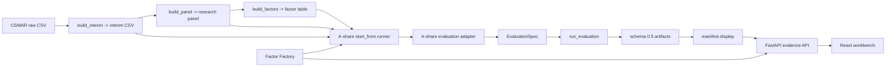

# 平台接口与数据流向图

本文是 `quant-research-platform` 当前代码事实的全局 code map。交互版见 [platform-flow-interactive.html](platform-flow-interactive.html)。

## 总览



## A 股主链路

```text
CSMAR raw CSV
-> build_interim
-> interim CSV
-> build_panel
-> research_panel_<start>_<end>.parquet
-> build_factors
-> price_volume_factors_<start>_<end>.parquet
-> A 股 evaluation adapter
-> EvaluationSpec
-> run_evaluation
-> schema 0.5 artifacts
-> manifest.display
-> API / downloads / React workbench
```

## Pipeline API

Snapshot 入口：

```http
POST /api/pipeline-snapshots
GET /api/pipeline-snapshots/{run_id}
GET /api/pipeline-snapshots/{run_id}/checkpoints
```

Executable run 入口：

```http
POST /api/pipeline-runs
GET /api/pipeline-runs/{run_id}
GET /api/pipeline-runs/{run_id}/checkpoints
```

Run payload 使用 `start_from`，结束层固定为 evaluation：

```text
existing_factors -> evaluation
rebuild_factors  -> build_factors -> evaluation
rebuild_panel    -> build_panel -> build_factors -> evaluation
rebuild_interim  -> build_interim -> build_panel -> build_factors -> evaluation
```

Canonical implementation:

- Route: `src/quant_research_platform/interfaces/api/routes/pipeline.py`
- Service: `src/quant_research_platform/interfaces/api/services/pipeline_service.py`
- Runner: `src/quant_research_platform/pipelines/a_share/runner.py`
- Snapshot writer: `src/quant_research_platform/pipelines/a_share/snapshots.py`
- Step registry: `src/quant_research_platform/pipelines/a_share/pipeline_step_registry.py`

## 节点清单

| ID | 节点 | 状态 | 代码位置 | 功能说明 |
|---|---|---|---|---|
| N01 | CSMAR raw CSV | 私有输入 | `data/raw_private/csmar/` | 用户手工导出的 CSMAR 原始文件 |
| N02 | build_interim | 已实现 | `markets/implementations/a_share/csmar/build_interim.py` | raw -> normalized interim |
| N03 | build_panel | 已实现 | `markets/implementations/a_share/datasets/build_panel.py` | interim -> research panel |
| N04 | build_factors | 已实现 | `markets/implementations/a_share/factors/build_factors.py` | panel -> factor and label table |
| N05 | A 股 evaluation adapter | 已实现 | `markets/implementations/a_share/evaluation/evaluation_adapter.py` | factor table -> `EvaluationSpec` |
| N06 | Evaluation layer | 已实现 | `evaluations/` | 统一评估逻辑 |
| N07 | Artifact writer/loader | 已实现 | `artifacts/` | schema `0.5` 和 `manifest.display` |
| N08 | Run repository | 已实现 | `interfaces/api/services/run_repository.py` | API-visible run index |
| N09 | Evidence API | 已实现 | `interfaces/api/routes/` | runs, evidence, previews, downloads, comparison |
| N10 | Pipeline Builder | 已实现 | `web/src/PipelineBuilder.tsx` | 当前只提交 snapshot |
| N11 | Pipeline snapshots | 已实现 | `pipelines/a_share/snapshots.py` | 写 `run_config.yaml`、`warnings.json`、`summary.md` |
| N12 | Start-from runner | 已实现 | `pipelines/a_share/runner.py` | 从指定层开始并运行到 evaluation |
| N13 | Factor template registry | 已实现 | `research/factor_factory/factor_registry.py` | 受控 factor templates |
| N14 | Factor Factory batch runner | 已实现 | `research/factor_factory/batch_runner.py` | 批量候选评估并写 factory artifacts |
| N15 | Factor Factory API | 已实现 | `interfaces/api/routes/factor_factory.py` | 浏览 factory runs、tables 和 downloads |

## HTTP API 清单

| Endpoint | 状态 | 说明 |
|---|---|---|
| `GET /health` | 已实现 | 健康检查 |
| `GET /api/markets` | 已实现 | 市场能力列表 |
| `GET /api/factor-templates` | 已实现 | A 股受控 factor templates |
| `POST /api/pipeline-snapshots` | 已实现 | 写配置快照，不执行 |
| `GET /api/pipeline-snapshots/{run_id}` | 已实现 | 读取 snapshot 状态 |
| `GET /api/pipeline-snapshots/{run_id}/checkpoints` | 已实现 | 读取 snapshot checkpoints |
| `POST /api/pipeline-runs` | 已实现 | 按 `start_from` 执行到 evaluation |
| `GET /api/pipeline-runs/{run_id}` | 已实现 | 读取执行状态 |
| `GET /api/pipeline-runs/{run_id}/checkpoints` | 已实现 | 读取执行 checkpoints |
| `GET /api/runs` | 已实现 | API-visible evaluation runs |
| `POST /api/runs` | 保留入口 | CSV upload local debug / compatibility |
| `DELETE /api/runs/{source_alias}/{run_id}` | 受控删除 | 仅 uploaded-panel local artifacts |
| `GET /api/runs/{source_alias}/{run_id}/evidence` | 已实现 | run evidence payload |
| `GET /api/runs/{source_alias}/{run_id}/artifacts/{artifact_item:path}` | 已实现 | display download item |
| `GET /api/runs/{source_alias}/{run_id}/download` | 已实现 | browser ZIP download |
| `GET /api/comparison` / `GET /api/comparison.csv` | 已实现 | API-visible run comparison |
| `GET /api/factor-factory-runs` | 已实现 | Factor Factory run list |
| `GET /api/factor-factory-runs/{run_id}` | 已实现 | Factor Factory detail |
| `GET /api/factor-factory-runs/{run_id}/tables/{table_key}` | 已实现 | Factor Factory table preview |
| `GET /api/factor-factory-runs/{run_id}/artifacts/{artifact_item:path}` | 已实现 | Factor Factory artifact download |

## 自查结论

- A 股主链路、evaluation schema `0.5`、`manifest.display`、API/download/frontend、start-from runner 和 Factor Factory 已在代码中落地。
- 通用 `evaluate-parquet` 不是 A 股 adapter 验收替代品。
- `source_alias + run_id` 是 API-visible run identity。
- 用户可见 artifact 必须进入 `manifest.display`，不能走后端或前端私有 shortcut。
