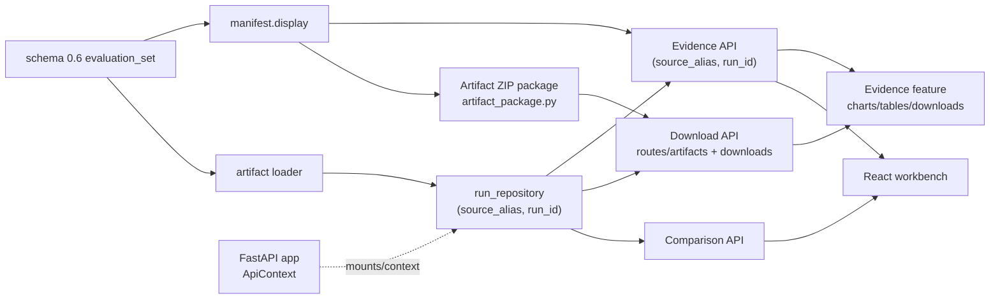
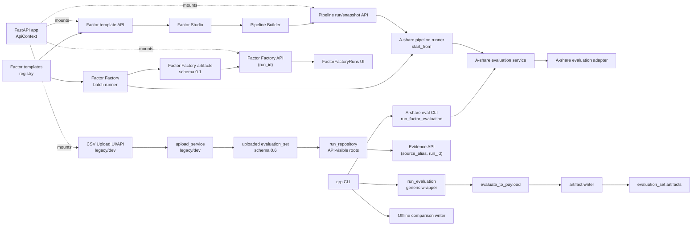

# 平台流程 Code Map

本页是 `quant-research-platform` 当前源码阅读图谱，描述的是代码事实和工程边界，不描述收益结论、因子有效性或实盘能力。可交互版本见 [platform-flow-interactive.html](platform-flow-interactive.html)。

## 总览

本页 Markdown 版按阅读用途拆成三张小图：先看 A-share 主链路，再看 artifact/display 到 API 和前端的展示链路，最后看 CLI、Factor Factory 和 CSV upload 兼容入口。完整节点、边、参数详情和可拖动布局仍以交互 HTML 为准。

以下 Mermaid 连线表示数据、契约或 payload 可用流；HTTP request 方向以 API 列表和节点说明为准。

### A-share 主链路

```mermaid
flowchart LR
  raw["CSMAR raw CSV\n私有输入"]
  interim["build_interim\n标准化 interim CSV"]
  panel["build_panel\nresearch panel"]
  factors["build_factors\nfactor + label table"]
  runner["A-share pipeline runner\nstart_from"]
  service["A-share evaluation service\nservice.py"]
  adapter["A-share evaluation adapter"]
  spec["EvaluationSpec"]
  payload["evaluate_to_payload"]
  writer["write_evaluation_set_artifacts"]
  artifacts["schema 0.6 evaluation_set"]
  display["manifest.display"]

  raw --> interim --> panel --> factors
  factors --> service --> adapter --> spec --> payload --> writer --> artifacts --> display
  raw --> runner
  interim --> runner
  panel --> runner
  factors --> runner
  runner --> service
```



### Artifact、API 与前端展示链路



### 旁路入口和兼容路径



旁路入口说明：

- `run_evaluation` 是 `qrp evaluate-parquet` 等通用入口使用的 wrapper，不是 A-share 私有主链路的必经节点。
- Factor Studio 通过 `GET /api/factor-templates` 读取模板，不直接绕过 API 访问 registry。
- CSV Upload UI/API 是本地 legacy/dev 兼容路径，不是 A-share 私有主链路。

## 主链路

```text
CSMAR raw CSV
-> build_interim
-> data/interim_private/csmar/
-> build_panel
-> panel_full/research_panel_<start>_<end>.parquet
-> build_factors
-> price_volume_factors_full/price_volume_factors_<start>_<end>.parquet
-> A-share evaluation service 或 start_from pipeline runner
-> EvaluationSpec
-> evaluate_to_payload
-> write_evaluation_set_artifacts
-> schema 0.6 evaluation_set artifacts
-> manifest.display
-> API / downloads / React workbench
```

私有数据边界必须保持清楚：`data/raw_private/`、`data/interim_private/`、`data/processed_private/` 和 `reports/private_real/` 都是本地私有面，不提交、不发布、不通过 API 对外暴露。项目不负责登录 CSMAR、自动下载、管理凭据、连接券商/交易所 API、纸面交易、实盘交易或投资建议。

## A-share 私有数据与评估

- `build_interim` 读取用户手动导出的 CSMAR raw CSV，写入审计友好的 interim CSV。
- `build_panel` 读取 interim 层，生成 full-sample research panel。
- `build_factors` 读取 panel，生成 slim factor/label table，保留 `stock_code`、`trade_date`、tradability、流动性/市值、factor columns 和 forward label columns。
- A-share 私有/full evaluation 应走专用入口 `python -m quant_research_platform.markets.implementations.a_share.evaluation.run_factor_evaluation`，或走 `POST /api/pipeline-runs` 对应的 A-share pipeline runner；两者最终通过 `markets/implementations/a_share/evaluation/service.py` 调用 A-share adapter。
- `qrp evaluate-parquet` 只是通用 Parquet adapter 检查，可验证 shared evaluation layer 的一部分；它不是 A-share adapter、A-share private data pipeline 或 Pipeline Builder 的验收替代品。

## Pipeline Builder 与 `start_from`

配置快照只保存配置，不执行计算：

```http
POST /api/pipeline-snapshots
GET /api/pipeline-snapshots/{run_id}
GET /api/pipeline-snapshots/{run_id}/checkpoints
```

可执行 pipeline run 使用 `start_from`，并且每一种入口都会继续到 evaluation：

```http
POST /api/pipeline-runs
GET /api/pipeline-runs/{run_id}
GET /api/pipeline-runs/{run_id}/checkpoints
```

当前支持的 `start_from`：

```text
existing_factors -> evaluation
rebuild_factors  -> build_factors -> evaluation
rebuild_panel    -> build_panel -> build_factors -> evaluation
rebuild_interim  -> build_interim -> build_panel -> build_factors -> evaluation
```

关键实现面：

- Route: `src/quant_research_platform/interfaces/api/routes/pipeline.py`
- Service: `src/quant_research_platform/interfaces/api/services/pipeline_service.py`
- Runner: `src/quant_research_platform/pipelines/a_share/runner.py`
- Evaluation service: `src/quant_research_platform/markets/implementations/a_share/evaluation/service.py`
- Snapshot writer: `src/quant_research_platform/pipelines/a_share/snapshots.py`
- Step registry: `src/quant_research_platform/pipelines/a_share/pipeline_step_registry.py`

## Evaluation、Artifact 与显示契约

- Evaluation artifact 类型是 `evaluation_set`，schema version 是 `0.6`。
- `EvaluationSpec` 是 evaluation layer 的输入契约；A-share 专用评估路径构造 `EvaluationSpec` 后调用 `evaluate_to_payload(spec)`，合并 payload 后由 `write_evaluation_set_artifacts(...)` 写出 schema `0.6` artifacts。
- `run_evaluation(spec)` 是通用 wrapper，当前由 `qrp evaluate-parquet` 等通用入口使用，内部同样调用 `evaluate_to_payload(spec)` 并写出 artifacts。
- `manifest.display` 是 API evidence、CSV preview、direct download、ZIP download、frontend tables、frontend charts 和 download presets 的唯一展示契约。
- API-visible evaluation run identity 是 `(source_alias, run_id)`；run list、evidence routes、CSV preview、direct download、ZIP cache path、comparison payload 和 frontend routing 都必须保留这个身份。
- Artifact ZIP package (`artifact_package.py`) 负责校验 `manifest.display.downloads` 并按照 manifest-resolved download items 组装 ZIP；API download service 只做响应编排。

## API 与前端

主要 API 面：

- Runs/evidence: `GET /api/runs`、`GET /api/runs/{source_alias}/{run_id}/evidence`
- Table preview: 主入口是 `GET /api/runs/{source_alias}/{run_id}/tables/{table_key}/preview`，由 `manifest.display.tables[]` 的 portable preview descriptor 和运行时 `preview_url` 驱动；旧 `metrics/{metric_name}`、`portfolio/{metric_name}`、`diagnostics/{metric_name}`、`breakdowns/{group}/{metric_name}` routes 仅作为兼容代理。
- Downloads: `GET /api/runs/{source_alias}/{run_id}/artifacts/{artifact_item:path}`、`GET /api/runs/{source_alias}/{run_id}/report.md`、`POST|GET /api/runs/{source_alias}/{run_id}/download`
- Comparison: `GET /api/comparison`、`GET /api/comparison.csv`
- Pipeline: `POST /api/pipeline-snapshots`、`POST /api/pipeline-runs`
- Factor templates: `GET /api/factor-templates`
- Factor Factory: `GET /api/factor-factory-runs`、`GET /api/factor-factory-runs/{run_id}`、`GET /api/factor-factory-runs/{run_id}/tables/{table_key}`、`GET /api/factor-factory-runs/{run_id}/artifacts/{artifact_item:path}`
- CSV upload compatibility: `POST /api/runs`、`GET /api/templates/factor-csv`，仅用于本地 legacy/dev 上传路径，不是 A-share 私有主链路。

关键 N8 helper/service：

- `src/quant_research_platform/artifacts/display_tables.py`: manifest display table preview/download resolver。
- `src/quant_research_platform/interfaces/api/payloads.py::runtime_display_payload`: 运行时补充 API-only `preview_url`。
- `src/quant_research_platform/interfaces/api/services/table_preview_service.py`: generic display-table preview service。
- `src/quant_research_platform/interfaces/api/services/factor_template_service.py`: Factor Studio 模板 API service。

React workbench 的依赖方向是：

```text
web/src/shell -> web/src/features -> web/src/shared
```

`web/src/features/evidence/` 通过 API evidence/display payload 消费由 `manifest.display` 驱动的表格、图表、CSV preview、report 和下载；`web/src/features/factor-studio/` 通过 `GET /api/factor-templates` 读取受控模板，并把 `factorDraft` 交给 `web/src/features/pipeline/` 的 Pipeline Builder；Pipeline Builder 执行 run 后刷新 `/api/runs`、选中 `pipeline/<run_ref or run_id>` 并切回 evidence workbench；`web/src/features/factor-factory/` 通过 Factor Factory API 浏览 run、table preview 和 artifact downloads；`web/src/features/uploads/` 是本地 CSV upload 兼容/调试路径，不是 A-share 私有主链路。

交互 HTML 的连线按数据/契约可用流阅读，不逐条等同 HTTP request 方向；具体调用方向在入口节点详情里说明。默认布局以左到右主流向为准，局部上下回流用于减少交叉和遮挡。交互 HTML 允许少量复合节点：只有前端 UI 与后端 API 是单一路径、没有复用分叉、没有独立职责边界时才合并，并且节点必须显式标注为 `Frontend + API`。当前 `CSV Upload UI/API (legacy/dev)` 就是这种复合节点；Factor Factory UI 与 API、Pipeline Builder 与 Pipeline API、Factor Studio 与 factor-template endpoint 都保持拆分。

## Factor Factory

- Factor Factory 使用 `research/factor_factory/` 下的模板注册、batch runner 和 report writer。
- Factory batch runner 当前以 controlled factor templates 生成候选，并调用 A-share runner，通常从 `start_from=existing_factors` 开始。
- Factor Factory artifact schema 是 `0.1`，不同于 evaluation-set schema `0.6`；不要把二者混为同一个 artifact contract。
- Factor Factory API 只暴露 manifest/display 允许的 run detail、table preview 和 artifact download；前端 `FactorFactoryRuns` 是单独 UI 消费者，不与 API 节点合并。

## CLI 入口

- `python -m quant_research_platform.interfaces.cli` / `qrp` 是 Typer root entry。
- `qrp evaluate-parquet` 是通用 Parquet evaluation 入口，不是 A-share 验收替代品。
- `qrp compare` 写出多个 completed evaluation-set artifact 目录的离线 comparison CSV。
- `qrp a-share build-interim`、`build-panel`、`build-factors`、`evaluate` 是 helper entry，会提示实际 `python -m quant_research_platform.markets.implementations.a_share...` 模块入口。
- 详细命令参数和 API request 字段见交互 HTML 的入口节点详情。

## 自检重点

- A-share raw/interim/panel/factor/evaluation 主链路是否仍然保持本地私有数据边界。
- `start_from` executable pipeline 是否每次继续到 evaluation。
- `manifest.display` 是否仍然是 API/download/frontend 的唯一展示源。
- `(source_alias, run_id)` 是否贯穿 API、下载、comparison 和 frontend state。
- `evaluate-parquet` 是否只被描述为通用 adapter 检查，而不是 A-share adapter 或 pipeline 验收。
- 交互 HTML 的边是否按数据/契约可用流保持左到右主流向，局部上下回流是否确实减少交叉/遮挡，并在详情中补充实际 API request 方向。
