# 平台接口与数据流向图

本文是 `quant-research-platform` 当前代码事实的全局 code map。交互版见 [platform-flow-interactive.html](platform-flow-interactive.html)。

## 总览

```mermaid
flowchart LR
  raw["CSMAR raw CSV"]
  interim["build_interim -> interim CSV"]
  panel["build_panel -> research panel"]
  factors["build_factors -> factor table"]
  runner["A-share run_a_share_pipeline(start_from)"]
  adapter["A-share evaluation adapter"]
  spec["EvaluationSpec"]
  eval["run_evaluation"]
  artifacts["schema 0.5 artifacts"]
  display["manifest.display"]
  package["artifact_package"]
  api["FastAPI evidence API"]
  web["React workbench"]
  factory["Factor Factory"]

  raw --> interim --> panel --> factors
  interim --> runner
  panel --> runner
  factors --> runner
  runner --> adapter --> spec --> eval --> artifacts --> display
  display --> package --> api --> web
  display --> api
  factory --> runner
  factory --> api
```



## A 股主链路

```text
CSMAR raw CSV
-> build_interim
-> interim CSV
-> build_panel
-> research_panel_<start>_<end>.parquet
-> build_factors
-> price_volume_factors_<start>_<end>.parquet
-> run_a_share_pipeline(config)
-> A 股 evaluation adapter
-> EvaluationSpec
-> run_evaluation
-> schema 0.5 artifacts
-> manifest.display
-> API / downloads / React workbench
```

## Pipeline API

Configuration snapshot 入口：

```http
POST /api/pipeline-snapshots
GET /api/pipeline-snapshots/{run_id}
GET /api/pipeline-snapshots/{run_id}/checkpoints
```

Executable run 入口：

```http
POST /api/pipeline-runs
GET /api/pipeline-runs/{run_id}
GET /api/pipeline-runs/{run_id}/checkpoints
```

Run payload 使用 `start_from`，结束层固定为 evaluation：

```text
existing_factors -> evaluation
rebuild_factors  -> build_factors -> evaluation
rebuild_panel    -> build_panel -> build_factors -> evaluation
rebuild_interim  -> build_interim -> build_panel -> build_factors -> evaluation
```

Run checkpoints 统一展示完整链路。未执行的前置层标为 `skipped`，成功层标为 `ready`，失败层标为 `failed`，失败后的后续层标为 `skipped`。

Canonical implementation:

- Route: `src/quant_research_platform/interfaces/api/routes/pipeline.py`
- Service: `src/quant_research_platform/interfaces/api/services/pipeline_service.py`
- Runner: `src/quant_research_platform/pipelines/a_share/runner.py`
- Snapshot writer: `src/quant_research_platform/pipelines/a_share/snapshots.py`
- Step registry: `src/quant_research_platform/pipelines/a_share/pipeline_step_registry.py`

## 节点清单

| ID | 节点 | 状态 | 代码位置 | 功能说明 |
|---|---|---|---|---|
| N01 | CSMAR raw CSV | 私有输入 | `data/raw_private/csmar/` | 用户手工导出的 CSMAR 原始文件 |
| N02 | build_interim | 已实现 | `src/quant_research_platform/markets/implementations/a_share/csmar/build_interim.py` | raw -> normalized interim |
| N03 | build_panel | 已实现 | `src/quant_research_platform/markets/implementations/a_share/datasets/build_panel.py` | interim -> research panel |
| N04 | build_factors | 已实现 | `src/quant_research_platform/markets/implementations/a_share/factors/build_factors.py` | panel -> factor and label table |
| N05 | run_a_share_pipeline | 已实现 | `src/quant_research_platform/pipelines/a_share/runner.py` | 按 `start_from` 执行到 evaluation，并写完整 checkpoint 链 |
| N06 | A 股 evaluation adapter | 已实现 | `src/quant_research_platform/markets/implementations/a_share/evaluation/evaluation_adapter.py` | factor table -> `EvaluationSpec` |
| N07 | Evaluation layer | 已实现 | `src/quant_research_platform/evaluations/` | 统一评估逻辑 |
| N08 | Artifact writer/loader | 已实现 | `src/quant_research_platform/artifacts/` | schema `0.5` 和 `manifest.display` |
| N09 | Artifact ZIP package | 已实现 | `src/quant_research_platform/artifacts/artifact_package.py` | display download items 的文件收集、校验和 ZIP item 打包规则 |
| N10 | Run repository | 已实现 | `src/quant_research_platform/interfaces/api/services/run_repository.py` | API-visible run index，身份为 `(source_alias, run_id)` |
| N11 | Evidence API | 已实现 | `src/quant_research_platform/interfaces/api/routes/` | runs, evidence, previews, downloads, comparison |
| N12 | Pipeline Builder | 已实现 | `web/src/PipelineBuilder.tsx` | 当前提交 configuration snapshot |
| N13 | Pipeline snapshots | 已实现 | `src/quant_research_platform/pipelines/a_share/snapshots.py` | 写 `run_config.yaml`、`warnings.json`、`summary.md` |
| N14 | Factor template registry | 已实现 | `src/quant_research_platform/research/factor_factory/factor_registry.py` | 受控 factor templates |
| N15 | Factor Factory batch runner | 已实现 | `src/quant_research_platform/research/factor_factory/batch_runner.py` | 通过 `run_a_share_pipeline(start_from="existing_factors")` 批量评估候选 |
| N16 | Factor Factory API | 已实现 | `src/quant_research_platform/interfaces/api/routes/factor_factory.py` | 浏览 factory runs、tables 和 downloads |
| N17 | React workbench | 已实现 | `web/src/App.tsx` | 本地 evidence workbench，消费 API 和 display contract |
| N18 | `qrp` CLI | 已实现 | `src/quant_research_platform/interfaces/cli/commands.py` | Typer 总入口，含 evaluation、comparison 和 A 股帮助入口 |

## HTTP API 清单

| Endpoint | 状态 | 说明 |
|---|---|---|
| `GET /health` | 已实现 | 健康检查 |
| `GET /markets`, `GET /api/markets` | 已实现 | 市场能力列表 |
| `GET /markets/{market}/capabilities`, `GET /api/markets/{market}/capabilities` | 已实现 | 单市场能力 |
| `GET /api/factor-templates` | 已实现 | A 股受控 factor templates |
| `POST /api/pipeline-snapshots` | 已实现 | 写配置快照，不执行 |
| `GET /api/pipeline-snapshots/{run_id}` | 已实现 | 读取配置快照状态 |
| `GET /api/pipeline-snapshots/{run_id}/checkpoints` | 已实现 | 读取配置快照 artifacts 状态 |
| `POST /api/pipeline-runs` | 已实现 | 按 `start_from` 执行到 evaluation |
| `GET /api/pipeline-runs/{run_id}` | 已实现 | 读取执行状态 |
| `GET /api/pipeline-runs/{run_id}/checkpoints` | 已实现 | 读取完整执行 checkpoints |
| `GET /api/runs` | 已实现 | API-visible evaluation runs |
| `POST /api/runs` | 保留入口 | CSV upload local debug / compatibility |
| `GET /api/templates/factor-csv` | 保留入口 | 下载本地 CSV upload 的 factor template |
| `DELETE /api/runs/{source_alias}/{run_id}` | 受控删除 | 仅 uploaded-panel local artifacts |
| `GET /api/runs/{source_alias}/{run_id}/evidence` | 已实现 | run evidence payload |
| `GET /api/runs/{source_alias}/{run_id}/metrics/{metric_name}` | 已实现 | 预览 display metrics 表 |
| `GET /api/runs/{source_alias}/{run_id}/portfolio/{metric_name}` | 已实现 | 预览 display portfolio 表 |
| `GET /api/runs/{source_alias}/{run_id}/diagnostics/{metric_name}` | 已实现 | 预览 display diagnostics 表 |
| `GET /api/runs/{source_alias}/{run_id}/breakdowns/{group}/{metric_name}` | 已实现 | 预览 display breakdown 表 |
| `GET /api/runs/{source_alias}/{run_id}/artifacts/{artifact_item:path}` | 已实现 | 下载 display download item |
| `GET /api/runs/{source_alias}/{run_id}/report.md` | 已实现 | 下载 report Markdown |
| `POST /api/runs/{source_alias}/{run_id}/download` | 已实现 | 按请求 item 打 ZIP |
| `GET /api/runs/{source_alias}/{run_id}/download` | 已实现 | 浏览器原生 ZIP 下载入口 |
| `GET /api/comparison`, `GET /api/comparison.csv` | 已实现 | API-visible run comparison |
| `GET /api/factor-factory-runs` | 已实现 | Factor Factory run list |
| `GET /api/factor-factory-runs/{run_id}` | 已实现 | Factor Factory detail |
| `GET /api/factor-factory-runs/{run_id}/tables/{table_key}` | 已实现 | Factor Factory table preview |
| `GET /api/factor-factory-runs/{run_id}/artifacts/{artifact_item:path}` | 已实现 | Factor Factory artifact download |

## CLI

| 入口 | 状态 | 说明 |
|---|---|---|
| `python -m quant_research_platform.interfaces.cli` / `qrp` | 已实现 | Typer 总入口 |
| `qrp evaluate-parquet` | 已实现 | 通用 local Parquet adapter check |
| `qrp compare` | 已实现 | 离线 comparison writer |
| `qrp a-share build-interim` | 已实现帮助入口 | 提示 A 股模块 CLI |
| `qrp a-share build-panel` | 已实现帮助入口 | 提示 A 股模块 CLI |
| `qrp a-share build-factors` | 已实现帮助入口 | 提示 A 股模块 CLI |
| `qrp a-share evaluate` | 已实现帮助入口 | 提示 A 股专用 evaluation CLI |
| `python -m quant_research_platform.markets.implementations.a_share.csmar.build_interim` | 已实现 | raw -> interim |
| `python -m quant_research_platform.markets.implementations.a_share.datasets.build_panel` | 已实现 | interim -> research panel |
| `python -m quant_research_platform.markets.implementations.a_share.factors.build_factors` | 已实现 | panel -> factor and label table |
| `python -m quant_research_platform.markets.implementations.a_share.evaluation.run_factor_evaluation` | 已实现 | A 股 factor table -> evaluation artifacts |

## Frontend

| 入口 | 状态 | 说明 |
|---|---|---|
| `web/src/App.tsx` | 已实现 | Workbench shell |
| `web/src/ResultsView.tsx` | 已实现 | Runs、summary、tables、charts、report |
| `web/src/ArtifactDownloads.tsx` | 已实现 | display-driven direct/ZIP download |
| `web/src/FactorStudio.tsx` | 已实现 | 受控 factor draft |
| `web/src/PipelineBuilder.tsx` | 已实现 | Configuration snapshot submission UI |
| `web/src/FactorFactoryRuns.tsx` | 已实现 | Factor Factory run browser |
| `web/src/CreateRunPanel.tsx` | 保留入口 | CSV upload local debug / compatibility |

## Phase 1 后续架构债

这些不是 Phase 1 清单内未完成项，而是 Phase 1 之后应单独设计的工作：

1. 前端 feature split：当前 `web/src` 仍是平铺文件，后续可按 Evidence、Pipeline、Factor Factory、Uploads、shared 拆分。
2. Eligibility / tradability 可见诊断：当前列进入 panel/factor/evaluation，后续应增加覆盖数和过滤影响 artifact。
3. ML prediction / risk / regime / portfolio optimization：属于 research layer 后续能力，不是 Phase 1 阻塞项。
4. Crypto 和其他市场：只能作为 planned / disabled 能力表述；不得保留空 implementation package。

## 自查结论

- A 股主链路、evaluation schema `0.5`、`manifest.display`、API/download/frontend、start-from runner 和 Factor Factory 已在代码中落地。
- 通用 `evaluate-parquet` 不是 A 股 adapter 验收替代品。
- `source_alias + run_id` 是 API-visible run identity。
- 用户可见 artifact 必须进入 `manifest.display`，不能走后端或前端私有 shortcut。
