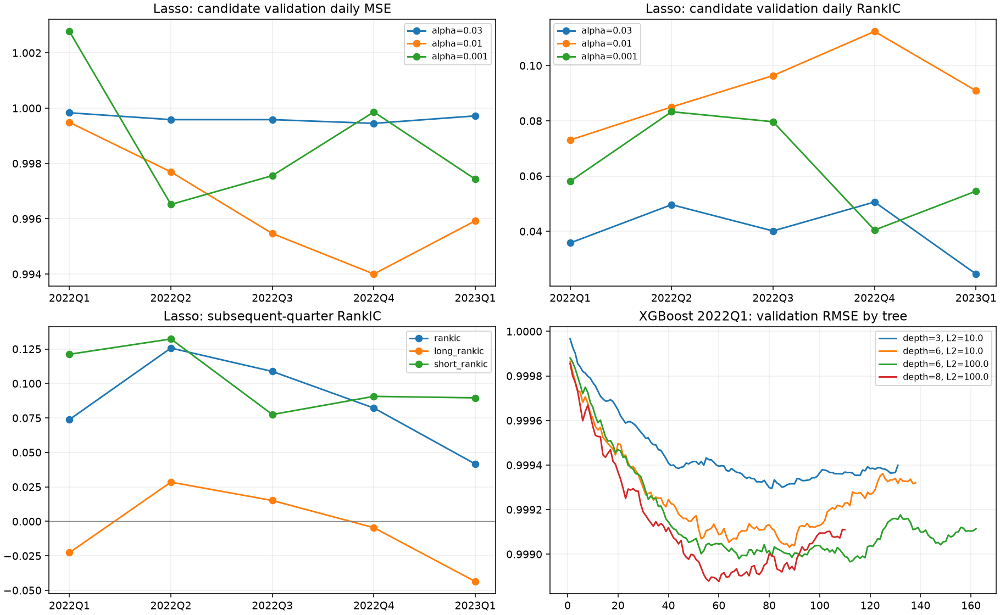

# A股低频五日模型阶段结果

## 2022年起滚动预测的当前结果

2026年11月16日快照包含Lasso的2022Q1—2023Q3七季，以及XGBoost和LSTM各自的2022Q1。当前协议从2014年扩展训练，每季保留最近120个成熟信号会话作验证，以共同日期的全截面日均RankIC选择候选，再用全部成熟历史重新拟合并预测随后季度。唯一目标为未来五交易日收益的当日合格股票截面标准分，目标不裁剪。

候选输入1276列，本次最终模型实际使用1221—1269列。列选择、缺失插补与缩放均由当时训练样本估计并冻结；目标缺失不插补。完整配置与模型设置见[低频模型方法](../docs/low-frequency-models.md)。

| 季度 | 模型 | 验证MSE | 验证RankIC | 预测IC | 预测RankIC | 多头RankIC | 空头RankIC |
|---|---|---:|---:|---:|---:|---:|---:|
| 2022Q1 | Lasso | 0.999487 | 0.073061 | 0.049787 | 0.073841 | -0.022682 | 0.121176 |
| 2022Q1 | LSTM | 1.062975 | 0.013855 | -0.004525 | -0.001409 | -0.021229 | 0.048529 |
| 2022Q1 | XGBoost | 0.998589 | 0.082288 | 0.072416 | 0.091435 | -0.011627 | 0.120849 |
| 2022Q2 | Lasso | 0.997695 | 0.085010 | 0.109687 | 0.125680 | 0.028433 | 0.132274 |
| 2022Q3 | Lasso | 0.995464 | 0.096371 | 0.084459 | 0.108720 | 0.015120 | 0.077476 |
| 2022Q4 | Lasso | 0.994001 | 0.112341 | 0.054371 | 0.082190 | -0.004555 | 0.090652 |
| 2023Q1 | Lasso | 0.995925 | 0.090904 | 0.013285 | 0.041582 | -0.043628 | 0.089576 |
| 2023Q2 | Lasso | 0.997530 | 0.076805 | 0.044779 | 0.068846 | 0.010967 | 0.086311 |
| 2023Q3 | Lasso | 0.999549 | 0.052334 | 0.064444 | 0.069741 | -0.034615 | 0.133601 |

多头和空头分别为当日预测前20%和后20%的组内相关，沿用单因子检验的样本与并列规则。IC/RankIC逐日计算、再对有效日等权；多头组内相关不是多头超额收益。MSE以目标标准分平方表示，预测分数不是百分比收益。

XGBoost首季按验证RankIC选中深度3、L2=10、81棵树；深度6和8也参与了比较。更低验证MSE并不一定对应更高RankIC。首季LSTM两档候选均在早期取得最佳验证损失，此后训练损失下降而验证MSE上升；这些曲线不支持继续机械增加训练轮数或模型容量。

[逐季完整指标](data/stock-current-quarterly.csv)同时保存标准分目标与原始五日收益的全截面、多头和空头IC/RankIC、组内均值及有效日数；[全部候选验证记录](data/stock-current-validation.csv)保留完整参数及拟合、验证窗口；[逐日预测诊断](data/stock-current-prediction-daily.csv.gz)和[候选训练、验证曲线](data/stock-current-candidate-curves.csv)可用于复核。

XGBoost曲线是每棵树后的原生验证RMSE；LSTM训练曲线是更新中模型的在线epoch MSE，验证曲线是epoch结束后的冻结模型MSE。选参仍按恢复最佳候选后的日均RankIC，不能混用这些口径。

当前尚未汇总最终冻结模型的训练MSE和完整预测MSE，逐期三阶段统计在对应拟合队列完成后计算。Transformer尚无本协议完整季度结果。本次只评价预测与信号，未推进组合回测和交易执行。

## 组合回测前的模型核对

新增[共同季度模型比较](data/stock-backtest-model-comparison.csv)读取已发布模型内保存的
候选验证记录，以及原生五日收益检验。现阶段 Lasso 与 XGBoost 可共同比较 2022 年四季，
每季内仍为日等权指标，再对四季等权：

| 模型 | 验证 RankIC | 随后预测 RankIC |
| --- | ---: | ---: |
| Lasso | 0.091696 | 0.097608 |
| XGBoost | 0.094545 | 0.089842 |

按既定的验证 RankIC 选择，XGBoost 暂时领先；随后预测的排序相关则是 Lasso 更高，
不能据首季度结果宣布 XGBoost 在完整区间也最佳。LSTM 目前仅有 2022Q1，
验证 RankIC 为 0.013855，预测为 −0.001409；Transformer 同协议结果尚未发布。
剩余模型继续计算，组合任务将在可比窗口上复核选择。未完成窗口不补零，也不把
Lasso 更长的预测历史直接与 XGBoost 较短历史混合排名。
