# A 股量价、预期与财务信息的联合检验

**本轮重算从 2026 年 10 月 21 日开始，17 项研究仍在执行。以下先报告已经核验的结论。**

这项研究根据当时可见的价格、成交、分析师预期和财务信息，为股票未来约一个月的相对收益打分，再检查这些分数能否改善实际组合。**Core6、PV25、PV52分别表示6、25、52个价格与成交量相关因子**，不是股票数量；“非金融”表示另选不含金融行业的研究样本。2019—2023年用于开发，2024—2025年用于冻结模型的历史检验。这段历史已在以前的研究中使用，本轮是重新计算，不能称为一次全新的未见样本试验。

文中 **G** 用整段开发期成绩选型，**Q** 在每个季度开始前用此前 12 个月的成绩选型；两者都在 2023 年末冻结，用于 2024—2025 年。**RankIC** 衡量预测排序与随后收益排序的相关程度，**IC** 衡量数值间的线性相关程度。区间和 p 值按下文各自的检验口径解读，不能把预测相关性当成收益率。

读下列结论时，先分开三件事：**排序更准、模型更依赖某项信息、交易后赚得更多**。它们分别需要预测比较、模型解释和账户结果，不能由其中一项代替其他两项。

- **扩展量价输入后，预测排名略有改善，增量是否显著还没有定论。** 在已完成的 Core6 与 PV25 中，Q 选择的固定检验期日均 RankIC 从 0.1174 升至 0.1207。预定的配对比较和联合校正尚未齐备，不能把这两个均值直接当成显著改善。
- **模型反复使用风险、交易活跃度和规模信息，但使用方式不同。** Core6 的 OLS 对短期反转和 Amihud 因子的系数在 20 个季度中一直为正，对波动率、换手率和流通市值一直为负。PV25 的普通决策树先看换手波动，再分规模或成交额。系数、分裂次数和预测贡献分别说明模型怎样使用信息，都不是投资利润。
- **Core6 已有完整的两期账户统计，收益伴随较大回撤。** 冠军等权组合在2024—2025年历史重算中的费用后年化收益为34.98%，最大回撤为39.86%；加入行业与规模约束后，年化收益为20.03%，最大回撤为17.37%。这些是既定模拟条件下的历史结果；行业、风格及残差收益拆分尚无已定义区间，不能据此宣称已识别选股alpha。
- **预期变量在主检验期限下尚未显示稳定的单因子证据。** 七个预期变量在两期、两种保鲜期的 20 会话 RankIC 均未通过各自完整家族的 BY 5% 校正；部分其他期限有通过项。是否能帮助非线性模型，仍需等同一股票域的增量检验。
- **财务研究受到开发期数据缺口限制。** 财务资格在 2020—2023 年没有合格资产日，三个财务配置无法完成预定的最终模型选择。2024—2025 年的描述结果不能补上这段缺失的验证。

本轮要回答的是：新增信息是否改善样本外预测，模型怎样使用这些信息，以及改善能否在实际持仓和交易成本之后保留下来。完整模型矩阵、冻结检验、组合账户、模型解释及联合统计尚未全部完成。此前《[A股量价研究报告](A股量价研究报告.md)》的历史结果单独保留，不与本轮结果拼接。

例如，RankIC为0.12，表示预测名次与后来收益名次有正相关，**不是收益率12%，也不是胜率62%**。每个日期先分别计算相关性，再汇总为文中的日均值。“成熟标签日期”指截至评价终点，已经能观察到该日期之后完整预测期限收益的日期；样本因此不会延伸到年末最后一天。

本报告先看模型预测和解释，再看单因子、事件与截面回归，最后交代完整研究设计。下文两种统计缩写分别是：**HAC区间**考虑每日结果之间的相关性；**BY校正**在同时检验很多信号时控制假发现比例。未通过校正，表示当前证据不足，不等于效应已经被证明为零。

## 从零理解：这轮研究到底比较什么

### 一行数据、一项因子、一个模型，各指什么

可以把研究表想成按“股票×日期”排列的表格。某行记录一只股票在一个信号日已经知道的状态；因子是其中描述价格、成交、预期或财务状况的数字。未来收益标签放在另外的列里，只有相应未来区间已经结束，才能用于训练或评价。

| 名称 | 本轮具体含义 | 容易混淆的地方 |
|---|---|---|
| 因子 | 用当时可见事实按固定规则计算的输入，例如5日反转、20日换手率 | 因子为正不表示未来一定上涨 |
| 特征 | 实际交给模型的坐标，可能经过截尾、中性化、标准化或带有缺失标记 | 25个经济因子不必对应25个最终矩阵列 |
| 标签 | 要预测的未来结果；主模型用未来20会话收益的当日截面标准分数 | 标签不能在尚未成熟时提前进入训练 |
| 模型家族 | 一种从输入生成预测的算法，例如OLS或LightGBM | 同一家族可以有多个候选参数组合 |
| 候选配置 | 因子集合、算法参数和训练设置明确的一种候选 | 候选多不等于独立证据多 |
| 研究配置 | 固定一组信息与样本资格，例如“非金融PV25加四项预期” | 17配置不是17只股票，也不是17个已成功账户 |
| 账户 | 将某套预测交给固定交易规则后，逐日推进的现金、持仓和权益记录 | 一份预测可以对应多个账户对照 |

Core6、PV25、PV52先比较输入范围：6项基础信息、25项常见量价描述、52项更完整的量价与市场暴露。四块消融再从PV52分别删除一类信息，看其他输入能否弥补。预期和财务研究另改变可用信息，有时也改变样本资格；所以要设置同资格的PV25基线。

原计划每个配置每季拟合20个候选，2018—2023年共有24个季度，17×24×20=8,160次预定季度拟合。九个模型家族、20个参数候选、17个研究配置是三个不同的计数。8,160描述计划规模，不能自动写成8,160次成功拟合；缺标签、缺选择依据或拟合失败都要保留真实状态。

### 这些信息怎样产生一个预测

以Core6为例，长期动量描述约一年前至一个月前的可比价格变化；5日反转把过去一周收益取负号；波动率描述近期收益的离散程度；Amihud描述绝对价格变化相对成交金额；换手率描述成交股数相对流通股数；对数流通市值描述规模。它们全部来自过去和当时，随后收益才是未知答案。

假设股票最近一周从10元降至9.5元，按相应复权价格计算的收益为−5%，反转因子为+5%。这个正号只是“近期下跌较多”的编码。若训练模型给反转一个正系数，表示控制其他输入后，这个冻结模型倾向于给它更高预测分数；是否存在稳定收益仍需后续日期检验。

本轮对同一天的股票先压缩极端值，再去除行业和对数流通市值的线性影响，并将残差标准化。中性化的“残差”就是原始因子减去行业与规模能够拟合的部分。对数流通市值本身只去行业，否则把一列对自身回归会人为消掉它。

原始值、中性化前特征、中性化后特征是同一因子的三个不同观察对象。比如某项原始因子与未来收益有关，但去掉行业和规模后关系变弱，可以说其原关联与这些条件有关；不能直接说模型已经识别了某个经济原因。缺行业造成中性化特征不可计算，也不等于公司原始经济量为零。

模型最后把这一行特征变成一个分数。OLS的形式是“截距加各输入乘系数”；树模型则根据阈值走到叶子，集成树再结合多棵树的结果。主模型目标已在当日股票间标准化，因此预测1.2是目标坐标中的相对强弱，不是预测收益1.2%。排名越高的股票通常获得更高选股优先级，但还没有产生一笔真实成交。

### 预期、财务和PIT为什么尤其依赖时间

**PIT（point in time）表示只使用当时已经可以知道的版本。** 财务报表描述的是一个报告期，报告期结束不等于投资者已经读到了报表；分析师报告也有自己的发布日期、预测对象和后来更新版本。把最终修订值回填到较早日期，会让模型读到当时尚未知的信息。

预期保鲜期90日或180日，是对已可用报告是否仍可作为当前信息的限制，不是预测目标为90日或180日。比如两家公司今天都用同一数值的EPS预测，一份报告刚更新，一份已近保鲜上限，信息年龄仍可能不同。新报告与数值改动也不是同一件事：机构可以发布新的报告但维持原预测。

“同一财务研究资格内PV25”很关键。若加财务后只剩资料较完整的一批公司，直接与全市场PV25比较，成绩差可能来自股票范围变化。让基线也使用相同资格，再比较是否增加财务输入，才能减少这个混淆；若开发期没有足够成熟标签，两边都不能凭固定检验期的好看结果补选模型。

### G与Q怎样选择，什么才算后续检验

训练估计系数和树，验证在候选之间选参数，后续检验检查选择之后的效果。Q在季度开始前按此前12个月已经成熟的验证成绩选择；G在开发期结束后用整段成绩选择。因此G的开发均值可以描述这段历史，但其选择含事后信息，不发布“仿佛当时已知赢家”的显著性结论。

2023年末，两种选择规则各自冻结参数和模型，用于2024—2025年。此后读取该阶段成绩，不能再修改候选范围、因子方向或交易规则，然后仍把同一成绩称为未使用的最终检验。本轮又使用了先前研究过的这段历史，因此正文始终称固定历史检验或重算，保留这一限制。

## 读结果前，先把几个统计问题分开

### RankIC和分组收益不是账户收益

RankIC是在同一天把预测和未来收益分别排序，再计算两个名次序列的相关。比如预测名次为5、4、3、2、1，实际收益名次为5、3、2、4、1，无并列时RankIC为0.7。它表示这五个教学观察的排序关系，不是70%的收益率或胜率。正文0.12左右的数值同样是相关系数单位。

分组收益把因子按名次分成若干组，再比较各组的未来标签均值。即使称“多空差”或“高减低”，它也可以只是一种标签统计，并没有模拟借券、调仓、成交限制和费用。账户收益需要另读真实模拟账本；不能把高减低标签直接写成可实现的多空利润。

### 为什么日均相关还要报告区间

每天的相关性会变化。同一批股票、重叠的20会话收益，以及持续的市场环境，会让相邻日期的结果相关；一百万行股票日期记录不是一百万次独立实验。本文先形成每日统计，再用声明的完整市场时钟处理不确定性。

HAC区间是一种允许日序列存在异方差与自相关的近似区间。本轮相关结果常用Bartlett滞后20：除了每日自身的波动，也考虑相隔最多20个会话的共同变动。它不是“把样本只留20天”，也不是让所有不同分析共享一个未声明的误差假设。

区间跨零表示在这一估计及其假设下，证据还不足以排除零均值；不跨零也不保证将来仍有效。两个方案各自的区间不能代替差值检验：比较PV25与Core6时，应在匹配的日期、股票资格和指标上先求差，再分析差值的不确定性。

### p值与BY校正分别控制什么

p值是在指定零假设和统计模型下，得到当前或更极端统计量的概率；它不是“这个因子没有用的概率”。当同时试很多信号时，即使每个单项都用5%阈值，也容易出现偶然的显著项，因此本轮按预先声明的家族进行BY校正。

用三个教学p值说明：0.001、0.020、0.040都小于0.05；若把它们作为同一个三项家族，BY在5%水平下使用的逐级阈值约为0.00909、0.01818、0.02727，只保留第一项。正文的真实家族可能有165项，不能用这个三项例子的阈值替代实际计算。BY控制的是所声明家族和相应条件下的假发现率，即被判显著的结果中误报比例的期望；不是保证这一次恰好只有5%误报，也不证明通过项必有交易价值。

正文按预测期限和原声明范围报告校正。看到六个期限里某一期通过，不能挑出它之后宣称“六个期限整体已经显著”。同理，不通过校正也不证明效应恰为零，只说明当前检验没有取得所要求的证据。

### 模型系数、SHAP、置换与消融问的是不同问题

| 方法 | 把什么保持不变 | 改变或读取什么 | 能支持的解释 |
|---|---|---|---|
| 冻结模型系数 | 当前线性模型和其他输入 | 看某列在模型公式中的斜率 | 模型怎样响应这列，不能自动得到因果效应或显著性 |
| SHAP或其他加性贡献 | 当前模型及指定解释背景 | 把一次预测分解为基准值和各输入贡献 | 这次模型输出由哪些坐标组成，需先通过加和检查 |
| 同组置换 | 冻结模型 | 在声明样本内打乱一个因子及其缺失标记 | 模型对这组信息有多依赖 |
| 消融并重训 | 声明的比较协议 | 移除一个信息块，再重新拟合 | 剩余输入重新学习后能弥补多少信息 |

例如教学预测“基准0.1，加动量贡献0.3，减风险贡献0.2”，最后为0.2。三个数都在预测坐标里，不是现金收益；贡献加起来对得上，只证明这次分解与模型一致。高度相关的输入可以替代彼此，所以贡献小、置换影响小和删除重训影响小也不是完全相同的结论。

Fama–MacBeth则是另一项研究统计：每天在股票截面回归未来收益对因子，得到每天的斜率，再研究这串斜率的平均及区间。例如在使用标准化因子的教学回归中，斜率0.002表示因子高一个单位对应未来收益高0.2个百分点的条件关联。它不是训练好的XGBoost系数，也不能把其区间移到OLS训练系数表。

## 从预测到实际持仓：本轮账户怎样解释

主组合每周最后一个交易日收盘决策，下一会话开盘尝试成交，选预测排名前20%。20会话是模型预测期限，每周调仓是交易规则；两者不同。目标股票不能买入时留现金，已有股票不能卖出时保留持仓，实际账本再记录费用和后续价格变化。

本轮中性组合还约束已知行业子组合和整条股票腿的规模暴露。假设教学目标中20%权重行业未知，另外80%中行业A/B比例为40%/60%，则全股票腿A/B实际权重为32%/48%。行业约束比较的是已知80%内的40%/60%，并不因此把未知20%证明为行业中性。未知行业不自动禁止买卖，有效预测、资本化信息及执行条件仍按各自规则判断。

账户使用原股价格和数量，股数变化、分红应收、到账与锁定分别记录。教学例子中，持有100股、价格10元，总值1,000元；若发生每股送一股且纯机械除权到5元，总股数变200，总值仍为1,000元，并未凭空损失一半。新增股在尚不能交易的阶段要保留锁定，不能按可卖数量处理。另一个纯机械分红例子中，每股分红1元、价格从10降到9，100股市值900元加100元现金或应收仍为1,000元。这些例子忽略税费及额外行情变化，只解释权益守恒。

因此，预测改善能否转成收益，要逐步检查：是否改变了入选股票，是否真的成交，持仓持续多久，费用和容量用了多少，现金及公司权益怎样变化。行业、风格归因还要有合格风险因子和完整持有期输入；净利润为正本身不足以把它命名为已识别的选股alpha。

## Core6 与 PV25 的已完成模型结果

两项配置的季度拟合、最终选择、冻结预测及八组原生模型统计已经完成。Core6 的 G/Q 最终均选择 XGBoost；PV25 的 G 最终选择 LightGBM，Q 最终选择 XGBoost。下表为所选方案每日截面 RankIC 的均值，括号为 HAC 95% 区间。开发期有 1,193 个成熟标签日期，固定检验期有 464 个；这两个日期数不同于连续账户的估值间隔数。

| 配置与选择规则 | 2019—2023 年 | 2024—2025 年 |
|---|---:|---:|
| Core6，G | 0.1243，仅描述 | 0.1174（0.0683，0.1665） |
| Core6，Q | 0.1208（0.0968，0.1448） | 0.1174（0.0683，0.1665） |
| PV25，G | 0.1246，仅描述 | 0.1182（0.0741，0.1623） |
| PV25，Q | 0.1212（0.0984，0.1440） | 0.1207（0.0741，0.1672） |

这四行最直接的比较是：Q规则下，增加到25个量价因子后，固定检验期均值从0.1174变为0.1207，增加约0.0033个相关系数单位。这个变化值得继续检验，但还没有告诉我们同一天两种方案的差值是否稳定，更没有给出交易收益的增加量。

G 开发期使用同一段结果选模型，原生统计因此将其推断标为未定义，保留均值而不报告显著性。表中各方案自己的区间也不能代替方案差值的配对检验。预定 540 项跨方案比较及联合校正尚未齐备，当前不能据此断言 PV25 显著优于 Core6。完整[预测统计](assets/a-share-full-20261021/core6-pv25-prediction-diagnostics.csv)、[家族比较](assets/a-share-full-20261021/core6-pv25-model-comparison.csv)、[联合检验](assets/a-share-full-20261021/core6-pv25-model-reality-checks.csv)及[G/Q 配对结果](assets/a-share-full-20261021/core6-pv25-model-group-comparison.csv)保留各自状态与原因；不同检验的零假设不能互换。

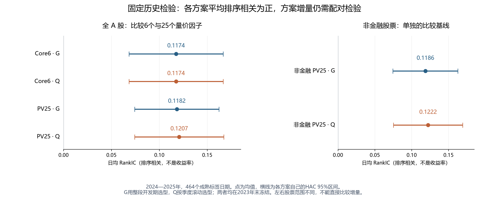

**读图：** 点越靠右，平均排序相关越高；横线是各方案自己的95%区间。左侧四行使用全A股范围，右侧两行使用非金融范围，所以分成两个面板。各条区间都位于零的右侧，支持各方案在这段历史里存在正的平均关联；区间是否重叠，均不能代替方案差值的配对检验。右侧结果在下一节解释。

## Core6组合：收益已能核对，风险来源仍有解释边界

Core6的20个连续账户及四份组合统计产物已完成：开发期、固定检验期各有G/Q两组，每组五种构建方式。四份原生统计共18张成员表已完整复读；每个账户的期末净值、累计收益、年化收益、年化波动率、Sharpe、最大回撤和平均现金比例，另从逐日净值独立复算，共140项核对通过。开发期每个账户覆盖1,212个交易区间，固定检验期覆盖483个区间。

下表的收益已经扣除账本费用，年化收益按252个交易区间折算。最大回撤写成正的损失幅度，例如39.86%表示从某个历史净值高点到随后低点损失约四成；Sharpe按零无风险收益计算。G开发期有事后选型成分，不能把它高于Q的数值直接解释成更好的可执行规则。

| 组合构建 | 开发期G年化收益 | 开发期Q年化收益 | 固定检验期年化收益 | 固定检验期最大回撤 | 固定检验期Sharpe |
|---|---:|---:|---:|---:|---:|
| 因子等权排名基线 | 21.72% | 21.72% | 28.94% | 34.49% | 0.91 |
| 冠军预测前20%等权 | 27.11% | 25.47% | 34.98% | 39.86% | 0.99 |
| 冠军预测前20%流通市值加权 | 13.41% | 15.70% | 29.38% | 22.69% | 1.03 |
| 冠军预测加行业与规模约束 | 7.96% | 7.70% | 20.03% | 17.37% | 0.85 |
| 冠军预测半步调仓 | 26.53% | 25.24% | 35.54% | 36.41% | 1.01 |

固定检验期的G和Q对每种构建方式产生完全相同的逐日账户序列，因此合并展示，不能算作两次独立验证。等权主组合这段期间累计收益为77.69%，但途中经历39.86%的最大回撤。中性约束降低了这段历史里的回撤，也降低了收益；半步调仓的年化收益略高，并不等于已经证明它具有稳定优势。G/Q开发期的五项配对比较均未通过预定BY 5%校正，固定检验期因差值恒为零而没有可用的HAC差值推断。两期CSCV过拟合概率也因候选收益序列重复而未定义，不能解读成“没有过拟合”。原生统计将这些组合推断标为探索性，尚未建立正式选择资格。

归因程序已结束，但“成功生成产物”和“成功解释收益来源”是两回事。行业、风格和残差收益三个分量在两期都没有已定义的账户区间；下表按每个分量分别计数，单位为“账户×交易区间”，三者不能相加，也不能把重复的G/Q当作独立证据。

| 无法拆分的原因 | 开发期账户区间数 | 固定检验期账户区间数 |
|---|---:|---:|
| 区间涉及公司行动调整 | 5,724 | 3,434 |
| 区间包含研究估值 | 6,340 | 972 |
| 持有期风险因子回归无法识别 | 56 | 294 |
| 持仓暴露不完整 | 0 | 130 |

这不抹去可计算的账户净值和费用，也不允许把未拆出的收益归为选股alpha。固定检验期等权主组合的研究估值持仓最高约占净值1.35%；这些估值及前述公司行动近似都是结果的解释条件。完整[账户绩效](assets/a-share-full-20261021/core6-portfolio-performance.csv)、[逐日净值与收益](assets/a-share-full-20261021/core6-portfolio-daily.csv)、[G/Q比较](assets/a-share-full-20261021/core6-portfolio-group-comparison.csv)、[稳健性状态](assets/a-share-full-20261021/core6-portfolio-robustness.csv)、[容量汇总](assets/a-share-full-20261021/core6-portfolio-capacity-summary.csv)和[归因覆盖](assets/a-share-full-20261021/core6-portfolio-attribution-coverage.csv)保留全部原生数值或逐项覆盖计数。本节没有重新逐笔重演全部20份原始账本，也未完成与其余16项研究的联合比较。

## 非金融 PV25 的基线结果

非金融 PV25 的 480 次季度拟合与预测、22 次 G/Q 选择、12 个最终模型及四组原生统计已经完成。它仍使用 25 个量价因子，尚未加入预期或财务因子；这里的作用是为同一非金融资格下的预期增量检验提供基线。G 最终选择 LightGBM，Q 最终选择 XGBoost。

| 选择规则 | 2019—2023 年日均 RankIC | 2024—2025 年日均 RankIC |
|---|---:|---:|
| G | 0.1255，仅描述 | 0.1186（0.0745，0.1627） |
| Q | 0.1227（0.0997，0.1458） | 0.1222（0.0752，0.1692） |

括号为按完整交易日时钟、Bartlett 滞后 20 复算的 HAC 95% 区间，两期分别有 1,193 和 464 个成熟标签日期。G 开发期仍因重复使用选择窗口而不作显著性推断。非金融资格改变了股票域，不能直接把本表与全 A 股 PV25 的均值差解释为增量收益或预测改善。完整[预测统计](assets/a-share-full-20261021/pv-nf25-prediction-diagnostics.csv)、[家族比较](assets/a-share-full-20261021/pv-nf25-model-comparison.csv)、[联合检验](assets/a-share-full-20261021/pv-nf25-model-reality-checks.csv)与[G/Q 配对结果](assets/a-share-full-20261021/pv-nf25-model-group-comparison.csv)保留原生状态。

24 份解释也已全部完成，另有 16,000 行季度系数。24,576 条“模型×抽样资产日”记录中，24,569 条贡献已定义；XGBoost 的开发期 3 行、固定检验期 4 行因加性抵消精度不足而未定义，其他 22 份解释没有这种未定义。完整[系数](assets/a-share-full-20261021/pv-nf25-coefficients.csv)、[贡献汇总](assets/a-share-full-20261021/pv-nf25-summary.csv)、[同组置换](assets/a-share-full-20261021/pv-nf25-permutation-summary.csv)和[原生重要性](assets/a-share-full-20261021/pv-nf25-native-importance.csv)可与后续同域预期模型对照；它们不替代尚未完成的配对增量检验和账户结果。

## PV25加路径特征：预测结果已完成，增量仍待检验

这个配置仍使用全A股样本，在PV25上增加三个20会话的路径描述，共28个经济因子：上涨日比例、最大单日绝对收益占全部绝对收益的比例，以及“1−收益之和的绝对值／绝对收益之和”。最后一项衡量涨跌之间的抵消程度；后两项分母为零时未定义。它们补充的是一段收益怎样形成：上涨是否经常发生、变化是否集中在一天、途中是否反复涨跌，不是再加入三个未来收益标签。

480次季度拟合与预测、22次选择和12个最终模型已通过原生契约、模型事实、选择账本及预测清单核对；492份预测均非空。四组原生统计的26张成员表已经复读，日均RankIC和有效HAC区间另用独立公式复算。组合账户仍在执行。

| 选择规则 | 2019—2023年日均RankIC | 2024—2025年日均RankIC |
|---|---:|---:|
| G | 0.1267，仅描述 | 0.1223（0.0760，0.1686） |
| Q | 0.1226（0.1001，0.1450） | 0.1223（0.0760，0.1686） |

两期分别覆盖全部1,193和464个成熟标签日期，括号为Bartlett滞后20的HAC 95%区间。G开发期仍因用同一段成绩选型而只作描述。G与Q在2023年末恰好选中了同一个XGBoost候选，因此固定检验期使用同一份预测，日序列和统计量完全相同；表中两行不能当成两份独立的成功证据。完整数值、状态和推断限制见[原生预测统计](assets/a-share-full-20261021/pv25-path-prediction-diagnostics.csv)。

与全A股PV25的Q结果相比，固定检验期均值由0.1207变为0.1223。这是两个结果的描述性比较，尚不能断言新增路径信息带来了稳定改善：预定的共同股票—日期配对比较及联合校正仍未齐备，模型解释和成本后的账户结果也不能由这两个均值代替。

24份原生解释现已完整复读，1,344组置换均值与标准差已按各自三次重复独立复算，17,920行季度系数汇总已按行数核对。24,576条抽样解释中，24,573条贡献已定义，XGBoost的开发期2条、固定检验期1条因加性抵消精度不足而未定义；这限制这些样本的贡献分解，不表示对应模型没有预测。完整[季度系数](assets/a-share-full-20261021/pv25-path-coefficients.csv)、[贡献汇总](assets/a-share-full-20261021/pv25-path-summary.csv)、[同组置换](assets/a-share-full-20261021/pv25-path-permutation-summary.csv)和[原生重要性](assets/a-share-full-20261021/pv25-path-native-importance.csv)保留实际模型与阶段，不能把某项解释较大直接当成路径因子的独立增量。

## PV52：有预测结果，但有效日期明显不足

PV52的480次季度拟合、22次选择、11个最终模型，以及四组模型统计和22份解释已经完成相应原生核对。491份季度或最终预测中，471份非空、20份为空；空预测全部来自2023年第三季度。这个计数说明产物的实际状态，不表示所有日期或股票都有有效预测。

**本节数值保留为修复前结果，暂不作为PV52研究的最终结论。** 后续检查复现了市场模型历史输入范围的代码问题：较晚的输出起点会漏掉预热期已退市成员的历史贡献，也可能截断长停牌期间累积的市场收益。修复后已完成[新旧因子的逐年全量比较](assets/a-share-full-20261021/market-model-history-comparison.csv)：变化最晚延续到2015年7月13日，2016—2025年数值与缺失状态逐值一致。因此2019年后的单因子统计和既有风险归因输入保留，但包含2014年历史的模型训练仍受影响。

共享开发集已在新路径重建，并完成8,911,144行、419列的新旧原生比较：仅这两个因子及其派生特征、标记的14列变化，其余405列逐值一致，标签和训练资格不变。按首轮2017年末训练截点核对，五项相关研究各有703,615个仅因子特征输入行、或703,621个同时带缺失标记的输入行发生变化，见[实际训练输入影响](assets/a-share-full-20261021/market-model-history-training-impact.csv)；表中`input_class=0`表示仅因子特征，`1`表示另带缺失标记。五项研究已接续新输入和独立产物路径，当前优先完成已接近结束、输入未变的PV25路径研究。

原有报告与产物保留。Core6、PV25及非金融、财务研究的模型输入不使用这两个因子。

| 选择规则 | 2019—2023年日均RankIC | 有效日／应有日 | 2024—2025年日均RankIC | 有效日／应有日 |
|---|---:|---:|---:|---:|
| G | 0.1171，仅描述 | 1,008／1,193 | 0.0641，仅描述 | 147／464 |
| Q | 0.1131，仅描述 | 1,008／1,193 | 0.0503，仅描述 | 147／464 |

G最终选择Huber，Q最终选择OLS。表中均值只描述能够计算相关性的日期；固定检验期缺少317日，不能与Core6或PV25覆盖464日的均值直接排高低。Q开发期与两种固定检验的HAC、区块自助区间均因`incomplete_session_clock`而未定义。G开发期还有事后选择问题，原生状态优先报告`selection_reuses_evaluation_window`。没有删去缺失日再拼成连续序列，也没有把缺预测当零预测。

2023年第三季度的64个交易日中，残差波动率因子整段不可用；这只是全部缺口的一部分。整段开发期和固定检验期的覆盖限制必须同时保留。原生[预测统计](assets/a-share-full-20261021/pv52-prediction-diagnostics.csv)、[家族比较](assets/a-share-full-20261021/pv52-model-comparison.csv)、[联合检验](assets/a-share-full-20261021/pv52-model-reality-checks.csv)及[G/Q比较](assets/a-share-full-20261021/pv52-model-group-comparison.csv)均保留状态与原因。22份解释和33,280行季度系数已经读取核对；解释成立的样本范围不能补回缺失的预测日期。

该季度缺失在原始完整窗口重放中得到确认：2023年前10个月的993,400条因子记录与原产物同键、同缺失，两个因子的最大数值差均为0。残差波动率要求最近60个交易日至少有45个有效残差；但三季度每天所有股票中的最高有效数也只有23—43个，64日全部达不到要求。未知报价及滞后市值权重缺失使部分市场收益无法计算，相应残差也缺失；9月市场收益恢复后，60日窗口的最高有效残差数仍只有26—36个。逐日状态见[市场模型窗口核对](assets/a-share-full-20261021/pv52-market-state-2023.csv)。这解释了既有产物的三季度缺口，不能据此推断其他年份缺口的原因，也不能以补零消除缺失。

## 非金融PV25加四项预期：已有模型结果，增量仍待配对检验

这个配置在25个量价因子上加入FY1、FY2预期盈利收益率、FY1预测分歧和对数机构覆盖，共29个经济因子；预期保鲜期固定为90日。480次季度拟合与预测、22次选择、13个最终模型、四组统计和26份解释已经完成原生核对。G最终选择LightGBM，Q最终选择XGBoost；下表仍是预测排序相关，不是账户收益。

| 选择规则 | 2019—2023年日均RankIC | 2024—2025年日均RankIC |
|---|---:|---:|
| G | 0.1275，仅描述 | 0.1200（0.0747，0.1653） |
| Q | 0.1205（0.0983，0.1428） | 0.1216（0.0744，0.1688） |

两期分别覆盖1,193和464个成熟标签日期，括号为Bartlett滞后20的HAC 95%区间；均值和三个有效区间已用独立公式复算。相对前文非金融PV25基线，固定检验的G均值从0.1186到0.1200，Q从0.1222到0.1216，方向并不一致。这些单独均值与区间都不能识别预期信息的增量，还需预定的共同股票—日期配对、联合校正及账户结果。

完整[预测统计](assets/a-share-full-20261021/pv-nf-expectations-prediction-diagnostics.csv)、[家族比较](assets/a-share-full-20261021/pv-nf-expectations-model-comparison.csv)、[联合检验](assets/a-share-full-20261021/pv-nf-expectations-model-reality-checks.csv)和[G/Q比较](assets/a-share-full-20261021/pv-nf-expectations-model-group-comparison.csv)可供复查。26份解释、18,560行季度系数已按实际模型核对；它们表明冻结模型怎样使用这些输入，不直接证明某个预期因子带来了收益。

## 把预期保鲜期延长到180日：固定检验均值略高，不能据此确定改善

这里仍在非金融PV25上加入同样四项预期信息，共29个经济因子；改变的是分析师报告从声明日起可保留的最长年龄，由90个自然日延长到180个自然日。预测目标仍为未来20个交易会话，**180日不是要预测的收益期限**。更长保鲜期可能保留更多较旧的信息，但“信息更容易取得”和“信息更准确”是两个问题。

480次季度拟合与预测、22次选择及13个最终模型已完成相应原生核验，493份预测均非空。四组模型统计的26张成员表已复读，四组均值和三个有效HAC区间已独立复算。G最终选择LightGBM，Q最终选择XGBoost。

| 选择规则 | 2019—2023年日均RankIC | 2024—2025年日均RankIC |
|---|---:|---:|
| G | 0.1257，仅描述 | 0.1211（0.0756，0.1665） |
| Q | 0.1168（0.0922，0.1414） | 0.1225（0.0753，0.1697） |

两期分别覆盖全部1,193和464个成熟标签日期，括号为Bartlett滞后20的HAC 95%区间；G开发期仍因重复使用选择窗口而只作描述。相对90日配置，固定检验均值在G下由0.1200变为0.1211，在Q下由0.1216变为0.1225；但Q开发期均值从0.1205降至0.1168。不能只挑固定检验的上升就确定180日更好，也不能把日均相关的变化解释为收益率增加。实际可用报告、模型输入和选择结果都可能随保鲜期变化，仍须按预定共同样本和配对统计检验差异，保留多重比较限制。完整状态与区间见[原生预测统计](assets/a-share-full-20261021/expectations-180d-prediction-diagnostics.csv)。

26份原生解释已完整复读，1,508组置换均值和标准差完成三次重复的独立复算，18,560行季度系数汇总已按行数核对。26,624条抽样解释中有17条因加性抵消精度不足而未定义，均来自两个XGBoost候选，其余26,607条贡献已定义；阅读[贡献汇总](assets/a-share-full-20261021/expectations-180d-summary.csv)时，应同时看其中的有效观察数和抽样总数。另附[季度系数](assets/a-share-full-20261021/expectations-180d-coefficients.csv)、[同组置换](assets/a-share-full-20261021/expectations-180d-permutation-summary.csv)及[原生重要性](assets/a-share-full-20261021/expectations-180d-native-importance.csv)。账户和预定跨方案联合检验尚未完成，本节不作净收益或显著增量结论。

## 模型究竟用了什么信息

### 线性模型：五个方向稳定，动量更依赖模型

这里的“反转”描述此前下跌较多、随后可能回升的排序关系；Amihud用价格变动与成交金额的比值描述非流动性，数值高通常意味着较小成交金额也伴随较大价格变化。OLS直接拟合这些输入的线性组合；Ridge惩罚过大的系数；Lasso还可能把部分系数压到零。下面比较的是它们实际学到了什么。

Core6 的 Q 选择下，OLS 在 20 个季度中始终给予短期反转和 Amihud 因子正系数，给予波动率、换手率和流通市值负系数。长期动量有 19 季为正、1 季为负；Ridge 则是 12 季为正、8 季为负。加入其他输入之后，动量的条件斜率比其余五项更不稳定。

下表直接读取 2023 年末冻结、用于 2024—2025 年的模型；Core6 的 G/Q 在这三个家族选中了相同参数。系数表示：其他模型输入不变时，该输入增加一个训练期标准差，预测的目标标准分数变化多少。它不是收益百分点，也不是把原始因子增加一个单位的效果。

| Core6 连续因子 | OLS | Ridge | Lasso |
|---|---:|---:|---:|
| 长期动量 | 0.01277 | 0.01072 | 0.01135 |
| 短期反转 | 0.02819 | 0.02574 | 0.02721 |
| 20日波动率 | −0.01740 | −0.01966 | −0.01622 |
| Amihud 非流动性 | 0.01576 | 0.01765 | 0.01474 |
| 20日换手率 | −0.05119 | −0.04368 | −0.05120 |
| 对数流通市值 | −0.03455 | −0.03141 | −0.03353 |

以OLS换手率系数−0.05119为例：在模型公式里，其他输入固定，换手率这一处理后输入增加一个训练期标准差，预测的目标标准分数下降约0.05119。因为预测目标也经过标准化，这不是收益下降5.119个百分点。系数为负说明该冻结模型怎样使用这个坐标，不能直接推出降低公司的真实换手率会提高未来收益。

正则化会重新分配相关输入的作用，不能理解为“每一个系数都按同一比例缩小”。例如，Core6 的 Ridge 换手率系数绝对值低于 OLS，但波动率和 Amihud 的绝对值反而略大。表中是各家族按预定规则选择后的结果，没有单独控制正则化强度。

Lasso 的稀疏性更直接。Q 选择的 20 个季度中，Core6 的 120 个连续因子系数有 15 个恰为零，PV25 的 500 个有 327 个恰为零。这些是“因子×季度”计数，不是被永久删除的因子数。到了最终冻结模型，PV25 的 G 选择将 25 个连续因子中的 16 个压为零，Q 选择只压掉 4 个；非金融 PV25 也是 16 个与 4 个。选择规则影响了模型保留多少信息，零系数并不证明该因子在其他模型或时期没有用。

**现有训练模型没有输出系数标准误、t 值或 p 值，因此这里不宣称任何 OLS、Ridge、Lasso 训练系数“显著”。** 季度间符号稳定只是描述；这些季度共享大量训练数据，不能把它们当作独立重复试验。Ridge/Lasso 的非零系数也不能按普通 OLS 的 t 检验解释。下文 Fama–MacBeth 的区间来自每日截面回归，检验的是另一组系数，不能移到本表。

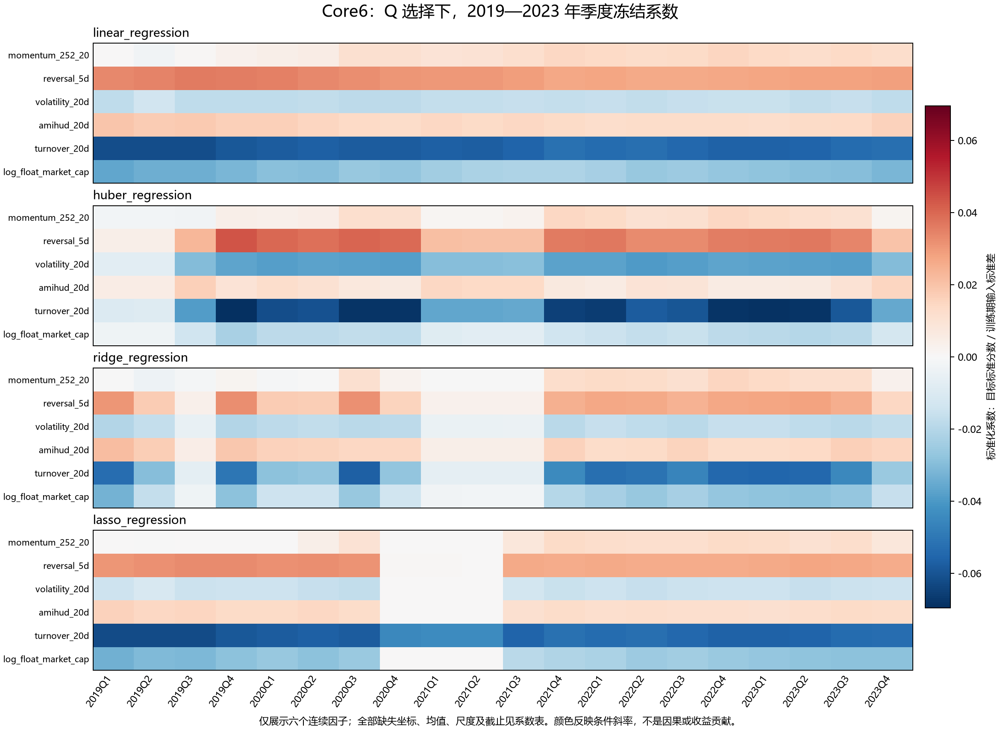

图中展示六个连续因子。完整[Core6 系数](assets/a-share-full-20261021/core6-coefficients.csv)和[PV25 系数](assets/a-share-full-20261021/pv25-coefficients.csv)保留 G/Q 的全部坐标；新增[季度系数汇总](assets/a-share-full-20261021/model-quarterly-coefficient-summary.csv)与[最终冻结系数](assets/a-share-full-20261021/model-final-coefficients.csv)同时覆盖 Core6、PV25 和非金融 PV25。缺失标记、训练均值、尺度与截距均保留，标准误和 p 值明确标为未计算。缺失标记之间可能携带相同信息，不宜逐个解释其“独立作用”。

### 树模型：先分交易活跃度，再组合规模、风险与反转

一棵回归树可以看作连续几道“是否超过某个阈值”的判断，走到最后一个叶子，就读出预测分数。这里的换手波动是过去20个交易日换手率的波动程度；流通市值描述规模，成交额描述交易活跃程度。图中的负值或小数来自处理后的输入坐标，不表示市值或成交额为负。

PV25 的普通决策树先按换手波动是否不超过 0.1634 分成两组：较低的一组再看对数流通市值是否不超过 −0.5331，较高的一组再看对数成交额是否不超过 1.5741。这里的阈值作用于完成中性化和截面标准化后的因子，不是原始换手率、市值金额或成交金额。

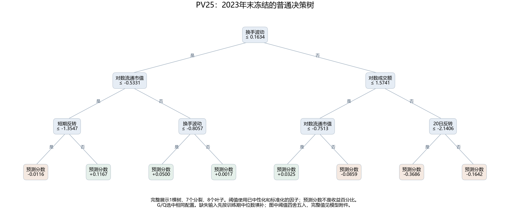

图中完整展示了 7 次分裂和 8 个叶子，叶子数值是预测分数。比如，低换手波动、较小规模这一支，还会继续根据短期反转分组；同一个因子怎样影响预测取决于此前走过哪些分支。完整精度及训练样本计数见[示例树参数](assets/a-share-full-20261021/pv25-frozen-decision-tree.json)。

普通决策树只有一棵；另外两个家族各有 400 棵，最终预测由整套树共同决定。下表统计所有分裂，完整附件覆盖三个已完成配置。

| PV25 最终模型 | 树数 | 分裂节点数 | 实际最大深度 | 分裂较多的连续特征 |
|---|---:|---:|---:|---|
| 普通决策树 | 1 | 7 | 3 | 换手波动、流通市值各2次，其余三个特征各1次 |
| XGBoost | 400 | 2,602 | 3 | 流通市值236次、60日回撤216次；20日反转与60日波动率各152次，并列第三 |
| LightGBM | 400 | 12,000 | 20 | 流通市值1,052次、60日回撤862次、长期动量740次 |

Core6 的普通决策树首先看换手率，PV25 与非金融 PV25 首先看换手波动。三个配置的 XGBoost 实际最大深度均为 3；LightGBM 分别为 17、20、17。LightGBM 更深、分裂更多，不能据此认定预测更好；分裂次数也没有方向和收益单位。根节点只是树的第一步，PV25 两个提升树家族的第1棵树都先看换手波动，但后续树的根节点并不固定。

这些结论来自保存模型的全部树结构。每个树模型另用 6 或 7 组构造输入，覆盖首棵树根阈值的两侧与等号，提升树还检查了缺失输入；沿所有树得到的 16,818 个叶子结果与模型原生接口一致。这核对的是分支读法，没有穷举每个节点的阈值，也不是新增的样本外绩效测试。附件保留[树结构汇总](assets/a-share-full-20261021/model-tree-summary.csv)、[全部特征的分裂次数](assets/a-share-full-20261021/model-tree-split-features.csv)和[各棵树的根节点](assets/a-share-full-20261021/model-tree-roots.csv)。

### 排名、SHAP 与置换：依赖什么，不等于靠什么赚钱

三种解释各回答一个问题。排名权重说明模型把多大权重放在某项排序上；SHAP等贡献分解说明一条预测由哪些输入共同形成；置换则保持模型不变，把某组输入在股票间打乱，观察排序能力损失多少。它们可以互相印证，也可能因输入相关、参考背景或模型结构不同而给出不同排序。

Core6 的 IC 加权排名模型给换手率、波动率和 Amihud 的绝对权重分别约为 29.70%、25.78% 和 19.13%，三项合计约 74.61%。它给长期动量负权重，而最终 OLS 给动量正系数：排名模型按单项关联定方向，OLS 则在控制其他输入后拟合条件关系，两者回答的问题不同。完整[排名方向、权重与校准参数](assets/a-share-full-20261021/model-rank-weights.csv)保留三个配置的全部输入。

固定检验期的解释抽取 24 个日期、1,024 个资产日，实际抽中日期位于 2024 年第二季度至 2025 年第四季度。PV25 的 G/Q 冻结赢家分别有 1,024 和 1,021 行有效贡献；Q 赢家另外 3 行因加性抵消精度不足而保留未定义。Core6 的 XGBoost 也有 2 行同类未定义，有效贡献为 1,022 行。贡献汇总先在同日内平均，再对日期等权。用于置换评分的成熟标签为 1,020 行，其有效条件与贡献精度分别判断。

以下图中绝对贡献份额把同一因子的连续特征和显式缺失特征相加，衡量冻结模型输出对这些输入坐标的依赖；它既不是带符号的收益归因，也不是因子获利占比。

PV25 的 G/Q 冻结赢家中，流通市值的绝对贡献份额分别为 14.95% 和 15.86%，换手波动分别为 13.77% 和 12.83%。置换回答另一个问题：打乱某组输入后，排序能力损失多少。G 赢家中，打乱 60 日波动率、流通市值、60 日回撤的平均 RankIC 损失分别为 0.0368、0.0336、0.0230；Q 赢家对应最靠前的是流通市值 0.0337、60 日回撤 0.0267、60 日波动率 0.0234。贡献份额与置换排名并不完全相同，相关输入之间的替代也是解释边界之一。

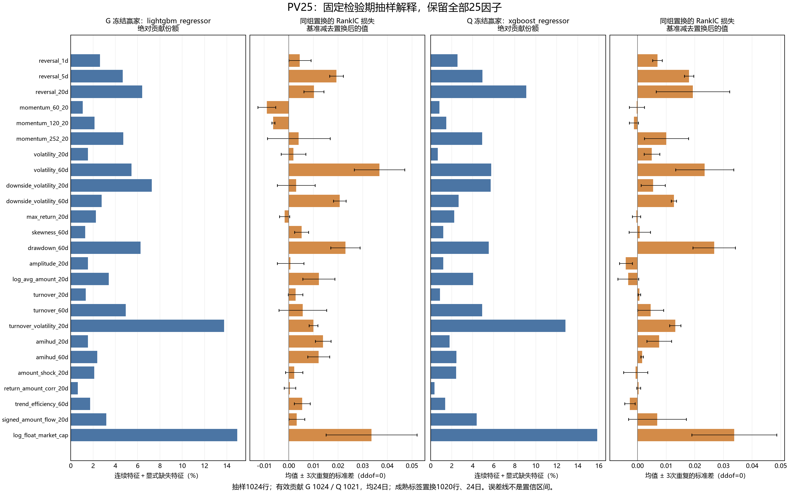

图中保留全部 25 个因子，负的置换损失表示这次打乱后评分反而上升。三次重复只描述本次随机置换的波动，误差线不是置信区间，不能据此划分“显著有效”或删除因子。完整[Core6 贡献](assets/a-share-full-20261021/core6-summary.csv)、[Core6 置换](assets/a-share-full-20261021/core6-permutation-summary.csv)、[PV25 贡献](assets/a-share-full-20261021/pv25-summary.csv)与[PV25 置换](assets/a-share-full-20261021/pv25-permutation-summary.csv)同时保留开发期描述及全部已选择家族；[Core6 原生重要性](assets/a-share-full-20261021/core6-native-importance.csv)和[PV25 原生重要性](assets/a-share-full-20261021/pv25-native-importance.csv)保留各算法自己的单位，不跨算法直接比较数值大小。扩展因子与消融仍在运行，模型解释的方向尚需与其增量及账户收益对照。

### 已读取的解释产物

Core6 的 20 份、PV25 的 24 份解释产物均已通过原生完整读取，季度系数分别导出 3,840 行与 16,000 行。系数表保留连续因子、显式缺失标记、模型插补标记、训练均值和尺度，不能把这些行数当作独立经济因子数。按“模型×抽样资产日”计，共 45,056 条解释记录，其中 45,047 条贡献已定义，9 条因加性抵消精度不足而未定义；该计数不是不重复的资产日数。

## 量价因子：反转较稳定，换手波动多为负相关

这一节先不使用多输入模型，而是逐个问：今天某个因子的排名，和之后收益的排名有没有关系？“1、5、10、20、60、120会话”按市场交易日历计，20会话约对应一个月。正相关表示该因子较高的股票后来收益通常也较高；负相关表示顺序相反，不能直接称为因子没有价值。

短期反转在固定检验期的 20、120 会话 RankIC 均为正，并通过所在家族的校正；长期动量六个期限均未通过。换手波动在 20、120 会话多为较强的负排序关联。下面完整列出各期限，避免只展示有利的结果。

全 A 股开发期六个收益期限的自身样本评价与整窗统计已完成。下表展示 55 个处理后因子；每个期限的 BY 校正实际覆盖原始、中性化前和中性化后三组共 165 个信号，未定义项仍计入家族。六个期限分别校正，尚未做六期限联合校正，因此这里属于预先列明期限的逐组结果，不能据此任挑最显著期限宣称整体发现。

| 收益期限（交易会话） | 最后可用信号日期 | 输入交易日数 | 55 个处理后因子中可推断 / BY 5%通过 |
|---|---|---:|---:|
| 1 | 2023-12-27 | 1,212 | 54 / 45 |
| 5 | 2023-12-21 | 1,208 | 54 / 44 |
| 10 | 2023-12-14 | 1,203 | 54 / 42 |
| 20 | 2023-11-30 | 1,193 | 54 / 43 |
| 60 | 2023-09-27 | 1,153 | 54 / 40 |
| 120 | 2023-07-05 | 1,093 | 54 / 34 |

图中英文与常用中文名称先对应如下，后面的系数、贡献和分层图沿用同一名称。`feature_`前缀表示处理后的输入，`missing_`表示是否缺失的指示变量，不是新增经济因子。

| 图中字段 | 中文读法 |
|---|---|
| `reversal_5d`、`momentum_252_20` | 5会话反转、剔除最近20会话的长期动量 |
| `volatility_20d`、`volatility_60d` | 20、60会话收益波动率 |
| `amihud_20d` | 20会话非流动性代理 |
| `turnover_20d`、`turnover_volatility_20d` | 20会话平均换手率、换手率波动 |
| `log_float_market_cap`、`log_avg_amount_20d` | 对数流通市值、对数20会话平均成交额 |
| `drawdown_60d` | 60会话价格路径的最大回撤 |

**先读一个格子：** 在下方2024—2025年固定历史检验图中，5会话反转与未来20会话收益的RankIC约0.0486，表示排名总体同向；不是4.86%的收益率。星号表示通过该期限声明的多重比较校正，没有星号表示证据不足，不等于已证明没有作用。两期热图各自使用色标，跨图比较应看数字。

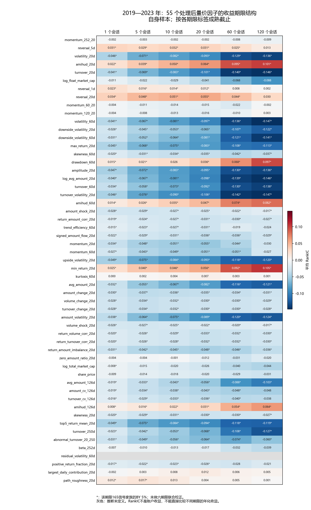

各期限保留完整因子顺序。`residual_volatility_60d` 因交易日覆盖不连续而推断未定义，灰色不能解释为零。1,980 行[完整聚合统计](assets/a-share-full-20261021/factor-all-development-own-rankic.csv)保留三组信号、六期限及 BY/BH 两种校正结果。

短期反转 `reversal_5d` 的平均 RankIC 在 20 会话为 0.0313，在 120 会话为 0.0135，后者未通过该组 BY 校正；长期动量 `momentum_252_20` 在六期限均未通过。换手波动的平均 RankIC 则从 1 会话的 −0.0463 变为 20 会话的 −0.1059 和 120 会话的 −0.1471。这些是截面排序关联，不是收益率；长短期限的标签、成熟截止与重叠程度不同，绝对 RankIC 较大不能直接解释为更好的年化策略。

2024—2025 年的同一组固定检验也已完成，未根据开发期显著性删减因子或期限。该期 `beta_252d` 和 `residual_volatility_60d` 均存在内部交易日缺口，53 个处理后因子可完成推断；两个未定义因子仍保留在每期限 165 信号的校正家族中。

| 收益期限（交易会话） | 最后可用信号日期 | 输入交易日数 | 55 个处理后因子中可推断 / BY 5%通过 |
|---|---|---:|---:|
| 1 | 2025-12-29 | 483 | 53 / 38 |
| 5 | 2025-12-23 | 479 | 53 / 36 |
| 10 | 2025-12-16 | 474 | 53 / 35 |
| 20 | 2025-12-02 | 464 | 53 / 29 |
| 60 | 2025-09-29 | 424 | 53 / 31 |
| 120 | 2025-07-07 | 364 | 53 / 25 |

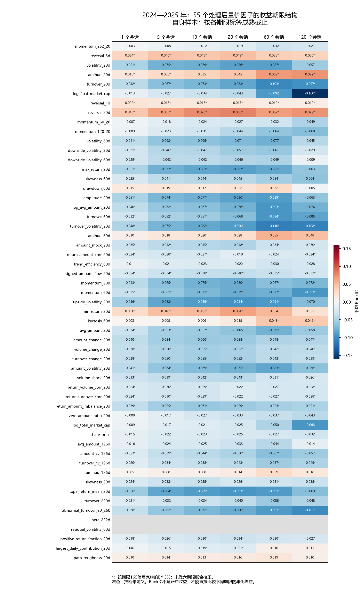

固定检验期 `reversal_5d` 在 20、120 会话的平均 RankIC 分别为 0.0486、0.0356，两项均通过所在期限的 BY 校正；`momentum_252_20` 六期限仍均未通过。换手波动在 20、120 会话分别为 −0.0900、−0.1079，也均通过所在期限的校正。这些例子与开发期展示的是同一批因子，完整结果见 1,980 行[固定检验期聚合表](assets/a-share-full-20261021/factor-all-holdout-own-rankic.csv)。两期样本长度不同，显著因子数量下降本身不证明经济效应减弱；两图各自使用色标，应比较标注值。

共同样本暴露出另一项限制：要求 55 个因子同时可用，或只要求 PV52 同时可用时，两期、六期限的 HAC 推断均因交易日时钟不完整而未定义。例如 20 会话共同样本在开发期只有 1,002—1,008 个有效相关系数日期（应有 1,193 日），固定检验期只有 137—147 日（应有 464 日）；范围来自不同信号组和因子的截面可计算性。保留描述均值，但不能删去空日后把剩余日期拼成连续序列做显著性检验，也不能从自身样本的两个 RankIC 直接推断同域优劣。全部结果分别保存为全55因子[开发期](assets/a-share-full-20261021/factor-all-development-common-rankic.csv)、[固定检验期](assets/a-share-full-20261021/factor-all-holdout-common-rankic.csv)，以及PV52[开发期](assets/a-share-full-20261021/factor-all-development-common-pv52-rankic.csv)、[固定检验期](assets/a-share-full-20261021/factor-all-holdout-common-pv52-rankic.csv)。这一限制不使各自满足条件的模型、因子或账户结果失效；模型增量与交易账户仍需继续完成，当前不据这些图表重选期限。

## 隔夜与日内：许多关联主要出现在隔夜成分

同样一段开盘到开盘的持有收益，可以继续分为开盘到收盘的日内部分，以及持有期间收盘到下一开盘的隔夜部分。这样可以问：信号与收益的关联主要出现在什么时候？这里不把实际买入之前的隔夜变化算进持有收益。

时间顺序是：**t日收盘形成信号 → 入场前隔夜 → t+1日开盘买入 → 持有期日内与隔夜 → 约定开盘退出**。下面的“入场前隔夜”发生在买入之前，其余三项才描述声明持有区间。

全 A 股处理后因子与持有期隔夜收益的关联，比与日内收益的关联更普遍；换手波动就是一个例子。这个分解提示应继续查验持仓跨夜的作用，但还不能据此计算利润贡献或确定经济机制。

四个样本域、两期共八组原生分解与评价均已完成。以下先报告全 A 股结果：共同具备日内、隔夜和端点收益的合格资产日分别为 4,554,251 和 2,247,163。逐行核验 `expm1(日内对数收益 + 持有期隔夜对数收益) = 端点简单收益`，最大绝对残差分别低于 `1.34e-15` 和 `5.33e-15`。入场前隔夜单列，不计入这条持有期恒等式。

下表仅统计 55 个处理后量价因子的 RankIC。每个成分、每期的多重比较校正仍包含全部 165 个原始、中性化前和中性化后信号，未因报告只展示其中一组而缩小校正范围。日内、隔夜和端点各自按可用时间截断，因此其有效日期及样本不同。

| 成分 | 2019—2023 年可推断 / BY 5%通过 | 2024—2025 年可推断 / BY 5%通过 |
|---|---:|---:|
| 入场前隔夜 | 54 / 46 | 53 / 48 |
| 持有期日内 | 54 / 0 | 53 / 2 |
| 持有期隔夜 | 54 / 46 | 53 / 49 |
| 端点简单收益 | 54 / 43 | 53 / 29 |

换手波动 `turnover_volatility_20d` 是一个具体例子：两期处理后因子与持有期隔夜收益的平均 RankIC 为 −0.1918 和 −0.2426，均通过上述 BY 校正；与持有期日内收益的平均 RankIC 为 0.0034 和 0.0467，均未通过。对应端点收益的 RankIC 为 −0.1059 和 −0.0900。这提示该因子的相关性在隔夜成分上更明显，但不识别成因，也不能推出可交易利润。RankIC 之间不可相加，不能按其大小计算“收益贡献百分比”。

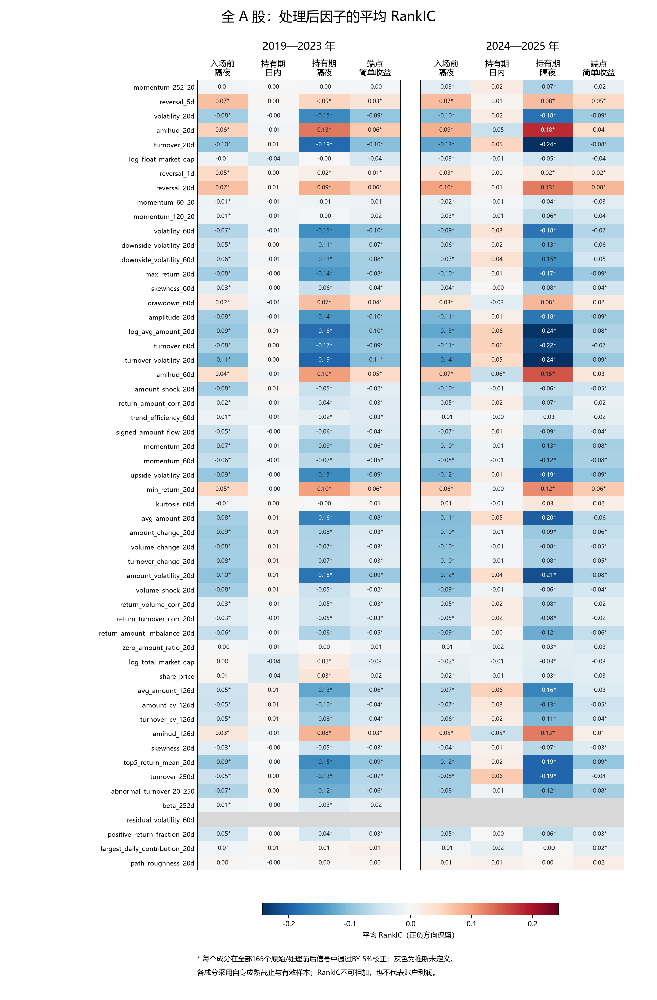

图中保留完整 55 因子顺序；灰色表示交易日时钟存在缺口而推断未定义，并非效应为零。全部三组信号的 IC、RankIC、有效日期数、HAC 区间和 BY 结果见[聚合统计表](assets/a-share-full-20261021/onid-all-inference.csv)。本节结果仍需与未完成的冻结模型、置换、消融及连续账户结果对照。

八组共 8,016 项成分 IC／RankIC 推断，其中 5,640 项已定义、2,376 项未定义。财务域两期各 1,152 项全部因会话覆盖不连续而未定义；即使固定检验期有 1,865,423 个分解合格资产日，也不能由总量推断完整会话覆盖已经恢复。

## 预期因子：20会话主检验未通过，其他期限有局部结果

“保鲜期90日或180日”限制可以使用多旧的分析师预测；它与预测未来1至120个交易会话是两个不同的时间设置。延长保鲜期会保留更多旧信息，也可能改变哪些股票满足条件，因此需要把期限差异与样本差异分开。

七个处理后预期变量在 20 会话主期限下都未通过各自完整检验家族的 BY 5% 校正。这个结果只说明当前单因子证据不足，尚不能判断它们是否有助于非线性模型。

非金融样本的90日、180日保鲜期因子统计均已完成。保鲜期是纳入机构预测的年龄上限，与未来收益标签的1—120个会话期限不同。这里完整展示事前列出的七个处理后变量：FY1/FY2预期盈利收益率（FY1是最早尚未结束且可见的目标财年，FY2是紧邻的下一财年）、FY1预测分歧、对数机构覆盖，以及价格缩放分歧、预测中位年龄、新更新机构占比三个机制变量，没有按显著性选择展示项。

每个保鲜期、阶段、收益期限分别对32个因子的原始、中性化前和中性化后三组共96个信号作BY校正。下图共用色标；星号只对应这24个家族各自的校正结果，尚未对全部保鲜期、阶段和期限联合校正。

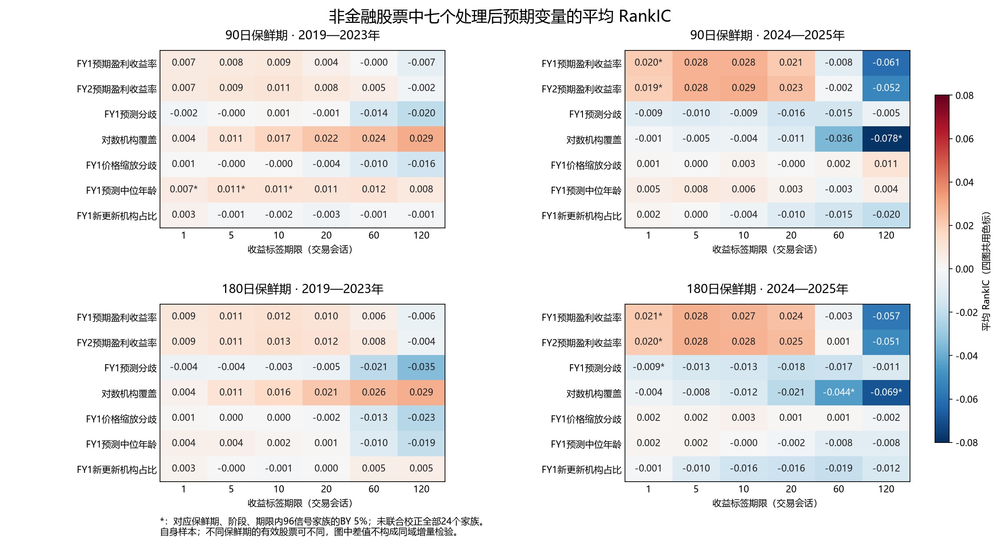

在主检验的20会话期限，七个处理后预期变量在两期、两种保鲜期的28项自身样本结果均未通过所在96信号家族的BY 5%检验。开发期和固定检验期分别保留1,193和464个完整日期；要求这96个信号共同可用的对应结果也没有通过。这说明当前单因子检验没有为这些变量的20会话排序关联提供经过该组校正确认的证据，不能据此断言变量对非线性模型没有增量。

其他期限的结果并非全部如此。90日保鲜期下，开发期的预测中位年龄在1、5、10会话通过所在家族的校正；固定检验期的两项预期盈利收益率在1会话通过。对数机构覆盖在固定检验期120会话的平均RankIC为−0.0783（90日）和−0.0691（180日），均通过各自家族的校正；图中也保留了其他通过项与全部未通过项。年龄、覆盖的关联不识别信息更新的因果效应，跨期限观察也不能替代预先固定的20会话模型和真实成本账户。

延长保鲜期会改变可使用的预测及有效股票，两个图中均值的差不能直接解释为同域预测改善。完整[90日结果](assets/a-share-full-20261021/factor-nonfinancial-90-rankic.csv)和[180日结果](assets/a-share-full-20261021/factor-nonfinancial-180-rankic.csv)各保留4,608行，覆盖两期、自身/共同样本、六期限、全部96信号及BY/BH两种校正。所需的模型配对增量和账户比较仍在执行。

## 报告事件：主检验没有确认公告后的收益差

事件分析把分析师或研究机构的盈利预测报告公布日作为起点，为收到报告的公司寻找可比较的非事件股票，再比较前后收益。它研究的是公告附近的差异，不是直接用报告内容训练预测模型；对照匹配也不能自动排除所有未观察到的差异。

“全部报告”事件的 20 会话收益差在两期均未通过校正；换一种事件加权方法，开发期均值甚至会改变方向。公告前的隔夜差异与公告后的可交易收益需要分开。

重新生成的市场面板有 13,109,841 行，覆盖 2011 年 1 月 4 日至 2025 年 12 月 31 日。全 A 股研究表的开发期为 8,911,144 行，固定检验期为 2,487,799 行。这些是保存的资产日期行数，不能直接当作每个因子、模型或收益标签的有效样本量。

报告事件按报告身份去重，保留同值新报告；只有数值变化尚不能证明每股口径可比的经济修订。报告按声明后的首个交易日可见。匹配使用声明前一交易日的行业、规模和成交额，并从对照候选中排除同一可见日的全部报告公司。伪事件日固定前移 40 个交易会话，无匹配或不满足标签条件的事件保留未定义。

| 事件样本 | 公司报告日事件单位 | 找到匹配对照 | 无有效前期匹配上下文 | 同层无非事件对照 |
|---|---:|---:|---:|---:|
| 2014—2023 年 | 306,423 | 260,052 | 44,201 | 2,170 |
| 2024—2025 年 | 59,305 | 54,144 | 4,926 | 235 |

开发期主要推断从 2019 年开始。20 会话成熟标签对应的最后可用信号日期分别为 2023 年 11 月 30 日和 2025 年 12 月 2 日，标签是否成熟分别按两期年底判断。事件类别可以重叠：一个公司报告日可能同时收到不同机构的同值与变值报告，不能把类别数加总为互斥事件总数。事件标签差、伪日差及二者之差均不是可直接交易的自融资账户收益。

对“全部报告”类别，先在同一日期内按公司平均，再对日期等权，得到下列主检验。单位为收益差的百分点；括号为 HAC 95% 区间。BY 在每期五种类别、四种对照、两种依赖处理共 40 项预定检验中统一校正。

| 检验 | 2019—2023 年 | 2024—2025 年 |
|---|---:|---:|
| 事件日的20会话收益标签差 | 0.1956（−0.1275，0.5187），BY p=1 | −0.2177（−0.7289，0.2935），BY p=1 |
| 事件差减去伪日差 | −0.0710（−0.5418，0.3999），BY p=1 | 描述均值 −0.6847；仅424/464日有值，推断未定义 |

开发期入场前隔夜的平均对数收益差为 0.000348，校正后 p 约为 0.000009；固定检验期为 0.000031，校正后 p=1。这一差异发生在声明的入场之前，不能作为本轮组合已经赚到的收益。

另按事件配对等权、允许事件公司或对照公司重复及同日期依赖进行敏感性检验。开发期“事件差减去伪日差”的均值为 0.4096 个百分点，方向与按日等权主检验不同；这种差异说明聚合权重会影响结论，不能只选显著的口径。完整结果见[按日等权检验](assets/a-share-full-20261021/event-daily-inference.csv)和[公司复用敏感性检验](assets/a-share-full-20261021/event-company-sensitivity.csv)。

公告前后分层以原始财报首次可见会话为中心，保留前20会话、同会话、后20会话、窗外及无合格公告五类，仅作描述。机构覆盖方面，2024 年观察到的 20,117 个公司—机构配对中，10,926 个在2025年再次出现，9,191 个未再次出现；后者不能解释为机构退出经营。2025 年是样本右端，不判断其下一年留存。退市分层使用“截至本阶段末观察到退市”的事后分类，也不能当作当时已知的筛选条件。

## 财务信息：先受数据覆盖限制，暂不能判断模型增量

财务研究目前最主要的问题是开发期验证不足。大样本的来源行数、早期可拟合数据和后期描述结果，都不能代替 2019—2023 年的有效验证。

财务来源虽然包含大量标记为原始与修订版本的记录，但多数对应项目只有一侧有数值。当前可比的数值变更集中在一家公司的记录，无法据此估计全市场的版本修订偏差。2018—2022 年的原始财务值覆盖存在明显缺口；逐因子、逐年以及实际持仓的覆盖必须分别核验，不能用来源总行数证明财务信息充分。

原生研究表的覆盖检查进一步显示：财务资格在 2019 年仅留下 90 个资产日，且全部来自同一家公司，`model_target` 有效数为零；2020—2023 年合格资产日为零。因此，三个财务资格配置均无法完成预定的 G-final 和 Q-final 模型选择。2014—2017 年训练数据仍可用于合法拟合，2024—2025 年的 812,566 和 1,158,956 个合格资产日仍可用于独立因子描述，但这两点都不能代替缺失的开发期验证。

2018 年验证预热期仍有两个公司、20 个具备有限目标的截面，因此不能据此删除所有早期 Q 选择与系数分析。这部分若产生结果，仅代表极窄的验证支持，不能当作广泛的财务增量证据。原定候选矩阵继续保留，最终无赢家与真实训练失败分别记录。

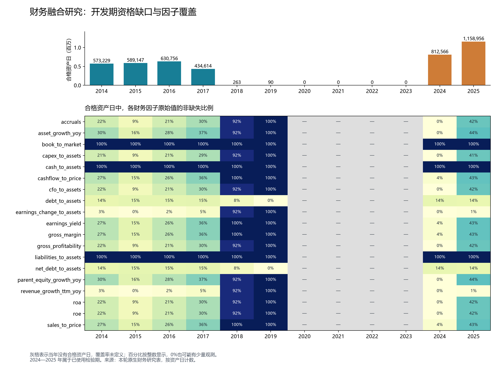

图中分母是当年的财务合格资产日；灰色表示分母为零，不能解释为因子值为零。完整年度、市场与资格内覆盖计数见[聚合数据](assets/a-share-full-20261021/financial-factor-coverage.csv)。

### 财务因子的可用日期

财务域两期、两种样本和六个收益期限的24份整窗统计已完成，48个经济因子的原始、中性化前和中性化后三组共144个信号完整保留。全部3,456个“统计窗口—信号”组合均因交易日覆盖不完整而无法推断；[完整聚合表](assets/a-share-full-20261021/factor-financial-rankic.csv)按BY／BH各保留一行，共6,912行，p值和区间仍为空，没有将未定义项算作不显著或零效应。

开发期最后一个仍有合格成熟收益标签的日期为2019年5月20日。即使只统计年初到该日的90个交易日，也没有一个信号能形成有效的日截面RankIC；这不是把2019—2023年的数据压成90天后得到的显著性检验。固定检验期20会话标签的完整时钟为464日，自身样本中的处理后因子只有24—416个有效日期。下面完整列出19个财务因子的描述均值，均值只来自各自实际可计算日期；行间样本不同，不能按数值大小排名选因子。

| 处理后财务因子 | 有效日期数／464 | 描述性平均 RankIC |
|---|---:|---:|
| 盈利收益率 | 206 | 0.0264 |
| 账面市值比 | 416 | 0.0494 |
| 销售收入市值比 | 206 | 0.0268 |
| 经营现金流市值比 | 206 | 0.0338 |
| 净资产收益率 | 168 | -0.0059 |
| 资产收益率 | 168 | -0.0062 |
| 毛利资产比 | 168 | -0.0217 |
| 毛利率 | 206 | -0.0018 |
| 经营现金流资产比 | 168 | 0.0032 |
| 应计项 | 168 | -0.0152 |
| 总资产同比增长 | 168 | 0.0043 |
| 营业收入同比增长 | 24 | 0.0310 |
| 归母净利润变化／平均资产 | 24 | -0.0383 |
| 归母权益同比增长 | 168 | 0.0064 |
| 资本开支资产比 | 168 | 0.0030 |
| 总负债资产比 | 416 | 0.0007 |
| 有息债务资产比 | 406 | 0.0036 |
| 现金资产比 | 416 | 0.0007 |
| 净债务资产比 | 406 | 0.0052 |

同一20会话检验若要求全部144个信号同时可用，所有信号仅余24个有效相关系数日期。共同样本仅重做观察掩码，不重新拟合因子变换；其描述均值见同一附件。自身样本与共同样本都保留完整时钟中的缺口，没有把零散日期拼接后计算HAC。这些描述结果不能弥补开发期验证缺失，也不能证明财务信息具有模型增量或交易收益。

现有股本变更来源未提供足以证明分析师 EPS 跨期每股口径可比的数量字段。因此，同机构固定财年和滚动 FY1 的经济修订研究仍受该条件限制；报告事件、预测年龄和合法预期因子的计算继续进行。

CSI500/1000 的历史成分权重覆盖不足，原生基准权重准备已明确失败。正式指数增强保持受阻，不以近似等权指数替代。普通组合的收益与风险分析独立执行。

## 主期限下的分层关联

20会话标签另按行业、规模、成交额及非金融样本的预测年龄分层。规模使用当日总市值，成交额使用当日`amount`，各分三组；组1为低、组3为高。先在当日合格且主标签已成熟的焦点总体中计算平均秩，再确定组别，同值并列可使组内数量不相等。共同样本筛选不重新切分组别。这里的总市值分层与本研究使用对数流通市值的因子中性化各按原声明执行。

分层表的BY校正把三组信号、全部已记录分层、全样本行以及IC／RankIC一起纳入，每个研究域和阶段分别校正；未定义项仍保留在家族中。全A股开发期为8,910项、固定检验期为15,180项。它不是只对图中的Core6或某三个组校正，分层表中的全样本行也不能直接沿用前述165信号家族的校正p值。

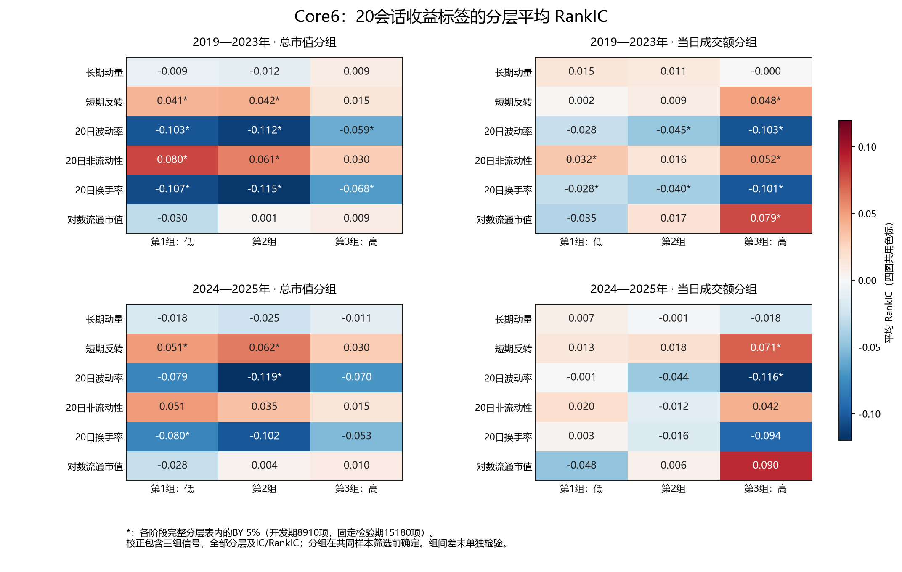

两期短期反转在三个规模组中的均值均为正，在低、中规模组通过所在完整分层家族的BY 5%；高规模组未通过。按成交额分组时，两期均只有高成交额组通过。波动率、换手率的均值大多为负，但是否通过校正随组别和阶段而变。这些是各组内的截面排序关联，没有单独检验组间差值，不能据此声称某一组显著优于另一组，也不能将成交额组直接当作可执行容量结论。

行业键包含分类标准和一级行业代码。固定检验期的全A股及两种非金融保鲜期中，`CAPCO`出现在2024-02-19至2025-12-02的436个日期，`CSRC2012`出现在2024-01-02至2025-04-18的235个日期，范围重叠，不能解释为一次整齐的分类切换。这些处理后行业层均因整窗日期缺口而未定义。同一个字母在不同标准下仍保留为两个键，没有未经映射论证把它们拼成一条连续行业序列。其他满足自身完整时钟条件的规模或成交额结果照常保留。

年龄分层使用原始预测中位年龄，预设区间为0—7、8—30、31—60、61—90日，180日规格另含91—180日。中位数可以是半日；例如7.5、30.5和60.5日是合法年龄，却不属于这些区间，按原规则仅从年龄分层排除，其他分层不因此删除。下表分母为合格且20会话主标签已成熟的资产日；年龄缺失与合法但未归组分别计数，两种保鲜期的非法年龄计数均为0。

| 保鲜期与阶段 | 合格且成熟资产日 | 年龄缺失 | 合法但未归组 |
|---|---:|---:|---:|
| 90日，2019—2023年 | 4,364,310 | 3,332,441 | 5,933 |
| 90日，2024—2025年 | 2,177,695 | 1,824,188 | 2,332 |
| 180日，2019—2023年 | 4,364,310 | 2,979,221 | 6,910 |
| 180日，2024—2025年 | 2,177,695 | 1,682,342 | 2,579 |

[完整处理后分层表](assets/a-share-full-20261021/factor-20d-processed-strata.csv)共21,022行，覆盖四个研究域的两期自身样本、IC／RankIC、全部处理后变量及其实际分层，并保留原完整家族大小。原始与中性化前信号参与原生校正，但不重复放入这个处理后附件。财务域的整窗分层仍全部未定义；这与下文2025年度部分因子可以推断不矛盾。不同分层的观察总体和统计家族不同，均不用于事后更换主期限、保鲜期或模型。

## 主期限的年度变化

主期限20会话另按自然年保留结果。开发期2019—2023年与固定检验期2024—2025年分别展示，标签仍按各阶段年底判断成熟性；阶段末年的右端因此早于年末，其余年份可以包含随后已经成熟的跨年标签。每个年份、样本和观察掩码使用事前声明的完整信号家族作BY／BH校正；不同年份之间没有再次联合校正。

下图展示事前选定的Core6与七个预期变量，三图共用色标。它描述逐年方向和幅度，不以年度显著性重新筛选因子。全A股的BY家族包含三组共165个信号，非金融各保鲜期包含96个；图中只有部分变量，校正分母没有随展示范围缩小。

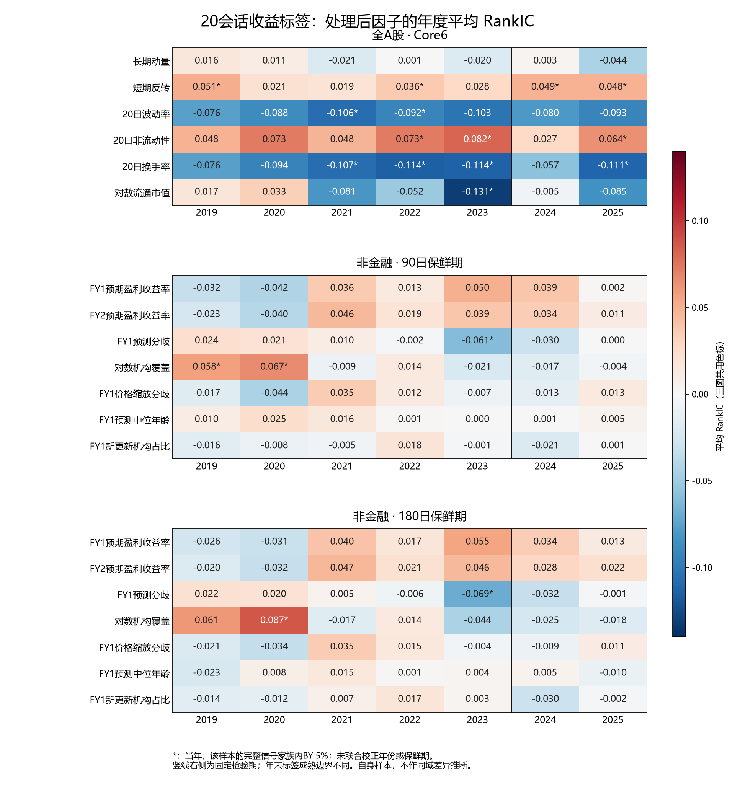

短期反转在七年均为正，20日波动率和换手率在七年均为负，但年度显著性并不一致。两种保鲜期下，FY1／FY2预期盈利收益率的均值在2019—2020年为负、2021—2025年为正，却没有一个年度通过其所在完整家族的BY 5%。这说明整段均值可能掩盖方向变化；既不能只看符号认定稳定预测能力，也不能把未通过校正解释为效应精确等于零。

[全部20会话年度统计](assets/a-share-full-20261021/factor-annual-20d-rankic.csv)共13,908行，覆盖55份原生统计：全A股自身／全55共同／PV52共同、两个预期保鲜期的自身／共同，以及财务域实际存在的2019、2024、2025年度。财务2020—2023年无合格资产日，未伪造对应年度结果。年度结果保留自身的推断资格，不由整窗状态一律替代；这些描述仍不能代替预定模型配对和交易账户比较。

财务域2025年的处理后48信号中有34项满足年度推断条件，其中25项量价、4项预期、5项纯财务；另外14项纯财务仍因日期缺口未定义。五项可推断的财务因子为账面市值比、总负债资产比、有息债务资产比、现金资产比和净债务资产比，均覆盖222/222日，在当年完整144信号家族中的BY校正p值均为1。不能将四项预期变量误计入19个财务因子，也不能把这一年度的资格扩大到两年整窗。

## 截面回归：固定检验期仅反转的等权区间未跨零

这一节每天重新估计“当日哪些因子对应较高的未来收益”，最后汇总每日系数。它与前文在历史训练窗拟合一次、随后冻结预测的OLS模型不同。先分清这两个对象，才能理解为什么这里有HAC区间，而前面的训练系数没有发布标准误和p值。

在 Core6 的 20 会话联合回归中，固定检验期只有短期反转的等权 95% 区间未覆盖零；改用总市值加权，六个因子的区间全部覆盖零。这些区间尚未做多重比较校正。

Fama–MacBeth 检验每天用未来收益标签对当日因子做截面回归，再检验每日系数的时间均值。全 A 股两期、三组特征、六个期限的36份结果已完成，包含55个单因子回归和一个Core6联合回归，各自保留等权OLS与总市值加权WLS。它没有拟合55因子的联合模型，也不是前述冻结预测模型的训练系数。

本轮在计算前为六期限统一设置 HAC 滞后 `max(20, h)`，其中 `h` 为标签的会话数；20会话结果使用 lag20，区别于此前20会话研究采用的lag19。原生请求和元数据保留实际参数。所有区间均为未经多重比较校正的95%区间，不能与前一节经过BY校正的RankIC结果混用。

下表使用处理后六因子的联合回归，因变量为20会话开盘到开盘收益标签。数字为每单位处理后特征对应的收益差百分点，括号为HAC区间。开发期覆盖1,193个完整日期，回归样本日期截至2023-11-30；固定检验期覆盖464日，截至2025-12-02。标签成熟性分别按2023年和2025年年底判断。它们是条件截面斜率，不是因子持仓赚取的收益。

| 因子 | 2019—2023 年，等权OLS | 2024—2025 年，等权OLS |
|---|---:|---:|
| 长期动量 `momentum_252_20` | 0.3145（0.0696，0.5594） | 0.0519（−0.3500，0.4538） |
| 短期反转 `reversal_5d` | 0.2635（0.1518，0.3752） | 0.4291（0.2486，0.6096） |
| 波动率 `volatility_20d` | −0.2545（−0.4727，−0.0363） | −0.2257（−0.5923，0.1410） |
| 非流动性 `amihud_20d` | 0.1383（0.0190，0.2575） | 0.1439（−0.1115，0.3992） |
| 换手率 `turnover_20d` | −0.4110（−0.6622，−0.1598） | −0.1610（−0.6080，0.2861） |
| 对数流通市值 `log_float_market_cap` | −0.3791（−0.7337，−0.0245） | −0.3423（−1.1002，0.4156） |

固定检验期只有短期反转的等权联合回归区间未覆盖零；其余五项的均值方向与开发期相同，但区间均跨零。改用总市值WLS时，六项固定检验区间全部覆盖零，短期反转为0.1513（−0.0949，0.3975）个百分点。统计权重会改变所描述的股票截面，这些差异尚不能证明等权与市值加权系数彼此显著不同，也不能据此把反转认定为经过多重检验确认的唯一有效因子。

完整[Core6联合回归表](assets/a-share-full-20261021/fmb-all-core6-20d.csv)保留两期、两权重及截距的28行结果；[全A股FMB聚合表](assets/a-share-full-20261021/fmb-all-summary.csv)保留全部8,424行，其中8,208行可推断、216行因交易日时钟不完整而未定义。未定义结果没有用删去空日后的序列补做推断。单因子、联合回归、模型解释与实际持仓收益回答不同问题，后续仍须结合预定增量比较和账户结果判断信息的实用性。

### 非金融与财务域的截面回归

非金融90日、180日保鲜期的72份Fama–MacBeth统计也已完成。每种保鲜期的联合回归实际纳入13个因子：Core6加上前述七个预期变量；单因子回归仍覆盖全部32个经济因子。这里的联合回归不是仅含Core6，也没有以全部32个因子同时回归。两种权重、三组变换和六期限的11,232行结果均保留在[非金融聚合表](assets/a-share-full-20261021/fmb-nonfinancial-summary.csv)。

下表完整展示固定检验期20会话联合回归中的七项预期变量。单位和未校正的HAC 95%区间与上表相同；四列各自使用464个日期，均为条件截面斜率。

| 处理后预期变量 | 90日，等权 | 90日，总市值加权 | 180日，等权 | 180日，总市值加权 |
|---|---:|---:|---:|---:|
| FY1预期盈利收益率 | −0.2009（−1.1538，0.7520） | 0.0496（−1.1450，1.2443） | −0.3286（−1.1740，0.5168） | −0.1658（−1.2777，0.9460） |
| FY2预期盈利收益率 | 0.1017（−0.9532，1.1566） | 0.3229（−0.9522，1.5979） | 0.1991（−0.6371，1.0352） | 0.3107（−0.9180，1.5393） |
| FY1预测分歧 | 0.2208（−0.1493，0.5909） | 0.1844（−0.0652，0.4340） | 0.1487（−0.2231，0.5205） | 0.1864（−0.1385，0.5113） |
| 对数机构覆盖 | −0.2229（−0.4898，0.0440） | −0.0944（−0.4339，0.2451） | −0.2475（−0.4432，−0.0517） | −0.2350（−0.5056，0.0355） |
| FY1价格缩放分歧 | −0.2206（−0.4850，0.0437） | −0.2105（−0.5035，0.0825） | −0.1907（−0.4814，0.1000） | −0.2111（−0.4892，0.0671） |
| FY1预测中位年龄 | 0.0678（−0.0626，0.1981） | 0.0862（−0.1296，0.3020） | −0.1206（−0.2415，0.0003） | −0.1753（−0.3840，0.0333） |
| FY1新更新机构占比 | −0.0522（−0.1053，0.0009） | −0.0741（−0.1649，0.0167） | −0.0267（−0.0650，0.0116） | −0.0824（−0.1491，−0.0156） |

90日保鲜期的七项预期变量在两种权重下区间均覆盖零；180日下，对数机构覆盖的等权区间和新更新机构占比的总市值加权区间未覆盖零。这里没有多重比较校正，且两个保鲜期的有效股票可能不同，不能把这些例外当作已确认的预期增量或据此选择保鲜期。其余期限、开发期、截距以及六个量价控制变量均完整保留在附件。

财务域的36份截面回归共8,136行，全部因整窗交易日覆盖不完整而未定义；有有限日期系数时保留描述均值，不补造区间。该域的联合回归实际包含16因子：Core6、六个预先指定的基本面核心因子以及四个原始预期因子；不等于将48个因子全部放入同一个回归。完整结果见[财务FMB聚合表](assets/a-share-full-20261021/fmb-financial-summary.csv)。

## 研究设计与计算口径

### 样本与重算范围

原始来源重新规范化，市场面板、因子、标签和研究表重新生成。各研究共同使用一次生成的价格与状态事实；不同资格或预期保鲜期各有一张最大研究表，模型从中选择自己的输入列。这避免逐模型重复加工因子，也保留了不同研究问题的样本边界。

| 最大研究表 | 经济因子数 | 使用范围 |
|---|---:|---|
| 全 A 股 | 55 | Core6、PV25、PV52、三个路径变量及四块消融 |
| 非金融，90 日预期 | 32 | 非金融 PV25、四个原始预期因子及三个机制因子 |
| 非金融，180 日预期 | 32 | 延长保鲜期的一次对照 |
| 财务融合，90 日预期 | 48 | 同一财务研究资格下的 PV25、19 个财务因子及四个预期因子 |

每种研究表分别保存开发期与固定检验期，包含原始因子、完成截尾与标准化但尚未中性化的特征、完成中性化的特征。中性化明确使用历史行业和对数流通市值；对数流通市值自身只做行业中性化，避免把它对自身回归。标签包括 1、5、10、20、60、120 个交易会话的开盘到开盘收益；主模型目标是 20 会话收益的当日截面标准分数。

| 研究配置 | 因子数 | 比较目的 |
|---|---:|---|
| Core6、PV25、PV52 | 6 / 25 / 52 | 基础量价信息的扩展 |
| PV25 加路径、PV52 加路径 | 28 / 55 | 正收益日占比、最大单日贡献和路径粗糙度 |
| PV52 去规模价格、趋势反转、活跃流动性、风险路径 | 49 / 43 / 29 / 35 | 四个预先固定经济块的逐块移除 |
| 非金融 PV25、加原四预期 | 25 / 29 | 预期信息相对量价的增量 |
| 180 日原四预期 | 29 | 保鲜期对照 |
| 90 日、180 日预期机制 | 32 / 32 | 价格缩放分歧、预测年龄和新更新机构比例 |
| 财务资格内 PV25、加财务、再加预期 | 25 / 44 / 48 | 同资格下的量价—财务—预期比较 |

共 17 个配置。每个配置保留九个模型家族、20 个候选参数组合：等权排名、IC 加权排名、OLS、Huber、Ridge、Lasso、XGBoost、普通决策树、LightGBM。随机森林和传统 GBRT 按此前已确认的计算范围排除；其仓库实现保留。

### 训练、选择与固定检验

初始训练从 2014 年开始。2018—2023 年逐季度扩张训练窗，每次只读取拟合截止时已经成熟的标签，总计 8,160 次预定季度拟合。2018 年预测用于验证预热，2019—2023 年形成主要开发结果。

G 在开发期结束后，依据整段开发期表现选择参数，因此其开发表现具有事后选择性质。Q 在每个季度开始前，依据此前 12 个月的已成熟验证结果选择参数。两者在 2023 年末各自完成最终选择；所选参数的并集只拟合一次，随后冻结用于 2024—2025 年。

这段检验期已在此前研究中使用。本轮是保留方法边界的历史重算，不能称为新的、从未观察过的留出试验。候选失败保留原始原因；联合比较缺少必需成员时不缩小预定比较家族，满足条件的独立统计继续产出。

### 怎样判断因子是否有用

第一层考察因子本身：分别计算原始、中性化前和中性化后的 IC、RankIC、分组收益标签及年度稳定性，并查看行业、规模、流动性和预期年龄分层。自身有效样本与共同样本分开保存。HAC 使用完整交易日时钟；右端未成熟部分按标签各自的可用时间截断，内部缺口不删除后拼接。

第二层考察模型怎样使用输入。线性模型导出每个季度的冻结系数、训练均值、尺度及选择截止。正负号表示给定其他输入后的模型斜率，相关输入之间的替代会影响系数稳定性。解释分析复用原生接口：线性 SHAP、排名贡献、树模型原生贡献或路径 SHAP，并单独保存原生重要性。抽样上限为 1,024 行、24 个日期；线性背景限于 2014—2022 年，最多 512 行。解释只覆盖这一声明的样本，不能当作全市场的精确贡献份额。

置换分析将一个经济因子的连续特征和显式缺失标记放在同组，在同一日期截面内共同置换，重复三次，比较 IC 与 RankIC。它回答冻结模型对该输入的依赖；逐块移除并重新训练回答缺少这类信息后模型还能学到多少。SHAP、置换和消融都不直接识别因果效应。

第三层比较预先声明的 15 对研究配置。每对覆盖九个家族、G/Q 和两期，15 对合计形成 540 项比较。优先复用股票日期完全一致的原生日表；覆盖身份不一致时，在明确的共同资格下重算。比较对象是经过各自选择的研究方案，不能把差值解释为“固定参数下某一个因子的纯效应”。

第四层进入连续账户：每周末调仓、前 20% 等权为主，保留流通市值加权、行业规模中性和固定预测下半步调仓的对照。收益、换手、费用、容量和实际持仓风险归因来自原生账本。隔夜／日内标签分解另行检验，入场前隔夜不计入已经开始持有的收益。

中性对照在原合法研究池内，以正且有限的流通市值构造参照；本轮规模暴露也使用流通市值。行业未知仍保留在股票池，有有效预测时正常买卖。先形成冠军预测前 20% 的等权目标，再在非负、股票权重和为 1、已知行业子组合的行业比例偏离不超过 2 个百分点、全股票腿规模偏离不超过 0.2 个标准化单位的约束下，使权重尽量接近该目标；这一步不最大化 RankIC。基准、目标和实际持仓分别披露未知行业占比，不声称整个组合行业中性。部分缺预测的股票不新增，已有持仓按现有缺预测规则固定，其他股票继续调仓；全缺预测或固定持仓使约束不可行时跳过。行业缺失本身不触发强制退出。旧中性账户保留对照，新口径重算结果待完整原生核验；因子、模型、预测及其他组合的规则不变。

本轮账户以原股价格和股数核算，分红应收、到账及送股单独记账，与上一轮复权名义金额核算有所不同。现金分红付款日期空白或早于除息日时，采用除息日开盘到账的研究近似；原始日期不改写，回测元数据明示该政策。当前 2018—2025 年 A 股范围有 6 条付款日期提前 1—4 天的记录，其中 4 条在 2018 年预热期、2019 年和 2021 年各 1 条，2024—2025 年未发现这类记录。该近似可能影响现金可用及再投资时点，不能当作真实到账日证据；金额未知、非法或冲突的付款日期仍不能据此放行。

## 证据边界

截至2026年10月22日北京时间零时前后，690份本轮因子相关原生产物、1,812张成员表已全部完成原生复读，并与独立请求绑定、清单及成员身份逐项合并核对。该验收确认产物可被完整读取且对应预定计算，不等于又独立重算了每一个统计量。PV52的480次季度拟合和480次预测操作已结束，但这不等于480份都有有效预测：2023年第三季度的20个候选全部发布为`empty`，原生Parquet行数均为0，见[逐模型空预测核对](assets/a-share-full-20261021/pv52-empty-predictions-2023q3.csv)。该季度293,604条合格股票—日期记录中的`residual_volatility_60d`原始值全部缺失，处理后既没有有效观察，也没有普通缺失标记，因而属于结构不可用。按既有规则，消费这个因子的PV52模型不能用填充零绕过该状态；未使用这个因子的Core6和PV25同季度均有有效预测。原始完整窗口重放已确认该季度64日的60日有效残差数均不足45，详见前文逐日状态；另行发现的历史输入范围问题已修复，原生因子和共享开发集重建通过；五项相关模型研究已接续新输入，PV52已有模型统计暂保留为修复前结果。其他研究与四个账户修复继续按各自状态推进。

此前四项中性账户曾因`portfolio_ledger_valuation_invalid`失败：Core6、PV25的G开发期，以及非金融PV25的G、Q开发期。共同原因是浮点金额归零时，程序误把仍含锁定股的精确持仓清为零，已在代码提交`50ceae02`修复。Core6的第491批、PV25的第521批，以及非金融PV25的G、Q第704、601批，均用真实失败输入完成独立新旧对照；每例仅修正一条成交和两条估值，其他资产、现金流、诊断及权益调整记录不变。

截至2026年10月22日北京时间11:18，四条修复回放均已在隔离源码下按原参数完整结束，并通过完整账本原生复读，每条覆盖1,212个交易区间。成交、现金流、估值、诊断和权益调整五类记录均已全量读取；原失败位置的落盘记录与独立核算结果精确一致。北京时间22时前后的进一步核对已完成Core6两期四份组合统计的18张成员表复读，以及20个账户140项核心指标的独立复算，结果与归因限制见前文。其他修复账户的统计验收及跨方案比较仍待完成，不能据此宣布17项研究全部完成。旧失败回执保留，非金融PV25另一次旧配置失败单独统计；已验收的因子与预测结果继续有效。

来源规范化从提交 `6e50ba61` 开始；面板批量计算修复为 `bae127e9`；后续预期年龄单位及列投影修复为 `0472e01c`，无赢家诊断修复为 `d0ad8814`，多日并行评价为 `bf041be2`。前序代码修改按当时指定范围验收；锁定股与市场模型历史范围两项修复合并后的代码已通过7,271项全量测试、90项子检查和502文件格式检查，保留125项警告。测试通过不替代真实研究产物验收；未执行安装包验证。

多日并行保留完整焦点截面、共同样本及标签成熟规则，结果按原日期顺序写入。真实十日、165 个信号的对照中，串行耗时 58.9 秒，四进程耗时 21.9 秒，六张原生结果表一致；该约 2.69 倍提速只代表这一工作负载及当时并行运行其他研究任务的环境，不外推为整个模型矩阵的加速比。

研究产物按其原生模型、预测、评价、统计和账本读取器验收。运行脚本提交成功、某项测试通过或当前进程仍在运行，均不代替研究结果的完成证据。本文将在矩阵、账户和解释产物实际终态后补齐结论、图表与各项有效覆盖。
