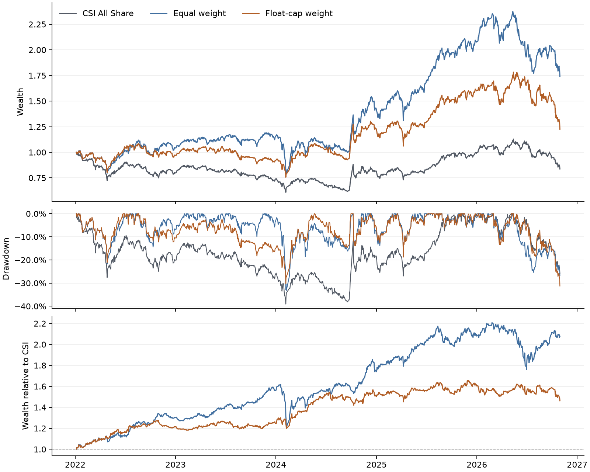

# A 股滚动预测组合回测

## XGBoost 排名前 20% 等权组合

两个账户各以 1 亿元现金起步，使用 2022Q1 至 2026Q4 的季度扩窗样本外预测。两组共同使用 2022 年 1 月 4 日信号，在 1 月 5 日开盘按预测排名前 20% 的等权目标建仓。首日各买入 618 只股票，逐只数量和金额相同，合计成交 7,857.99 万元。此后日频组每日收盘决定目标，周频组在每周最后一个交易日收盘决定目标，均在下一交易日开盘执行。比较区间从 2022 年 1 月 5 日开盘至 2026 年 10 月 30 日开盘，共 1,165 个相邻交易日区间。账户净值包含已计入账本的权益和交易费用。基准使用 CSMAR 中证全指（000985）开盘点位，是不含现金分红再投资的价格指数。[模型选取与预测检验](A股低频五日模型阶段结果.md)

| 指标 | 日频等权 | 周频等权 |
| --- | ---: | ---: |
| 账户累计净收益 | 39.63% | 74.11% |
| 中证全指同期收益 | −16.24% | −16.24% |
| 账户收益减指数收益 | +55.87 个百分点 | +90.35 个百分点 |
| 相对净值累计收益 | +66.71% | +107.87% |
| 扣费后年化夏普（现金收益按零计） | 0.410 | 0.600 |
| 年化跟踪误差 | 14.49% | 14.26% |
| 信息比率 | 0.824 | 1.167 |

相对净值等于账户净值除以指数净值，两者起点均为 1。样本结束时，日频账户的财富为基准的 1.667 倍，周频为 2.079 倍。跟踪误差按两者逐日收益之差的标准差年化，信息比率按该差值的均值除以标准差后年化，均采用 252 个交易日。[逐日净值](data/stock-equal-weight-wealth.csv)

### 账户与中证全指的前五大回撤

一段回撤从净值跌离前的最近一次高点开始，首次回到该高点时结束。期间的多个低点合计为一段，取首次到达最低净值的日期为谷底。回撤按谷底相对前高的跌幅从深到浅排序，截至样本末日仍未修复的区间也参与排名。以下日期均为交易日开盘。

| 序列 | 排名 | 前高日 | 谷底日 | 修复日 | 回撤 |
| --- | ---: | --- | --- | --- | ---: |
| 日频等权 | 1 | 2023-11-24 | 2024-02-06 | 2024-10-08 | −33.24% |
| 日频等权 | 2 | 2026-05-12 | 2026-10-30 | 期末未修复 | −30.63% |
| 日频等权 | 3 | 2022-01-18 | 2022-04-27 | 2022-06-29 | −21.71% |
| 日频等权 | 4 | 2025-03-19 | 2025-04-09 | 2025-05-20 | −18.28% |
| 日频等权 | 5 | 2022-08-19 | 2022-10-11 | 2023-02-02 | −14.55% |
| 周频等权 | 1 | 2023-11-29 | 2024-02-08 | 2024-10-08 | −33.21% |
| 周频等权 | 2 | 2026-05-12 | 2026-10-30 | 期末未修复 | −26.69% |
| 周频等权 | 3 | 2022-01-18 | 2022-04-27 | 2022-06-29 | −21.78% |
| 周频等权 | 4 | 2025-03-19 | 2025-04-09 | 2025-05-21 | −18.23% |
| 周频等权 | 5 | 2022-08-19 | 2022-10-11 | 2023-02-02 | −14.40% |
| 中证全指 | 1 | 2022-01-05 | 2024-02-06 | 2026-01-05 | −39.08% |
| 中证全指 | 2 | 2026-05-14 | 2026-10-30 | 期末未修复 | −25.83% |
| 中证全指 | 3 | 2026-03-03 | 2026-03-27 | 2026-05-06 | −9.32% |
| 中证全指 | 4 | 2026-01-26 | 2026-02-06 | 2026-03-03 | −4.12% |
| 中证全指 | 5 | 2026-01-13 | 2026-01-21 | 2026-01-26 | −1.99% |

日频与周频账户的前五大回撤对应相同的五次下跌。第三大都发生在 2022 年初，跌幅约 21.7%，两组都在 6 月 29 日收复前高。第四大都在 2025 年 4 月 9 日触底，跌幅约 18.2%。两组差距最大的是截至期末仍未修复的第二大回撤，周频比日频少跌 3.94 个百分点。

### 相对中证全指的前五大回撤

相对净值为扣费后账户净值除以同期中证全指价格指数净值。表中回撤衡量组合相对指数从此前最高领先水平回落的幅度，前高和修复日按各自的相对净值确定。

| 序列 | 排名 | 前高日 | 谷底日 | 修复日 | 回撤 |
| --- | ---: | --- | --- | --- | ---: |
| 日频相对净值 | 1 | 2024-01-16 | 2024-02-08 | 2024-11-22 | −24.75% |
| 日频相对净值 | 2 | 2025-08-12 | 2026-07-01 | 期末未修复 | −23.13% |
| 日频相对净值 | 3 | 2024-12-17 | 2024-12-26 | 2025-03-07 | −6.00% |
| 日频相对净值 | 4 | 2025-03-13 | 2025-04-09 | 2025-04-24 | −5.29% |
| 日频相对净值 | 5 | 2022-04-25 | 2022-04-29 | 2022-05-19 | −5.04% |
| 周频相对净值 | 1 | 2024-01-18 | 2024-02-08 | 2024-08-07 | −25.16% |
| 周频相对净值 | 2 | 2026-02-25 | 2026-07-01 | 期末未修复 | −20.21% |
| 周频相对净值 | 3 | 2025-08-12 | 2025-10-10 | 2026-02-05 | −8.98% |
| 周频相对净值 | 4 | 2024-12-17 | 2024-12-26 | 2025-03-04 | −6.40% |
| 周频相对净值 | 5 | 2024-09-12 | 2024-10-10 | 2024-10-29 | −6.17% |

两组相对净值的最大回撤均在 2024 年 2 月 8 日触底，周频在当年 8 月 7 日修复，日频在 11 月 22 日修复。第二大相对回撤均在 2026 年 7 月 1 日触底，样本期末仍未修复。

正文每条序列列出跌幅最深的五段。日频、周频和中证全指在样本内分别出现 55、64 和 7 段回撤，两条相对净值分别出现 72 和 81 段。完整明细含每段的排名、前高日、谷底日、修复日及回撤，回撤以小数记录，修复日为空表示期末尚未修复。[全部 279 段回撤](data/stock-equal-weight-drawdowns.csv)

## 同一选股范围下的周频流通市值加权组合

两组账户使用相同的 20 季 XGBoost 样本外预测，均以 1 亿元起步，每周以预测排名前 20% 的股票作为目标股票池，采用相同的调仓日和费用规则，按各自实际成交计费。等权组给每只入选股票相同的目标权重，流通市值加权组按信号交易日的流通市值分配目标权重。2022 年 1 月 4 日信号选出 783 只股票，两种方法的首批入选名单完全相同。市值加权的前十只股票占目标资金 2.92%，实际下单受整手和可用现金限制，单股成交金额以其近 20 个交易日日均成交额的 5% 为上限。1 月 5 日开盘两组各买到 618 只股票，流通市值加权组合合计买入 7,940.46 万元。

| 指标 | 周频等权 | 周频流通市值加权 |
| --- | ---: | ---: |
| 累计净收益 | 74.11% | 22.55% |
| 年化复合收益 | 12.74% | 4.50% |
| 年化波动 | 25.35% | 24.10% |
| 费后年化夏普 | 0.600 | 0.302 |
| 最大回撤 | -33.21% | -31.25% |
| 相对中证全指累计收益 | 107.87% | 46.31% |
| 年化跟踪误差 | 14.26% | 11.46% |
| 信息比率 | 1.167 | 0.762 |
| 日均实际换手 | 8.68% | 12.13% |
| 累计交易成本 | 2,299.52 万元 | 2,758.59 万元 |

同期中证全指价格指数收益为 -16.24%，流通市值加权组合累计净收益减指数收益为 +38.79 个百分点。相对净值按照组合净值除以指数净值计算。日均换手包含两次周频调仓之间的交易日。[逐日净值](data/stock-weekly-float-cap-wealth.csv)

### 流通市值加权组合的前五大绝对与相对回撤

| 序列 | 排名 | 前高日 | 谷底日 | 修复日 | 回撤 |
| --- | ---: | --- | --- | --- | ---: |
| 账户净值 | 1 | 2026-05-14 | 2026-10-30 | 期末未修复 | -31.25% |
| 账户净值 | 2 | 2022-08-19 | 2024-02-06 | 2024-05-20 | -30.24% |
| 账户净值 | 3 | 2022-01-18 | 2022-04-27 | 2022-06-24 | -21.13% |
| 账户净值 | 4 | 2025-03-17 | 2025-04-09 | 2025-07-07 | -18.77% |
| 账户净值 | 5 | 2024-05-21 | 2024-09-18 | 2024-09-30 | -14.60% |
| 相对中证全指净值 | 1 | 2025-12-01 | 2026-10-30 | 期末未修复 | -11.65% |
| 相对中证全指净值 | 2 | 2024-07-12 | 2024-10-10 | 2024-11-27 | -7.90% |
| 相对中证全指净值 | 3 | 2024-01-18 | 2024-02-08 | 2024-02-26 | -7.78% |
| 相对中证全指净值 | 4 | 2024-12-19 | 2025-04-09 | 2025-05-07 | -7.38% |
| 相对中证全指净值 | 5 | 2022-10-28 | 2023-02-16 | 2024-01-05 | -7.29% |

[该组合全部绝对与相对回撤](data/stock-weekly-float-cap-drawdowns.csv)
