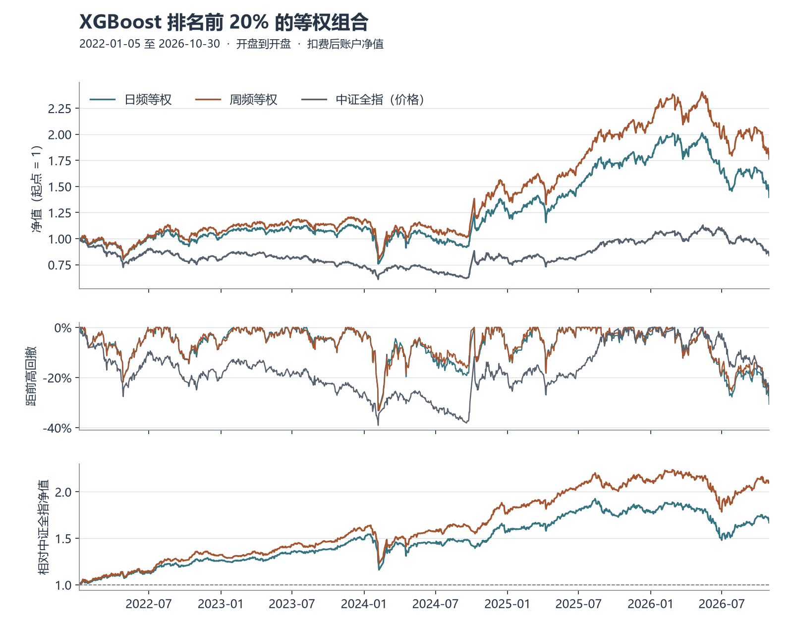

# A 股滚动预测组合回测

## XGBoost 排名前 20% 等权组合

两个账户各以 1 亿元现金起步，使用 2022Q1 至 2026Q4 的季度扩窗样本外预测。每次选取预测排名最高的 20% 股票等权持有，分别按日和每周最后一个交易日决定目标，在下一交易日开盘执行。比较区间从 2022 年 1 月 5 日开盘至 2026 年 10 月 30 日开盘，共 1,165 个相邻交易日区间。账户净值包含已计入账本的权益和交易费用。基准使用 CSMAR 中证全指（000985）开盘点位，是不含现金分红再投资的价格指数。[模型选取与预测检验](A股低频五日模型阶段结果.md)

| 指标 | 日频等权 | 周频等权 |
| --- | ---: | ---: |
| 账户累计净收益 | 39.63% | 76.38% |
| 中证全指同期收益 | −16.24% | −16.24% |
| 账户收益减指数收益 | +55.87 个百分点 | +92.62 个百分点 |
| 相对净值累计收益 | +66.71% | +110.58% |
| 扣费后年化夏普（现金收益按零计） | 0.410 | 0.611 |
| 年化跟踪误差 | 14.49% | 14.29% |
| 信息比率 | 0.824 | 1.185 |

相对净值等于账户净值除以指数净值，两者起点均为 1。样本结束时，日频账户的财富为基准的 1.667 倍，周频为 2.106 倍。跟踪误差按两者逐日收益之差的标准差年化，信息比率按该差值的均值除以标准差后年化，均采用 252 个交易日。[逐日净值](data/stock-equal-weight-wealth.csv)

### 最大和次大回撤

每段回撤从跌离前的最近一次净值高点开始，首次回到该高点时结束。尚未修复的回撤也参与排名，深度为谷底净值除以前高净值再减 1。日期沿用开盘估值时点。

| 序列 | 排名 | 前高日 | 谷底日 | 修复日 | 回撤 |
| --- | ---: | --- | --- | --- | ---: |
| 日频等权 | 1 | 2023-11-24 | 2024-02-06 | 2024-10-08 | −33.24% |
| 日频等权 | 2 | 2026-05-12 | 2026-10-30 | 截至期末未修复 | −30.63% |
| 周频等权 | 1 | 2023-11-29 | 2024-02-08 | 2024-10-08 | −33.20% |
| 周频等权 | 2 | 2026-05-12 | 2026-10-30 | 截至期末未修复 | −26.69% |
| 中证全指 | 1 | 2022-01-05 | 2024-02-06 | 2026-01-05 | −39.08% |
| 中证全指 | 2 | 2026-05-14 | 2026-10-30 | 截至期末未修复 | −25.83% |

两个账户最深的回撤都在 2024 年 2 月触底，同年 10 月收复前高。第二段都始于 2026 年 5 月，周频少跌 3.94 个百分点。相对于中证全指，日频组合的相对净值最大回撤为 24.75%（2024-01-16 至 2024-02-08），周频为 25.16%（2024-01-18 至 2024-02-08）。
