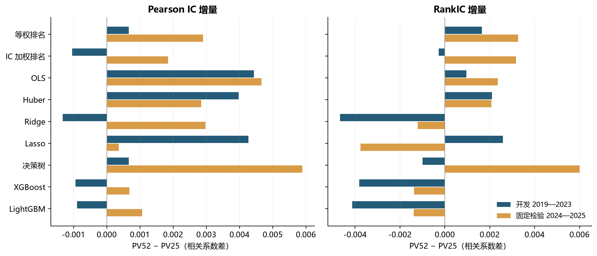
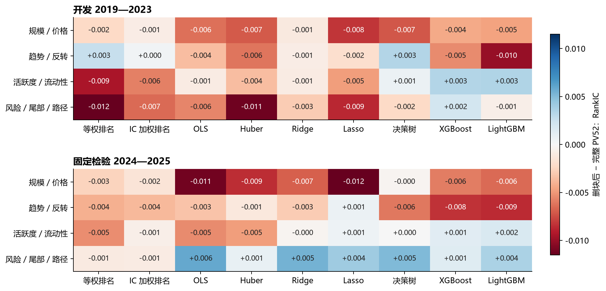
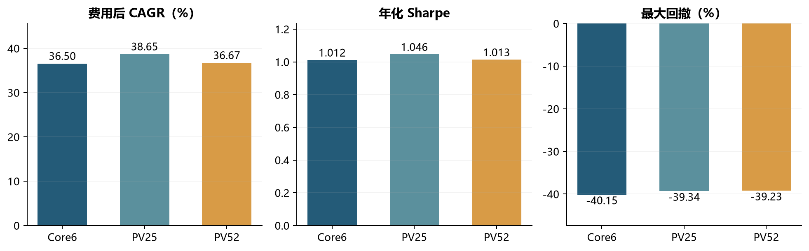
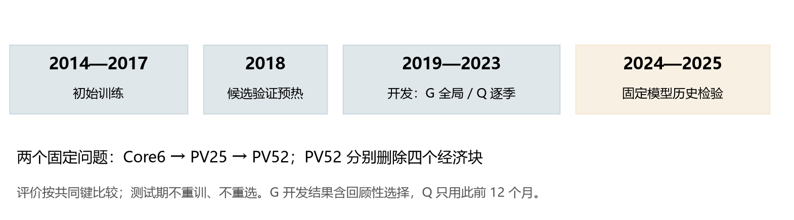

# A 股日频量价研究

**研究做了什么：** 用A股的历史价格与成交信息预测未来20个交易区间的相对收益，比较6、25、52个经济因子的输入集合，简称Core6、PV25、PV52。2019—2023年用于开发，模型在2023年末冻结，再评价2024—2025年。这段历史检验曾经被研究使用，不代表全新未见样本。本文展示的主组合每周买入预测排名前20%的股票并等权持有，初始资本10亿元。

文中 IC 指数值间的线性相关，RankIC 指排序间的相关。G 在开发期结束后用整段成绩选型，Q 每季使用此前 12 个月的成绩选型；两者都在 2023 年末冻结，用于 2024—2025 年。

这组实验最直接的结论是：**增加因子能改善部分预测指标，但没有稳定提高费用后的收益。**

研究分别检验三个问题：从六个基础信号扩展到 25 个、52 个经济因子，预测是否改善；从完整输入中逐一删去经济块，哪些信息较难替代；把预测变成持仓后，改善能否覆盖交易费用。下面先看结果，再交代样本与方法。

可以把IC理解为“预测数值与后来收益是否一起变化”，把RankIC理解为“预测名次与后来收益名次是否一致”。例如0.12的RankIC不是12%的投资收益。后文的模型“家族”指OLS、树模型等不同算法形式；G/Q是在各家族内选择参数、再选择所用模型的规则，不是两种交易资产。

## 第一次读量化研究：先走完一条完整的链

本文所有数字都围绕同一个问题：**在当时可见的信息下，能否把未来相对收益较高的股票排在前面；按固定规则交易后，这种排序是否留下费用后的收益。** “因子多了”“相关性高了”“账户赚了更多”分别是三个结果，不能互相替代。

### 六个基础因子究竟是什么

因子是根据已经发生的行情计算出来的描述。下表的收益和换手率都用小数表示，例如0.01表示1%；交易日按市场会话计数，不是自然日。

| Core6输入 | 怎样计算或理解 | 数值大首先表示什么 |
|---|---|---|
| 长期动量 `momentum_252_20` | 一个交易月前的复权收盘价，除以约一交易年前的复权收盘价，再减1 | 剔除最近一个月后，此前价格上涨较多 |
| 短期反转 `reversal_5d` | 最近五个交易会话的复权收盘收益取负号 | 最近一周下跌较多；是否反弹仍要检验 |
| 波动率 `volatility_20d` | 过去20会话有效全收益的样本标准差 | 近期日收益变化较大；它本身不是涨跌方向 |
| Amihud `amihud_20d` | 每日绝对收益除以当日成交金额，再在窗口内平均 | 单位成交金额对应较大价格变化，是非流动性代理 |
| 换手率 `turnover_20d` | 当日成交股数除以流通股数，再取过去20会话均值 | 相对可流通股本，近期交易更活跃 |
| 对数流通市值 `log_float_market_cap` | 流通市值取自然对数 | 公司可流通规模较大；取对数压缩尺度差异 |

举例：一只股票五会话前复权收盘价10元，现在9.5元，五会话收益为−5%，反转因子为+5%。另一只过去一个月前的可比价格12元、约一年前10元，剔除最近月的长期动量为20%。反转为正或动量为正，都不是事先知道未来一定上涨。

PV25和PV52继续拆分窗口、价格路径、风险、成交活跃度及市场暴露。它们仍然来自当时的价格与成交事实；52列不等于52份互相独立的信息。完整字段属于哪个配置、哪个经济块，保留在[实验配置](data/a-share-methods.json)中，四块删除实验的计数见后文。

### 为什么原始因子不能直接混在同一个回归里解释

原始规模可能以亿元计，波动率通常是百分之几，Amihud又是收益除以金额。数值大小不同，不能据此比较“哪个更重要”。同一因子还可能只是把行业或公司规模重新表达了一遍，因此本实验先按当日截面处理。

处理分三步：压缩极端值，回归掉行业和规模的线性部分，再将剩余量标准化。这里的“截面”是同一天的不同股票；“训练期缩放”则是在之后拟合模型时，利用历史训练行再估计一次坐标尺度，两者不是同一步。

一个仅用于手算的MAD例子：原值为1、2、3、4、100，中位数3，到中位数的绝对偏差为2、1、0、1、97，其中位数MAD=1。按本实验3×1.4826×MAD的规则，上界为7.4478，100被压到7.4478；其他四个数不变。它保留这项观察但限制极端幅度，并不是删除整只股票。正式计算还要满足完整股票池、行业和样本数条件，五个教学数字不能当作正式样本。

中性化可以理解为先问：“如果只知道行业和规模，这项因子大致应该是多少？”原值减去这个拟合值，得到残差。残差大，表示这只股票相对其行业和规模条件仍然更高。之后标准化值为“残差减均值，再除以标准差”；+1表示高出当日残差均值一个标准差，不表示未来上涨1%。

### 模型学什么，预测分数怎样读

监督模型训练时，每一行给出过去已经知道的输入，以及后来已经完整观察到的未来收益目标。模型调整系数或树分支，使预测误差尽量小；到了真正评价时，参数冻结，只提供当时输入，不再提供该行的未来标签。

本实验把未来20个交易区间的收益在当日股票间标准化作为训练目标，所以预测输出是相对强弱分数。下面五只股票只是教学例子，说明评分与排序；不是实际持仓或真实收益记录。

| 股票 | 模型预测分数 | 以后观察到的20会话收益 | 预测名次（大为好） | 实际收益名次（大为好） |
|---|---:|---:|---:|---:|
| A | 1.2 | 4% | 5 | 5 |
| B | 0.6 | 2% | 4 | 3 |
| C | 0.1 | −1% | 3 | 2 |
| D | −0.3 | 3% | 2 | 4 |
| E | −0.8 | −2% | 1 | 1 |

A的预测分数1.2不是预测收益1.2%。在这个无并列的例子中，两个名次序列的相关系数，即RankIC，为0.7。它说明排序总体较一致，但模型把D排得偏低；0.7既不是收益70%，也不是五只股票中“70%预测正确”。真实研究每一天在完整合格截面计算，然后按日期汇总。

模型名称说明如何把输入变成分数：OLS拟合线性加权和；Ridge和Lasso在拟合误差外加入系数约束；Huber降低极端残差的影响；树模型用阈值分组，集成树再结合多棵树。排名方法则先把每个因子转成名次再组合。算法更复杂不保证样本外更好，所以研究保留简单基线、失败候选和固定评价规则。

### 为什么还要分训练、验证与固定检验

训练用于估计模型参数。验证用于在候选之间选择，例如决定Ridge惩罚多强、树多深。固定检验则检查选择之后的方案在后续历史中的表现。用一段数据选出赢家，再用同一段数据证明赢家很好，会混入选择本身带来的乐观偏差。

Q在每个季度开始前，只用此前12个月已经成熟的验证成绩选型，接下来一个季度才用于检验这次选择。G用整段2019—2023年的成绩选型，因此G的开发结果含事后选择，不能当作当年逐时可执行的选型结果。两者在2023年末冻结后，2024—2025年才是相对于这次拟合和选择的后续评价；由于这段历史以前已经被研究过，本报告仍明确称“固定历史检验”。

### 从排名到组合，中间还隔着哪些步骤

先按预测分数排序，取前20%，再按声明方式分配目标权重；等权表示所选股票各占相同的股票资金比例。目标权重不是已经成交的权重，停牌、涨跌停、交易金额上限、费用和现有持仓都会改变实际结果。

本实验每周最后一个交易日收盘形成决策，下一会话开盘尝试交易。20会话是预测标签的期限，调仓仍每周发生；因此不应把每笔交易都理解为固定持有20天。已有股票卖不掉时留在账户中，想买的股票买不到时相应资金留作现金。

交易成本按实际成交计算。教学例子中，交易金额10万元、ADV20为200万元，参与率为5%，恰好达到本实验5%的单次金额上限。固定5bp滑点对应50元；冲击率为25bp×√0.05≈5.59017bp，对应约55.90元；另外还须加该历史交易日适用的佣金、印花税和过户费。这不是真实成交费用记录，只演示同一组成本假设怎样换算成金额。

最后才从账户净值计算CAGR、Sharpe和回撤。例如教学账户两年从100变成121，CAGR是√(121/100)−1=10%；若途中先到120再跌到90，这段回撤是90/120−1=−25%。最终赚钱与中途大幅回撤可以同时成立。真实报告使用完整账户时钟和初始资本，不能只拿两个端点重造整条风险路径。

## 特征增加后，相关性与排序并未同步提高

PV25 相对 Core6 的 Q 口径 IC，在开发期有七个家族提高，在固定检验期只有三个提高。RankIC 的方向较稳定，固定检验期仍有六个家族提高。增加常见量价描述能够帮助部分模型，但这种帮助不是各时期、各指标都同向。

PV52 相对 PV25 的差异更清楚。固定检验期 G、Q 各有九个家族的 IC 提高，但 RankIC 各只有五个提高。G、Q 共享研究数据和候选，这些计数描述改善方向，相关比较并不独立。

图 1　Q 选择口径下的固定比较。横轴为相关系数之差，零线右侧表示扩展后提高；蓝色为开发期，橙色为固定检验期。完整 G/Q 原值及差值保留在[预测比较表](data/prediction-comparisons.csv)。

以 Q 口径的 XGBoost 为例，三个输入集合在固定检验期的 IC 依次为 0.064644、0.067329、0.068016；RankIC 则为 0.117230、0.120419、0.119047。扩展到 PV52 后，线性相关继续增加，排序相关反而下降。LightGBM 也出现 PV52 相对 PV25 的 RankIC 在两期均下降。一个预测模型更接近收益的相对幅度，不必然意味着它更善于排出最值得持有的股票。

因此，如果组合规则依赖截面排名，仅凭 IC 上升不足以支持更换输入集合。还需要核对排名差异发生在什么股票、什么时段，以及变化是否进入实际持仓。本报告按开发期确定的方法展示结果。

## 规模／价格块的消融方向最稳定

四项消融中，删除规模／价格块的方向最一致：开发期与固定检验期，G/Q 各九个家族的 IC、RankIC 均下降。以 Q 口径 OLS 为例，RankIC 的下降幅度从开发期约 0.00636 扩大到固定检验期约 0.01112。不过，决策树相应下降幅度反而缩小，方向一致不表示影响强度一致。

图 2　Q 口径的四项消融。每个格子表示“删块配置减完整 PV52”，红色表示删除后下降。两期共用色标；显示值按三位小数四舍五入，接近零的格子应以完整精度表为准。

其他块更依赖时期和模型。删除趋势／反转块在开发期改善的两类排名和决策树，到固定检验期均转为下降。删除风险／尾部／路径块则出现相反变化：Q 口径 IC 提高的家族从一个增至八个，RankIC 从一个增至七个。删除活跃度／流动性块也没有获得统一改善，部分树模型的 IC 与 RankIC 方向甚至不同。

这些删块结果没有形成统一的“有用／无用”清单。同一块信息的作用会随模型、其他输入、训练样本和市场时期变化。规模／价格块在本实验中较难替代，但预处理仍使用流通市值，其他因子也可能携带规模信息。判断组合是否赚取规模溢价，还需要分析实际持仓和收益归因。

## 预测增量如何进入组合

下表固定展示 Q 选择的冠军信号、预测排名最高 20% 的等权组合，三组使用相同展示规则。“冠军”指开发阶段选出的模型。

| 输入集合 | 费用后年化复合收益率（CAGR） | 年化夏普比率（Sharpe） | 最大回撤 |
|---|---:|---:|---:|
| Core6 | 36.50% | 1.012 | −40.15% |
| PV25 | 38.65% | 1.046 | −39.34% |
| PV52 | 36.67% | 1.013 | −39.23% |

**怎样读这张表：** CAGR把整段复利结果换算成平均每年的复合增长速度，不表示每年都赚这个比例。Sharpe用收益相对日常波动衡量表现；最大回撤则是账户从此前最高点到随后低点的最大跌幅。Core6的−40.15%意味着中途曾从高点跌去约四成，不是期末亏损40.15%。因此，36%以上的年化增长与接近40%的中途回撤可以同时出现。

图 3　2024—2025 年固定历史检验。每个组合初始资本为 10 亿元，包含 483 个日持有区间；CAGR 按 252 区间年化，Sharpe 为费用后日 Sharpe 乘以 √252，最大回撤包含初始资本基准。[组合结果表](data/fixed-portfolios.csv)同时保留费用、换手、现金和其他表现指标。

在这个固定展示规则下，PV52 的 IC 改善没有转化为高于 PV25 的 CAGR 或 Sharpe，最大回撤则略小。这表明，在同一研究里，预测指标和组合目标也会给出不同排序。

简历中列出的 PV25 结果如下。XGBoost 由验证期 RankIC 选出；加入行业与规模暴露约束后，收益有所降低，回撤也明显收窄。对因子做中性化，不等于组合持仓已经没有行业与规模偏向。

| PV25 组合 | 累计净收益 | 年化净收益 | 夏普比率 | 最大回撤 |
|---|---:|---:|---:|---:|
| 前 20% 等权持股 | 87.06% | 38.65% | 1.05 | −39.34% |
| 加入行业与规模暴露约束 | 42.85% | 20.45% | 0.87 | −18.48% |

以上是历史模拟结果，不是实盘收益。最大回撤的负号表示从此前高点回落的幅度。

## 这些结果适用于什么范围

解释这些结果时，有三项限制最直接。第一，固定历史检验只有两年，多个模型与配置共享样本，本文展示的差值是点估计。第二，共同评价样本没有同时固定训练样本，历史标签还条件于次日可入场。第三，持股期间的完整风险因子归因覆盖率为 0%，已有组合收益尚不能分解为行业、风格和选股贡献。

后续应优先在共同训练样本上重做信息增量比较，补齐风险归因，并在新的时间跨度上检验同一规则。这样才能进一步判断：新增信息改善了什么，这些改善通过哪条持仓路径产生收益。

## 样本、因子与执行方法

### 研究问题与样本范围

本研究比较两件事：把常见量价信号扩展得更细，是否能提高预测能力；在较完整的因子集合中删去一类信息，模型会损失什么。最后用固定组合规则检查这些差异能否转化为费用后的收益。

样本来自 CSMAR 的 A 股日频行情、市值和历史行业信息，覆盖沪深主板、创业板和科创板，包含相应时期的退市股票，按各自上市生命期处理。研究池随历史状态变化，不采用当前存续名单回填历史，也不限定为某个指数的现有成分。B 股、北交所股票不在范围内，金融行业没有单独剔除。

在每个信号日，股票须正常交易、上市满 252 个本市场交易会话，且不属于 ST、*ST 或 PT。收盘价、复权收盘价、成交量、成交额和换手率须有效且为正；这些条件未知的股票不进入当日新信号样本。是否进入信号样本与已有持仓能否卖出分开处理。

初始训练使用 2014—2017 年，2018 年用于验证预热，2019—2023 年为开发期，2024—2025 年为固定方法的历史检验期。开发期按季度扩张训练窗；每次拟合只使用当时已经获得、标签已经成熟的样本。

图 4　时间安排。G 在开发期结束后，用整段开发成绩选型，因此其开发表现含回顾性选择；Q 在每个季度开始前，只使用此前 12 个月的已成熟验证成绩。两种方式均在 2023 年末完成最终拟合与选择，2024—2025 年保持模型和选择结果不变。

### 因子、缺失值与模型

第一项实验比较 Core6、PV25、PV52。这里的数字表示经济因子数。Core6 包含动量、短期反转、波动率、Amihud 非流动性、换手率和对数流通市值；PV25 增加不同期限收益、下行风险、交易活跃度和价格路径；PV52 进一步加入尾部收益、量价关系、长期流动性及市场模型暴露。

第二项实验从 PV52 中分别删除四个经济块。四块互不重叠，合计 52 个因子；每次只删一个块，其他研究设置保持一致。加上前三个输入集合，共有七个配置。

| 删除的信息块 | 因子数 | 主要内容 | 删除后剩余因子数 |
|---|---:|---|---:|
| 规模／价格 | 3 | 流通市值、总市值、股价 | 49 |
| 趋势／反转 | 9 | 不同期限动量、短期反转、趋势效率 | 43 |
| 活跃度／流动性 | 23 | 换手、成交额、Amihud、量价相关与资金流 | 29 |
| 风险／尾部／路径 | 17 | 波动、上下行风险、极端收益、振幅回撤、beta 与残差波动等 | 35 |

每个交易日，因子在当日合格股票截面内经过以下处理。

1. **压缩极端值。** 以中位数为中心，把因子限制在中位数 ± 3 × 1.4826 × MAD 内；MAD 为到中位数的绝对偏差的中位数，MAD 为零时不裁剪。
2. **剔除行业和规模的线性影响。** 用等权回归把因子对一级行业虚拟变量和对数流通市值回归，取残差。行业保留历史分类标准及其代码；规模因子自身只去行业，不再对自身回归。
3. **统一截面尺度。** 用残差的当日均值和总体标准差做标准化（zscore）。截面至少需要 `max(100, 5p)` 个有效样本，`p` 为回归参数数目；行业或规模信息不足、回归不可识别时，该特征保持缺失。

普通因子缺失与上述预处理无法成立分开处理。前者在当日中性化可以完成时，把规范化特征填为零，并增加缺失标志：零表示没有该项观测提供的偏离信息，不表示原始经济量等于零。后者仍保留为不可用特征，不靠填零通过模型筛选。标签不插补。

两类排名方法使用规范化因子；监督模型还输入每个因子的缺失标志，因此 Core6、PV25、PV52 分别对应 12、50、104 个监督模型输入列。监督模型再用训练期估计的均值、总体标准差缩放，预测时固定沿用；本组历史实验的树模型也使用了这一步。训练按日期等权，不做时间衰减，避免某些年份股票更多而自然获得更高权重。

中性化与组合持仓中性是两个问题：对输入去行业、规模，不保证按预测排名形成的等权组合也没有行业或规模暴露。删去规模／价格块时，对数流通市值仍用于共同的预处理步骤，因此该实验检验的是直接规模输入的作用。

模型包括等权排名、IC 加权排名、普通最小二乘回归（OLS）、Huber 稳健回归、岭回归（Ridge）、Lasso 回归、决策树、XGBoost 和 LightGBM，共九个家族。候选参数以验证期平均每日 RankIC 选择，成绩相同时按预先固定的候选顺序处理。完整因子清单和模型参数见[实验配置](data/a-share-methods.json)。

### 预测目标与样本对齐

主目标是信号日之后，从下一交易会话开盘到其后第 20 个会话开盘的复权收益。若信号日为 `t`，价格端点为 `t+1` 和 `t+21`，再将收益在当日合格股票间标准化，作为监督模型的目标。预测分数因此表示截面相对强弱，不直接表示预期收益百分比。期限按声明的市场会话轴计算，停牌日仍占位置。

本组历史实验还要求次日能够按执行规则买入，才形成有效收益标签。因此，预测评价回答的是“在次日可入场的条件样本上，谁的收益更高”。这个条件使用了之后的交易状态，限制了结果向所有信号日股票推广。退出价格取固定端点的有效复权开盘价，没有另以可卖出状态筛选；若端点停牌，沿用价格可能参与估值，实际组合则继续受卖出限制。

预测评价先计算每日截面的 Pearson IC 和 RankIC，再按有效日期等权汇总。开发期有 1,193 个有效评价日，固定检验期有 464 日。评价要求 20 日标签已经成熟，组合账本则按实际持仓日期推进，因此评价日数与账户的持有区间数不同。不同配置在相同股票、相同日期的共同样本上比较；各配置的训练仍按自身输入资格完成，因而结果反映整套研究配方的变化。进一步分离新增因子的作用，需要把训练样本也固定为相同集合。

### 停牌、涨跌停与交易成本

停牌不会让历史时间轴或已有持仓消失。已确认停牌时，价格按同一上市生命期内此前的有效收盘价延续，成交量、成交额和换手率记零；正常交易但价格缺失，或交易状态未知时，不沿用旧价填平。停牌股票不产生当日新信号，持仓仍留在账户中估值，复牌后的价格变化继续计入收益。

日线成交限制按下一会话的交易状态、涨跌停状态和开、高、低、收四价（OHLC）判断。四价相同且处于涨停状态，视为一字涨停，限制买入；一字跌停限制卖出。普通触及涨停但并非一字板的交易日没有统一禁买。所需状态或价格未知时，不认定该方向可以成交。这是一套日线成交近似，不能刻画开盘排队和真实订单优先级。

主展示组合持有预测最高的 20% 股票，等权、只做多。每周最后一个交易日收盘决策，下一会话开盘交易。20 日是预测期限，组合仍每周调整，并非每笔固定持有 20 日。每个组合初始资本为 10 亿元；买卖按实际成交后的资金余额推进，受限卖出留下原持仓，受限买入留下现金。

单只股票每次交易金额最多为此前 20 个会话平均成交额的 5%。成本包括按历史费率表计算的佣金、印花税和过户费，以及 5bp 固定滑点和随参与率变化的冲击：冲击率为 `25bp × sqrt(交易金额 / ADV20)`。这组实验采用复权名义金额核算，收益在统一复权价格尺度上计算；10 亿元是实验资本设定，容量结果仍取决于这些执行假设。
