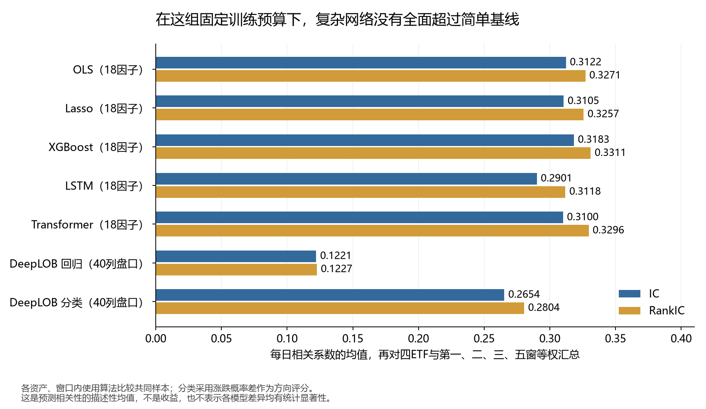
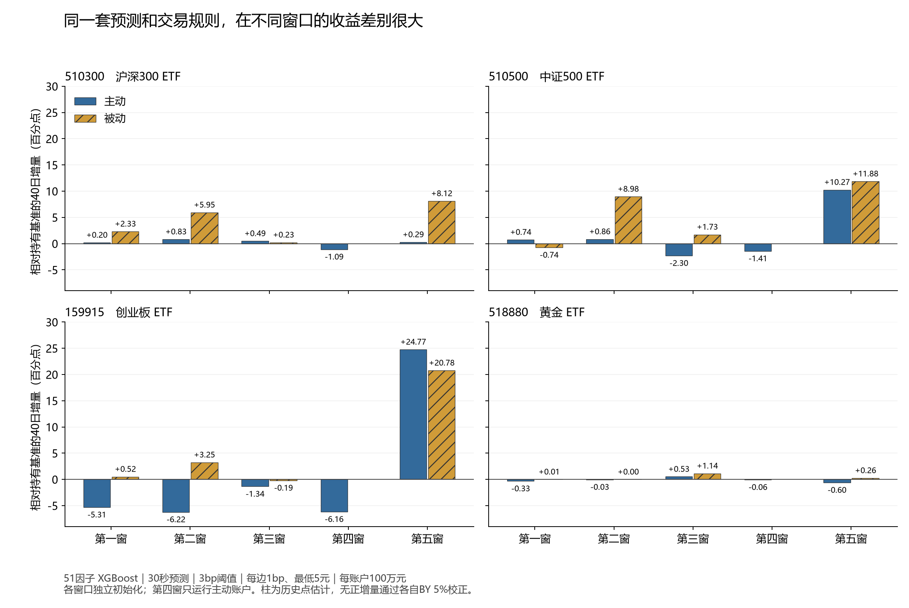

# A 股 ETF 高频研究：盘口信息能否变成费用后的收益

本文保留历史实验的配置、数值和结论。本轮代码更新只做合成验证，未重跑本文研究；文中的延迟、参与率及固定阈值属于当时场景，不代表当前动态 ETF 策略或股票组合的结果。当前合同见[A 股高频约定](../docs/a-share-hft.md)与[策略配置](../docs/research-learning.md)。

研究对象为沪深 300、中证 500、创业板和黄金四只 ETF。使用十档盘口、逐笔委托与成交预测未来 30 秒的中间价变化，再将预测放进有现金、库存、T+1 和交易费用约束的账户，比较相同初始底仓的持有收益。

这项研究得到两个不同层面的结果。**盘口信息有预测价值，增加盘口特征能在部分时期进一步改善预测；交易后的收益则明显依赖市场窗口和执行方式。** 固定使用 51 因子 XGBoost，四个主窗口的平均日 IC 为 0.3326、RankIC 为 0.3444。在单边佣金 1 bp、每笔最低 5 元的假设下，主动与被动账户的平均 40 日净收益分别为 5.00% 和 7.59%，相对同底仓持有账户的平均增量分别为 1.43 和 4.02 个百分点。

这些均值包含底仓收益，而且第五窗贡献很大。第四窗中，四只 ETF 的主动账户全部落后于持有基准。将单边 1 bp 下所有模型和执行变体纳入考察，共 324 组策略账户，**没有一组正向日增量资本收益通过其所属检验族的 BY 5% 校正**。因此，目前可以确认的是预测信号、跨时期差异和执行方式对模拟账户的影响；稳定的费用后超额收益仍需后续样本检验。

本文使用截至 2026 年 11 月 9 日的最终研究产物。每个窗口独立初始化，下文的平均收益不年化，也不拼成连续净值。IC 和 RankIC 是相关系数，不是收益率。

## 1. 研究从三个问题展开

第一个问题是信息是否有用。只看最优买卖价、挂单数量和短期价格变化，能预测多少？加入更深的盘口形状、订单流和逐笔事件后，是否提供了原有输入没有的信息？

第二个问题是模型是否有用。在相同数据和时间划分下，线性模型、树模型与神经网络分别表现如何？如果简单模型已经能捕捉大部分关联，增加模型复杂度是否值得？

第三个问题是信号是否值得交易。预测正确并不自动带来盈利：主动成交要付价差，小额交易可能被最低佣金吞掉，股票 ETF 当天买入的份额还不能当天卖出。因此，预测评价之后必须再看成交、库存、费用和基准。

选择 ETF，是为了在几个有代表性的资产上比较这些问题，同时保留股票 ETF 与黄金 ETF 的交易机制差异。本研究围绕秒级行情和 30 秒预测开展，数据不足以支持对毫秒延迟优势或真实队列位置的研究。

## 2. 数据覆盖了什么，哪些信息看不到

| 标的 | 代码 | 本研究中的交易约束 | 主要比较作用 |
|---|---|---|---|
| 沪深 300 ETF | 510300 | T+1 | 大盘宽基 |
| 中证 500 ETF | 510500 | T+1 | 中盘宽基 |
| 创业板 ETF | 159915 | T+1 | 与前两者不同的权益暴露 |
| 黄金 ETF | 518880 | T+0 | 非权益资产及日内回转交易对照 |

原始数据来自 [venvoo 的 A 股 Level-2 归档](https://huggingface.co/datasets/venvoo/china-a-share-l2-level2-limit-order-book-tick-data)，包括十档行情、逐笔委托和逐笔成交。本轮预取 318 个交易日，正式清洁输入保留 278 日交易日历，研究面板约 523 万行。一行面板代表某只 ETF 在一个报价时点可观察到的信息，并非一笔交易。

供应商的上海 ETF 代码使用了 `.SZ` 后缀。导入时将供应商代码、项目证券标识和真实交易所分别保存，避免根据后缀误判交易规则。来源转换还处理时间编码、委托类型、成交方向与可空索引；只有可以确认的事件才进入相应统计。

本轮来源固定在归档 revision `6ab4c56bb90833c078c2484aa9c7968bdbe36561`，使用[ETF 来源配置](../configs/high-frequency/prepare-source-etf.json)声明真实交易所和证券类型。数据集后续更新不自动改变本轮输入。

数据检查发现个别日期报价精度异常、报价文件为空。核对来源及历史版本后，2024-02-28 和 2024-06-17 的行情从研究输入排除，但两日仍留在真实交易日历中。评价窗口按已确定方案调整，不能把缺失日从日历里删掉，再假装历史完整。

快照通常约三秒一条。研究按交易日、午休和行情缺段切开序列，主口径将超过六秒的报价间隔切断。过去窗口不足时保留缺失，标签不跨片段寻找未来价格。成交和委托流使用当时已经发生的事件；报价间隔内的流量按“前一报价之后、当前报价及以前”汇总。

这套数据没有本地接收时钟，也没有完整订单队列。快照数量变化只能形成可观察的订单流代理；不能由此还原所有订单的真实生命周期。本轮没有使用需要可靠订单关联的六项生命周期特征。

## 3. 先固定比较，再逐步增加信息

### 3.1 五个窗口按时间编号，比较范围有所不同

| 窗口 | 评价日期 | 交易日 | 用途 |
|---|---|---:|---|
| 第一窗 | 2023-10-13—2023-12-07 | 40 | 第一段完整模型、因子和账户比较 |
| 第二窗 | 2023-12-25—2024-02-27 | 40 | 跨时期比较 |
| 第三窗 | 2024-03-07—2024-05-08 | 40 | 跨时期比较 |
| 第四窗 | 2024-07-08—2024-08-30 | 40 | 固定 51 因子 XGBoost 评价 |
| 第五窗 | 2024-09-02—2024-11-05 | 40 | 跨时期比较，并提供共同样本诊断 |

第一、二、三、五窗为四个主窗口；第四窗仅做固定模型评价。原生 ID `continuous` 对应第四窗，`w4` 对应第五窗，附件保留原生 ID，并用 `window_number` 给出本文编号。主窗口按不同历史环境选取，所以结果解释为这些指定时期的比较。它们没有覆盖 2023—2024 年的全部行情，也没有经过一个独立的市场状态识别模型分类。第四窗单独报告，不用它替换表现较弱的主窗口。

训练历史从 2023-09-07 起累计，每五个交易日重训一次。每次只使用拟合截止时已经成熟的标签，再预测后续五日。一个评价日的标签在以后成熟后，可以进入下一次训练；这符合逐时滚动研究的顺序。2023-09-07 是本轮训练数据起点，不是这些 ETF 的上市日期。

四只 ETF 分别拟合，账户在窗口内部连续结转，窗口之间重新初始化。因而，本报告比较的是同一套更新规则在不同时期的表现，而非一只模型从头到尾保持参数不变的成绩。固定旧模型的表现另见第 8 节。

### 3.2 十八、三十六、五十一个因子分别增加了什么

| 输入集合 | 内容 | 希望回答的问题 |
|---|---|---|
| 18 因子 | 价差、深度不平衡、微价格、OFI、短期收益与波动、可观察事件流 | 基础微观结构信息能预测多少 |
| 36 因子 | 在 18 因子上增加多档 OFI、盘口集中度、深度形状和补量代理 | 更深的盘口是否还有增量 |
| 51 因子 | 在 36 因子上增加成交间隔、连续买卖、大小单压力和撤单活动 | 逐笔事件是否补充了快照没有的信息 |

“51 因子”指输入列数，不表示有 51 份独立信号。许多因子描述相近现象，所以增量比较固定算法、参数、预测日期和标签，并在共同有效样本上配对。

例如，一档买量 2,000 份、卖量 1,000 份，数量不平衡为 `(2000−1000)/(2000+1000)=1/3`。它描述当前显示买量较多，不等于净资金流入。OFI 则同时考虑买卖价和数量怎样变化：在价格不变时，买量增加、卖量减少都会使其上升。OFI 的研究动机可参照 [Cont、Kukanov 与 Stoikov 的订单流研究](https://arxiv.org/abs/1011.6402)，这里实际计算的仍是该归档可观察到的快照代理。

另一类信息来自成交节奏。连续很多笔买方成交，和相同总量的一笔买单不同；同样的价格变化，发生在成交密集时与成交稀疏时也可能不同。逐笔特征把这些差异交给模型检验，没有预先认定“大单一定有效”或“撤单一定看跌”。附录列出全部 51 项输入及含义。

### 3.3 标签、预处理和模型怎样对应

主标签是未来 30 秒 mid 收益。`mid=(买一+卖一)/2`；目标时点没有报价时，使用同一连续片段内目标时点及之后的首条有效报价，并保存真正的标签结束和成熟时点。预测 30 秒收益，不能在第 30 秒尚无对应报价时提前把标签当作已知。

mid 用来衡量价格变化，实际主动买入按卖价、卖出按买价模拟。因此，即使预测对了 mid 的方向，变化幅度也可能不足以覆盖价差和佣金。

高频主线保留有效极端值，没有照搬日频股票截面的行业中性化。需要填补和缩放的因子模型使用本次训练历史估计中位数与尺度，预测阶段沿用；XGBoost 使用原生缺失处理。某列在一折训练中全部缺失时，记录该折不可估的列，不用全样本信息补齐。

LSTM、Transformer 和 DeepLOB 的序列按交易日、午休与连续片段隔离。DeepLOB 直接使用十档价格和数量共 40 列，每日根据该 ETF 之前五个完整交易日的历史均值和标准差标准化。执行账户仍读取原始价格，不把标准化后的数值当作成交价格。

主期限比较 OLS、Lasso、XGBoost、LSTM、Transformer、DeepLOB 回归与三分类。三分类使用 ±1 bp 区分跌、平、涨，以“上涨概率减下跌概率”作为方向评分；这个评分没有收益率单位，因此没有直接套用回归模型的 3 bp 交易阈值。3 秒期限用于预测诊断，60 秒期限另做传统模型和账户对照。

本轮固定 XGBoost 为 100 棵树、深度 3、学习率 0.05；Lasso 的惩罚参数为 0.00001。神经网络统一训练五轮，窗口首折另做历史验证学习曲线。这是有计算预算约束的比较，不能将其解释成各类神经模型充分调优后的性能上限。DeepLOB 采用原论文的主要结构并做因果时间卷积适配，训练设置与原论文不同。[DeepLOB 原论文](https://arxiv.org/abs/1808.03668)

## 4. 盘口扩展的增量较常见，逐笔扩展更依赖时期

每个主窗口有四只 ETF、三种传统模型，共 12 组因子扩展比较。下表统计 IC 差异为正、且通过各自原生检验族 BY 5% 校正的组数；它们不是 12 次独立重复实验。

| 主窗口 | 18→36 因子显著正增量 | 36→51 因子显著正增量 |
|---|---:|---:|
| 第一窗 | 9 / 12 | 4 / 12 |
| 第二窗 | 6 / 12 | 3 / 12 |
| 第三窗 | 11 / 12 | 0 / 12 |
| 第五窗 | 3 / 12 | 2 / 12 |

第三窗尤其容易说明两种扩展的区别：更深的盘口带来了较普遍的预测改善，逐笔扩展却没有一组显著正增量。第五窗的两组逐笔增量来自中证 500 ETF 的 OLS 和 Lasso。由此更适合继续研究“哪些信息在什么时期有效”，而不能把因子数量本身当成进展。

[逐项差异、有效日数与校正结果](data/hft-feature-increments.csv)保留了正负方向和未定义项。未定义可能来自常数预测或退化差值，不按零收益或一次有效的不显著检验处理。

### 模型复杂度增加后，结果如何

图中先在每个资产、窗口内使用算法比较的共同有效样本，计算每天的相关性，再对四只 ETF、四个主窗口等权汇总。确切数值如下。

| 模型与输入 | 平均日 IC | 平均日 RankIC |
|---|---:|---:|
| OLS，18 因子 | 0.3122 | 0.3271 |
| Lasso，18 因子 | 0.3105 | 0.3257 |
| XGBoost，18 因子 | 0.3183 | 0.3311 |
| LSTM，18 因子 | 0.2901 | 0.3118 |
| Transformer，18 因子 | 0.3100 | 0.3296 |
| DeepLOB 回归，40 列盘口 | 0.1221 | 0.1227 |
| DeepLOB 分类，40 列盘口 | 0.2654 | 0.2804 |

在这组设置下，简单基线已经捕捉了相当一部分信息。XGBoost 的描述性均值略高，Transformer 的排序相关与它接近；DeepLOB 回归明显较弱。三分类的方向评分优于 DeepLOB 回归，但并未全面超过因子模型。均值排序本身不证明每两种模型之间的差异都显著。

开头的 51 因子 XGBoost 指标使用其自身有效样本，平均 IC / RankIC 为 0.3326 / 0.3444；这里使用算法比较共同样本，不能直接相减后将全部差额归给新增因子。因子增量应看前面的配对结果。[共同样本模型结果](data/hft-prediction-common.csv)、[各模型自身样本结果](data/hft-prediction-own.csv)

## 5. 预测怎样进入账户

每只 ETF 使用独立 100 万元初始资金，约一半买入底仓、一半保留现金，初始份额向下取整到 100 份。持有账户使用完全相同的初始资金、底仓、估值和窗口。

回归预测高于 +3 bp 时请求增加到库存上限，低于 −3 bp 时请求减至零，区间内不主动改变目标。上限为初始底仓的两倍，实际成交还受可用现金、可卖数量和流动性约束。股票 ETF 当天买入份额不能当天卖出，日初底仓提供可卖库存；黄金 ETF 按 T+0 处理。14:50 起尝试恢复当日开盘库存，未完成量如实结转。

这使策略成为“围绕底仓调整库存”的研究。有买入也有卖出，但没有假设可以裸卖空；尾盘尝试恢复也不保证每天消除额外隔夜持仓。

| 设定 | 主口径 | 另外比较什么 |
|---|---|---|
| 信号期限与触发值 | 30 秒、±3 bp | 60 秒传统模型；固定 XGBoost 的 5 / 10 bp 阈值 |
| 佣金 | 每边 1 bp，最低 5 元 | 每边 0.6 / 2 bp，最低佣金不变 |
| 费用表 | 按研究期 ETF 费率输入；佣金已含经手费 | 不重复扣除内含费用 |
| 名义延迟 | 1 毫秒 | 实际成交仍取决于后续可观察行情和事件 |
| 主动成交数量 | 最优档显示量的 5% 上限 | 同时满足现金、整手及库存要求 |
| 行情切段 | 间隔超过 6 秒切断 | 固定 XGBoost 的 30 秒切段对照 |
| 信号平滑 | 原始预测 | 固定 XGBoost 的 6 秒半衰期 EWMA |

1 bp 是万分之一。成交金额 1 万元时，按 1 bp 计算的佣金只有 1 元，但最低佣金会将其抬到 5 元，实际单边为 5 bp。因此，“预测超过 3 bp”不能保证覆盖这笔交易的全部成本。研究将阈值、成交规模和费用分别记录。

本轮 ETF 二级市场账户的佣金内含每边 0.4 bp 交易经手费，印花税、过户费和证券交易监管费输入均为零，不另计申购赎回费用。1 bp 佣金和最低 5 元是显式研究假设，不代表所有券商报价。经手费依据核对参考了[上交所 2021 年历史通知](https://www.sse.com.cn/lawandrules/sselawsrules/repeal/rules/c/c_20211231_5674684.shtml)；该网页现已标为失效，本文引用其历史费率事实，账户继续按保存的研究期费率表计算。

主动执行在严格后续报价上按卖一买、买一卖。被动执行把限价单挂在同侧最优价之后，初始排在可见队列末尾，保守模型只依靠符合方向和价格的实际逐笔成交推进队列；支持部分成交、撤单延迟与日终失效。

被动挂单可能获得更好的价格，也可能排不到、错过行情，或在价格即将向不利方向变化时成交。主动按执行请求计最低佣金，被动按持续限价单的累计成交计佣金，二者的订单组织也不同。下文的执行比较包含这些差异，不能只解释成“少付了一次价差”。交易成本应连同订单规模和执行方式考察，这也是 [AQR 交易成本研究](https://www.aqr.com/Insights/Research/Working-Paper/Trading-Costs)所讨论的问题。

## 6. 整体收益需要连同分窗口结果一起看

固定配置为 51 因子 XGBoost、30 秒预测、±3 bp 触发、每边 1 bp 佣金且最低 5 元。四个主窗口各有四只 ETF，共 16 个资产与窗口组合。

| 执行方式 | 独立账户数 | 平均 40 日净收益 | 相对持有基准平均增量 | 增量为正 |
|---|---:|---:|---:|---:|
| 主动 | 16 | 5.00% | +1.43 个百分点 | 9 / 16 |
| 被动 | 16 | 7.59% | +4.02 个百分点 | 13 / 16 |

两个收益的分母都是初始 100 万元。相对增量等于“策略净损益减持有基准净损益，再除以初始资金”。全账户收益中包含持有 ETF 本身的涨跌，不能将它全部解释为日内交易贡献。

### 第五窗明显抬高了整体均值

下表先在每个窗口对四只 ETF 等权平均。持有基准也是约一半底仓、一半现金的账户，不能将其当成 ETF 满仓涨跌幅。

| 窗口 | 持有基准收益 | 主动净收益 | 主动增量/百分点 | 被动净收益 | 被动增量/百分点 |
|---|---:|---:|---:|---:|---:|
| 第一窗 | −1.55% | −2.72% | −1.17 | −1.02% | +0.53 |
| 第二窗 | +0.35% | −0.79% | −1.14 | +4.90% | +4.54 |
| 第三窗 | +1.90% | +1.24% | −0.66 | +2.63% | +0.73 |
| 第四窗 | −1.02% | −3.20% | −2.18 | 未运行 | 未运行 |
| 第五窗 | +13.59% | +22.27% | +8.68 | +23.85% | +10.26 |

前三个主窗口中，主动账户的平均增量都为负；第五窗转为较大的正值。被动账户在四个主窗口的平均增量均为正，但单只 ETF 的结果仍有例外。16 组配对中，13 组被动增量高于主动，另三组相反。

每根柱是一只 ETF 在一个独立 40 日账户中的历史增量点估计。第四窗只运行了主动账户，图中没有把缺少的被动结果补成零。该窗四只 ETF 的增量都为负；将它纳入后，20 个主动账户的平均净收益降为 3.36%，平均增量降为 0.71 个百分点。[全部固定账户](data/hft-fixed-accounts.csv)、[窗口汇总](data/hft-window-results.csv)

这组结果说明：较高的预测相关性仍不足以保证交易价值，市场变化和库存路径会明显改变账户结果。窗口是条件样本，当前证据还不能单独区分行情、波动、流动性和模型变化各自造成了多少差异。

### 费用敏感性包含成交路径变化

| 单边佣金 | 主动平均净收益 | 主动平均增量/百分点 | 被动平均净收益 | 被动平均增量/百分点 |
|---|---:|---:|---:|---:|
| 0.6 bp | 5.12% | +1.55 | 7.92% | +4.34 |
| 1 bp | 5.00% | +1.43 | 7.59% | +4.02 |
| 2 bp | 4.64% | +1.07 | 7.70% | +4.13 |

这里每格仍是四个主窗、16 个独立账户的均值。主动收益随费率上升而下降；被动 2 bp 的均值却略高于 1 bp。这一反常变化主要来自第五窗创业板 ETF：成交记录从 8,846 条增加到 41,113 条，增量净损益增加约 3.50 万元，其余 15 组该差值均非正。

改变费率会改变可用现金和后续成交路径，所以这不是对同一组固定成交简单换一个扣费比例。现有结果尚未单独拆开路径变化与直接费用扣减的作用，不能据此推断更高佣金有利。[费用敏感性结果](data/hft-fee-sensitivity.csv)

## 7. 账户赚钱，还要解释钱来自哪里

收益分解从账户和同底仓基准的实际模拟账本出发，将增量拆成盘中额外库存、隔夜库存、成交至估值的价格差额、分红现金差异和费用。它回答的是账户损益怎样形成。SHAP 回答某个因子怎样影响模型预测，两者不能互相替代。

以第五窗创业板 ETF 的主动账户为例，净损益约 47.41 万元；持有基准已贡献约 22.63 万元，剩余约 24.77 万元才是增量。增量分解如下，金额按原生账本汇总后四舍五入。

| 增量项目 | 金额/元 | 怎样理解 |
|---|---:|---|
| 盘中库存价格变动 | +219,275.10 | 与基准不同的盘中库存带来的价格损益 |
| 隔夜库存价格变动 | +73,342.70 | 未恢复到底仓的隔夜数量差异带来的损益 |
| 成交至估值差额 | −34,023.50 | 成交价格与核算估值价格之间的差额 |
| 交易费用 | −10,885.31 | 实际模拟成交计费 |
| 合计增量 | +247,708.99 | 相对同底仓持有基准的净损益 |

该账户有 14 条未完成底仓恢复记录。它的好成绩包含额外隔夜暴露，不能全部归给 30 秒信号捕捉了日内价差。

再看一个较弱的例子。第三窗沪深 300 ETF 的被动账户增量为 +2,330.07 元，其中盘中库存贡献 −387.23 元、隔夜库存贡献 +2,862.10 元、成交至估值差额 +275.66 元，再扣费用 420.47 元。账户有正增量，却没有表现为正的盘中库存贡献。

这些例子帮助解释为何收益会随窗口改变，但没有为每个因子分配一份“独立赚到的钱”。因子相关、阈值非线性以及库存约束，使逐因子交易收益需要另外定义实验与分配方法。本轮主要通过 18 / 36 / 51 配对比较和预测贡献解释研究信息增量。

## 8. 固定旧模型后，预测和因子贡献是否稳定

滚动研究不断更新模型。为了分清“旧模型仍然有效”和“重训带来改善”，另将第一窗最后一折的 51 因子 OLS、Lasso、XGBoost 冻结，在之后四个窗口评价。冻结模型的训练历史为 2023-09-07—2023-11-30。

固定的 XGBoost 在后续各窗仍保留正的预测相关性；滚动重训的改善则有资产差异。例如，创业板 ETF 与黄金 ETF 在第二、三、五窗的滚动相对冻结 IC 增量均通过原生配对检验的 BY 5% 校正；中证 500 ETF 第三窗的点估计为负。模型并未在每个时期以相同方式受益于扩展历史。

再把不同训练时点的模型放到同一批 2024-10-30—11-05 数据上预测。每只 ETF 固定使用第一窗训练历史中的 200 条参考观察解释模型，避免因解释参照不同而误判贡献变化。线性使用 Linear SHAP，树使用 interventional Tree SHAP。

下表比较 XGBoost 第一窗与第五窗末折版本。

| ETF | 每日预测相关均值 | 预测方向一致率 | 平均绝对预测差/bp | 因子重要性排序相关 |
|---|---:|---:|---:|---:|
| 510300 | 0.9067 | 92.11% | 0.3377 | 0.7410 |
| 510500 | 0.8729 | 86.20% | 0.6315 | 0.7313 |
| 159915 | 0.8902 | 90.42% | 0.7353 | 0.7644 |
| 518880 | 0.9725 | 96.04% | 0.0849 | 0.7970 |

两个版本总体给出相近预测，但重要性排序仍有变化。较高相关也不意味着越过交易阈值的时点、成交量和账户收益相同。共同样本只有五天，而且后期模型拥有更长训练历史，所以这项诊断描述版本间的稳定性，不能将差异全部归因于市场环境。[共同样本稳定性结果](data/hft-model-stability.csv)

Hawkes 则单独研究买卖事件怎样成团出现，输出买卖强度、强度不平衡和激发占比。它估计的是事件发生率，并不直接预测收益。本轮没有将它加入 51 因子后继续沿用原模型成绩；其预测诊断与主模型、交易收益分开解释。

## 9. 怎样判断结果是否可靠

每个报价时点的 30 秒标签互相重叠，相邻预测也高度相关。因此，数百万行数据不能被当成数百万次独立试验。研究先计算每个交易日的 IC、RankIC 和账户收益，再使用日级 HAC 标准误；滞后为五日。原生结果另提供平均块长五日、2,000 次重采样的 stationary bootstrap 区间。多重检验沿用明确声明的 BY 检验族。

单边 1 bp 下，全部 324 组策略账户的结果如下。“增量为正”按窗口净损益判断，显著性检验针对每日增量资本收益。

| 窗口 | 策略账户数 | 增量为正 | 增量为负 | 增量为零 | 推断有定义 | 正向且通过 BY 5% |
|---|---:|---:|---:|---:|---:|---:|
| 第一窗 | 80 | 25 | 51 | 4 | 76 | 0 |
| 第二窗 | 80 | 34 | 38 | 8 | 72 | 0 |
| 第三窗 | 80 | 30 | 46 | 4 | 76 | 0 |
| 第四窗 | 4 | 0 | 4 | 0 | 4 | 0 |
| 第五窗 | 80 | 57 | 19 | 4 | 76 | 0 |
| 合计 | 324 | 146 | 158 | 20 | 304 | 0 |

没有通过显著性阈值，不等于证明信号无效；它表示这些短窗口、多方案比较下的证据还不足以确认正向增量。20 组零增量账户的推断保持未定义，不充当 20 次有效的不显著检验。不同模型、资产和费率共享输入，也不能把 972 个账户视作 972 次独立验证。[账户方向与推断汇总](data/hft-all-account-outcomes.csv)

当前主要限制有四项。第一，四只 ETF、有限的历史窗口不足以支持广泛外推，窗口也经过历史环境选择。第二，约三秒快照、缺少接收时钟与完整队列，使成交模拟依赖小单不改变市场的假设；保守排队不意味着收益一定是下界。第三，神经网络只使用固定五轮预算，第三窗另有八项首折历史验证因有效样本为空而缺失，训练收敛诊断不完整；正式拟合与预测已完成。第四，正增量可能包含额外隔夜库存，而非完全来自盘中择时。

这些限制直接决定下一步的优先级：先用固定方案检查新的连续时期，复核被动成交路径和库存恢复，再决定是否值得增加模型和信号。仅靠继续增加候选数量，无法解决当前统计证据与成交真实性的问题。

## 10. 实现与结果核对

数据来源转换、盘口与逐笔因子、标签成熟、模型拟合、预测评价和账户核算分别由仓库已有模块负责。滚动日期、模型组合和资源安排由研究调用脚本指定，研究没有在 Agent 中另写收益和费用算法。

| 研究环节 | 对应实现 |
|---|---|
| 因子、标签与数据约定 | [高频协议](../src/quant_research_platform/research/protocols/a_share_hft.py) |
| 盘口因子 | [microstructure.py](../src/quant_research_platform/research/factors/microstructure.py) |
| 逐笔特征 | [event_microstructure.py](../src/quant_research_platform/research/factors/event_microstructure.py) |
| 历史盘口标准化 | [book_normalization.py](../src/quant_research_platform/research/features/book_normalization.py) |
| 库存与执行回放 | [high_frequency.py](../src/quant_research_platform/research/portfolios/high_frequency.py) |
| 交易边界与配置说明 | [A 股高频文档](../docs/a-share-hft.md) |

最终研究包含 972 组策略账户、20 组持有基准，三档费率下的 324 种资产、窗口与策略配置；12 项冻结及共同样本诊断全部完成。原生总状态保留 `partial`，唯一未完成范围为前述八项 DeepLOB 历史验证诊断。不同阶段使用各自保存的代码与参数，当前代码更新不会自动重算历史结果。已核对的准备／第一窗版本为 `9b0551f6e1efbce68bdf7c2a32a05aeef9f48da6`，其余窗口与合并协议为 `985a51e84aafca238c2d1c880de5ca1a2a3010c6`；后续修复的逐阶段版本尚未完整恢复，见附件 `code_provenance`，不据此宣称全部结果属于单一版本。

2026-11-09 09:13（北京时间）重新连接服务器检查，已知研究计算进程均已退出，当前各启动器退出码为零，GPU 空闲；本地 19 个最终聚合文件与服务器逐文件 SHA-256 一致，随后关闭 SSH。计算环境配额为 10 vCPU、60 GiB 内存和 RTX 3090 24 GB。

本次报告从最终表重算固定账户均值、收益分母、窗口统计和显著性计数，并核对模型比较与稳定性摘要。此前研究验收已核对 77,760 行账户日指标、1,944 条账户推断和 7,868 条预测推断的来源，并独立复核账户日均值、HAC 和 BY。没有全量重放原始行情和撮合，也没有独立重算 bootstrap 区间。[报告数据与来源哈希](data/hft-report-evidence.json)

## 附录：本轮 51 项因子怎样理解

下面列出真正进入主比较的输入。括号内是历史窗口或单位；“份额”沿用归档的成交和挂单数量。历史不足、分母无定义或方向不能确认时，保留缺失。

### 基础十八项

| 因子 | 定义或直观含义 |
|---|---|
| `spread_cny` | 卖一减买一，绝对价差（元） |
| `relative_spread` | 绝对价差除以 mid，衡量相对交易摩擦 |
| `imbalance_1` | 一档买卖量之差除以双侧总量 |
| `imbalance_5` | 前五档合计数量的不平衡 |
| `imbalance_10` | 十档合计数量的不平衡 |
| `microprice_deviation` | 数量加权微价格相对 mid 的偏离；买侧越厚，微价格越靠近卖价 |
| `book_ofi` | 同时考虑最优价格、数量变化的一档 OFI 代理（份额） |
| `depth_normalized_ofi` | 一档 OFI 除以当前一档双侧深度 |
| `return_3s` | 当前 mid 相对至少三秒前最后可用报价的收益 |
| `return_30s` | 相同定义，历史三十秒 |
| `return_60s` | 相同定义，历史六十秒 |
| `realized_volatility_60s` | 六十秒内逐次 log(mid) 变化平方和的平方根，未年化 |
| `observed_trade_flow_imbalance` | 当前报价间隔内有符号成交量除以成交总量 |
| `observed_order_flow_imbalance` | 当前报价间隔内有符号新增委托量除以总量 |
| `observed_cancel_flow_imbalance` | 当前报价间隔内有符号撤单量除以总量；买侧撤单为正不代表看涨 |
| `observed_trade_volume_30s` | 过去三十秒观察到的成交总量 |
| `observed_signed_trade_volume_30s` | 过去三十秒买方成交量减卖方成交量 |
| `book_ofi_30s` | 过去三十秒一档 OFI 累计值 |

### 扩展到三十六项时新增的十八项

| 因子 | 定义或直观含义 |
|---|---|
| `book_ofi_5` | 前五档价格与数量变化贡献之和 |
| `book_ofi_10` | 十档贡献之和 |
| `depth_normalized_ofi_5` | 前五档 OFI 除以前五档双侧深度 |
| `depth_normalized_ofi_10` | 十档 OFI 除以十档双侧深度 |
| `book_ofi_near_far` | 前五档 OFI 减后五档 OFI，比较近远压力 |
| `book_ofi_10_30s` | 十档 OFI 的三十秒累计值 |
| `book_ofi_10_ewma` | 十档 OFI 的真实时间衰减均值，半衰期三十秒 |
| `bid_depth_concentration` | 买侧各档数量占比平方和，衡量集中程度 |
| `ask_depth_concentration` | 卖侧相同定义 |
| `bid_near_depth_fraction` | 买侧前三档数量占十档的比例 |
| `ask_near_depth_fraction` | 卖侧相同定义 |
| `bid_depth_slope` | 买侧累计深度占比随实际价格距离变化的斜率（每 bp） |
| `ask_depth_slope` | 卖侧相同定义 |
| `bid_depth_slope_change` | 买侧斜率相对前一快照的变化 |
| `ask_depth_slope_change` | 卖侧相同定义 |
| `bid_replenishment_30s` | 同价位下买侧显示数量正增量的三十秒累计，属于补量代理 |
| `ask_replenishment_30s` | 卖侧相同定义 |
| `depth_slope_difference` | 买侧深度斜率减卖侧深度斜率 |

### 扩展到五十一项时新增的十五项

| 因子 | 定义或直观含义 |
|---|---|
| `trade_interval_seconds` | 相邻成交的实际时间间隔，同毫秒可以为零 |
| `trade_interval_mean_seconds` | 最近五十个成交间隔的均值 |
| `trade_interval_cv` | 上述间隔的样本标准差除以均值，衡量成交是否成团 |
| `trade_intensity` | 最近五十笔成交的四十九个间隔除以其总用时（笔/秒） |
| `trade_activity_ratio` | 前两百个历史间隔均值与最近五十个间隔均值之比 |
| `trade_signed_run` | 连续同向成交的带符号笔数，未知方向打断 |
| `trade_signed_run_volume` | 上述连续段的带符号累计成交量 |
| `trade_event_flow_imbalance` | 最近五十笔的有符号成交量除以总成交量，按量而非笔数加权 |
| `trade_volume_flow_imbalance` | 最近恰好一万份成交的有符号数量比例，最早一笔可部分计入 |
| `large_trade_pressure` | 按此前两百笔 90% 分位识别大单，近五十笔有符号大单量除以全部成交量 |
| `small_trade_pressure` | 按此前两百笔 10% 分位识别小单，相同方式计算压力 |
| `trade_interval_return_interaction` | 最近五十笔首尾成交价收益乘平均成交间隔（收益×秒） |
| `observed_cancel_order_ratio` | 最近五十条新增/撤单消息中，撤单量除以新增量，可能大于一 |
| `observed_cancel_count_fraction` | 最近五十条消息中撤单笔数的占比 |
| `observed_cancel_pressure_change` | 撤单/新增量比值的相邻变化，没有再做买卖方向相减 |

Hawkes 的买卖强度、强度不平衡和激发占比另作诊断，不属于以上 51 项。DeepLOB 使用十档价格与数量的 40 列原始盘口结构，也不是对 51 因子换一个名字。
