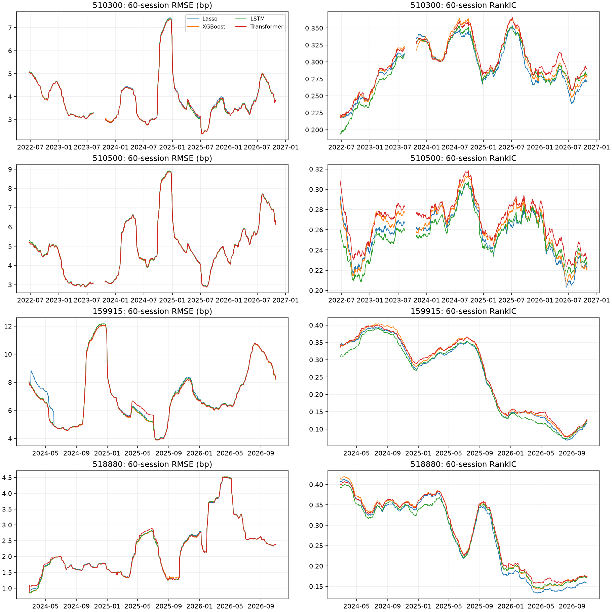
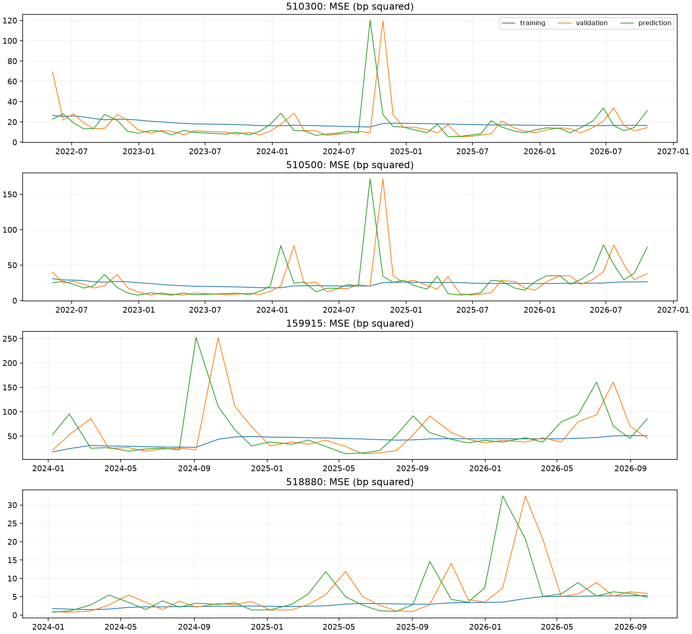
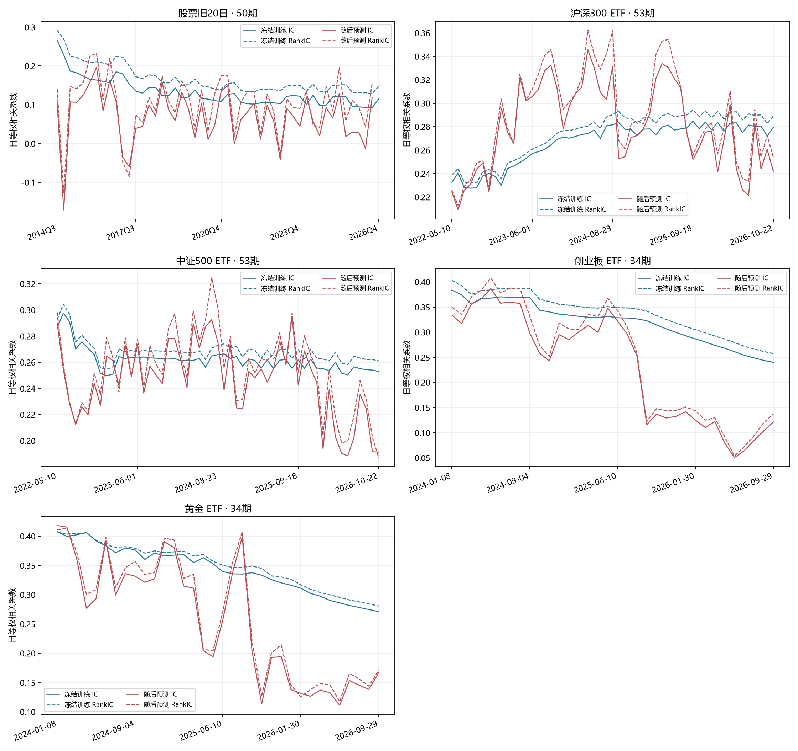

# ETF 高频滚动预测

## 当前137列协议的完整预测快照

2026年11月16日补充四只ETF、四种模型的全期预测结果，读取已保存的原生全期日表与汇总。沪深300与中证500各模型各53个有效窗口，创业板与黄金各34个，共696个模型窗口。沪深300和中证500的名义计划各55窗；2023-07-03、2023-07-31起始的两窗没有模型和预测产物，仍保留覆盖缺口。这里的完成数量不表示名义日历完整覆盖。

目标为未来30秒中间价小数收益；各模型按自身有效配对计算，每日先计算指标，再对有效日等权。RMSE为日均MSE的平方根，表中换算为bp；R²使用同配对模型与零收益基准的日均MSE之比。

| ETF | 模型 | MSE | RMSE（bp） | 相对零收益R² | IC | RankIC | MSE有效日／请求日 |
|---|---|---:|---:|---:|---:|---:|---:|
| 510300 | Lasso | 1.599447193e-07 | 3.9993 | 5.7039% | 0.280650 | 0.290333 | 1027/1087 |
| 510300 | XGBoost | 1.578617422e-07 | 3.9732 | 6.9320% | 0.289091 | 0.296243 | 1027/1087 |
| 510300 | LSTM | 1.584178318e-07 | 3.9802 | 6.6041% | 0.284044 | 0.291260 | 1027/1087 |
| 510300 | Transformer | 1.585296741e-07 | 3.9816 | 6.5382% | 0.290115 | 0.299743 | 1027/1087 |
| 510500 | Lasso | 2.661888678e-07 | 5.1593 | 5.0622% | 0.246999 | 0.255577 | 1027/1087 |
| 510500 | XGBoost | 2.646451223e-07 | 5.1444 | 5.6128% | 0.254252 | 0.260366 | 1027/1087 |
| 510500 | LSTM | 2.662050933e-07 | 5.1595 | 5.0564% | 0.245097 | 0.252814 | 1027/1087 |
| 510500 | Transformer | 2.644153183e-07 | 5.1421 | 5.6947% | 0.258354 | 0.267884 | 1027/1087 |
| 159915 | Lasso | 5.622525321e-07 | 7.4984 | 1.4159% | 0.231349 | 0.247379 | 676/679 |
| 159915 | XGBoost | 5.443656647e-07 | 7.3781 | 4.5522% | 0.241866 | 0.255559 | 676/679 |
| 159915 | LSTM | 5.532162601e-07 | 7.4379 | 3.0003% | 0.230046 | 0.242797 | 676/679 |
| 159915 | Transformer | 5.527661788e-07 | 7.4348 | 3.0793% | 0.242615 | 0.256793 | 676/679 |
| 518880 | Lasso | 5.646384043e-08 | 2.3762 | 3.2006% | 0.253790 | 0.264355 | 677/679 |
| 518880 | XGBoost | 5.620150538e-08 | 2.3707 | 3.6504% | 0.268657 | 0.274939 | 677/679 |
| 518880 | LSTM | 5.640810304e-08 | 2.3750 | 3.2962% | 0.261841 | 0.267311 | 677/679 |
| 518880 | Transformer | 5.667676433e-08 | 2.3807 | 2.8356% | 0.268523 | 0.276249 | 677/679 |

XGBoost在沪深300、创业板与黄金ETF的MSE点估计最低，Transformer在中证500ETF最低。Transformer的四只ETF RankIC点估计均最高，但黄金ETF的MSE高于另外三类模型，说明排序相关和误差幅度衡量不同能力。当前表按各自样本汇总，不把相同观测数当作逐行共同样本检验，也没有据此声称显著优势。

510300、159915、518880的既有Lasso全期统计各有8项指标，其推断状态为`UNDEFINED / incomplete_session_clock`：会话轴不完整，未形成有效推断。这不等于“不显著”。当时的统计设置为HAC滞后5会话、区块长度5会话、bootstrap 1000次、置信水平95%、种子42；该状态不扩称为其他模型已完成的推断检查。

[完整原生预测汇总](data/etf-current-prediction-summary.csv)和[逐日指标](data/etf-current-prediction-daily.csv.gz)保存各指标的有效日、配对量与缺失原因。以下曲线按60个请求会话滚动，至少30个有效值才显示；缺失日保留在会话轴上，滚动均值忽略未定义值。

本节只汇总已完成预测。Lasso已有冻结训练期诊断；另外三类模型的逐期训练诊断仍待补算，历史未保存的候选指标不会补造。本次未计算交易费用、账户净值或组合回测。

## 当前 137 因子、四模型协议

本轮四只 ETF 分别使用 137 个原值因子，模型为 Lasso、XGBoost、LSTM 和 Transformer，目标均为未来 30 秒中间价比例收益。实际输入见[137 因子清单](data/etf-intraday-model-inputs.csv)，完整模型参数、候选、随机种子与计划窗口见[本轮协议](data/etf-rolling-protocol.json)。

| ETF | 历史起点 | 首个计划预测折 | 最后计划预测折 | 计划折数／模型 |
|---|---|---|---|---:|
| 510300 | 2022-01-04 | 2022-05-10 | 2026-10-22 | 55 |
| 510500 | 2022-01-04 | 2022-05-10 | 2026-10-22 | 55 |
| 159915 | 2023-09-07 | 2024-01-08 | 2026-09-29 | 34 |
| 518880 | 2023-09-07 | 2024-01-08 | 2026-09-29 | 34 |

各自历史扩展到 2026-10-30。计划至少留 60 个训练会话，验证从预测前已成熟标签对应的最近 20 个会话中选择；以共同样本上的日等权 MSE 选参，再用当时可用的扩展历史重新拟合，冻结预测后续至多 20 个日历交易会话，每 20 会话前移，末折保留真实剩余会话。未知或缺报价的日子不改成休市，也不压缩预测计划日历。缺失标签和未成熟标签按各自实际时点处理。

报价样本沿用 3 秒网格、1 毫秒可见延迟、6 秒最大报价年龄与标签匹配容差。Lasso、LSTM、Transformer 使用训练期估计的缩放；XGBoost 不做训练缩放。四类模型均使用随机种子 42；Lasso 有三组 alpha 候选，XGBoost 有四组深度与 L2 候选，两类神经网络各有两组序列长度、隐层及学习率候选。Lasso 不设固定迭代上限，XGBoost 和神经网络分别依据验证早停。

137个输入的定义与实际角色见上述清单；每折仅依据训练数据排除全缺失或常量列。输入使用原值，不对四只 ETF 做横截面标准化或行业风格中性化；模型自己的训练期预处理与因子中性化分别记录。

本轮因子本身的 IC、RankIC 和历史参考分组已单独整理，见[当前因子检验结果](因子检验样本报告.md#已发布的原生检验快照)。

[全部候选验证记录](data/etf-current-validation.csv)覆盖696个模型窗口、1914组候选，保存验证MSE、完整候选与最终参数、训练/验证边界和实际输入计数。历史未保存的验证RankIC保持空值。[已完成的最新折输入诊断](data/etf-input-diagnostics.csv)保留三只ETF的全缺失与常量排除记录，未将未检查的中证500补成空名单。

## Lasso逐期冻结训练、验证与预测诊断

本节取自 2026-11-15T09:45:06.333874+00:00 已发布的原生逐期统计，覆盖沪深300 ETF 53期、中证500 ETF 53期、创业板 ETF 34期、黄金 ETF 34期。完整数值、时间窗、成熟截止、样本量、参数、缺失原因及全期预测汇总见[逐期统计CSV](data/lasso-model-periods.csv)。

`training` 把每期最终冻结模型重新应用于它当时实际用于拟合的完整样本，先按日计算再日等权，属于样本内诊断；最终重新拟合已经吸收选参验证期，因此它与 `validation` 不是同一模型、同一样本的成绩。`validation` 保留历史选中候选的共同样本日等权MSE；其它验证指标当时未保存，保留空值。`prediction` 是随后滚动预测窗内的原生统计。三者都不等于在线epoch loss，不能把训练曲线中的loss移填到本表。

下表比较最前10期与最后10期的期等权均值；每一期内部仍是日等权。MSE乘1亿显示为bp²。它们是描述性对照，不能替代全期日等权汇总或证明单调趋势。

| 对象 | 阶段 | MSE 前10→后10 | IC 前10→后10 | RankIC 前10→后10 |
|---|---|---:|---:|---:|
| 沪深300 ETF | 冻结训练 | 23.534104→16.438052 | 0.234744→0.279535 | 0.239129→0.289311 |
| 沪深300 ETF | 历史验证 | 23.456870→15.925758 | 未保存 | 未保存 |
| 沪深300 ETF | 随后预测 | 17.612284→17.904702 | 0.243836→0.253042 | 0.248365→0.264094 |
| 中证500 ETF | 冻结训练 | 27.165989→25.101540 | 0.270990→0.254411 | 0.276349→0.262218 |
| 中证500 ETF | 历史验证 | 22.777618→38.666936 | 未保存 | 未保存 |
| 中证500 ETF | 随后预测 | 19.778952→43.578128 | 0.242907→0.206017 | 0.248096→0.216043 |
| 创业板 ETF | 冻结训练 | 28.526057→46.702425 | 0.367116→0.265110 | 0.385081→0.283219 |
| 创业板 ETF | 历史验证 | 55.312520→64.890757 | 未保存 | 未保存 |
| 创业板 ETF | 随后预测 | 65.281969→69.814519 | 0.339162→0.100326 | 0.360475→0.111840 |
| 黄金 ETF | 冻结训练 | 2.010400→4.762720 | 0.387962→0.290943 | 0.391259→0.299572 |
| 黄金 ETF | 历史验证 | 2.507524→10.120414 | 未保存 | 未保存 |
| 黄金 ETF | 随后预测 | 2.730263→10.259151 | 0.344706→0.138175 | 0.355408→0.145830 |

沪深300的前后10期预测IC由0.243836到0.253042，整体接近；中证500由0.242907降至0.206017。创业板由0.339162降至0.100326，黄金由0.344706降至0.138175，两者后段预测相关性明显弱于前段，训练相关性也下降。对应RankIC呈同向变化。它们提示结果随时期改变，不能由全期正相关推断各期表现稳定。

ETF的MSE受到各预测期收益波动水平影响，扩窗训练又不断改变历史样本组成，MSE上升本身不能识别拟合变差；相关性曲线与同配对零收益基准需一起看。图中缺失点保持缺口。每期都更换为当时冻结的模型，扩窗训练区间相互重叠，各点不独立。

这174个窗口的诊断对应本轮已保存Lasso模型；另外三类模型的冻结训练统计仍在队列中，未保存的历史验证指标不补造。

## 2026年单次委托容量估算

本次只读取2026-01-05至2026-10-30已有结构化盘口，不使用预测标签或回放订单。四只ETF共3,761,277条快照，其中3,759,673条处于原生历史规则定义的连续竞价时段、买卖价格均已知且未锁定交叉；510300、510500、159915各197个交易日，518880为198日。价格单位为元，数量为份，以下统计按观察到的快照等权。该样本不是完整2026年，也不意味着每个实际信号均有同样容量。

| ETF | 买入对手盘数量中位数（份） | 卖出对手盘数量中位数（份） | 相对价差中位数（bp） |
|---|---:|---:|---:|
| 510300 | 312,100 | 420,500 | 2.127 |
| 510500 | 60,400 | 59,500 | 1.284 |
| 159915 | 354,700 | 365,500 | 3.013 |
| 518880 | 100,500 | 101,500 | 1.095 |

单次上限取买入ask1或卖出bid1的显示数量乘参与率，再按100份取整。参考账户每只100万元，初始按下表首个有效盘口中价配置50%资金、向下取整，最大库存仍按20万份；买入缺口为最大库存减初始份额，卖出缺口为初始份额。金额由每条快照的实际价格换算。表中每格为“买入／卖出”的单次容量金额中位数，单位万元；这还没有扣除账户现金、可卖量或更小目标缺口的限制，也不代表maker可以立即成交。

| ETF | 5% | 10% | 20% | 30% | 50% |
|---|---:|---:|---:|---:|---:|
| 510300 | 7.32／9.78 | 14.66／19.59 | 29.34／39.20 | 40.40／46.62 | 43.69／48.27 |
| 510500 | 2.42／2.35 | 4.87／4.75 | 9.78／9.53 | 14.68／14.31 | 24.51／23.89 |
| 159915 | 6.17／6.35 | 11.71／12.71 | 14.45／25.43 | 14.65／38.09 | 14.73／48.34 |
| 518880 | 4.65／4.70 | 9.35／9.44 | 18.75／18.93 | 28.14／28.41 | 46.95／44.09 |

首轮采用统一10%：相对5%提高了单次容量，但在100万元参考资金下，中位上限已约占4.7%—19.6%，没有必要仅为扩大下单量直接升到50%。20%可以作为后续容量敏感性场景，本次未另建配置或启动回测。提高参与率并不消除薄盘口：10%时中证500买卖方向仍分别有4.73%／5.51%的快照不足一手；其月度最差卖出不足一手比例为8.63%。其余三只10%下不足一手比例约1.24%—2.28%。

5%时各ETF中位委托金额已经超过2万元，5元最低佣金对应的中位金额成本低于2.2bp。当前已准备的ETF执行费用假设为每边成交金额3bp、每单最低5元，手续费包含在佣金内，因此这些中位金额已进入比例收费区间；提高参与率不会降低3bp本身。这个计算不能代替双边费用、价差或策略收益检验。这里的参与率是盘口显示量比例，同时约束maker每笔逐笔成交，区别于占全天或某时段总成交量的POV。

初始仓位统一为资金半仓，随后每日恢复这份固定底仓。以每只独立100万元、2026年首个有效盘口中价示例计算：

| ETF | 初始中价（元） | 初始份额 | 底仓市值（万元） | 剩余现金（万元） |
|---|---:|---:|---:|---:|
| 510300 | 4.7825 | 104,500 | 49.977 | 50.023 |
| 510500 | 7.6445 | 65,400 | 49.995 | 50.005 |
| 159915 | 3.2145 | 155,500 | 49.985 | 50.015 |
| 518880 | 9.4225 | 53,000 | 49.939 | 50.061 |

半仓按100份向下取整，约为49.94%—50.00%；零头保留为现金。实际账户按启动时已知的估值换算，未观察到的稍后盘口不用于提前决定初始份额，最终以原生账本为准。底仓是预先持有的资产，计入初始净资产，不再模拟开场建仓收费。

每日14:50起目标仍为这份初始股数，不因价格变化重新配成50%，也不把前一天未恢复差额变成新底仓。现金、T+1及流动性约束继续生效；未能恢复时记为未完成，不补造收盘成交。若四只合用400万元，初始各分配总资本的12.5%为底仓、合计约50%，现金和冻结资金由同一个账户共享。20万份只是本表沿用的显式最大库存假设，因此创业板的额外买入空间较小；真实运行须明确自己的份额上限。

maker与taker已统一单次对手盘口上限；maker仍按本方报价排队，并受真实逐笔成交量约束。限价单本身也可能影响价格，订单位置和规模会改变执行结果，见[Hautsch与Huang的限价单规模研究](https://papers.ssrn.com/sol3/papers.cfm?abstract_id=1914293)。本模拟不推演自身订单改变未来盘口，因此10%是容量情景的选择，尚不是已校准的无冲击阈值。

可复核附件：[样本与初始资金](data/etf-order-capacity-sample.csv)、[买卖盘口分布](data/etf-book-depth.csv)、[七档参与率容量](data/etf-order-capacity.csv)、[逐月容量](data/etf-order-capacity-monthly.csv)。原始缺失数量单独统计，不补成零；本样本有效价格快照中没有缺失数量。没有把相邻快照的显示量累加成可执行总量，也没有依据随后收益选择参与率。
