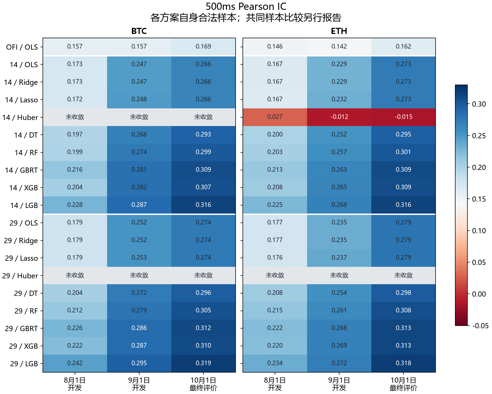
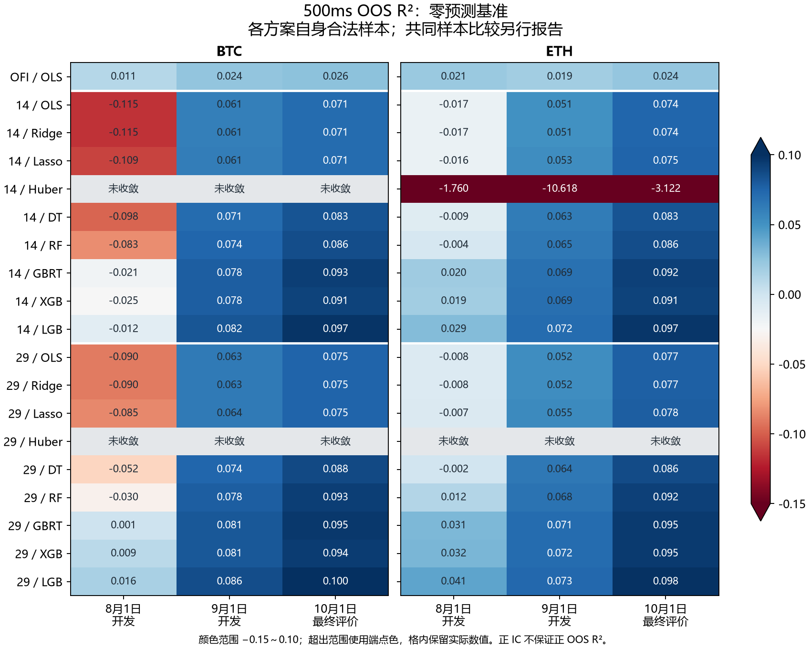
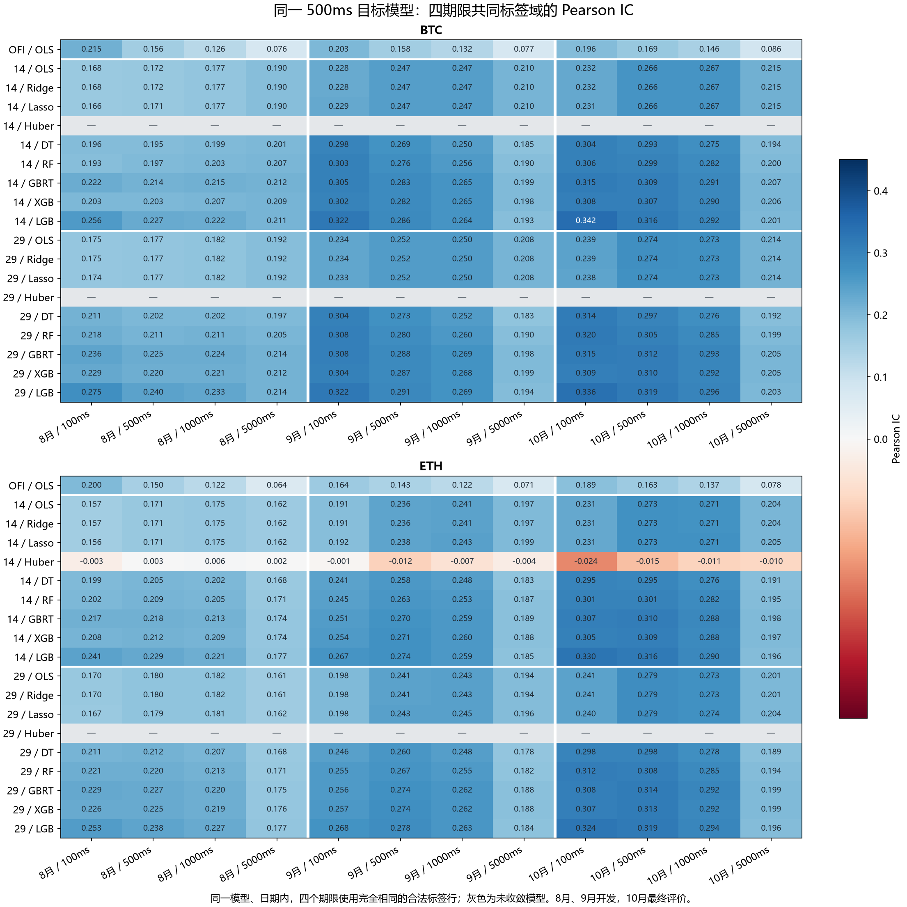

# 加密资产短周期预测的信息增量

**BTC、ETH 的多尺度特征、外部信息与交易检验**

这项研究从一个简单问题出发：盘口和成交流里已经有短周期价格信息，增加时间尺度、其他币种和其他交易场所的数据，还能带来多少改善？进一步的问题是，这些预测能否覆盖费用、延迟和成交约束，形成实际收益。

已有结果显示，从 14 个基础输入扩展到 29 个多尺度输入后，BTC、ETH 的八个可配对模型家族在三个评价日的 IC 和样本外 R² 均有所改善。辅助信息的效果更不均匀，跨币信息较一致，衍生品状态则在不少比较中降低了预测表现。交易端的首批结果与预测端有明显距离：多数已完成模型没有下单，正相关尚未转化为持续的交易收益。

本文汇总已完成的预测比较和首批执行结果。信息增量的共同样本实验及完整交易矩阵仍在计算，文中的结论对应下表所列范围。

## 研究范围与时间安排

预测和交易对象是 Binance 的 BTC、ETH USDT 线性永续合约。使用 Tardis 历史归档中的盘口、报价和成交流，以及相应衍生品状态与资金费数据；现货、SOL 和 Bybit、OKX 数据作为辅助信息。SOL 不进入交易组合。

数据是 2026 年 5 月至 10 月每月 1 日的六个观察日，合计六天，而非连续六个月。5、6、7 月的观察日用于训练，8、9 月用于开发诊断，10 月用于固定模型的最终评价。模型按币种分别拟合，以 100ms 为决策网格，主目标是未来 500ms 的中间价收益。

| 实验 | 设计 | 本文采用的结果 |
|---|---|---|
| 基础预测 | OFI 单变量；14、29 输入各九个模型，两币共 38 个候选 | 35 个拟合成功，105 份逐日评价完成；3 个 Huber 未收敛 |
| 辅助信息 | 在 29 输入上逐一加入七类信息，两币共 14 组 | 14 组完成，112 个模型成功、14 个 Huber 未收敛 |
| 共同样本 | 两币各比较 14→29 及七类辅助信息，共 16 组 | BTC 的八组及 ETH 的 14→29、衍生状态、Bybit/OKX 联合信息、现货信息、BTC/ETH 及 BTC/ETH/SOL 信息六组完成，共十四组；其余两组继续 |
| 信息延迟 | 跨币、Bybit 信息分别延迟 100/200ms，Ridge 与 XGBoost 对照 | 16 个候选中 12 个成功；4 个 Ridge 因训练列全缺失失败 |
| 跨币迁移 | 六个相对量特征，分别用 BTC、ETH、两币训练 Ridge | 3 个模型、6 个训练与评价币种组合、18 份逐日评价完成 |
| 交易检验 | 主动吃单（Taker）主线、信息增量、延迟、挂单（Maker）与迁移，预定 1,224 个组合 | 本文使用已核对的主线 210 例、信息增量 74 例、信息延迟 26 例、Maker 17 例（固定报价 13 例、校准报价 4 例）及迁移矩阵 8 例（同币基准 4 例、ETH→BTC 3 例、两币联合训练 1 例），共 335 例；另有主线 18 例因拟合失败未运行，其余矩阵继续计算 |

每个观察日独立说明覆盖情况。盘口序号中断、连接断开或来源缺口会切开有效观察段，特征、标签和订单都按这些边界处理。

## 如何区分信息、模型与样本的作用

OFI 基线用订单流不平衡解释未来收益。14 输入补充价差、盘口深度和买卖不平衡、微价格偏离、成交量及短期价格变化；29 输入进一步描述不同时间尺度上的订单流、成交压力和收益状态。两者主要使用同一市场流，区别在于对历史信息的表达方式。

辅助信息分为七组：衍生品状态、现货与永续关系、BTC/ETH 信息、BTC/ETH/SOL 信息、Bybit、OKX、Bybit 与 OKX 联合信息。每组都在相同的 29 输入基线上增加，避免同时改变基线和信息来源。BTC/ETH 信息块也包含目标币自己的派生列，因此整个块的改善包含自身特征扩展和跨币信息两部分。

九个模型家族为普通最小二乘回归（OLS）、Huber 稳健回归、岭回归（Ridge）、Lasso 回归、决策树、随机森林、梯度提升回归树（GBRT）、XGBoost 和 LightGBM。参数在训练阶段固定，随机种子为 42；线性模型和 Huber 使用训练期估计的缩放，树模型不做训练缩放。部分模型使用缺失标志与训练期插补，支持原生缺失的模型沿用自身规则。标签不插补，无法估计的全缺失训练列保留为失败原因。

特征只使用决策时已观察到的信息。信息延迟改变可用输入，执行延迟改变订单何时生效，两者分别实验。模型训练和评价还检查标签是否已经成熟，避免把尚未发生的价格变化带入拟合。

比较分两层：先在各方案自身可用样本上评价，再把训练键和评价键分别取交集，重拟合共同样本模型。前者反映整套方案在实际数据条件下的表现，后者用于分离样本变化的影响。交易回放使用决策时可获得的预测，不用事后标签是否齐全来删选交易时点。

## 多尺度输入改善了预测，但相关性和误差并不等价

预测指标按币种、按观察日计算。Pearson IC 衡量预测与未来收益的线性关联；样本外 R² 定义为 `1 − 模型均方误差 / 基准均方误差`，本文主要使用始终预测零的基准。R² 为负意味着模型的平方误差比预测零更大。

图 1　35 个成功模型的未来 500ms 收益相关性。失败候选保留在完整实验集合中。

14→29 输入的 48 个可配对结果中，IC 与零预测基准 R² 的增量全部为正。这 48 项来自八个家族、两个币种和三个日期，模型共享行情，结果之间存在相关性。

BTC 的共同样本重拟合保留了这一方向：16 个成功模型都使用 2,590,917 个训练观察，三个评价日的共同观察数分别为 863,232、863,762 和 863,923。八个家族的 24 个 IC 配对仍全部改善，两个 Huber 保持未收敛。这组多尺度增量没有被样本集合的差异解释掉。

ETH 的共同样本实验也保留了多尺度增量：17 个模型成功，使用 2,590,933 个训练观察和三个评价日合计 2,590,864 个共同观察。八个可配对家族的 24 项 IC、零预测与训练均值两种基准下的各 24 项 R² 增量均为正。IC 增量范围为 +0.00211～+0.01276，零预测基准 R² 增量为 +0.00110～+0.01587。29 输入 Huber 未收敛，因此 Huber 不进入这 24 个配对，逐项汇总见[共同样本比较表](data/crypto-information-comparisons.csv)。

在 10 月观察日，29 输入 LightGBM 的 IC 为 BTC 0.31912、ETH 0.31847；OFI 基线分别为 0.16939 和 0.16249。完整逐日数值见[主线结果](data/crypto-primary-500ms-summary.csv)及[14→29 配对表](data/crypto-primary-14-29-own-comparison.csv)。

这些 IC 是单币逐日时间序列相关，不能直接与 A 股日频横截面 IC 比较，也不代表收益率或胜率。按同日零预测基准 MSE 开平方，500ms 目标收益的均方根幅度为 BTC 约 0.369bp、ETH 约 0.464bp，低于本研究设定的 5bp 单边 Taker 费率；价差、延迟和深度还会影响实际执行。这一量级比较说明预测关联与交易利润之间仍有距离，均方根并非模型可赚取的收益，也不能单凭它归因所有零下单结果。

图 2　同一模型的平方误差评价。负值表示预测幅度的误差高于零预测基准。

8 月 BTC 的 17 个成功模型中，只有 4 个 R² 为正。14 输入 OLS、Ridge 的 IC 约为 0.173，R² 却约为 −0.115；扩展到 29 输入后，IC 约为 0.179，R² 改善到约 −0.090，仍低于零基准。相关系数对整体正比例缩放不敏感，而平方误差会惩罚幅度偏差，这解释了两个指标为什么会分开走。

在自身样本实验中，ETH 的 14 输入 Huber 原生拟合返回成功，三个日期的 R² 约为 −1.760、−10.618 和 −3.122。优化器返回成功、参数充分优化与模型有好的样本外表现，需要分别检查。换用冻结训练均值作为基准后，105 项结果仍有 80 项 R² 为正，两种基准没有发生正负号翻转。

这个单边 Huber 在共同样本重拟合后的结果与上述结果明显不同。逐列哈希核对表明，两次拟合的有效训练键、特征、标签和权重相同，参数也相同，仍得到了不同的系数。两份模型和评价均保留，没有挑选较好的版本替换原实验；其余 16 个成功模型与各自原结果的差异仅在舍入尾数。这一复现限制不改变八个可配对家族的增量计数。

进一步只读核对发现，两份 Huber 保存参数的训练目标值分别为 138.7525、134.8463，均高于同一目标下一组可行零预测参数的 132.8839；复算梯度也明显高于声明的停止阈值。因此，这两份结果存在优化质量问题，不能把拟合成功状态当作参数已充分优化的证据。这项核对没有重新训练或改变既有预测；原优化器的具体停止消息未保存，数值终止原因仍未完全确定。

## 辅助信息的增量并不均匀

下表每行与同币、同家族、同日期的 29 输入模型比较，包含八个成功家族的 24 个配对。正增量按绝对差大于 10⁻¹² 计数，以排除浮点计算的尾差；这是数值比较规则，并非经济显著性门槛。

| 目标币 | 新增信息 | IC 改善数 | R² 改善数 | IC 增量范围 |
|---|---|---:|---:|---:|
| BTC | 衍生品状态 | 10/24 | 6/24 | −0.00760～+0.00047 |
| BTC | 现货信息 | 11/24 | 7/24 | −0.00002～+0.00389 |
| BTC | Bybit 与 OKX | 17/24 | 17/24 | −0.00164～+0.00922 |
| BTC | Bybit | 21/24 | 22/24 | −0.00002～+0.00359 |
| BTC | OKX | 11/24 | 13/24 | −0.00170～+0.00871 |
| BTC | BTC/ETH | 24/24 | 23/24 | +0.00122～+0.02624 |
| BTC | BTC/ETH/SOL | 24/24 | 23/24 | +0.00182～+0.03130 |
| ETH | 衍生品状态 | 10/24 | 13/24 | −0.00690～+0.00096 |
| ETH | 现货信息 | 18/24 | 16/24 | −0.00247～+0.00428 |
| ETH | Bybit 与 OKX | 20/24 | 19/24 | −0.00136～+0.00580 |
| ETH | Bybit | 24/24 | 24/24 | +0.00011～+0.00394 |
| ETH | OKX | 13/24 | 12/24 | −0.00263～+0.00364 |
| ETH | BTC/ETH | 23/24 | 24/24 | −0.00088～+0.00989 |
| ETH | BTC/ETH/SOL | 24/24 | 24/24 | +0.00032～+0.01489 |

跨币信息的改善较一致。BTC 的 OLS 在 8 月加入 BTC/ETH/SOL 信息后，IC 从 0.17912 升至 0.21041，R² 从 −0.09027 改善到 −0.05622：关联更强，幅度误差仍高于零基准。进一步以 BTC/ETH 信息为基线，单独增加 SOL 后，BTC 的 24 项比较中有 23 项 IC、22 项 R² 改善。

衍生品状态没有显示同样的一致性。BTC 在 9 月的 OLS，加入这组信息后 IC 从 0.25200 降至 0.24441；ETH 同期从 0.23473 降至 0.22824。BTC 的共同样本实验也保留了这一结果：24 项中只有 10 项 IC、6 项 R² 改善。变量有清楚的经济解释，并不意味着它一定能改善当前模型。

BTC 的 Bybit/OKX 联合信息在共同样本上仍有 17 项 IC、17 项 R² 改善。BTC/ETH 信息块的共同样本实验也已完成：24 项 IC 全部改善、23 项 R² 改善；唯一的 R² 下降来自 8 月的普通决策树，降幅约 0.00158。它保留了跨币信息的主要改善方向，同时也说明更高的 IC 不一定对应更低的平方误差。

BTC/ETH/SOL 信息块在共同样本上的 24 项 IC 也全部改善、23 项 R² 改善，唯一的 R² 下降仍来自 8 月普通决策树，降幅约 0.00196。这是整个信息块相对 29 输入基线的比较，不能独立归因于 SOL。其他尚未完成共同训练对照的信息块，表中结果仍来自各自可用样本。

BTC 的 Bybit 单场所信息也已完成共同样本比较：24 项 IC 中有 21 项改善、3 项下降，24 项 R² 中有 22 项改善、2 项下降，与各自可用样本上的方向一致。固定训练和评价样本后，这组外部信息仍有预测增量，但改善并不覆盖所有模型和日期。

BTC 的 OKX 单场所信息在共同样本上则有 11/24 项 IC、13/24 项 R² 改善，与各自可用样本上的方向一致。IC 增量范围为 −0.00170～+0.00871，R² 增量范围为 −0.00318～+0.00541；固定样本后仍有接近一半的比较下降，没有显示跨模型、跨日期的一致优势。

BTC 现货信息的共同样本比较也已完成。固定训练与评价域后，24 项 IC 中 11 项改善、1 项下降、12 项在数值容差内持平；零预测与训练均值两种基准下，R² 均为 7 项改善、5 项下降、12 项持平。IC 增量范围为 −0.000018～+0.003890，零预测基准 R² 增量为 −0.004338～+0.002351，与各自样本结果的方向一致。到此，BTC 的八组共同样本实验均已核对；现货信息的增量仍较小且不均匀。

ETH 衍生状态的共同样本比较也已完成。训练域固定为 2,590,933 行，评价域为 2,590,864 行，双方各自合法样本均等于相应交集；参数和训练窗口保持一致。24 项 IC 中 10 项改善、13 项下降、1 项在数值容差内持平；两种基准的 R² 均为 13 项改善、10 项下降、1 项持平。IC 增量范围为 −0.006903～+0.000957，零预测基准 R² 增量为 −0.004950～+0.004167，与各自样本结果方向一致。这组状态信息没有带来跨模型和日期的一致改善。

ETH 的 Bybit/OKX 联合信息也已在共同样本上复核：24 项 IC 中 20 项改善、4 项下降，两种基准下的 R² 均为 19 项改善、5 项下降。IC 增量范围为 −0.001359～+0.005796，零预测基准 R² 增量为 −0.001355～+0.005473。训练域、评价域与实际模型参数均已对齐，主要方向与各自可用样本一致；这是联合信息块的预测增量，不能拆分为单个场所贡献，也不能替代扣费后的交易检验。

ETH 现货信息的共同样本实验已核对：24 项 IC 中 18 项改善、6 项下降，两种基准下的 R² 均为 16 项改善、8 项下降。IC 增量范围为 −0.002473～+0.004276，零预测基准 R² 增量为 −0.001744～+0.002811。实际拟合参数、训练窗口与共同样本域均已对齐，方向与各自可用样本一致；这支持部分模型中的小幅预测增量，尚不能说明加入现货信息普遍有效或产生扣费后收益。

ETH 的 BTC/ETH 信息块在共同样本上也保留了主要改善方向：24 项 IC 中 23 项改善，两种基准下的 24 项 R² 均改善。唯一的 IC 下降来自 8 月普通决策树，降幅约 0.000877；零预测基准 R² 增量范围为 +0.000593～+0.006192。实际拟合参数、训练和评价域已对齐。这支持整个信息块在当前样本中的预测增量，仍不能把它全部归因于另一币种的信息，或直接推断扣费收益。

ETH 的 BTC/ETH/SOL 信息块也完成共同样本比较：24 项 IC 与两种基准下各24项 R² 均改善，IC 增量范围 +0.000323～+0.014892，零预测基准 R² 增量 +0.000629～+0.012847。实际模型参数、训练窗口和共同样本域已对齐，改善方向与各自可用样本一致。这里比较的是整个信息块相对29输入基线的增量，不能独立归因于SOL，也不能据此推断扣费后收益。

两币的 Bybit、OKX 单场所组中，随机森林、XGBoost、LightGBM 使用 1 线程，对应主线为 4 线程；其余已核对的模型参数和时间窗口相同。完整计数及范围见[信息增量比较表](data/crypto-information-comparisons.csv)。

## 预测期限、信息延迟与跨币迁移

用同一个按 500ms 目标训练的模型，分别评价未来 100、500、1,000、5,000ms 收益，可以观察信号在不同尺度上的关联。四个期限使用相同的成熟标签样本，每项约有 86.3 万个观察。

图 3　固定模型的多期限 IC，使用同模型、同日四个期限的共同标签样本。

105 个模型与观察日组合中，38 个的 IC 随期限严格递减，67 个至少有一处持平或上升。OFI 的六个组合全部递减；BTC 8 月的 29 输入 Ridge 则从 100ms 的 0.17511 升至 5,000ms 的 0.19192。期限曲线不仅受信号持续性影响，也受各期限收益的波动与相关结构影响。

信息延迟实验中，XGBoost 的 12 个可配对结果有 11 个在延迟从 100ms 增至 200ms 后 IC 下降，10 个 R² 下降。变化虽多为负，仍有例外，见[延迟配对表](data/crypto-information-delay-xgb-comparisons.csv)。四个 200ms Ridge 配方则因部分选定列在训练期全部缺失而失败：延迟与输入最大年龄共同作用，已经使这些列无法获得合法观测。失败本身反映了信息时效约束。

跨币迁移使用六个相对量特征，以保持不同价格、数量尺度之间的可比性。下表固定展示 10 月，完整比较也包含 8、9 月。

| 评价币种 | 训练币种 | 10 月 IC | 10 月 R² |
|---|---|---:|---:|
| BTC | BTC | 0.24916 | 0.06178 |
| BTC | ETH | 0.24690 | 0.05089 |
| BTC | 两币 | 0.24820 | 0.05832 |
| ETH | BTC | 0.26002 | 0.06624 |
| ETH | ETH | 0.26042 | 0.06709 |
| ETH | 两币 | 0.26070 | 0.06792 |

BTC 三个日期都是同币训练略好；ETH 的领先方案随日期变化。相对量特征存在跨币可迁移的预测关联，但联合训练没有统一优势。

执行层已完成 BTC 训练并在 BTC 评价的八月连续账户与独立模式七段，以及九月、十月连续账户，属于四个同币基准场景、十个账户区间。原生回测、统计与成员表复读完成，订单、成交、毛净损益、费用和现金账户回撤均为0，年化指标仍未定义；这些同币结果不能证明跨币迁移的交易价值。

ETH 训练→BTC 评价的八月两种模式及九月连续账户均已完成原生回测与统计核验，共三个场景、九个账户区间，六个相对量输入和训练窗口保持不变，同样零下单、零成交、零毛净损益及零现金回撤，年化指标未定义。预测关联在这些跨币账户上尚未形成实际订单。两币联合训练、在BTC八月评价的continuous账户也完成原生模型身份与统计核验，零下单、零成交、零损益及零现金回撤；其余28个场景继续。

## 从预测到交易：首批结果为何大多不下单

Taker 基准账户初始资本为 100,000 USDT，单边费用 5bp，执行延迟 100ms。BTC 单笔数量上限为 0.01、仓位上限 0.1，ETH 分别为 0.1 和 1。行动选择把预测收益与盘口成交条件、费用和库存状态一起比较。回放区分连续账户与缺口后重新起步的独立账户段，并记录实际部分成交、资金费和剩余持仓。

下表展示已完成的 BTC 8 月连续账户，完整数值见[首批执行结果](data/crypto-first-execution.csv)。八个 14 输入模型包括 OLS、Ridge、Lasso、决策树、随机森林、GBRT、XGBoost 和 LightGBM。

| 模型 | 成交次数 | 毛损益（USDT） | 成交费用（USDT） | 净损益（USDT） |
|---|---:|---:|---:|---:|
| OFI / OLS | 2 | 7.061000 | 0.624392 | 6.436608 |
| 八个 14 输入模型，各自结果 | 0 | 0 | 0 | 0 |
| 29 输入 OLS | 0 | 0 | 0 | 0 |

表中九个多输入模型的零成交来自零下单。每个模型有 863,267 个决策时点，其中 34 个因未来资金费信息不足而无法评估，其余时点都没有选择正增益交易。进一步读取开发期全部 35 个成功模型的保存预测，共 70 个模型与日期组合、约 6,045 万条预测：60 个组合的最大绝对预测幅度都没有超过 5bp；按同刻最优买卖价计入 5bp 入场费用后，62 个组合连最优一档的正收益机会也没有。这个筛查暂不计资金费、仓位与更深档位，不能替代完整回测，但直接说明了大部分预测幅度与当前成本门槛的不匹配。

下表列四个代表性组合，单位为 bp；预测幅度使用绝对值，不是已实现收益。

| 币种与模型 | 观察日 | 99.9% 分位 | 最大值 | 5bp 费用下最优一档正增益时点 |
|---|---|---:|---:|---:|
| BTC 14输入 Ridge | 8月 | 0.5866 | 4.8576 | 0 |
| BTC 29输入 LightGBM | 8月 | 0.5460 | 4.0014 | 0 |
| ETH 29输入 LightGBM | 8月 | 0.6620 | 4.2801 | 0 |
| ETH 29输入 LightGBM | 9月 | 0.6676 | 2.6747 | 0 |

少数超过 5bp 的预测也未必能交易。例如 ETH 14 输入 OLS 与 Ridge 在 9 月各有两个这样的时点，计入当时买卖价差后仍没有正增益。ETH 多尺度线性模型也出现极少数正增益时点，已核对的 29 输入 OLS、Ridge 在 8 月各有三笔、9 月各有一笔成交，Lasso 在 9 月也有一笔；下文说明它们共享的市场事件。BTC 8月 OFI 的两个正增益时点则与已保存账本的两次下单一致。此次诊断只读取 8、9 月开发期预测，没有用 10 月选择新规则。

OFI 账户只有两次成交，均为买入，窗口末仍持有 0.02 BTC；净额相当于初始资本的 0.006437%。其 500ms 成交后价格变化金额只有 0.005 USDT，远小于整个窗口的毛损益。策略没有要求每笔成交在 500ms 后强平，后续持仓重估也计入收益，因此账户利润包含更长持仓路径的影响。盘口路径缺口使这个账户的连续最大回撤无法确定；九个纯现金账户的回撤为零。

同日的独立段模式中，这两笔 OFI 成交落在同一个账户段，其净损益为 −3.063392 USDT，另外六段没有交易。连续账户允许缺口后的持仓延续，独立账户在段末估值后结束；同样的成交因此不保证相同收益。该活跃段的最大回撤可定义为 −0.003185%，也不能替代连续账户未定义的整日回撤。

主线 228 个预定场景已全部到达终态，其中 210 例完成原生回测与统计，包含 805 个实际账户区间；BTC 14/29 输入和 ETH 29 输入三个 Huber 模型拟合未收敛，对应的 18 例未运行。未运行与零交易分别保留。其中 BTC 的 17 个成功模型已覆盖三日、两种账户模式；ETH 的 OFI 与 14 输入九个模型也均已覆盖三日、两种账户模式；29 输入另已核对 OLS、Ridge、Lasso、决策树、随机森林、GBRT、XGBoost 和 LightGBM 各六例。除 BTC 8 月 OFI、下述 ETH Huber、29 输入 OLS、Ridge 和 Lasso 外，其余已核对的主线账户均没有下单。

ETH 29 输入 OLS 的 8 月连续账户创建并成交三笔卖单，每笔选择 0.001 ETH，均全部成交；设定的 0.1 ETH 是单笔上限。毛损益 −0.045055 USDT、费用 0.00274372 USDT、资金费为零，净损益 −0.047799 USDT。窗口末仍持有 −0.003 ETH，已实现平仓损益为零；三笔 500ms markout 与连续最大回撤均未定义。少数预测超过成本门槛可以触发交易，但这三笔成交尚未形成盈利证据。

三笔 OLS 交易的观察限制还来自同一次盘口缺口：决策发生在 18:45:07.0～07.2 UTC，缺口从 18:45:07.335529 开始，三笔入场后的 500ms 观察窗都跨过缺口。对应决策的 500ms 目标标签及可用时间也均缺失。因此，同日整体预测指标无法验证这三笔信号的准确性，期末库存损益也不能补足它们的短期价格响应。未来缺口和标签缺失不能回填为当时的交易过滤条件。

8 月独立段模式也有三次成交，集中在七个账户段中的一段：毛损益 −0.000250 USDT、费用 0.00274372 USDT、净损益 −0.002994 USDT，其余六段没有交易。活跃段在盘口边界截断，三笔 500ms markout 仍未定义；段内最大回撤可以计算，但不能替代连续账户的完整日回撤。两种账户模式的估值终点和持仓延续规则不同，损益不能直接互换。

ETH 29 输入 Ridge 的 8 月连续账户也有三笔成交。原生逐笔比较确认，其成交时钟、数量、名义金额及现金流均与同日 OLS 相同，毛损益、费用、净损益及未定义回撤也逐项一致；请求和账本身份不同，未误读同一产物。两模型共享同一组三笔交易，不能视作更多独立交易样本。 Ridge 的 8 月独立模式也有同样三笔成交，集中于七段中的一段，净损益为 −0.00299372 USDT；成交与现金流均与连续模式相同，但估值截止于该盘口段末，末仓仍为 −0.003 ETH。其余六段零交易。

9 月，ETH 的 29 输入 OLS、Ridge、Lasso 与跨币信息延迟 100ms Ridge 四个连续账户都在同一时点卖出 0.1 ETH。四套配方的成交与现金流逐项相同，在相同账户模式下的期末净额也相同。这是四套配方共享的一次市场事件，不能算成四份独立盈利证据。

OLS、Ridge、Lasso 与跨币延迟 Ridge 的独立模式各有九个观察段，只有一个段发生这笔卖出，其余八段零交易。四套配方在同一账户模式下的结果相同，而连续与独立模式的损益随估值终点改变：

| 账户模式及已核对配方 | 估值终点 | 毛损益（USDT） | 费用（USDT） | 净损益（USDT） |
|---|---|---:|---:|---:|
| 连续：OLS、Ridge、Lasso、跨币延迟 Ridge | 当日窗口结束 | +0.155500 | 0.1209505 | +0.0345495 |
| 独立段：OLS、Ridge、Lasso、跨币延迟 Ridge 的唯一活跃段 | 盘口段结束 | −0.006500 | 0.1209505 | −0.1274505 |

两种模式在各自估值终点都仍持有 −0.1 ETH，没有退出成交，资金费及已实现平仓损益均为零。正负差异来自同一未平仓库存的重估，尚未扣除并未发生的退出费用。该笔交易的 500ms 目标和 markout 窗口均跨过盘口缺口，短期响应未定义；独立段内最大回撤可计算，连续账户的完整路径回撤仍未定义。因此，连续账户的微利不能证明短期交易已经盈利。

10 月 OLS、Ridge、Lasso 的两种模式，8 月 Lasso 的两种模式、决策树与随机森林的 8/9/10 月两种模式、GBRT 的三日两种模式、XGBoost 的 8/9 月两种模式与 10 月连续模式、LightGBM 的 8 月两种模式与 9/10 月连续模式均零交易。

ETH 14 输入 Huber 在 8 月连续账户中创建并成交 10 笔订单，均为卖出，窗口末仍持有 −1 ETH；毛损益 22.889000 USDT，费用 0.933527 USDT，资金费收入 0.103641 USDT，净损益为 22.059114 USDT。但其 500ms 成交后价格变化金额为 −0.051000 USDT，正的账户净额不能解释为短期限预测盈利。账户端点可核算，中间盘口观察不完整，连续最大回撤仍未定义。独立段模式共有 36 次成交，七段净损益为四正三负，范围 −15.544074～+21.689114 USDT。这些回测使用原实验保存的 Huber 模型；前述同输入重拟合差异仍然保留，单个日期的正净额不足以证明该模型稳定。9 月连续账户也有 10 笔卖出，窗口末仍持有 −1 ETH；净损益 +52.579189 USDT，500ms markout 却为 −0.106000 USDT，约 97.71% 的观察时长处于仓位上限，再次显示收益主要需要结合长于预测期限的库存路径解释。

9 月独立模式另有 83 次成交、费用 10.024153 USDT，九段净损益六正三负，范围 −15.066795～+24.307250 USDT；九项段内回撤均可定义。10 月连续账户成交 10 次，均为卖出，末仓仍为 −1 ETH；毛损益 −22.070920、费用 1.341492、资金费收入 0.285144，净损益 −23.127268 USDT，500ms markout 为 +0.028080 USDT，连续回撤仍未定义。不同日期的短期限价格响应与账户损益没有稳定对应关系，独立段也不能相加冒充连续账户。10 月独立模式的四段各成交 10 次，共费用 5.365805 USDT；净损益依次为 +1.997588、−8.021365、+0.613055、−23.326535 USDT，两正两负，段内回撤均可定义。至此，原 ETH 14 输入 Huber 的三日、两种账户模式均已核对，仍无跨日期稳定盈利的证据。

信息增量的 74 例、281 个账户区间均无下单和成交，其中 BTC 衍生状态八个成功模型的48例已齐备；外部联合信息已有26例，OLS、Ridge与Lasso各六例、决策树五例、随机森林三例；三个线性模型家族的三个日期两种模式均齐备，新增随机森林九月连续账户。信息延迟已核对 26 例、100 个区间：18 例 BTC 跨币账户仍零下单、零净损益；ETH 跨币信息延迟 100ms Ridge 的九月两种账户模式都只有上表所述同一次卖出，十月两种模式共五个账户区间均零交易。该Ridge的三个日期、两种模式至此齐备；ETH 跨币信息延迟 100ms XGBoost 的八月两种模式共八个区间也均零下单、零成交和零净损益。不能据此认定延迟信息具有独立、稳定的交易价值。

上述 Ridge 信息延迟模型的 8 月连续账户另有 4 笔成交，一买三卖，每笔 0.001 ETH，末仓为 −0.002 ETH。毛损益 −0.044440 USDT、费用 0.003665495 USDT、资金费为零，净损益 −0.048105 USDT；四笔 500ms markout 与连续最大回撤均未定义。两个日期分别保留实际损益，少量成交不足以判断跨日稳定性。

8 月信息延迟的独立模式共有七段，其中两段交易：第一段买入 0.001 ETH，段末净损益 +0.000063225 USDT；另一段三次卖出、末仓 −0.003 ETH，净损益 −0.00299372 USDT，其余五段零交易。四笔成交与连续模式逐项相同，费用合计也相同；独立账户在缺口后重新初始化，两个活跃段均未平仓，已实现平仓损益均为零，而连续账户的已实现平仓损益为 −0.01407 USDT。因而两种模式既有估值终点差异，也有跨段持仓延续差异，不能拼成同一条收益路径。三笔卖出及其现金流还与主线 29 输入 Ridge 的同日独立段完全相同，不应重复计算独立交易样本。四笔 500ms markout 均未定义。

窗口从 00:00:00 到 23:59:59.9，没有覆盖两个完整午夜之间的收益区间；各观察日又分散在不同月份，所以本文不报告年化 Sharpe。

Maker 另以公开 L2 的队列规则进行敏感性检验。首批三例是 BTC 8 月的固定报价基线，均不使用收益预测或压力模型；单次报价 0.01 BTC、仓位上限 0.1 BTC，单边费用 2bp。

三种执行延迟的账户都在约 18:30:40 出现无法确定的后续执行状态。此前约 18.51 小时、占窗口 77.13% 的路径可以核算，结果如下；整段日内净损益和最大回撤仍未定义。

| 执行延迟 | 已确认前段成交次数 | 已确认前段费用（USDT） | 已确认前段净损益（USDT） |
|---|---:|---:|---:|
| 0ms | 4,138 | 483.731110 | −752.525292 |
| 100ms | 2,559 | 298.385659 | −457.774941 |
| 200ms | 1,931 | 224.130448 | −330.091730 |

在这三条路径的已确认部分，延迟增加伴随成交和费用下降，亏损也缩小。这段行情中的固定报价基线亏损，成交费用进一步降低了净收益。预测驱动的校准报价已有下述三例完成，其余场景仍在运行。表中金额是截至最后一次可靠估值的账户结果，并非完整观察日收益，逐项值见[执行汇总数据](data/crypto-first-execution.csv)。

BTC 8 月三种延迟的独立账户模式各包含 7 段，0、100、200ms 下分别成交 7,822、4,754、3,483 次，费用为 917.79、556.29、408.58 USDT。全部 21 个段结果的净损益均为负。每组可核算路径合计约 86,326.66 秒、缺失约 73.24 秒；独立段各自重新初始化，不能把这些金额拼成连续账户收益。

| 独立段 | 0ms 净损益 | 100ms 净损益 | 200ms 净损益 |
|---|---:|---:|---:|
| 1 | −752.525292 | −457.774941 | −330.091730 |
| 2 | −15.680051 | −11.471268 | −8.037651 |
| 3 | −81.537172 | −55.001929 | −38.412299 |
| 4 | −0.745368 | −0.499246 | −0.499246 |
| 5 | −60.517410 | −36.558817 | −26.604200 |
| 6 | −434.050531 | −257.881058 | −177.473033 |
| 7 | −33.216769 | −24.658340 | −18.645884 |

金额单位为 USDT。9 月三种延迟的连续账户也出现后续执行无法确定的情况，只有约 10,020.60 秒、占窗口 11.60% 的前段可核算，完整日净损益和回撤仍未定义。

| 执行延迟 | 已确认前段成交次数 | 已确认前段费用（USDT） | 已确认前段净损益（USDT） |
|---|---:|---:|---:|
| 0ms | 3,139 | 445.955995 | −652.255595 |
| 100ms | 1,913 | 272.448291 | −376.644591 |
| 200ms | 1,324 | 186.526420 | −247.947620 |

9 月 0ms 的独立账户模式另有九段，共成交 37,743 次、费用 5,441.77 USDT。九段毛损益与净损益均为负，净损益范围为 −1,740.91～−46.41 USDT；段内最大回撤均可定义，范围为 −1.74133%～−0.04650%。加上 8 月的 21 段，这 30 个独立段结果全部亏损，仍不能拼成一个连续账户。

9 月 100ms 的固定报价独立模式也已完成，共 22,427 次成交、费用 3,237.735593 USDT。九段毛损益与净损益仍全部为负，净损益范围 −1,038.877460～−37.455767 USDT，段内最大回撤范围 −1.039226%～−0.037579%。上述固定报价独立账户共 39 段，净损益均为负；这些段仍不能拼接成连续账户。

9 月 200ms 固定报价独立模式也完成了九段，共 15,823 次成交、费用 2,272.801617 USDT。九段毛损益及净损益仍全部为负，净损益范围 −714.342776～−27.079617 USDT，段内最大回撤范围 −0.714897%～−0.027201%。已核对的固定报价独立账户由此增至 48 段，均未盈利；这一 200ms 结果的成交数和费用低于 100ms 结果，仍未获得正收益。

预定 10 月留出观察中，BTC 0ms 固定报价连续账户新增 8,831 次已确认成交。可核算前段覆盖约 7.75 小时、占原窗口 32.2941%，毛损益 −676.213800 USDT、费用 1,348.307225 USDT、资金费为零，净损益 −2,024.521025 USDT；完整期净损益及回撤因未决执行保持未定义。已确认成交的平均 500ms markout 为 −0.676756bp，继续显示费用之外的不利价格变化。这是冻结设置下的留出结果，不用于选择或调整参数。

十三例固定报价结果均保留在同一执行数据表中；上述前段金额不能代表完整观察日收益。进一步分解此前 30 个独立段，毛损益全部为负；保持原成交路径、把手续费改为零的原生成本敏感性结果也全部为负。各段平均 500ms 成交后收益为 −0.968～−0.042bp，说明费用之外还有不利的成交后价格变化，不能靠免手续费解释为有利策略。

例如 8 月 0ms 的第一段，毛损益 −268.371600、手续费 483.731110、资金费 −0.422582，合计净损益 −752.525292 USDT。费用解释约 64.3% 的亏损，但零费用后仍亏损 268.794182 USDT。该段约 22.87% 的观察时长处于仓位上限，而固定报价的库存偏移参数为零。它在最优买卖价报价，却没有预测或成交质量筛选；这两天 BTC 的典型完整买卖价差仅约 0.013～0.016bp，也远低于两次成交合计 4bp 的费用假设。成交后的不利价格变化、费用和库存路径需要共同解释，500ms markout 与账户毛损益存在重叠，不能再相加扣除。

BTC 9 月的预测与校准报价已有 0ms、200ms 两个连续账户完成。模型保持冻结，成交校准只使用 8 月数据，费用仍为单边 2bp。0ms 场景创建 13 笔订单、成交 7 笔，毛损益 22.978500、费用 1.078589、资金费收入 0.059875，净损益 +21.959786 USDT，窗口末仍持有 0.01 BTC。六笔有合法 500ms markout 的成交全部为正，合计 4.185500 USDT；扣这六笔的入场费用后为 3.260828 USDT，尚未计退出费用，另有一笔 markout 未定义。连续最大回撤仍因盘口观察不完整而未定义。

200ms 场景创建 7 笔订单、仅成交 1 笔，约 18.46 小时后发生未决执行，已确认前段净损益 +6.862212 USDT；完整日净损益与回撤均未定义，唯一成交也没有合法 500ms markout。两种校准策略在各自与固定报价可共同核算的最初约 2.78 小时内均保持纯现金、净额为 0，对应固定报价前段已分别亏损 652.255595、247.947620 USDT。这个同窗比较说明校准策略避开了一批交易，但不能把不同长度路径的终值相减，当作策略收益增量。0ms 的少量正成交提供了后续验证线索；不同延迟及日期的结果仍须分别核对。

100ms 校准连续账户创建 11 笔订单、成交 7 笔，其中 5 笔买入、2 笔卖出，末仓仍为 0.03 BTC。毛损益 25.314500、费用 1.077271、资金费收入 0.029938，净损益 +24.267167 USDT。六笔有定义的 500ms markout 为五正一负，合计 +2.448500 USDT，扣除这六笔的入场费用后为 +1.525146 USDT，尚未计退出费用；另有一笔 markout 未定义，连续最大回撤也未定义。在与固定报价共同可核算的最初约 2.78 小时内，校准账户保持纯现金，固定报价净亏 376.644591 USDT。它补充了一个非零延迟样本，但七笔成交仍不足以判断跨日稳定性；含剩余持仓的账户终值不能当作七笔完整开平仓的利润。

BTC 9 月 100ms 校准报价的独立模式已完成正式统计和账本交叉核验。九段共11条订单、7次成交，费用1.077271 USDT；成交时间、方向、数量、名义金额和入场费用与连续账户对应事件逐项相同。五段没有成交，四个活跃段净损益按顺序为+2.442683、−0.597417、−2.122662、+19.670125 USDT；其段内最大回撤为−0.013122%至−0.000187%，其他五段回撤为0。覆盖约86,379.75秒、缺失20.15秒，八段截断，年化指标未定义。独立初始化改变了库存和估值终点，九段资金费均为零，不能将各段净额拼成连续账户，也不能把相同七次成交当作新的独立样本。

## 优化试验的首批验证

以下是另立输出的开发期试验，不计入前述冻结矩阵的模型与执行场景数。训练仍限于5月1日、6月1日和7月1日，验证仅用8月1日、9月1日；10月没有参与新规则或参数选择。

Huber先检验内部目标缩放是否改善数值求解。保持训练数据和统计目标，标签在求解时乘10,000、正则强度相应换算，输出恢复十进制收益。两台机器的原单位目标值改善为132.887311、132.887382，比原模型的138.752473、134.846281低；但仍略高于可行零预测参照132.883931，投影梯度约5.75×10⁵、4.94×10⁵，不能称优化质量已经合格。8月两次拟合的IC约0.0331、0.0333，零预测基准R²约0.00015；9月IC约−0.0104，R²约−0.00013。两次验证日的最大预测幅度分别约0.307bp、1.300bp，均低于单边5bp费用。两机同参数复现均完整重现保存参数，后端都因目标值相对下降量触发默认停止阈值，而非梯度达到阈值；这解释了本轮成功状态与优化不足为何并存。结果支持继续把数值质量与交易价值分开，不能放大预测以制造交易。

另外按5秒目标重新训练两币的14输入Ridge和LightGBM，得到下表。四个模型、八份逐日评价和对应预测均已原生复读，损失与评价成熟样本数一致。

| 币种与模型 | 验证日 | 成熟样本 | IC | 零预测基准 R² | 最大预测绝对值（bp） | 超过10bp的预测数 |
|---|---|---:|---:|---:|---:|---:|
| BTC Ridge | 08-01 | 862,953 | 0.187172 | -0.051655 | 6.2730 | 0 |
| BTC Ridge | 09-01 | 863,357 | 0.215608 | 0.046447 | 4.0347 | 0 |
| ETH Ridge | 08-01 | 862,936 | 0.158659 | 0.006848 | 3.9745 | 0 |
| ETH Ridge | 09-01 | 863,307 | 0.199837 | 0.039715 | 15.5544 | 2 |
| BTC LightGBM | 08-01 | 862,953 | 0.196718 | -0.022007 | 1.7432 | 0 |
| BTC LightGBM | 09-01 | 863,357 | 0.210001 | 0.044065 | 4.7093 | 0 |
| ETH LightGBM | 08-01 | 862,936 | 0.165560 | -0.002362 | 9.2693 | 0 |
| ETH LightGBM | 09-01 | 863,307 | 0.198904 | 0.036527 | 5.8180 | 0 |

八项IC均为正，零预测基准R²五正三负，说明方向相关性与幅度误差仍需分别判断。只有ETH Ridge在9月有两行预测绝对值超过约10bp的双边Taker费用，其余七组均没有；超过该幅度也不等于能成交或盈利，仍须计算双侧深度、点差、延迟和实际退出。四个模型的两日、两种账户模式共16个完整交易周期回测已启动；另有12个沿用原500ms预测的交易周期对照和8个校准Maker库存惩罚对照在运行。36个新执行对照已有十二个场景完成原生核验，其余继续运行；逐项预测指标见[优化验证数据](data/crypto-optimization-validation.csv)。

首个结果是原ETH 14输入Huber在9月验证日的500ms交易周期对照，采用100ms延迟和双边各5bp费用。275次成交中，274次组成137次完整往返；每次从入场到退出均为400ms，与决策后100ms入场、500ms退出的预定时钟一致。闭合交易毛损益合计+0.417080 USDT，双边费用33.655586 USDT，净损益−33.238506 USDT；137次中1次净盈利、136次净亏损，资金费为0。毛收益明显不足以覆盖费用，原库存策略的正账户净额不能据此解释为可兑现的500ms交易优势。

第275笔入场后，退出指令遇到盘口缺口，最后可观测持仓为−0.1 ETH。包括该未平仓入场的已知前段毛损益为+0.464580 USDT、费用33.777310 USDT、净损益−33.312730 USDT；账户可确认覆盖约63.36%。完整窗口净损益和回撤仍未定义，不能把前段金额补齐成全日收益，也不能用单个验证日判断稳定性。逐项状态与闭合交易摘要见[优化执行结果](data/crypto-optimization-execution.csv)。

同一原 Huber 模型的 8 月验证日现也完成核验。51 次成交中，50 次组成 25 次完整往返，持有时间同为400ms；闭合交易毛损益 +0.572000 USDT、双边费用 4.626496 USDT、净损益 −4.054496 USDT，2 次净盈利、23 次净亏损，资金费为零。另一次入场后的退出遇到盘口缺口，末仓仍为 −0.1 ETH；含该笔的已知前段净损益为 −4.174319 USDT，完整窗口收益及回撤未定义。8 月与 9 月的闭合交易均未覆盖双边费用，原库存账户的正终值没有在这两个500ms交易周期对照中复现。

原 Huber 的九月独立模式也完成回测、统计及原生复读。九个时段共477条指令、474次成交，236次完整往返均持有400ms；闭合交易毛损益−0.328920 USDT、双边费用57.580660 USDT、净损益−57.909580 USDT，1次净盈利、235次净亏损。前137次往返与连续账户已知前段完全相同，不能重复计为独立观察。第5、6段各留下−0.1 ETH未闭合仓；第8段创建一条指令但未成交。

九段账户净损益八负一零，段内最大回撤均可定义，范围−0.014390%～0%；这些账户在段末分别估值和结束，不能拼成连续全日收益。有效观察86,376.501742秒、缺失23.398258秒，八个段因盘口覆盖结束而截断；四次成交的500ms markout缺失，完整UTC收益日计数仍为0，年化指标未定义。闭合交易、未闭合库存及每段统计分别保留在[优化执行结果](data/crypto-optimization-execution.csv)。

BTC 与 ETH 的 OFI 模型在 8、9 月两个验证日的500ms交易周期连续账户均没有下单或成交。四个账户都采用100ms执行延迟和双边各5bp费用，毛损益、费用、净损益及现金账户最大回撤均为0；完整UTC收益日计数为0，年化指标未定义。零净额不能证明盈利，也不能证明实际成交时的执行质量。

BTC OFI九月独立模式另有九段账户完成原生核验，均零下单、零成交、零现金流、零毛净损益及零现金账户回撤。有效观察86,381.523273秒、缺失18.376727秒，八段因盘口覆盖结束而截断；每段完整UTC收益日计数均为0，年化指标仍未定义，九段不拼接为全日账户。

其中，BTC OFI 的 8 月账户与原库存账户使用相同输入、预测、窗口、费用和100ms延迟，只改变持仓与退出规则；原规则的两次买入在往返规则下均未发生。当日预测最大绝对幅度约6.7646bp，不足以覆盖约10bp的双边费用。实际863,267个决策中，863,232个无正预期净增益、30个资金费前瞻不足、5个因退出超出窗口而不入场。这说明原账户的正终值未在预定500ms往返规则下复现，不能据此把原库存损益解释为该预测期限的交易优势。

两项 ETH 5 秒目标的 9 月连续账户也已完成回测、统计及原生复读。对原生账本作投影核对，Ridge 与 LightGBM 均零下单、零成交、零现金流，期末 NAV 与初始资本相同；正式统计同样确认毛损益、费用、净损益及现金账户最大回撤均为0；完整UTC收益日计数为0，年化指标未定义。这两项计入上述十二个已核验场景。Ridge 的两条较大负预测分别约为 −15.5544bp、−10.6336bp，对应时点完整买卖价差达到 5.3204～10.2562bp。按当前相对深度不变的退出价格假设，计入双边各 5bp 费用、不计资金费后，两处顶档预期净增益均约为 −4.69bp；实际决策也都记录为无正预期净增益。预测幅度超过双边费率仍不足以覆盖当时的盘口成本。

BTC 5 秒 Ridge 与 LightGBM 的 9 月连续账户也完成核验。两者预测 IC 分别为0.215608、0.210001，零预测基准 R² 为0.046447、0.044065，最大绝对预测分别仅4.0347bp、4.7093bp。每个账户的863,807个决策中，863,637个无正预期净增益、120个资金费前瞻不足、50个因退出超出窗口而不入场；订单、成交、现金流和期末 NAV 差均为0。正式统计确认零毛损益、费用、净损益及现金账户回撤；完整UTC收益日仍为0，年化指标未定义。四个5秒模型的九月连续账户至此全部核验，预测端的正指标均未转化为实际交易。

## 结论

已有结果支持三个判断。多尺度表达在这组固定实验中提供了较一致的预测增量；外部信息的价值取决于信息种类、模型和日期；预测相关性、收益幅度误差和交易收益需要分开检验。

当前优先改进方向是明确预测期限对应的退出与库存规则，并评价成交条件下的净收益。Taker 应核对收益幅度的校准及完整开平仓成本；Maker 已有三例校准报价结果，应继续完成其余预定对照，检验减少低质量成交的作用能否跨日期与延迟保持，再决定是否调整报价和库存规则。成交与价格变化不能视为独立事件；有关逆向选择与延迟的研究也解释了这一点。[Lehalle 与 Mounjid](https://arxiv.org/abs/1610.00261)

研究目前最主要的限制是独立日期少。100ms 网格有大量观察，但相邻标签重叠，模型也共享行情，六个观察日只覆盖有限市场状态。现有结果不足以支持通过放大预测或降低收益门槛来追求更多交易，也没有证明更复杂的预测模型会改善净收益。先完成预定矩阵；任何新规则另立实验，在训练和开发期确定后，用新的连续时间段检验。本文保留原固定模型、费用及失败结果，没有回写参数或重选 10 月结果。
