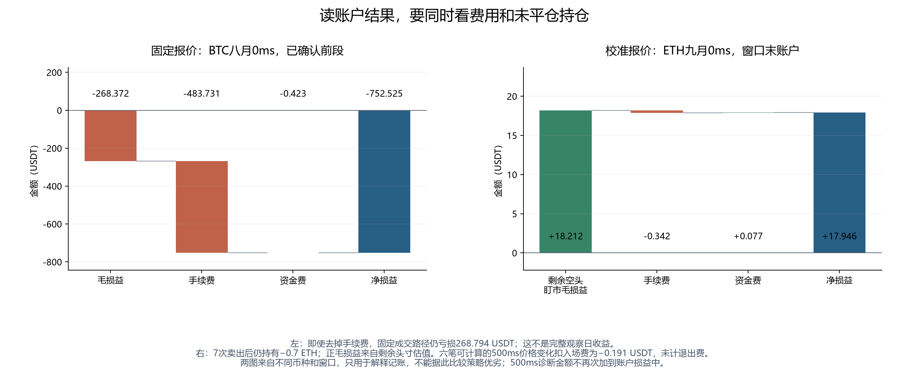

# 加密资产高频微观结构研究

这项研究用 Binance BTC、ETH 永续合约的盘口和成交，预测接下来半秒的价格变化，再检查这种预测能否覆盖交易成本。主要比较 OFI 线性基线、14 项盘口成交因子和 29 项多尺度因子。

**目前的结果是：增加时间尺度改善了预测，但还没有证明稳定的扣费后收益。**

- 八类可配对模型、两个币种、三个评价日的 48 项比较中，29 因子相对 14 因子的 IC 和样本外 R² 均提高。
- 10 月 1 日，29 因子 LightGBM 的 BTC/ETH IC 为 0.319/0.318，OFI 基线为 0.169/0.162；LightGBM 的零预测基准样本外 R² 为 9.97%/9.82%。这些是当日预测指标，不是收益率，也不是三个日期的平均值。
- 多数预测幅度不足以覆盖费用与买卖价差。少量成交、或含未平仓持仓的账面利润，还不能说明半秒预测已经带来稳定盈利。

每 100ms（0.1 秒）观察一次，预测未来 500ms（0.5 秒）的中间价收益。中间价是最优买价与卖价的平均，但不保证能按这个价格成交。Taker 主动吃单，Maker 挂单等待成交；两者的成本和成交条件不同。

金额用 USDT 表示，1bp=0.01%。本研究的 Taker 单边费用为 5bp，即成交 10,000 USDT 收取 5 USDT，买入和卖出分别计费。

## 从一张盘口开始理解这项研究

**因子是一条计算规则，不是一个预先知道会赚钱的指标。** 比如“买一挂量比卖一挂量多多少”可以算成一个数。模型根据过去的例子学习：这些数出现时，随后价格通常怎样变化。研究再用后面的日期检验这种关系，最后把预测交给明确的交易规则。

| 步骤 | 输入是什么 | 输出是什么 | 本研究中的例子 |
|---|---|---|---|
| 观察 | 当时已经收到的报价、盘口变化和成交 | 可见的市场状态 | 每100ms取一次研究观察 |
| 因子计算 | 当前状态和过去完整窗口 | 一行描述市场的数字 | 买卖深度不平衡、OFI、过去500ms收益 |
| 模型预测 | 这些输入及训练期已经冻结的参数 | 未来收益的预测数 | 预测未来500ms中间价收益为0.00001，即0.1bp |
| 决策 | 预测、当前报价、持仓、费用和限制 | 买、卖、挂单、撤单或不操作 | 预测收益不足以覆盖成本时不下单 |
| 事件回放 | 历史消息与已经发出的指令 | 实际模拟成交与账户变化 | 指令延迟到达后按当时可用深度成交 |
| 评价 | 已成熟的未来收益、预测和账本 | 预测指标、损益及其适用范围 | IC、样本外R²、费用后PnL |

PnL是profit and loss，即损益；NAV是账户净值。本报告的价格变动毛损益、成交手续费和有符号资金现金流分开记录，净损益为“毛损益−手续费+资金现金流”。滑点已经通过实际模拟成交价影响价格损益，不再把同一价差重复扣一次。

“这一刻输入什么”与“以后用什么检查它”必须分开。过去500ms收益是已知因子；未来500ms收益是标签。训练时可以使用历史上已经成熟的标签，预测当前时不能提前读当前标签。

### 订单簿与订单流有什么区别

假设一刻的买一价为99.99，挂量12；卖一价为100.01，挂量8。买一是当前最高买价，卖一是当前最低卖价，数量以本币base计。

- **中间价**为100；**价差**为0.02，除以100得到相对价差0.0002，即2bp。
- **深度不平衡**为(12−8)/(12+8)=0.2，表示买一显示量相对较多。它描述当前尚未成交的挂单存量。
- 如果卖一价没变、挂量由8降至6，这次变化对**OFI**（订单流不平衡）贡献+2。它可能来自主动买走2，也可能来自卖方撤单2；盘口变化本身不能区分。
- 只有成交流确认主动买了2，**主动买成交量**才增加2。主动买量3、主动卖量1时，净主动量为2，**TFI**（主动成交方向不平衡）为(3−1)/(3+1)=0.5。

OFI处理的是最佳报价及其显示量的变化，TFI处理的是已观察成交的买卖方向，深度不平衡处理的是某一时刻还挂着多少。它们可能给出不同方向，这不是数据必然出错。例如买盘撤单会降低OFI，同时仍可能发生主动买成交。

价格改变时，OFI也不能只做新数量减旧数量：买一上移，计新买一量的正贡献；买一下移，计旧买一量的负贡献。卖一改善到更低价格，计新卖一量的负贡献；卖一升高，计旧卖一量的正贡献。价格不变时，买侧计数量增加，卖侧计数量减少。逐事件相加后，才得到100ms或更长窗口的OFI。

基础14项扩展到29项，主要是在同一套盘口与成交信息中增加时间尺度和相对量。完整定义和手算例子见[因子附录](#附录29项因子怎样计算)。

### 因子有数值，不代表已经知道未来方向

如果OFI为10，单位是base数量，它不是“未来会上涨10bp”。如果深度不平衡为0.2，它也不是“上涨概率为20%”。模型要从训练数据中估计输入和未来收益之间的关系，而且关系可能随时期改变。

本报告中的“普通OFI模型”是一条明确的线性基线：只选择`ofi_100ms`这一经济输入，以未来500ms中间价收益为标签，拟合带截距的普通最小二乘。它不是把OFI的正负直接翻译成买卖指令，也不是每100ms重新训练。两币分别用5、6、7月1日的观察训练；之后冻结到8、9、10月的评价。

训练实现仍保存缺失标记和输入缩放。完整观察时，可把BTC的实际冻结公式写成：先将OFI减去训练均值−0.00968618，再除以训练标准差7.01719360；所得标准化输入乘约0.00000682177，再加截距约0.0000000145285。系数单位使最终输出成为十进制收益。

例如输入OFI=10，这个BTC模型输出约0.09745bp，远小于本研究5bp的单边Taker费用。这个例子解释输入量纲如何变成收益量纲，不意味着所有日期、所有输入都没有交易机会。两币OFI模型的缺失标记系数均为0；其他模型仍要按各自实际保存的预处理解释。 两套完整系数和冻结缩放值见[OFI公式汇总](data/crypto-ofi-frozen-formula.csv)。

### 本轮究竟做了哪些预处理

本轮Crypto研究表没有套用A股的“每日截面MAD截尾—行业规模中性化—截面标准化”，也没有对全部输入统一去极值。价格比例、OFI除以深度属于各个因子的定义，不能因此说模型输入已经做过统一zscore。

| 实际成功主线模型 | 缺失输入怎样处理 | 是否再做训练期zscore |
|---|---|---|
| OLS、Ridge、Lasso、Huber，包括OFI线性基线 | 用训练期中位数插补，并加入缺失标记 | 是，使用训练期均值和总体标准差 |
| 传统GBRT | 训练期中位数插补，并加入缺失标记 | 否 |
| 普通决策树、随机森林、XGBoost、LightGBM | 使用本次估计器的原生缺失支持 | 否 |

这张表逐一核对了35份成功主线保存模型，不把默认配置当成已运行事实。 [逐模型预处理表](data/crypto-primary-preprocessing.csv)同时保留三项没有发布模型的状态，没有把它们填成零系数或未缩放。插补、均值、尺度都只在训练行上估计，之后预测沿用冻结值；标签不插补，所消费经济输入全部缺失的行不产生普通有效预测。

例如某列训练值为1、2、缺失、5，中位数为2，插补后是1、2、2、5，均值2.5、总体标准差1.5。未来观测为8时，标准化值是(8−2.5)/1.5≈3.667；不会为了让它看起来正常而重新估计均值或裁成3。缺失标记另成一列，表示这次是否使用了插补。

## 怎样读预测指标，再把它接到交易

### IC、普通R²和本报告样本外R²分别在问什么

IC用相关系数检查预测数值与实际未来收益是否一起变化。若预测整体乘一个正数，IC不会因此改变；但预测过大或过小，可能显著增加平方误差。因此IC高不代表预测幅度已经准确。

均方误差MSE是“每个预测减真实值，平方后再平均”。平方使正负错误不能相互抵消，也使较大的错误受更重惩罚。普通R²用评价样本自己的真实均值作分母基准；本报告主要使用的样本外R²则以始终预测零作基准，另保留冻结训练均值的对照。分子必须使用同一批可评分行，不能给模型和基准挑不同的样本。

| 教学观察 | 实际未来收益 | 模型预测 | 平方误差 |
|---|---:|---:|---:|
| 1 | 1bp | 1bp | 0 bp² |
| 2 | 2bp | 2bp | 0 bp² |
| 3 | 3bp | 2bp | 1 bp² |

模型平方误差和为1。评价样本均值为2bp，围绕它的平方偏差和为2，所以普通R²=1−1/2=0.5。若零预测作基准，其平方误差和为1²+2²+3²=14，本报告口径的零基准样本外R²=1−1/14≈0.92857。若冻结训练均值为1.5bp，基准误差和为2.75，则相应R²约0.63636。三个数字都来自同一组预测，差别在于比较对象。

实际计算用十进制收益而非bp；只要模型、真实值和基准统一单位，分子分母同倍缩放，R²不变。基准误差为0时，这个比值未定义，不能硬填0或1。R²可以为负，也不是相关系数平方的通用替代，更不是收益率或胜率。

本轮BTC八月OFI模型的模型MSE约为2.74324×10⁻¹⁰，零基准MSE约为2.77257×10⁻¹⁰，对应R²约0.01058：平方误差相对零预测减少约1.058%。这个百分比描述预测误差改善，并不表示账户赚了1.058%。它使用863,232个可评分观察，仍只来自一个观察日。

### 预测怎样改变是否下单：先把价格、数量和费用放进同一单位

以教学盘口mid=100、ask=100.01为例，买入1单位实际需要接受卖方报价100.01。若单边Taker费率为5bp，即0.0005，手续费为100.01×0.0005=0.050005 USDT。相对当前mid，入场价差成本0.01，加手续费0.050005，共0.060005 USDT，相当于mid的6.0005bp。

如果模型仅预测未来涨1bp，预计未来mid约100.01，尚不足以覆盖上述入场成本；不下单符合这一规则。如果预测涨7bp，预计未来mid约100.07，按这个简化的“未来mid减入场成本”比较，还剩0.009995 USDT的预期空间。真实策略继续检查数量上限、当前库存、有效行情、资金时点和执行模式；不能只看7大于5。

Taker 和 Maker 的成交方式不同，解释结果时也要分开：

| 策略 | 模型输出怎样参与决策 | 退出怎样发生 | 结果应怎样解释 |
|---|---|---|---|
| 原库存Taker规则 | 比较候选交易给当前库存带来的预期价值与入场成本 | 由后续决策改变持仓，没有强制500ms清仓 | 账户可能赚到更长持有期的价格变化，不能全归于500ms预测 |
| Maker报价 | 将价格预测、成交响应、报价距离和库存价值一起比较 | 后续报价、撤单、成交和库存规则推进 | 需要承担排队与被选择性成交的不确定性，挂单不等于成交 |

Taker的5bp是本次实验设定，不是对用户真实交易账户费率的查询。Maker也按本次声明费率计费，不因名称叫Maker就默认免费。费用按实际成交的绝对名义金额逐笔计算：成交数量×成交价格×费率；未成交的请求数量不产生这笔成交费。买入和卖出分别计费，多个价位成交就分别算后相加。

### 事件驱动回测具体怎样走时钟

事件驱动的意思是：按时间顺序让已经发生的市场事件和策略指令逐个改变状态。它不把“某时刻有一个预测”直接当作“同一时刻已经按中间价成交”。下面仍是教学时间线；10ms仅用于演示，正式场景使用各自记录的延迟。

| 时间 | 发生了什么 | 程序现在能做什么 |
|---|---|---|
| 10:00:00.090 | 收到一条报价消息 | 更新可见盘口；尚未收到的其他消息不能使用 |
| 10:00:00.100 | 到达研究决策网格 | 计算因子、读取冻结模型、得到500ms收益预测，再按策略产生指令 |
| 10:00:00.105 | 又收到报价或成交 | 更新市场；不能把旧盘口当成五毫秒后的实际盘口 |
| 10:00:00.110 | 具有10ms延迟的指令到达 | 按这一时刻可用的对手报价和深度处理成交、部分成交或不可执行 |
| 成交发生时 | 确认实际数量与价格 | 更新持仓、费用和账户记录；Taker与Maker使用各自执行规则 |
| 10:00:00.600 | 决策后的500ms端点 | 当前预测的未来标签现在才成熟，可以用于事后评价 |
| 10:00:00.610 | 若成交在.110，距成交500ms | 计算该成交的500ms markout；它与上一行的标签时钟不同 |
| 后续时刻 | 持仓、结算或退出事件发生 | 继续按所选策略和账本规则推进，不能凭预测期限自动补一个退出 |

markout是从成交价出发、到声明未来中间价的有向价格差乘成交数量。例如买入1单位、成交价100.01，500ms后的mid为100.02，markout为+0.01 USDT，尚未扣费。这里仍没有发生卖出；这个诊断数不能再加进已经包含同一价格变化的账户毛损益。

例如发出买0.5单位的请求，但到达时合格对手量只有0.3，实际费用和持仓按0.3计算；能否继续成交更深档位，取决于实际可见深度与该策略的执行设置。公开L2无法知道隐藏挂单和自己的真实市场冲击，Maker也缺少真实队列位置，因此结果受所声明的执行假设限制。

行情缺口不只是“少了几行输入”。有仓账户跨越缺口时，可能不知道中途能否成交、是否发生退出以及最大回撤。分段模式重新初始化一个账户，只回答该段内的问题；把各段末值连成一条曲线，会创造一个并未真实回放的连续策略。

`PARTIAL`表示只确认了部分账户或行情路径，`UNDEFINED`表示某项指标无法按定义给出；二者都不是数值0。完整观察中没有成交可以记录零成交，但模型失败、输入缺失或执行未知不能伪装成零交易成功。

## 研究范围与时间安排

预测和交易对象是 Binance 的 BTC、ETH USDT 线性永续合约，数据来自 Tardis 历史归档的盘口、报价和成交，并在交易核算中使用资金费数据。

数据只有 2026 年 5—10 月每月 1 日，共六个观察日，不是连续六个月。5、6、7 月用于训练，8、9 月用于开发诊断，10 月用于固定模型评价。两个币分别建模，预测未来 500ms 中间价收益。

九类模型为 OLS、Huber、Ridge、Lasso、决策树、随机森林、GBRT、XGBoost 和 LightGBM。OFI 另作单变量线性基线。共 38 个候选，其中 35 个拟合成功，产生 105 份逐日评价；三个 Huber 未收敛。八类模型有完整的 14→29 配对结果，不能把未完成的模型算作零收益或零误差。

训练只使用当时已经能观察到的特征和已经成熟的标签。比较时先看各方案自己的可用样本，再固定双方的训练和评价样本，检查改善是否只是样本变化造成的。

## 多尺度输入改善了预测，但相关性和误差并不等价

14个基础输入描述近期盘口、成交和价格状态，扩展到29个输入则加入更多时间尺度。这里问的是：让模型同时看更短、较长的近期变化，有没有改善预测？先比较每个模型自己的可用样本，再让两边使用完全相同的训练和评价样本，检查结论是否只是样本变了。

预测指标按币种、按观察日计算。Pearson IC 衡量预测与未来收益的线性关联；样本外 R² 定义为 `1 − 模型均方误差 / 基准均方误差`，本文主要使用始终预测零的基准。R² 为负意味着模型的平方误差比预测零更大。

图 1　35 个成功模型的未来 500ms 收益相关性。失败候选保留在完整实验集合中。

**读图：** 同一币种、同一天内比较模型。IC越高，预测与后来价格变化的线性关联越强；它不告诉我们预计能赚多少基点，也不包含手续费。下面的R²图再检查预测幅度是否准确，交易部分才检查这种预测能否覆盖成本。

14→29 输入的 48 个可配对结果中，IC 与零预测基准 R² 的增量全部为正。这 48 项来自八个家族、两个币种和三个日期，模型共享行情，结果之间存在相关性。

BTC 的共同样本重拟合保留了这一方向：16 个成功模型都使用 2,590,917 个训练观察，三个评价日的共同观察数分别为 863,232、863,762 和 863,923。八个家族的 24 个 IC 配对仍全部改善，两个 Huber 保持未收敛。这组多尺度增量没有被样本集合的差异解释掉。

ETH 的共同样本实验也保留了多尺度增量：17 个模型成功，使用 2,590,933 个训练观察和三个评价日合计 2,590,864 个共同观察。八个可配对家族的 24 项 IC、零预测与训练均值两种基准下的各 24 项 R² 增量均为正。IC 增量范围为 +0.00211～+0.01276，零预测基准 R² 增量为 +0.00110～+0.01587。29 输入 Huber 未收敛，因此 Huber 不进入这 24 个配对。

在 10 月观察日，29 输入 LightGBM 的 IC 为 BTC 0.31912、ETH 0.31847；OFI 基线分别为 0.16939 和 0.16249。完整逐日数值见[主线结果](data/crypto-primary-500ms-summary.csv)及[14→29 配对表](data/crypto-primary-14-29-own-comparison.csv)。

这些 IC 是单币逐日时间序列相关，不能直接与 A 股日频横截面 IC 比较，也不代表收益率或胜率。按同日零预测基准 MSE 开平方，500ms 目标收益的均方根幅度为 BTC 约 0.369bp、ETH 约 0.464bp，低于本研究设定的 5bp 单边 Taker 费率；价差、延迟和深度还会影响实际执行。这一量级比较说明预测关联与交易利润之间仍有距离，均方根并非模型可赚取的收益，也不能单凭它归因所有零下单结果。

图 2　同一模型的平方误差评价。负值表示预测幅度的误差高于零预测基准。

**读图：** 零线是“每次都预测价格不变”的参照。比如R²为−0.115，表示该模型的均方误差约为零预测的1.115倍；这不是亏损11.5%。模型可能经常把方向排对，却把涨跌幅度估得过大，因而IC为正而R²为负。

8 月 BTC 的 17 个成功模型中，只有 4 个 R² 为正。14 输入 OLS、Ridge 的 IC 约为 0.173，R² 却约为 −0.115；扩展到 29 输入后，IC 约为 0.179，R² 改善到约 −0.090，仍低于零基准。相关系数对整体正比例缩放不敏感，而平方误差会惩罚幅度偏差，这解释了两个指标为什么会分开走。

在自身样本实验中，ETH 的 14 输入 Huber 原生拟合返回成功，三个日期的 R² 约为 −1.760、−10.618 和 −3.122。优化器返回成功、参数充分优化与模型有好的样本外表现，需要分别检查。换用冻结训练均值作为基准后，105 项结果仍有 80 项 R² 为正，两种基准没有发生正负号翻转。

同输入复核还发现，ETH 14 输入 Huber 的两次拟合得到不同系数，且两份保存参数的训练目标值都差于一个可行的零预测参照。它们存在优化质量问题；成功状态不等于优化充分，相关结果均保留，没有择优替换。这不改变八类可配对模型的比较范围，但限制了对 Huber 结果的解释。

## 从预测到交易：为何大多不下单

Taker 基准账户初始资本为 100,000 USDT，单边费用 5bp，执行延迟 100ms。BTC 单笔数量上限为 0.01、仓位上限 0.1，ETH 分别为 0.1 和 1。行动选择把预测收益与盘口成交条件、费用和库存状态一起比较。回放区分连续账户与缺口后重新起步的独立账户段，并记录实际部分成交、资金费和剩余持仓。

窗口从 00:00:00 到 23:59:59.9，没有覆盖两个完整午夜之间的收益区间；各观察日又分散在不同月份，所以本文不报告年化 Sharpe。

### 多数预测没有跨过成本门槛

主线 228 个预定场景已全部到达终态，其中 210 例完成原生回测与统计，包含 805 个实际账户区间；BTC 14/29 输入和 ETH 29 输入三个 Huber 模型拟合未收敛，对应的 18 例未运行。未运行与零交易分别保留。其中 BTC 的 17 个成功模型已覆盖三日、两种账户模式；ETH 的 OFI 与 14 输入九个模型也均已覆盖三日、两种账户模式；29 输入另已核对 OLS、Ridge、Lasso、决策树、随机森林、GBRT、XGBoost 和 LightGBM 各六例。除 BTC 8 月 OFI、下述 ETH Huber、29 输入 OLS、Ridge 和 Lasso 外，其余已核对的主线账户均没有下单。

下表展示已完成的 BTC 8 月连续账户，完整数值见[执行结果明细](data/crypto-first-execution.csv)。八个 14 输入模型包括 OLS、Ridge、Lasso、决策树、随机森林、GBRT、XGBoost 和 LightGBM。

| 模型 | 成交次数 | 毛损益（USDT） | 成交费用（USDT） | 净损益（USDT） |
|---|---:|---:|---:|---:|
| OFI / OLS | 2 | 7.061000 | 0.624392 | 6.436608 |
| 八个 14 输入模型，各自结果 | 0 | 0 | 0 | 0 |
| 29 输入 OLS | 0 | 0 | 0 | 0 |

表中九个多输入模型的零成交来自零下单。每个模型有 863,267 个决策时点，其中 34 个因未来资金费信息不足而无法评估，其余时点都没有选择正增益交易。进一步读取开发期全部 35 个成功模型的保存预测，共 70 个模型与日期组合、约 6,045 万条预测：60 个组合的最大绝对预测幅度都没有超过 5bp；按同刻最优买卖价计入 5bp 入场费用后，62 个组合连最优一档的正收益机会也没有。这个筛查暂不计资金费、仓位与更深档位，不能替代完整回测，但直接说明了大部分预测幅度与当前成本门槛的不匹配。

下表列四个代表性组合，单位为 bp；预测幅度使用绝对值，不是已实现收益。

| 币种与模型 | 观察日 | 99.9% 分位 | 最大值 | 5bp 费用下最优一档正增益时点 |
|---|---|---:|---:|---:|
| BTC 14输入 Ridge | 8月 | 0.5866 | 4.8576 | 0 |
| BTC 29输入 LightGBM | 8月 | 0.5460 | 4.0014 | 0 |
| ETH 29输入 LightGBM | 8月 | 0.6620 | 4.2801 | 0 |
| ETH 29输入 LightGBM | 9月 | 0.6676 | 2.6747 | 0 |

少数超过 5bp 的预测也未必能交易。例如 ETH 14 输入 OLS 与 Ridge 在 9 月各有两个这样的时点，计入当时买卖价差后仍没有正增益。ETH 多尺度线性模型也出现极少数正增益时点，已核对的 29 输入 OLS、Ridge 在 8 月各有三笔、9 月各有一笔成交，Lasso 在 9 月也有一笔；这些少量成交可能来自同一市场事件，不能算作相互独立的盈利证据。BTC 8月 OFI 的两个正增益时点则与已保存账本的两次下单一致。此次诊断只读取 8、9 月开发期预测，没有用 10 月选择新规则。

OFI 账户只有两次成交，均为买入，窗口末仍持有 0.02 BTC；净额相当于初始资本的 0.006437%。其 500ms 成交后价格变化金额只有 0.005 USDT，远小于整个窗口的毛损益。策略没有要求每笔成交在 500ms 后强平，后续持仓重估也计入收益，因此账户利润包含更长持仓路径的影响。盘口路径缺口使这个账户的连续最大回撤无法确定；九个纯现金账户的回撤为零。

同日的独立段模式中，这两笔 OFI 成交落在同一个账户段，其净损益为 −3.063392 USDT，另外六段没有交易。连续账户允许缺口后的持仓延续，独立账户在段末估值后结束；同样的成交因此不保证相同收益。该活跃段的最大回撤可定义为 −0.003185%，也不能替代连续账户未定义的整日回撤。

## Maker：固定报价亏损，校准后仍缺稳定证据

“固定报价”按预设数量和库存规则挂单；“校准报价”还用过去的价格预测误差与成交响应，比较继续等待、取消或重新挂单。两者都使用公开L2展示量近似排队位置，无法观察交易所每张订单的真实先后顺序。下面的结果在这套明确近似下成立。

固定报价没有使用收益预测或压力模型。在 BTC 三日、三种执行延迟、两种账户模式的 18 个场景中，60 个独立段的毛损益、净损益，以及保持原成交路径去掉手续费后的净额，全部为负。9 个连续账户都因后续执行无法确认而不能计算完整窗口收益；这些未知后段没有被记成零，也没有用独立段拼接补齐。

费用之外，成交后价格也常向不利方向变化。例如 BTC 八月 0ms 第一段，毛损益 −268.371600 USDT、手续费 483.731110 USDT、资金费 −0.422582 USDT，净损益 −752.525292 USDT；免去手续费后仍亏损 268.794182 USDT。500ms 成交后价格变化与账户毛损益重叠，不能再扣一次。

校准报价使用收益预测和此前数据估计的成交响应，确实避开了一批固定报价交易。BTC 九月 100ms 连续账户有 7 次成交、净损益 +24.267167 USDT，但末仓仍有 0.03 BTC；对应六笔有定义的 500ms 价格变化扣入场费后为 +1.525146 USDT，尚未计退出费用，另有一笔无法计算。它提供了继续检验的线索，还不是七笔完整开平仓的利润。

ETH 九月的三个延迟也没有给出一致结论：连续账户净额分别为 +17.946411、−0.747671、+0.1318702 USDT，均含剩余库存。三个延迟使用各自的八月校准结果，这同时改变了执行时间和对应报价策略，不能解释为纯粹的延迟效应，更不能用同一天择优选参。

**读图：** 每个面板前三项依次累加，蓝柱是最终净额。左图显示亏损不全由手续费造成，毛损益本身已为负；右图虽然账户净额为正，但正毛损益全部来自尚未平仓的空头重估。两边币种、日期和窗口不同，不能用柱高判断哪种策略更好。成交后0.5秒的价格变化只是另一个诊断，不再次加到账户金额中。

## 这些结果的限制

六个分散的观察日只覆盖了有限的市场状态。100ms 数据虽然很多，但相邻标签重叠，各模型也共享行情，不能把每行数据或每个模型都当成独立证据。

公开 L2 不能还原真实订单队列。行情缺口会限制连续回撤和完整执行路径的判断；把缺口后的独立账户段拼起来，不能补出一条真实的连续净值。500ms 成交后价格变化也不能再次加到账户损益里，否则会重复计算。

因此，目前可以讨论预测改善、费用门槛和成交机制，不能宣称已经找到稳定盈利策略。还需要更多独立日期和完整开平仓结果来检验。

## 附录：29项因子怎样计算

下面保留基础14项和新增15项的定义、单位及手算例子。数值的正负描述当时的市场状态，不代表提前知道未来涨跌。

### 订单簿、订单流与基础14项

#### 一张订单簿怎样读

订单簿，也常写成“订单薄”，是某个时刻尚未成交的买卖限价单集合。本研究使用L2数据：同一价格上的多个订单合并为一个总数量；看得到价格和展示量，看不到每个订单属于谁、单个订单的完整队列位置。

假设当前盘口如下。价格单位是USDT/单位币，数量单位是该币本身，下面简称base。它是教学数字，不是实际BTC价格。

| 档位 | 买盘价格 | 买盘数量 | 卖盘价格 | 卖盘数量 |
|---|---:|---:|---:|---:|
| 第1档 | 99.99 | 12 | 100.01 | 8 |
| 第2档 | 99.98 | 10 | 100.02 | 9 |
| 第3档 | 99.97 | 6 | 100.03 | 7 |

买盘从高价向低价排列，卖盘从低价向高价排列。**买一**是最高买价，**卖一**是最低卖价；买一不是“第一笔买成交”，卖一也不是“第一笔卖成交”。主动买入者接受卖方报价，先与卖一成交；主动卖出者接受买方报价，先与买一成交。若数量超过第一档可见数量，可能继续成交到更差的档位。

“深度”就是所选档位的挂单数量之和。上表买侧前三档深度是12+10+6=28，卖侧是8+9+7=24。前五档、前十档的深度必须有相应档位证据；这张只有三档的示例不能计算本项目的五档、十档因子。

本附录统一使用以下记号，后续公式均从这些量出发。

| 记号 | 中文含义 | 计算或单位 |
|---|---|---|
| $b_t,a_t$ | 时刻t的买一价、卖一价 | USDT/base，合法盘口满足 $0<b_t<a_t$ |
| $q^b_{\ell,t},q^a_{\ell,t}$ | 第$\ell$档买量、卖量 | base |
| $B_{k,t},A_{k,t}$ | 买侧、卖侧前k档总深度 | 分别为 $\sum_{\ell=1}^k q^b_{\ell,t}$、$\sum_{\ell=1}^k q^a_{\ell,t}$ |
| $m_t$ | 中间价mid | $(a_t+b_t)/2$，不保证这个价格可以成交 |
| $s_t$ | 买卖价差spread | $a_t-b_t$，USDT/base |
| $D_{k,t}$ | 前k档双边深度 | $B_{k,t}+A_{k,t}$，base |
| $V^+_t,V^-_t$ | 当前100ms桶内已观察的主动买量、主动卖量 | base；“主动”指发起成交、吃掉已有挂单的一方 |
| $o_t$ | 当前100ms桶内的OFI | 按报价变化逐事件计算后求和，下面给出完整规则 |
| $r_h(t)$ | 截至t、过去h时间的简单收益 | $[m_t-m_{t-h}]/m_{t-h}$，不是未来标签 |

100ms是0.1秒，500ms是0.5秒，1s是1秒。收益0.001是0.1%，等于10bp；1bp=0.0001。BTC研究中的base是BTC，ETH研究中的base是ETH，不能把“买了1 BTC”和“买了1 ETH”当成同一数量尺度。

#### 订单簿是存量，订单流描述变化

订单簿是一张“此刻还挂着多少”的照片。订单流描述一段时间内新增、撤销、成交以及报价变化带来的供求变化。这里有三类容易混淆的数：

| 量 | 观察对象 | 能回答什么 |
|---|---|---|
| 深度不平衡 $I_k$ | 某一时刻两侧还挂着的量 | 此刻显示的买侧量相对卖侧量多多少 |
| OFI，Order Flow Imbalance | 最优买卖报价及其展示量的逐事件变化 | 这段时间最佳盘口的变化，净偏向买侧还是卖侧 |
| 主动成交净量、TFI | 这段时间已经观察到的主动买卖成交 | 实际成交中，主动买入与主动卖出的相对强弱 |

例如，卖一数量从8降到6，可能因为有人买走2，也可能因为卖方撤单2。只看这次盘口变化，OFI的卖侧贡献都是+2；只有确认发生了主动买成交，主动买量才加2。因此**不能用OFI反推每一笔成交，也不能把盘口数量下降全部解释为成交**。

本研究从快照和有序增量重建订单簿，按来源规则处理序列衔接。缺口、重连和无效盘口会形成连续段边界；不能把断开前后的两个盘口硬接起来计算变化。100ms网格是研究采样时钟，区间 $(t-100\mathrm{ms},t]$ 内可能有很多消息，OFI先逐消息计算再累计。这里按本地观察时间纳入信息，避免在消息尚未收到时使用它；交易所事件时间另行保存。快照、消息序列、时钟及频道覆盖共同限定合法连续段。

#### OFI的完整计算：价格变了，不能只减数量

令n表示相邻两次可用盘口事件，$b_n,a_n$是买一价、卖一价，$B_n,A_n$只表示这两档各自的数量。单个事件的OFI为：

$$
e_n=
\mathbf{1}(b_n\ge b_{n-1})B_n
-\mathbf{1}(b_n\le b_{n-1})B_{n-1}
-\mathbf{1}(a_n\le a_{n-1})A_n
+\mathbf{1}(a_n\ge a_{n-1})A_{n-1}.
$$

$\mathbf{1}(\cdot)$是指示函数：条件成立取1，否则取0。这个式子可以直接按下表算，不需要先掌握任何回归模型。

| 盘口变化 | 该侧对 $e_n$ 的贡献 | 含义 |
|---|---|---|
| 买一价不变 | 新买一量−旧买一量 | 同价买盘净增加为正 |
| 买一价提高 | +新买一量 | 更高价格出现新的最佳买盘 |
| 买一价降低 | −旧买一量 | 旧最佳买盘退出最佳档 |
| 卖一价不变 | 旧卖一量−新卖一量 | 同价卖盘减少为正 |
| 卖一价降低 | −新卖一量 | 更低价格出现新的最佳卖盘 |
| 卖一价提高 | +旧卖一量 | 旧最佳卖盘退出最佳档 |

两侧贡献相加得到一个事件的OFI，再把当前100ms桶内全部有效事件相加：

$$
\mathrm{ofi\_100ms}_t=\sum_{n:\,\mathrm{observed}_n\in(t-100\mathrm{ms},t]}e_n.
$$

**例一：两侧价格不变。** 买一量12→15，卖一量8→6，事件OFI为(15−12)+(8−6)=5 base。即使没有任何成交，仅靠新增买单和撤销卖单，也能得到+5。

**例二：买一价提高。** 买一从99.99、数量12变为100.00、数量4，卖侧不变，贡献为+4，不是4−12=−8。公式追踪的是最佳价层级的变化，不是把所有未成交订单数量作总差。两个例子解释了为什么OFI既含价格变化，也含数量变化。

正OFI表示按这个定义，最佳盘口变化净偏向买侧；负OFI净偏向卖侧。它不是“上涨概率”，没有被限制在−1到1之间。同期价格与OFI可能一起变化；只有把截至t的OFI与t之后的收益配对评价，才是在问预测问题。

#### 基础14项：每一项是什么、怎么算

以下基础因子均使用截至t可见的本币盘口或成交。表中“可能用途”是机制解释，实际效果在本报告的预测与交易结果中单独判断。

| 因子及中文名 | 计算方法与单位 | 怎样理解数值、可能用途 |
|---|---|---|
| `spread`，绝对买卖价差 | $s_t=a_t-b_t$，USDT/base | 示例100.01−99.99=0.02。买卖报价之间的距离，常用于描述流动性和交易成本环境；单独不指向涨或跌 |
| `relative_spread`，相对价差 | $s_t/m_t$，无量纲 | 示例0.02/100=0.0002=2bp。把价差除以价格，便于比较不同价格尺度；这一步是因子定义中的比例换算 |
| `imbalance_1`，一档深度不平衡 | $I_1=(B_1-A_1)/(B_1+A_1)$，无量纲 | 示例(12−8)/20=0.2。正值表示买一展示量更多，负值表示卖一更多，0表示两侧相等；不等于20%的上涨概率 |
| `imbalance_5`，五档深度不平衡 | $I_5=(B_5-A_5)/(B_5+A_5)$，无量纲 | 先分别加总前五档，再求比值；不是五个单档不平衡的平均。描述较宽价格范围内的买卖量差 |
| `imbalance_10`，十档深度不平衡 | $I_{10}=(B_{10}-A_{10})/(B_{10}+A_{10})$，无量纲 | 与上一项相同但范围为十档。深处挂单离即时成交更远，可能撤销；显示量多不保证真实承接能力强 |
| `microprice`，队列加权微价格 | $(a_tB_1+b_tA_1)/(B_1+A_1)$，USDT/base | 示例100.002。买量较多时向卖一价倾斜，是一个盘口状态代理；注意买量乘卖价、卖量乘买价，不是同侧加权 |
| `microprice_deviation`，微价格相对中间价的偏移 | $\mathrm{microprice}-m_t=s_tI_1/2$，USDT/base | 示例0.002。把微价格的绝对价格水平去掉，保留队列不平衡产生的方向性偏移；仍不是未来实际价格 |
| `ofi_100ms`，100ms订单流不平衡 | 当前100ms桶内 $\sum e_n$，base | 按上文 OFI 规则逐事件计算。观察最佳盘口是否持续偏向一侧；与静态深度不平衡不同 |
| `signed_trade_flow_100ms`，100ms主动成交净量 | $V^+_t-V^-_t$，base | 主动买5、主动卖3时为+2；只反映观察到的成交，不包含单纯新增或撤销挂单 |
| `taker_buy_volume_100ms`，100ms主动买量 | $V^+_t=\sum_{\text{主动买}}q_j$，base | 上例为5。数值越大表示当前窗口主动买入越多；与卖量分别输入可保留总活跃度和非对称关系 |
| `taker_sell_volume_100ms`，100ms主动卖量 | $V^-_t=\sum_{\text{主动卖}}q_j$，base | 上例为3。它本身是非负数量，不能因卖出方向就在这一列存负数；方向在净量或比值中处理 |
| `return_100ms`，过去100ms中间价收益 | $r_{100\mathrm{ms}}(t)=(m_t-m_{t-100\mathrm{ms}})/m_{t-100\mathrm{ms}}$ | 100→100.01得到0.0001=1bp。是已经发生的涨跌，可用于研究短期延续或反转；不是要预测的未来收益 |
| `realized_volatility_1s`，过去1秒实现波动 | 最近10个连续100ms收益的样本标准差：$\sqrt{\sum_{j=1}^{10}(r_j-\bar r)^2/9}$ | 需要11个连续mid才能产生10个收益。未年化，单位与收益相同；衡量起伏大小，不表示上涨方向。当前定义不是 $\sqrt{\sum r_j^2}$ |
| `top10_depth_per_spread`，十档深度与价差之比 | $(B_{10}+A_{10})/s_t$，base/(USDT/base) | 双边十档合计100、价差0.02时为5000。大值表示相对于价差的展示深度较多；它既受数量也受价差影响，没有预设上下界 |

同一时刻的$\mathrm{microprice}=m+sI_1/2$是严格的代数关系，几个输入并非互相独立。把它们一起放入模型，不等于得到了几份完全独立的信息。深度不平衡只有在对应双边总深度为正、档位信息合法时才计算；五档或十档缺失，不用一档代替。

### 新增的15项多尺度因子

“多尺度”就是对同一种现象同时观察100ms、500ms、1s、5s。短窗口反应快但可能更噪，长窗口反映持续性但可能滞后；哪一个更好由样本外实验决定。

设窗口包含连续k个100ms桶，记这些桶的主动买卖量为$V_j^+,V_j^-$，OFI为$o_j$，最佳双边深度为$D_{1,j}$。先定义两个以后反复使用的量：

$$
T_h(t)=\frac{\sum_{j=1}^{k}(V_j^+-V_j^-)}
{\sum_{j=1}^{k}(V_j^++V_j^-)},\qquad
N_h(t)=\frac{\sum_{j=1}^{k}o_j}{k^{-1}\sum_{j=1}^{k}D_{1,j}},
\quad k=h/(100\mathrm{ms}).
$$

$T_h$是TFI（Trade Flow Imbalance，成交方向不平衡）：净主动成交量除以总主动成交量，合法时在−1到1之间。$N_h$是深度归一OFI：窗口OFI总量除以该窗口平均最佳双边深度，没有−1到1的限制。两个分子、两个分母均不同。

| 因子及中文名 | 精确窗口与计算 | 数值含义 |
|---|---|---|
| `trade_flow_imbalance_100ms`，100ms TFI | $T_{100\mathrm{ms}}$，1格 | 买5卖3时为(5−3)/(5+3)=0.25。表示观察成交量的净方向占比 |
| `trade_flow_imbalance_500ms`，500ms TFI | $T_{500\mathrm{ms}}$，5格 | 先加总5格买卖量，再算净量/总量；不是5个TFI的简单平均 |
| `trade_flow_imbalance_1s`，1秒TFI | $T_{1\mathrm{s}}$，10格 | 检查成交方向能否持续到1秒尺度 |
| `trade_flow_imbalance_5s`，5秒TFI | $T_{5\mathrm{s}}$，50格 | 检查更长的方向压力；历史信息更多，但不代表一定更有预测力 |
| `ofi_500ms`，500ms OFI | 最近5格 $\sum o_j$，base | 盘口变化在0.5秒内的净积累 |
| `ofi_1s`，1秒OFI | 最近10格 $\sum o_j$，base | 与100ms、500ms对照，区分瞬时变化与持续变化 |
| `ofi_5s`，5秒OFI | 最近50格 $\sum o_j$，base | 更长窗口的最佳盘口净变化；绝对量受本币流动性尺度影响 |
| `depth_normalized_ofi_500ms`，500ms深度归一OFI | $N_{500\mathrm{ms}}$，5格，无量纲 | 例如OFI总量10、平均最佳双边深度20，结果为0.5 |
| `depth_normalized_ofi_1s`，1秒深度归一OFI | $N_{1\mathrm{s}}$，10格，无量纲 | 将1秒净压力与这1秒内平均可见深度比较 |
| `depth_normalized_ofi_5s`，5秒深度归一OFI | $N_{5\mathrm{s}}$，50格，无量纲 | 同样处理5秒压力，不是逐格“OFI/深度”的和 |
| `imbalance_1_minus_10`，一档与十档不平衡差 | $I_1-I_{10}$，无量纲 | 正值表示最佳档比十档整体更偏买侧；例如0.6−0.1=0.5。可以研究近端、深层是否方向不一致 |
| `imbalance_5_minus_10`，五档与十档不平衡差 | $I_5-I_{10}$，无量纲 | 比较中间范围与更深范围；正值不要求两者本身都为正 |
| `near_depth_share_1_10`，最佳档深度占比 | $D_1/D_{10}$，无量纲 | 20/100=0.2，表示双边十档总量中20%集中在最佳档；反映分布集中度，不含买卖方向 |
| `taker_sell_pressure_500ms`，500ms主动卖压 | 最近5格主动卖量之和 / **当前**$B_1$，无量纲 | 过去卖量6、当前买一量3，结果2。不是“200%成交概率”，而是历史卖量相对当前买一容量的大小 |
| `taker_buy_pressure_500ms`，500ms主动买压 | 最近5格主动买量之和 / **当前**$A_1$，无量纲 | 过去买量6、当前卖一量3，同样为2；与上一项对称，分母不是窗口平均深度 |

**TFI的手算。** 两格的买卖量分别为(5,0)、(0,15)，两格TFI分别是+1和−1，但合并窗口的TFI是(5−15)/(5+15)=−0.5，不是0。大成交量的那格应当有更大的权重。

**缺失与零。** 在覆盖有效的窗口中，买卖量都已知、且净量相抵，净成交量可以为0；总成交量为0时，TFI分母为0，结果未知。某个100ms桶缺失时，不删除它再拿前面的有效桶凑数，否则“500ms”会变成不固定的历史长度。跨连续段边界要重新预热；缺失深度只影响依赖深度的因子，不把仍有效的收益、成交窗口一起清空。
