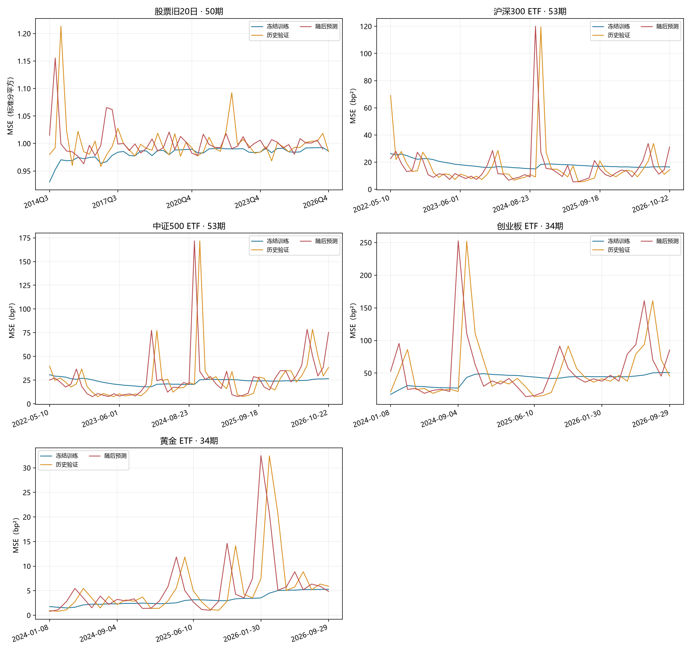
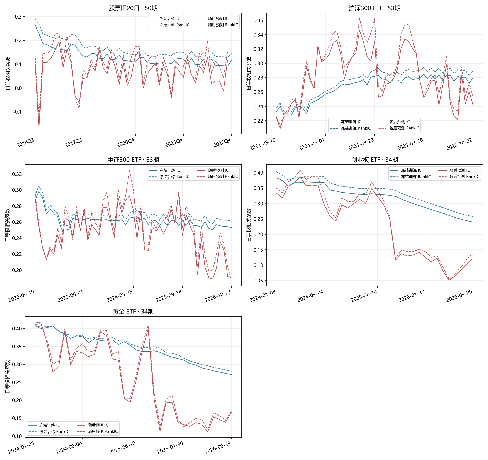

# 监督模型历史预测结果

前半部分的全期结果与股票Lasso季度曲线保留截至 2026-11-15T03:51:30.578156+00:00 的历史快照。完整精度、每折已保存的验证 MSE、实际输入列计数及股票季度点见[原汇总 CSV](data/supervised-model-results.csv)。后文补充2026-11-15完成的股票四模型共同11季诊断、Lasso逐期冻结训练与预测统计，以及其它已完成模型的正式全期结果；各部分的目标、样本与参数单独列明。

股票预测未来 20 会话收益的相对强弱分数，ETF 预测未来 30 秒中间价小数收益，两种误差不能横向比较。这些结果来自已用于研究的历史样本外区间，按当时可用信息顺序训练、冻结后预测，评价预测误差与相关性。

股票目标是 `forward_return_20d` 在当日合格股票截面的均值为零、总体标准差为一的 `date_zscore`，不裁剪目标。预测 +1 表示一个截面标准差单位，不是收益率 +1%。零分数对应这一标准化目标的零；本次同配对零分数 MSE 为 1。

| 股票模型 | MSE（标准化目标平方） | RMSE（标准差单位） | MAE（标准差单位） | 相对零分数 R² | IC | RankIC | 有效日／请求日 | 配对观测量 |
|---|---:|---:|---:|---:|---:|---:|---:|---:|
| Lasso | 1.001953813 | 1.000976430 | 0.683934894 | -0.1954% | 0.068877 | 0.100562 | 2,978／2,998 | 10,541,654 |

股票评价请求为 2014-07-01—2026-10-30，共保存 50 个预测季度模型。已有诊断确认最后成熟信号日为 2026-09-24；其后 20 个请求交易日尚无成熟的 20 会话目标，因此 2026Q4 有预测和历史验证成绩，季度样本外 MSE 仍为空，未补零。

Lasso 的排序相关为正，平方误差仍略高于零分数基准，两者并不矛盾。已核对的日等权分解为：目标二阶矩 1，加预测二阶矩 0.01680256，减两倍目标与预测乘积矩 2×0.00742437，得到 MSE 1.00195381。相关性描述共同变化，不能替代误差或费用后的收益。

ETF 保留未来 30 秒中间价比例收益，MSE 使用小数收益率平方，RMSE、MAE 在下表乘 10,000 显示为 bp；1 bp = 0.0001。相对零收益 R² 为 `1－同配对模型日均MSE／同配对零收益日均MSE`，不是投资收益率。

| ETF | 模型 | MSE（小数收益平方） | RMSE（bp） | MAE（bp） | 相对零收益 R² | IC | RankIC | 有效日（MSE／IC） | 请求日 | 配对观测量 |
|---|---|---:|---:|---:|---:|---:|---:|---:|---:|---:|
| 510300 | Lasso | 1.599447193e-07 | 3.9993 | 2.7406 | 5.7039% | 0.280650 | 0.290333 | 1,027／1,014 | 1,087 | 4,756,736 |
| 159915 | Lasso | 5.622525321e-07 | 7.4984 | 4.9479 | 1.4159% | 0.231349 | 0.247379 | 676／669 | 679 | 3,125,522 |
| 518880 | Lasso | 5.646384043e-08 | 2.3762 | 1.4267 | 3.2006% | 0.253790 | 0.264355 | 677／664 | 679 | 3,124,506 |

以上三只 ETF 的 Lasso 在自身有效样本上相对零收益具有正的 MSE 改善点估计。本表保留原快照范围，中证500及其他算法后续产生的全期结果尚未纳入；股票四模型的共同11季比较另见下文。ETF 以日内时序相关评价，股票以当日股票截面相关评价；有效相关日与配对观测量分别记录，有观测不代表相关系数必然有定义。

各 ETF 的预测评价轴为：510300：2022-05-10—2026-10-30；159915：2024-01-08—2026-10-30；518880：2024-01-08—2026-10-30。各项标签截止均为 2026-10-31T00:00:00，不将预测前的训练预热会话计入评价轴。

每天先计算误差与相关，再对有效交易日等权，不按日内行数或股票数重新加权。汇总 RMSE 是日均 MSE 的平方根；R² 用同配对日均平方误差之比。CSV 中 `inference_daily_mean` 是原生推断所针对的日统计量均值，其 RMSE、R² 不能替代上述非线性汇总值。

原全期快照的 32 条原生推断全部为 `UNDEFINED / incomplete_session_clock`。股票尾部未成熟目标与 ETF 请求轴上未形成有效统计的会话保留原样，未将缺失视为休市、未删日重跑推断。HAC、bootstrap 与 BY 调整值保留空值，不解释为‘不显著’。股票原生 HAC lag／平均块长为 20／20 日，ETF 为 5／5 日；均使用 1,000 次重采样、95% 区间与种子 42，逐项字段保存在原汇总 CSV。

实际输入取每折 MDL 的 `input_factor_columns`、`input_feature_columns`、`input_columns`，不按因子检验目录数量或数据集额外列数推断。下表只统计已有全期结果的模型：

| 对象／模型 | 已评价预测根 | 原值输入列范围 | 处理后输入列范围 | 总输入列范围 |
|---|---:|---:|---:|---:|
| 股票截面／Lasso | 50 | 87—127 | 198—208 | 285—335 |
| 沪深300 ETF／Lasso | 53 | 130—134 | 0 | 130—134 |
| 创业板 ETF／Lasso | 34 | 128—135 | 0 | 128—135 |
| 黄金 ETF／Lasso | 34 | 123—129 | 0 | 123—129 |

原值列与处理后表示是不同输入角色，不等于独立经济信号数。股票处理列沿各因子原有去极值、标准化及中性化定义；模型训练期的缩放另行估计并冻结。ETF 现有模型的处理后输入列为 0，原值因子也会在模型训练期缩放；没有对四只 ETF 做股票行业风格截面中性化。

最新折的训练期排除事实仅列一次，完整规范名单见[股票季度配置](../configs/quarterly-a-share.json)和[ETF 会话配置](../configs/high-frequency/rolling-etf.json)。数据集中合法但未被 ModelSpec 消费的方向、年龄或时钟等额外列不计为模型特征。

- 股票截面／Lasso，2026Q4：全缺失排除 无；常数排除 无。

- 沪深300 ETF／Lasso，2026-10-22：全缺失排除 `observed_completed_lifetime_seconds`、`prior_ownership_crowding_x_intraday_liquidity_stress`、`prior_residual_drawdown_x_activity_x_depth_recovery`；常数排除 无。

- 创业板 ETF／Lasso，2026-09-29：全缺失排除 `prior_ownership_crowding_x_intraday_liquidity_stress`、`prior_residual_drawdown_x_activity_x_depth_recovery`；常数排除 无。

- 黄金 ETF／Lasso，2026-09-29：全缺失排除 `observed_completed_lifetime_seconds`、`lagged_linked_benchmark_return_30s`、`lagged_linked_benchmark_return_60s`、`prior_ownership_crowding_x_intraday_liquidity_stress`、`prior_residual_drawdown_x_activity_x_depth_recovery`；常数排除 `opening_relative_activity_15m`、`opening_relative_activity_30m`、`opening_relative_activity_5m`。

已保存的 `training_selection` 是历史验证共同样本的日等权 MSE，不是训练集 loss。该全期快照的 Lasso MDL 没有保存固定最终模型的完整训练集 MSE，原汇总 CSV 标为 `not_saved`。下文另列共同11季NN实际保存的训练曲线，并区分在线训练损失、当时验证成绩与随后预测误差。

股票 Lasso 的已审季度曲线如下。上图是每次模型选择实际使用过的验证 MSE，下图是随后季度样本外 MSE；每个季度内部按有效日等权，粗线为过去 8 季度均值。

可配对比较的是 2014Q3—2026Q3 共 49 季度。前 10／后 10 季度的季度等权 MSE：验证为 1.011837／0.996224，样本外为 1.005096／0.998538；30／49 个成熟季度的样本外 MSE 低于 1。二者仍在 1 附近反复波动，这些描述不证明单调改善或显著趋势。季度等权摘要与上文全期有效日等权指标的权重不同，不互相替代。

## 股票四模型的共同11季诊断

四模型采用同一旧目标：未来20交易日收益的当日截面标准分，`date_zscore`、不裁剪。共同预测评价覆盖2014Q3—2017Q1的11个季度、673个真实交易会话。先按原有合格样本与标签成熟条件筛选，再取四模型有限预测分数的逐行交集；四模型各有1,466,797个共同配对，673日指标均有定义。成熟截止仍为2026-10-31T00:00:00。

下表来自保存预测的原生评价，先计算每日截面指标，再对交易日等权。MSE为标准分平方，RMSE与MAE为标准分；共同样本零分数MSE为1。各模型自身样本 `own` 与共同样本 `common_four` 分开保存，本次两者恰好相同。

| 模型 | MSE | RMSE | MAE | 相对零分数 R² | IC | RankIC |
|---|---:|---:|---:|---:|---:|---:|
| Lasso | 1.010365076 | 1.005169178 | 0.717763613 | -1.0365% | 0.086562 | 0.121016 |
| XGBoost | 1.002891439 | 1.001444676 | 0.715490944 | -0.2891% | 0.079795 | 0.104537 |
| LSTM | 1.143546543 | 1.069367356 | 0.772571730 | -14.3547% | 0.051426 | 0.069946 |
| Transformer | 1.142448165 | 1.068853669 | 0.778391370 | -14.2448% | 0.046307 | 0.059817 |

四模型的相关性均为正，共同样本MSE仍均高于零分数；XGBoost的误差最接近零基线，两类NN的误差较高。这一结果不能单独识别学习率、模型容量或收益期限的作用，也不等同于费用后投资收益。

[共同与自身预测汇总](data/stock-model-20d-prediction-comparison.csv)保留64条全窗、704条季度原生聚合记录，包含完整双精度数值、目标单位、窗口、成熟截止、样本范围及有效日和配对数。季度统计仅归约已保存日表；`evaluation_input_count` 是评价输入行数，不是模型特征列数。原生来源为 `results/a_share/stock/daily/historical-20d/model-evaluation/historical-20d-common-models`。

### 历史候选与验证选择

每季候选在当时最近20个成熟信号会话上，按共同样本的日等权MSE选择。四模型在每季的验证窗、配对行数与成熟截止相同；实际最终模型保留285—297个输入列。下表的均值是11个已存季度CV MSE的等权描述，权重与全窗日等权预测指标不同。

| 模型与候选 | 选中次数／11 | CV MSE均值 | 最小值 | 最大值 |
|---|---:|---:|---:|---:|
| Lasso α=.01 | 8 | 1.011595707 | 0.959896832 | 1.213299869 |
| Lasso α=.001 | 2 | 1.029626510 | 0.958781898 | 1.257515695 |
| Lasso α=.0001 | 1 | 1.035629862 | 0.958330823 | 1.267374305 |
| XGBoost depth=3，λ=10 | 3 | 0.977844122 | 0.939283028 | 1.004194652 |
| XGBoost depth=3，λ=100 | 1 | 0.978385193 | 0.940825889 | 1.004151968 |
| XGBoost depth=6，λ=10 | 5 | 0.977187899 | 0.923367736 | 1.003560064 |
| XGBoost depth=6，λ=100 | 2 | 0.976827285 | 0.926001135 | 1.003181046 |
| LSTM 小架构 | 8 | 1.150046070 | 0.982846261 | 1.318497906 |
| LSTM 大架构 | 3 | 1.201149630 | 1.020420391 | 1.437089044 |
| Transformer 小架构 | 3 | 1.112341645 | 0.974979065 | 1.360492599 |
| Transformer 大架构 | 8 | 1.072903247 | 0.949461699 | 1.158522567 |

小架构的序列长度为20、隐藏维度64、1层、学习率.001；大架构分别为60、128、2层、.0003。LSTM的小／大dropout为0／.1，Transformer两档均为.1，其余具体参数见[121条候选验证记录](data/stock-model-20d-validation.csv)。该表逐候选记录完整超参数、验证MSE、选中标志、真实训练与验证窗口、输入计数和早停事实；`final_input_count` 为最终模型列数，`validation_retained_input_count` 为选参阶段保留列数。

Lasso在正则上界α=.01选中8／11，下界.0001选中1／11。XGBoost深度6选中7／11，深度3选中4／11；λ=10选中8／11、λ=100选中3／11。LSTM偏向小架构，Transformer偏向大架构，历史证据不支持统一删除深树或大Transformer。XGBoost最终轮数来自当时选中候选的 `best_iteration+1`，范围1—647、均值150.82；旧Lasso元数据未保存实际坐标下降轮数。

### NN早停与训练曲线的含义

选中LSTM的11季最佳验证epoch均为第1轮，候选训练到第11轮耐心停止，最终重新拟合各1轮。Transformer选中候选9季最佳第1轮、2季最佳第2轮，最终相应拟合1或2轮。训练在首轮参数更新结束后才评价验证，未保存epoch0初始模型验证基线。

历史CV的完整epoch曲线未保存。`best_iteration` 与已执行轮数只能说明此后未再严格改善最佳的epoch末验证行均loss，不能还原每轮升降形态；选参 `validation_daily_mse` 则是恢复最佳候选后的共同样本日等权分数，两者归约口径不同。

[实际NN训练曲线](data/stock-model-20d-epoch-curves.csv)含22份最终模型的24个epoch点，损失已恢复为标准分平方。其 `training_loss_scope=online_epoch_weighted` 来自同一epoch中不断更新的模型，不是冻结最终模型的训练MSE；重新拟合没有验证集，`validation_loss` 为空。LSTM各季只保存一个点，首末loss范围为.863825—.913018；Transformer的2015Q1两点为.917435→.842066，2015Q3为.927726→.856520，其余9季只有一个点。

最佳epoch靠前是调整后续研究设计的线索，单凭它不能确定实现错误或最终模型过拟合。现有记录也不能补出未保存的CV轨迹、初始基线或NN冻结训练误差。

### 后续5日研究的候选替换

后续股票研究改用5日目标。每期保留3／4／2／2、共11个候选，不使用半衰期；保留原网络层数、宽度、序列长度及早停规则，不增加trial或epoch上限。全部显式参数与库默认、正则化/dropout的实际位置、激活、归一化、初始化及后续改进文献的采用判断见[低频模型设置依据](../docs/low-frequency-models.md)。上述旧20日指标保持历史身份。

| 模型 | 候选替换 | 保留范围 |
|---|---|---|
| Lasso | [.01,.001,.0001]→[.03,.01,.001] | 保留原两档，用更强正则替换最弱档 |
| XGBoost | 原4档不变 | 深度3／6与λ10／100的四组合 |
| LSTM | 小架构lr .001→.0003，大架构.0003→.0001 | 两种序列长度、容量及其它参数 |
| Transformer | 小架构lr .001→.0003，大架构.0003→.0001；股票采用独立层初始化 | 两种序列长度、容量、ReLU、Post-LN及dropout .1 |

这是参考已看过的旧20日验证与共同预测结果作出的研究设计，尚未证明这些值在5日目标上更优，也不保证更快：候选数量不增加，降低学习率仍可能改变最佳epoch和运行时间。后续5日整段回放不能作为整个研究设计完全未见数据的独立确认；每折训练继续遵守当时的信息可用与标签成熟条件。ETF设置不受此次股票候选替换影响。

独立层初始化采用PyTorch原生层构造，消除多层编码器默认复制同一初始权重的情形，不改变参数量或单轮计算量级；依据为[官方初始化建议](https://docs.pytorch.org/docs/2.12/generated/torch.nn.TransformerEncoder.html)，不是已验证的收益提升。旧11个验证窗的只读核对另见[样本权重与缺失摘要](data/stock-model-validation-inputs.csv)：缺失单元格23.40%—35.89%，因此继续保留训练中位数或树的原生NaN处理；不把完整案例删除当作提速手段。

## Lasso逐期冻结训练、验证与预测诊断

本节取自 2026-11-15T09:45:06.333874+00:00 已发布的原生逐期统计，覆盖股票旧20日 50期、沪深300 ETF 53期、中证500 ETF 53期、创业板 ETF 34期、黄金 ETF 34期。完整数值、时间窗、成熟截止、样本量、参数、缺失原因及全期预测汇总见[逐期统计CSV](data/lasso-model-periods.csv)。

`training` 把每期最终冻结模型重新应用于它当时实际用于拟合的完整样本，先按日计算再日等权，属于样本内诊断；最终重新拟合已经吸收选参验证期，因此它与 `validation` 不是同一模型、同一样本的成绩。`validation` 保留历史选中候选的共同样本日等权MSE；其它验证指标当时未保存，保留空值。`prediction` 是随后滚动预测窗内的原生统计。三者都不等于在线epoch loss，不能把训练曲线中的loss移填到本表。

下表比较最前10期与最后10期的期等权均值；每一期内部仍是日等权。股票MSE以标准分平方表示，ETF MSE乘1亿显示为bp²。它们是描述性对照，不能替代全期日等权汇总或证明单调趋势。

| 对象 | 阶段 | MSE 前10→后10 | IC 前10→后10 | RankIC 前10→后10 |
|---|---|---:|---:|---:|
| 股票旧20日 | 冻结训练 | 0.965128→0.989037 | 0.186834→0.105098 | 0.227700→0.138864 |
| 股票旧20日 | 历史验证 | 1.011837→0.997879 | 未保存 | 未保存 |
| 股票旧20日 | 随后预测 | 1.005096→0.997600 | 0.098176→0.054293 | 0.137044→0.102719 |
| 沪深300 ETF | 冻结训练 | 23.534104→16.438052 | 0.234744→0.279535 | 0.239129→0.289311 |
| 沪深300 ETF | 历史验证 | 23.456870→15.925758 | 未保存 | 未保存 |
| 沪深300 ETF | 随后预测 | 17.612284→17.904702 | 0.243836→0.253042 | 0.248365→0.264094 |
| 中证500 ETF | 冻结训练 | 27.165989→25.101540 | 0.270990→0.254411 | 0.276349→0.262218 |
| 中证500 ETF | 历史验证 | 22.777618→38.666936 | 未保存 | 未保存 |
| 中证500 ETF | 随后预测 | 19.778952→43.578128 | 0.242907→0.206017 | 0.248096→0.216043 |
| 创业板 ETF | 冻结训练 | 28.526057→46.702425 | 0.367116→0.265110 | 0.385081→0.283219 |
| 创业板 ETF | 历史验证 | 55.312520→64.890757 | 未保存 | 未保存 |
| 创业板 ETF | 随后预测 | 65.281969→69.814519 | 0.339162→0.100326 | 0.360475→0.111840 |
| 黄金 ETF | 冻结训练 | 2.010400→4.762720 | 0.387962→0.290943 | 0.391259→0.299572 |
| 黄金 ETF | 历史验证 | 2.507524→10.120414 | 未保存 | 未保存 |
| 黄金 ETF | 随后预测 | 2.730263→10.259151 | 0.344706→0.138175 | 0.355408→0.145830 |

股票旧20日目标最后10个请求季度中，9个季度有成熟预测指标，均值只使用这些有效季度；2026Q4保留空值，不补零。训练和历史验证的末10期仍各有10个有效值，因此与前文截至2026Q3的10个成熟季度摘要并非同一时段。

股票冻结训练MSE从前10季均值0.965128升至后10季0.989037，验证与随后预测MSE则略降至零分数基准1附近。训练IC由0.186834降至0.105098，随后预测IC由0.098176降至0.054293；误差接近零分数与相关性下降可以同时发生，不能只凭其中一条曲线判断模型改善。

沪深300的前后10期预测IC由0.243836到0.253042，整体接近；中证500由0.242907降至0.206017。创业板由0.339162降至0.100326，黄金由0.344706降至0.138175，两者后段预测相关性明显弱于前段，训练相关性也下降。对应RankIC呈同向变化。它们提示结果随时期改变，不能由全期正相关推断各期表现稳定。

ETF的MSE受到各预测期收益波动水平影响，扩窗训练又不断改变历史样本组成，MSE上升本身不能识别拟合变差；相关性曲线与同配对零收益基准需一起看。图中缺失点保持缺口。每期都更换为当时冻结的模型，扩窗训练区间相互重叠，各点不独立。

四只ETF全期Lasso预测结果如下；新增中证500的正式全期结果，另三只数值与上文历史快照一致。

| ETF | MSE（收益平方） | RMSE（bp） | MAE（bp） | 相对零收益R² | IC | RankIC | MSE有效日／请求日 | 配对数 |
|---|---:|---:|---:|---:|---:|---:|---:|---:|
| 510300 | 1.5994471934e-07 | 3.9993 | 2.7406 | 5.7039% | 0.280650 | 0.290333 | 1,027／1,087 | 4,756,736 |
| 510500 | 2.6618886776e-07 | 5.1593 | 3.4350 | 5.0622% | 0.246999 | 0.255577 | 1,027／1,087 | 4,745,850 |
| 159915 | 5.62252532079e-07 | 7.4984 | 4.9479 | 1.4159% | 0.231349 | 0.247379 | 676／679 | 3,125,522 |
| 518880 | 5.64638404319e-08 | 2.3762 | 1.4267 | 3.2006% | 0.253790 | 0.264355 | 677／679 | 3,124,506 |

ETF原生逐期产物保存在 `results/a_share/etf/intraday/{证券}/model-periods/lasso`。本节是冻结模型的追加诊断，没有重新训练、改动候选或重算未来预测；未保存的Lasso优化过程曲线与其它验证指标仍不能补造。

## 已完成的其它ETF全期预测

以下仅纳入已经发布正式全期评价的模型，仍在训练的模型不以部分窗口代替全期。预测目标与ETF Lasso相同，均为30秒中间价小数收益；先计算每日指标，再日等权。完整精度、样本计数、窗口及来源见[ETF预测指标CSV](data/etf-model-prediction-metrics.csv)。

| ETF | 模型 | MSE（收益平方） | RMSE（bp） | MAE（bp） | 相对零收益R² | IC | RankIC | MSE／IC有效日 | 配对数 |
|---|---|---:|---:|---:|---:|---:|---:|---:|---:|
| 510500 | XGBoost | 2.64645122292e-07 | 5.1444 | 3.4212 | 5.6128% | 0.254252 | 0.260366 | 1,027／1,024 | 4,745,850 |
| 159915 | LSTM | 5.5321626005e-07 | 7.4379 | 4.9193 | 3.0003% | 0.230046 | 0.242797 | 676／669 | 3,125,522 |
| 159915 | Transformer | 5.52766178755e-07 | 7.4348 | 4.8906 | 3.0793% | 0.242615 | 0.256793 | 676／669 | 3,125,522 |

中证500的XGBoost与Lasso各有4,745,850个有效预测配对、1,027个MSE有效日和1,024个相关性有效日。XGBoost的MSE点估计略低、相关性略高；本节保留各自原生样本的描述性结果，没有进行模型差异的配对显著性检验。

## 原全期附件与快照范围

原汇总 CSV 的三种粒度如下；空值保留未定义或不适用的原意，不补零。

| record_type | 一行表示什么 | value 的含义／单位 |
|---|---|---|
| full | 对象×算法×完整评价期×指标 | 原生全期汇总；MSE 为目标平方，MAE/RMSE 为目标单位，相关与R²无量纲；并列原生推断字段 |
| fold_validation | 一个已评价预测窗对应的最终 MDL | 该折已选候选的验证日等权MSE，单位为该模型目标平方；同时记录实际输入计数及选中变动参数，不是训练loss |
| quarterly_oos | 股票Lasso的一个预测季度 | 已审原生逐日结果在季度内的日等权MSE；2026Q4无成熟目标时为空 |

`paired_observation_count` 是各自粒度的配对行数；`inference_session_count` 是推断所用的有效日统计量数。最新折排除列仅在相应 `fold_validation` 行填写，其他折的该字段为空并不表示没有排除。统计配置、每项窗口、标签截止和原生逻辑来源随行保存，正式报告不依赖运行目录附件。

下表保留03:51全期快照的模型状态；共同11季四模型已有的预测误差在上文单列。MDL 数只是当时保存模型数，不代表完整预测或全期成绩，没有用部分窗口拼出全期指标。

| 对象 | Lasso | XGBoost | LSTM | Transformer |
|---|---|---|---|---|
| 股票截面 | 全期已评价；MDL 50 | 待正式全期评价；MDL 11 | 待正式全期评价；MDL 11 | 待正式全期评价；MDL 11 |
| 沪深300 ETF | 全期已评价；MDL 53 | 待正式全期评价；MDL 0 | 待正式全期评价；MDL 22 | 待正式全期评价；MDL 21 |
| 中证500 ETF | 待正式全期评价；MDL 41 | 待正式全期评价；MDL 33 | 待正式全期评价；MDL 10 | 待正式全期评价；MDL 9 |
| 创业板 ETF | 全期已评价；MDL 34 | 待正式全期评价；MDL 11 | 待正式全期评价；MDL 24 | 待正式全期评价；MDL 24 |
| 黄金 ETF | 全期已评价；MDL 34 | 待正式全期评价；MDL 0 | 待正式全期评价；MDL 0 | 待正式全期评价；MDL 0 |

现行研究设置见[股票季度配置](../configs/quarterly-a-share.json)、[ETF会话配置](../configs/high-frequency/rolling-etf.json)及[研究接口说明](../docs/research.md)。本报告旧20日参数以所附历史CSV和原模型保存事实为准，现行5日配置不改写其目标、样本或数值。旧 Core6/PV25/PV52、135 因子及账户研究仍由各自历史报告解释，不与本表拼接；后续全期表仅纳入对应对象正式原生评价。
