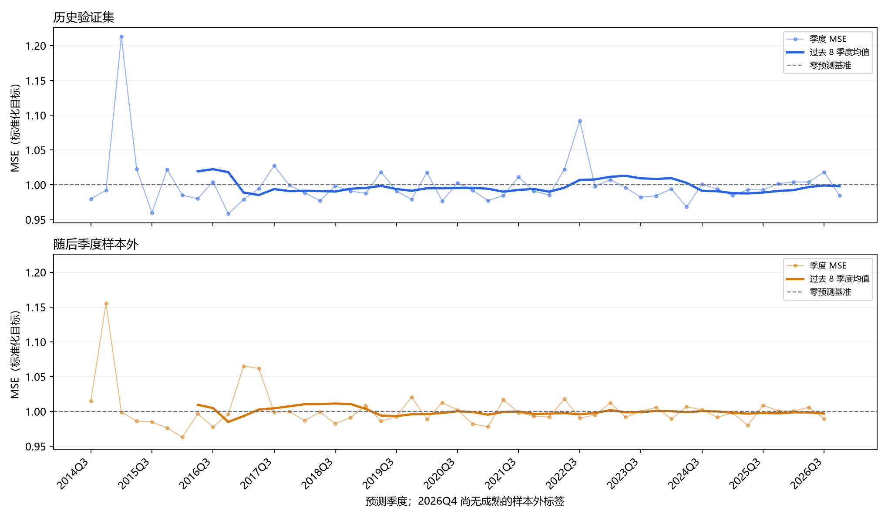

# 监督模型历史预测结果

本报告数据读取截至 2026-11-15T03:51:30.578156+00:00。已取得正式全期原生评价的结果如下；其余模型只列状态。完整精度、每折已保存的验证 MSE、实际输入列计数及股票季度点见[汇总 CSV](data/supervised-model-results.csv)。

股票预测未来 20 会话收益的相对强弱分数，ETF 预测未来 30 秒中间价小数收益，两种误差不能横向比较。这些结果来自已用于研究的历史样本外区间，按当时可用信息顺序训练、冻结后预测，评价预测误差与相关性。

股票目标是 `forward_return_20d` 在当日合格股票截面的均值为零、总体标准差为一的 `date_zscore`，不裁剪目标。预测 +1 表示一个截面标准差单位，不是收益率 +1%。零分数对应这一标准化目标的零；本次同配对零分数 MSE 为 1。

| 股票模型 | MSE（标准化目标平方） | RMSE（标准差单位） | MAE（标准差单位） | 相对零分数 R² | IC | RankIC | 有效日／请求日 | 配对观测量 |
|---|---:|---:|---:|---:|---:|---:|---:|---:|
| Lasso | 1.001953813 | 1.000976430 | 0.683934894 | -0.1954% | 0.068877 | 0.100562 | 2,978／2,998 | 10,541,654 |

股票评价请求为 2014-07-01—2026-10-30，共保存 50 个预测季度模型。已有诊断确认最后成熟信号日为 2026-09-24；其后 20 个请求交易日尚无成熟的 20 会话目标，因此 2026Q4 有预测和历史验证成绩，季度样本外 MSE 仍为空，未补零。

Lasso 的排序相关为正，平方误差仍略高于零分数基准，两者并不矛盾。已核对的日等权分解为：目标二阶矩 1，加预测二阶矩 0.01680256，减两倍目标与预测乘积矩 2×0.00742437，得到 MSE 1.00195381。相关性描述共同变化，不能替代误差或费用后的收益。

ETF 保留未来 30 秒中间价比例收益，MSE 使用小数收益率平方，RMSE、MAE 在下表乘 10,000 显示为 bp；1 bp = 0.0001。相对零收益 R² 为 `1－同配对模型日均MSE／同配对零收益日均MSE`，不是投资收益率。

| ETF | 模型 | MSE（小数收益平方） | RMSE（bp） | MAE（bp） | 相对零收益 R² | IC | RankIC | 有效日（MSE／IC） | 请求日 | 配对观测量 |
|---|---|---:|---:|---:|---:|---:|---:|---:|---:|---:|
| 510300 | Lasso | 1.599447193e-07 | 3.9993 | 2.7406 | 5.7039% | 0.280650 | 0.290333 | 1,027／1,014 | 1,087 | 4,756,736 |
| 159915 | Lasso | 5.622525321e-07 | 7.4984 | 4.9479 | 1.4159% | 0.231349 | 0.247379 | 676／669 | 679 | 3,125,522 |
| 518880 | Lasso | 5.646384043e-08 | 2.3762 | 1.4267 | 3.2006% | 0.253790 | 0.264355 | 677／664 | 679 | 3,124,506 |

以上三只 ETF 的 Lasso 在自身有效样本上相对零收益具有正的 MSE 改善点估计；中证500及其他算法尚无本报告可引用的正式全期评价，不据此排列算法优劣。ETF 以日内时序相关评价，股票以当日股票截面相关评价；有效相关日与配对观测量分别记录，有观测不代表相关系数必然有定义。

各 ETF 的预测评价轴为：510300：2022-05-10—2026-10-30；159915：2024-01-08—2026-10-30；518880：2024-01-08—2026-10-30。各项标签截止均为 2026-10-31T00:00:00，不将预测前的训练预热会话计入评价轴。

每天先计算误差与相关，再对有效交易日等权，不按日内行数或股票数重新加权。汇总 RMSE 是日均 MSE 的平方根；R² 用同配对日均平方误差之比。CSV 中 `inference_daily_mean` 是原生推断所针对的日统计量均值，其 RMSE、R² 不能替代上述非线性汇总值。

当前 32 条原生推断全部为 `UNDEFINED / incomplete_session_clock`。股票尾部未成熟目标与 ETF 请求轴上未形成有效统计的会话保留原样，未将缺失视为休市、未删日重跑推断。HAC、bootstrap 与 BY 调整值保留空值，不解释为‘不显著’。股票原生 HAC lag／平均块长为 20／20 日，ETF 为 5／5 日；均使用 1,000 次重采样、95% 区间与种子 42，逐项字段保存在 CSV。

实际输入取每折 MDL 的 `input_factor_columns`、`input_feature_columns`、`input_columns`，不按因子检验目录数量或数据集额外列数推断。下表只统计已有全期结果的模型：

| 对象／模型 | 已评价预测根 | 原值输入列范围 | 处理后输入列范围 | 总输入列范围 |
|---|---:|---:|---:|---:|
| 股票截面／Lasso | 50 | 87—127 | 198—208 | 285—335 |
| 沪深300 ETF／Lasso | 53 | 130—134 | 0 | 130—134 |
| 创业板 ETF／Lasso | 34 | 128—135 | 0 | 128—135 |
| 黄金 ETF／Lasso | 34 | 123—129 | 0 | 123—129 |

原值列与处理后表示是不同输入角色，不等于独立经济信号数。股票处理列沿各因子原有去极值、标准化及中性化定义；模型训练期的缩放另行估计并冻结。ETF 现有模型的处理后输入列为 0，原值因子也会在模型训练期缩放；没有对四只 ETF 做股票行业风格截面中性化。

最新折的训练期排除事实仅列一次，完整规范名单见[股票季度配置](../configs/quarterly-a-share.json)和[ETF 会话配置](../configs/high-frequency/rolling-etf.json)。数据集中合法但未被 ModelSpec 消费的方向、年龄或时钟等额外列不计为模型特征。

- 股票截面／Lasso，2026Q4：全缺失排除 无；常数排除 无。

- 沪深300 ETF／Lasso，2026-10-22：全缺失排除 `observed_completed_lifetime_seconds`、`prior_ownership_crowding_x_intraday_liquidity_stress`、`prior_residual_drawdown_x_activity_x_depth_recovery`；常数排除 无。

- 创业板 ETF／Lasso，2026-09-29：全缺失排除 `prior_ownership_crowding_x_intraday_liquidity_stress`、`prior_residual_drawdown_x_activity_x_depth_recovery`；常数排除 无。

- 黄金 ETF／Lasso，2026-09-29：全缺失排除 `observed_completed_lifetime_seconds`、`lagged_linked_benchmark_return_30s`、`lagged_linked_benchmark_return_60s`、`prior_ownership_crowding_x_intraday_liquidity_stress`、`prior_residual_drawdown_x_activity_x_depth_recovery`；常数排除 `opening_relative_activity_15m`、`opening_relative_activity_30m`、`opening_relative_activity_5m`。

已保存的 `training_selection` 是历史验证共同样本的日等权 MSE，不是训练集 loss。当前 Lasso MDL 没有保存固定最终模型的完整训练集 MSE，CSV 标为 `not_saved`，没有为补这一项重新预测训练集。NN 的学习曲线另有在线 epoch 加权损失和 epoch 末验证行均损失定义，回归损失在计算时乘目标尺度平方恢复单位；本报告未导出 NN 曲线，也未用它替代固定模型训练误差。

股票 Lasso 的已审季度曲线如下。上图是每次模型选择实际使用过的验证 MSE，下图是随后季度样本外 MSE；每个季度内部按有效日等权，粗线为过去 8 季度均值。

可配对比较的是 2014Q3—2026Q3 共 49 季度。前 10／后 10 季度的季度等权 MSE：验证为 1.011837／0.996224，样本外为 1.005096／0.998538；30／49 个成熟季度的样本外 MSE 低于 1。二者仍在 1 附近反复波动，这些描述不证明单调改善或显著趋势。季度等权摘要与上文全期有效日等权指标的权重不同，不互相替代。

CSV 的三种粒度如下；空值保留未定义或不适用的原意，不补零。

| record_type | 一行表示什么 | value 的含义／单位 |
|---|---|---|
| full | 对象×算法×完整评价期×指标 | 原生全期汇总；MSE 为目标平方，MAE/RMSE 为目标单位，相关与R²无量纲；并列原生推断字段 |
| fold_validation | 一个已评价预测窗对应的最终 MDL | 该折已选候选的验证日等权MSE，单位为该模型目标平方；同时记录实际输入计数及选中变动参数，不是训练loss |
| quarterly_oos | 股票Lasso的一个预测季度 | 已审原生逐日结果在季度内的日等权MSE；2026Q4无成熟目标时为空 |

`paired_observation_count` 是各自粒度的配对行数；`inference_session_count` 是推断所用的有效日统计量数。最新折排除列仅在相应 `fold_validation` 行填写，其他折的该字段为空并不表示没有排除。统计配置、每项窗口、标签截止和原生逻辑来源随行保存，正式报告不依赖运行目录附件。

读取时其余模型的状态如下。MDL 数只是已保存模型数，不代表已有完整预测或全期成绩；没有用部分窗口拼出全期指标。

| 对象 | Lasso | XGBoost | LSTM | Transformer |
|---|---|---|---|---|
| 股票截面 | 全期已评价；MDL 50 | 待正式全期评价；MDL 11 | 待正式全期评价；MDL 11 | 待正式全期评价；MDL 11 |
| 沪深300 ETF | 全期已评价；MDL 53 | 待正式全期评价；MDL 0 | 待正式全期评价；MDL 22 | 待正式全期评价；MDL 21 |
| 中证500 ETF | 待正式全期评价；MDL 41 | 待正式全期评价；MDL 33 | 待正式全期评价；MDL 10 | 待正式全期评价；MDL 9 |
| 创业板 ETF | 全期已评价；MDL 34 | 待正式全期评价；MDL 11 | 待正式全期评价；MDL 24 | 待正式全期评价；MDL 24 |
| 黄金 ETF | 全期已评价；MDL 34 | 待正式全期评价；MDL 0 | 待正式全期评价；MDL 0 | 待正式全期评价；MDL 0 |

模型、候选与研究方法沿用[股票季度配置](../configs/quarterly-a-share.json)、[ETF会话配置](../configs/high-frequency/rolling-etf.json)及[研究接口说明](../docs/research.md)。旧 Core6/PV25/PV52、135 因子及账户研究仍由各自历史报告解释，不与本表拼接。后续只在新的正式原生全期结果产生后更新对应对象，不更改本轮科学参数或追加交易结论。
