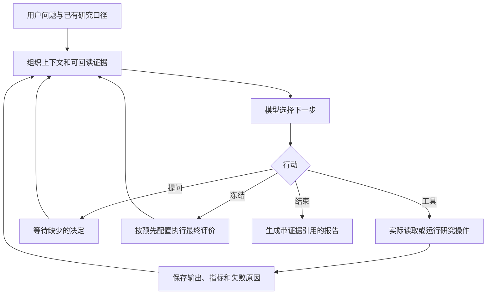

# 量化研究 Agent：让模型根据实验结果继续研究

量化研究中，很多时间花在同一类工作上：查字段、核对因子定义、修改少量公式、运行实验、检查结果，再决定下一步。这个项目把这些动作接到一个可连续对话的 Agent 中，让大模型提出假设、选择工具并解释反馈，因子、模型、统计和账户计算仍调用现有研究代码。

目前已经跑通两类实际模型调用。一类是完整研究链路：在合成任务中，由模型选择公式、拟合模型、冻结候选，并完成固定的最终评价，15 个原生研究与评价步骤成功执行。另一类是迭代挖因子：先根据两轮训练反馈提出四个候选，再固定候选，只做一次验证选择。两类验收都保留了负结果或未定义结果。

项目的主要成果是把“模型提出想法”接到了可检查的实验执行上。真实 A 股全量自动挖掘的收益验证尚未完成；已有 ETF 多窗口研究由研究脚本编排，不计作该 Agent 自主发现的成果。本文按 2026 年 11 月 9 日的实现与验收记录说明其工作方式。

## 1. 为什么给研究平台增加 Agent

已有平台能够清洗数据、计算因子、拟合模型和回测账户，但使用者仍需决定下一项实验。例如，新增特征后 IC 提高了，下一步究竟应该检查覆盖率、排除样本变化、检验与基线是否重复，还是直接进入账户回测？这些选择依赖上一步的结果，适合让模型参与。

Agent 接收一个研究问题，读取现有数据与源码，提出有限的候选，运行实验，再依据真实结果决定继续、改写或停止。它也可以先只做数据盘点和报告复核；没有必要为了查看字段就先填写完整回测配置。

我将系统分成三个部分：模型负责研究判断，本地运行程序负责把判断落实为行动，已有量化模块负责计算。这样的分工让同一套因子和账户规则继续服务人工研究、脚本和 Agent，避免每种入口算出不同的收益。

这与 [RD-Agent 所采用的假设、实验和反馈迭代思路](https://www.microsoft.com/en-us/research/articles/rd-agent-an-open-source-solution-for-smarter-rd/)相近；本项目采用单个模型逐步决策的实现，没有复刻其多 Agent 架构。选择这一结构，是因为当前主要问题是把真实反馈交给模型，增加角色数量并不能替代正确的计算与评价。

## 2. 从一条问题到一次实际行动

用户可以直接在命令行启动 `qrp agent`，连续补充问题。默认提供三个通用工具：

| 工具 | 能做什么 | 返回给模型什么 |
|---|---|---|
| `read` | 阅读仓库、数据结构、文档、图片与 PDF 页面 | 文本、结构摘要或实际图片 |
| `search` | 查找本地源码、文件名或公开网络资料 | 匹配片段、文件位置或公开来源 |
| `terminal` | 用当前项目 Python 调用现有函数或 CLI | 退出状态、聚合输出及可回读的文件引用 |

默认对话先发现本地已有内容。例如，原始数据目录存在、研究数据集目录为空，只能说明尚未生成研究输入，不能说“没有数据”。模型需要继续读取来源适配器、因子目录和配置，分清原始字段、已实现定义与实际落盘因子。

每一轮，运行程序把问题、用户补充、实际工具说明和已有证据组织成上下文，向模型请求一个结构化行动。行动有四种类型：调用工具、询问用户、冻结候选、结束任务。具体可用类型和工具随任务配置决定；默认本地对话通常使用工具、提问和结束，配置了最终评价的研究任务才使用冻结流程。

模型输出中的 `summary` 说明这一步想验证什么，`arguments_json` 保存工具参数，`evidence` 引用已存在的证据编号。本地程序解析并校验后才执行。模型写“已训练完成”不会生成一个成功模型；只有实际工具返回的结果才进入实验记录。

当前客户端使用 Responses API、HTTPX 和严格结构化输出。工具行动必须带非空工具名，提问、冻结和结束行动的工具名为空；供应商侧的嵌套 schema 与本地校验共同约束这一结构。它能减少格式错误，却不能保证模型选择的实验有意义，后者仍要由任务与结果评价。

## 3. 一个挖因子任务怎样逐步推进

以“寻找对已有量价基线有增量的信息”为例，Agent 首先检查可用字段、因子定义和时间约定，提出少量可以被反驳的假设。比如，近期成交压力可能只在较低波动时有效；这个想法需要明确可用输入和一个真正的对照，不能只写一段经济解释。

开始计算前，研究必须明确标签、预测期限、股票池、可用时点、训练与验证范围、基线、成本和候选预算。已有任务给出这些决定时直接沿用，真正缺少时才提问。只做数据盘点或提出假设，不受完整协议的前置限制。

公式由原生 AST 白名单解释，支持四则运算、符号、截面排名，以及向过去的延迟、均值和标准差等算子，没有将模型生成的表达式直接交给 Python `eval`。未来位移和将标签当成输入不属于允许的因果公式。

### 训练反馈用于改写，验证用于选择

最容易让自动搜索过拟合的做法，是每轮都看验证结果，然后据此改公式。几轮下来，所谓验证集已经参与了开发。因此，本项目增加了 `training_feedback`，专门给迭代阶段使用。

该接口只加载训练窗口，继续使用原生的成熟样本过滤、公式求值和截面统计。每个候选返回训练 RankIC、相对基线的增量 RankIC、覆盖率，以及失败或未定义状态。它不接收验证窗口和测试窗口。

这里的增量 RankIC 有明确含义：先将候选的截面排名对基线排名做回归，再检查残差与收益标签排名的相关性。它衡量候选是否还有基线之外的排序关联，不等于模型组合 IC，更不等于增加该因子后账户一定赚钱。

模型可以根据训练反馈改写下一批公式。候选和参数固定后，再调用一次原生搜索做验证选择；最终测试留给选择完成后的固定方案。没有有效候选时，可以直接以负结果结束。

### 验收中实际发生了什么

一次真实 API 验收使用了明确标注的合成数据，训练窗口只有九行合格观察，测试期不参与评价。

| 阶段 | 固定输入或候选 | 实际结果 |
|---|---|---|
| 第一轮训练反馈 | `x`、`-x` | RankIC 为 +1、−1，覆盖率均为 100% |
| 第二轮训练反馈 | 模型根据反馈提出 `sign(x)`、`rank(x)` | 前者成为常数，RankIC 未定义；后者为 +1 |
| 固定候选后验证 | 合并以上四个公式，只调用一次验证选择 | `x` 与 `rank(x)` 同分，按原生选择规则选中 `x` |
| 报告 | 解释训练、验证和图像读取结果 | 明确合成样本，未声称发现真实 alpha |

整次会话使用 13 次请求、三个实际终端实验，约 86.44 秒。这个案例很小，但能检查一件具体的事：第二轮公式是否真的由第一轮训练反馈推动，以及未定义结果是否被保留下来。RankIC 为 1 来自刻意构造的数据，不具备金融研究上的外推意义。

原生公式搜索的优化目标是同一时点多资产之间的截面 RankIC。单只 ETF 的高频预测没有足够截面，不能直接沿用这项目标。高频任务应调用已有时间序列评价与库存回测；目前没有将截面公式搜索包装成一个已经完成的高频公式优化器。

## 4. 如何固定研究口径和最终评价

除默认本地对话外，Agent 也支持显式声明原生研究工具的配置。这个形式适合目标和评价步骤已经确定的实验：工具模板声明操作、可调整参数、前序产物绑定，以及需要提取的指标。

模型可以在声明范围内提出公式、选输入和调整模型参数。标签、样本窗口、成本与主指标由研究协议固定，不能为了让结果更好而在同一任务中偷偷更换。输出目录由运行程序分配，后续操作引用已经成功生成的原生产物。

候选冻结时，程序保存“候选别名对应哪个实际证据”的映射，再按预先配置的步骤完成最终评价。成功步骤在恢复时直接引用，失败或中断步骤保留原记录，用相同冻结设置在新证据目录继续。最终评价后，模型回读结果、形成结论，不再用测试结果调整候选。

这套约束能固定经过这些原生工具执行的实验。但默认 `terminal` 拥有当前用户的文件和网络权限，协议不能被理解为文件访问隔离：模型仍可能通过终端读取不该用于开发的材料。若留出结果已经被看过，应如实披露；任务状态写着“未评价”，也不能证明数据从未被访问。

## 5. 会话保存的不只是聊天内容

一次研究结束后，需要能回答“这个结论来自哪次计算，参数是什么，失败过什么”。因此，Agent 为每次行动保存证据编号、行动参数、结果、产物引用与必要用量；完整状态写入 `session.json`，每项工具操作有独立输出目录。

| 保存内容 | 对研究有什么用 |
|---|---|
| 问题、协议与用户补充 | 恢复时继续原任务，避免丢失限制条件 |
| 实际行动和配置 | 能检查调用了什么，而非只看模型复述 |
| 成功输出与证据引用 | 后续训练、评价和报告使用同一份已生成产物 |
| 失败、暂停和未知结果 | 保留真实进度，避免把残留文件冒充成功 |
| 请求、token、实验与时间用量 | 决定是否还能继续，比较任务成本 |
| 冻结映射和最终步骤 | 确认最终成绩对应哪个候选 |

正常中断会保存暂停状态，并清理本次拥有的子进程；强制终止后，没有确认结果的运行中行动恢复为未知。模型或调用者需据此继续判断，程序不会仅因输出目录存在就认定完成。每个会话只允许一个进程写入，状态文件通过替换方式保存，减少中断时写坏状态的风险。

连续对话中，新的问题建立新的任务，近期对话作为历史提供。对已完成研究的追问不会把原记录改成“从未完成”；可以回读原产物，并继续提出新的检查。

### 上下文与研究记忆怎样处理

完整实验记录可能很长，不能每次全部发给模型。当前实现优先保留问题、协议、用户补充、冻结状态和最近行动引用的证据；较早结果超出上下文预算时保存在本地，通过编号或文件引用回读。某个结果太长时，会给出省略提示并继续选择其他可容纳记录，而非让它挡住全部历史。

本地字符上限只是粗略控制，不等于模型的 token 容量或精确费用限制。图片另占供应商用量。检索支持文档、目录、历史证据及研究记忆，中文文本也有关键词召回。

研究记忆保存问题、协议、发现和证据，供以后任务查找。它的价值在于复用经验与负结果，没有通过查到旧结论就将它当成当前事实。此前看过的测试结果也不会因为写入“记忆”后变成新的留出证据。

## 6. 数字、失败和预算如何进入判断

模型最容易写错的内容之一，是把一个真实数字放到错误语境里：将累计收益写成年化收益，将未定义填成零，或者把百分比和百分点混在一起。为减少这类错误，显式原生工具可以声明要提取的指标；结束行动中的结构化 `claims` 会核对证据编号、指标名和原始数值。

例如，已保存的原始值为 `0.1`，模型必须引用该指标的 `0.1`，不能先写成 `10` 再交给原始数值检查。未定义值使用 `null`。这项检查可以发现错抄数值，却没有自动核验所有自由文字、单位换算和因果解释。默认终端模式的结果尤其需要核对实际打印的聚合指标，不能声称每一句话都经过了程序证明。

工具失败会记录退出状态和原因，再交给模型判断下一步。模型可以根据错误修正调用，也可以停止；系统没有用自动换模型、放宽研究规则或伪造结果的方式继续。真实 API 验收中曾出现错误源码路径、分页参数和行动字段不一致，修正接口后重新验收，原始错误尝试仍保留。

请求次数、实验次数和运行时间分别设预算，也可设置 token 上限。网络检索占请求，最终评价占实验。token 按供应商返回的实际输入、输出计数累计；启用 token 上限而用量缺失时明确失败。预算控制后续是否继续，不承诺刚好在某个金额或墙钟时刻中止所有外部活动。

## 7. 已经完成哪些验证

本项目区分“软件行为测试”和“实际模型能否完成研究任务”。前者保护状态、参数、预算、恢复和数值引用；后者需要真实模型调用工具，并检查最终产物。验收方式参考了 [Anthropic 对 Agent 评价的讨论](https://www.anthropic.com/research/demystifying-evals-for-ai-agents)：检查环境中真正生成了什么，以及完整行动记录是否支持结论。

| 任务 | 实际执行情况 | 说明了什么 |
|---|---|---|
| 原生研究完整链路 | 10 次真实模型请求，15 个原生研究及最终评价步骤，约 81.20 秒 | 公式、数据组装、拟合、预测、评价、费用后股份账户和图表能衔接 |
| 已有 A 股报告复核 | 6 次请求，约 52.97 秒，实验调用为零 | 能从报告和 CSV 查原值、比较口径，识别回顾性选型限制 |
| 两轮训练反馈与一次验证 | 13 次请求，三个终端实验，约 86.44 秒 | 能根据训练反馈改写候选，固定后才做验证选择 |
| 行动 schema、图片与终端 | 4 次请求，约 13.92 秒 | 能识别实际图片、调用项目 Python，并返回合规结束行动 |

完整原生链路使用了刻意设置前后方向反转的合成数据。最终 IC 为 −1，统计推断保留未定义；账户净损益为 −29.04 元、费用为 29.04 元，期末净值 99,970.96 元。保留这样的结果，才能确认系统在不理想的反馈下仍按约定完成评价，没有将负结果改写为成功策略。

报告复核则正确读取两行历史累计净收益 64.43% 与 81.54%，计算差值约 17.11 个百分点，同时指出二者属于历史文件中的回顾性选型结果。它没有运行新的回测，也没有将股票组合收益套到 ETF 底仓增强上。

11 月 9 日的实现记录中，Agent 与 CLI 定向套件 85 项通过，终端收尾修改后的 workspace 与 client 定向复测 19 项通过，静态与全仓格式检查通过。这是不同批次的验证，不能相加后当成一次完整回归。本次报告工作重新读取了实际验收产物，没有重发模型请求，也没有重跑这些生产测试。[验收摘要与报告哈希](data/agent-acceptance-summary.json)

上述请求数和时间是单次验收记录，模型、上下文和任务规模各不相同，不能据此声称平均成功率、节省了多少人力，或比其他 Agent 更快。项目尚未建立覆盖多任务、多随机种子的质量基准。

## 8. 本地文件和执行权限的边界

结构化数据的默认读取返回字段、行数和 schema，计算在本机进行，再提供聚合反馈。源码和文档可以作为文本进入模型上下文，图片与 PDF 页面会以真实图像发送给模型。网络检索只发送检索词，不附带完整本地会话。

默认终端直接运行在宿主机，具有当前用户权限，不具备容器隔离。运行工具会移除模型连接所用的密钥变量，并清理普通共享输出中的凭据模式、绝对路径和 traceback；这些处理不保证识别全部私人业务字段，脚本仍须控制实际打印和发送的内容。默认生成产物位于被 Git 忽略的 `results/` 中。

另有显式配置的无网络容器 Python 执行路径，只挂载指定输入并写入输出目录。它与默认终端的权限不同；已有容器机制测试不能替代真实容器运行验收，当前记录中没有完成本机 Docker 实际执行验证。

## 9. 实现怎样组织

代码位于 `agents/`，CLI 负责入口适配。模型服务、会话与研究执行没有揉进因子或账户实现；已有 Python 操作和薄 CLI 继续提供实际计算。

| 模块 | 核心职责 |
|---|---|
| [client.py](../src/quant_research_platform/agents/client.py) | 请求模型、解析结构化行动、读取供应商用量 |
| [runner.py](../src/quant_research_platform/agents/runner.py) | 驱动决策循环，分发行动，管理研究阶段和最终评价 |
| [workspace.py](../src/quant_research_platform/agents/workspace.py) | 默认对话的文件读取、搜索与宿主终端 |
| [mining.py](../src/quant_research_platform/agents/mining.py) | 只加载训练窗口的公式反馈，复用原生计算 |
| [execution.py](../src/quant_research_platform/agents/execution.py) | 原生工具执行、指标提取、进程与容器生命周期 |
| [protocol.py](../src/quant_research_platform/agents/protocol.py) | 配置校验、固定研究口径与产物绑定 |
| [session.py](../src/quant_research_platform/agents/session.py) | 状态保存、上下文选择、用量汇总与报告生成 |
| [knowledge.py](../src/quant_research_platform/agents/knowledge.py) | 文档、证据和研究记忆检索 |
| [chat.py](../src/quant_research_platform/agents/chat.py) | 连续对话、补充要求、暂停恢复和状态展示 |

系统没有引入新的 Agent 框架、向量数据库或通用任务调度器。当前研究是串行反馈循环，执行顺序由模型决策，实际工具内部的计算仍使用原有实现。采用这一取舍，是为了让失败原因、数据流和研究口径都能直接追到源码；[Anthropic 的 Agent 构建经验](https://www.anthropic.com/research/building-effective-agents)也建议按任务需要逐步增加复杂度。

## 10. 目前最值得改进的地方

下一步优先解决的是如何稳定做对研究，而非增加模型角色。

首先，将已有验收整理成一组可重复的小任务，并多次运行。任务应包括口径不完整、没有有效候选、标签未成熟、工具失败、报告数字错配和同质公式等情况。检查实际产物、结论引用、失败处理以及 token 和时间消耗，才有依据比较提示词或模型的改动。

其次，给候选反馈增加紧凑的历史摘要。当前已经有完整行动记录和基线增量指标，但缺少跨轮次统一的经济含义、重复程度与淘汰理由摘要。先让模型能回读“这个思路为什么没用”，比立即建设大型长期经验数据库更贴近当前问题。

最后，在有限的真实 A 股样本上完成一次固定预算的自动研究，与相同预算的简单搜索或人工基线比较。要同时报告所有候选、失败、预测增量和费用后账户，才能判断 Agent 是否改善了研究效率或候选质量。目前的软件链路验收已经为这一步提供了执行基础，还没有替它给出收益结论。

使用方式、权限、恢复与配置细节见[Agent 文档](../docs/agent.md)，公式搜索的目标与限制见[自动挖因子说明](../docs/factor-mining.md)。ETF 的实证结果另见[A 股高频研究报告](A股高频研究报告.md)。
